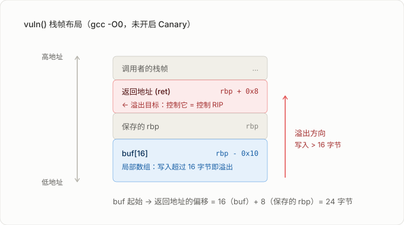

# 02 C 语言与内存模型
## C Language & Memory Model

> [!info]- 章节信息
> **所属方向**：通用基础 ｜ **难度阶段**：L0 预备期 ｜ **前置要求**：[[01-Linux环境与CTF实验环境搭建|01 Linux 环境与 CTF 实验环境搭建]]
> **本章目标**：建立「C 源码 → 内存布局 → 机器指令」三者之间的对应直觉，能预判一段简单 C 代码在内存里长什么样。这是后面读汇编、算溢出偏移、构造利用链的共同前提。

> [!danger] 你可能会看得云里雾里
>  因为汇编将在下下节介绍（看到什么如RBP等等词汇，基本都是汇编的内容），请两节内容一起看。

> [!warning] 关于C、C++的说明
> 你可能会认为C与C++是一个语言，==请你抛弃这种想法，这是两个完全不同的语言==，只是C++部分兼容C，再次强调，==🔴请不要将C++与C语言混为一谈==，两者在我们这里有非常非常大的区别。 

## 1. 为什么 PWN 与逆向都绕不开 C

CTF 的 PWN 与逆向题目绝大多数是 C 写的。所谓漏洞，本质是==程序对内存的假设被打破==：以为 `buf` 只有 16 字节，结果被写进去 100 字节。而"内存里的东西怎么排布"这件事，是 **C 语言的规则**决定的，不是某条汇编指令决定的。

读汇编之前先知道 `char buf[16]` 后面紧挨着什么、`int a[4]` 占几个字节、结构体为什么"多出来"几个字节，后面才不会全靠猜。

> [!note] 本节的范围
> 不是 C 语言教程，C语言基础自己去学，这里重点是**与内存相关**的部分：类型宽度、指针运算、内存分区、栈帧、对齐、整型转换、危险函数。语法细节（switch 穿透、位域、变参宏）遇到再查即可。

## 2. 从源码到可执行文件

### 2.1 四个阶段

| 阶段 | 输入 → 输出 | 命令 | 做什么 |
| ---- | ---------- | ---- | ------ |
| 预处理 | `.c` → `.i` | `gcc -E` | 展开 `#include`、`#define`，处理条件编译 |
| 编译 | `.i` → `.s` | `gcc -S` | C 源码翻译成汇编 |
| 汇编 | `.s` → `.o` | `gcc -c` | 汇编翻译成机器码，产出可重定位目标文件 |
| 链接 | `.o` → 可执行文件 | `gcc` | 合并目标文件与库，完成符号解析与重定位 |

```bash
gcc -E hello.c -o hello.i     # 预处理
gcc -S hello.i -o hello.s     # 编译（加 -masm=intel 输出 Intel 语法）
gcc -c hello.s -o hello.o     # 汇编
gcc hello.o -o hello          # 链接
file hello                    # 确认产物类型与架构
```

> [!info]- C、C++语言编译器
> C/C++语言由C++标准委员会制定统一标准，但是他们==并不负责实现==。实现交由其他人来做。
> 目前有三大主流实现，即编译器：GCC、Clang/LLVM、MSVC。
> **GCC（GNU Compiler Collection）** 是 Linux 世界的基石，也是开源软件最普遍的编译工具。对于 C++，对应的命令是 `g++`。它的核心优势在于**无与伦比的平台覆盖**和**激进的优化能力**。
> **Clang/LLVM** 是后起之秀，以其**卓越的开发者体验**和**模块化的架构**著称。它最突出的优点是**清晰、友好的错误诊断**，能提供精确的上下文和修复建议，极大提升调试效率。
> **MSVC（Microsoft Visual C++）** 是 Windows 平台上的“官方”编译器，与 Visual Studio IDE 深度绑定。它的核心优势在于**对 Windows 生态的原生支持**。==注意：MSVC对C标准支持不完全！MSVC是面向C++的编译器。==
> >[!danger]  注意
> >以上三个实际都没有完全实现所有C/C++语言标准。语言标准也并未讲明所有东西，所以很多C/C++代码会成为UB（未定义行为），即语言标准中没有注明是否是正确的或者错误的，请尽量避免此类代码。

### 2.2 PWN 学习必会的编译选项

| 选项                     | 作用                             |
| ---------------------- | ------------------------------ |
| `-g`                   | 生成调试信息，GDB 里能对着源码行下断点          |
| `-O0`                  | 关闭优化（默认），汇编与源码基本一一对应，最利于理解     |
| `-O2`                  | 开启优化：指令重排、变量进寄存器、函数内联，逆向难度明显上升 |
| `-m32`                 | 编译成 32 位（需要 `gcc-multilib`）    |
| `-static`              | 静态链接，体积大但无外部依赖                 |
| `-fno-stack-protector` | 关闭栈保护（Canary）                  |
| `-no-pie -fno-pie`     | 关闭 PIE（编译与链接**都要**加）           |
| `-z execstack`         | 让栈可执行，即关闭 NX                   |

> [!warning] 练习环境和出题环境不是一回事
> 入门阶段为了先把"栈溢出"这件事本身看清楚，常会一口气关掉保护：
> ```bash
> gcc -g -O0 -fno-stack-protector -z execstack -no-pie -fno-pie vuln.c -o vuln
> ```
> 但==现代赛题默认保护全开==（NX / Canary / PIE / RELRO 基本都开），所以别在关保护的舒适区待太久，原理弄懂就回到默认选项下练。

>[!info] 常见的保护机制
> |保护机制|介绍|
> |---|---|
> |**Stack Canary / Stack Protector**|栈保护。在函数栈帧的局部变量和返回地址之间插入一个随机值（Canary）。函数返回前检查该值是否被修改，用于检测栈溢出。|
> |**NX / DEP**|数据区不可执行。将栈、堆等内存页标记为不可执行，防止攻击者直接执行注入的 shellcode。|
> |**PIE**|位置无关可执行文件。使程序代码段、数据段等地址不固定，可配合 ASLR 随机化程序自身加载基址。|
> |**ASLR**|地址空间布局随机化。操作系统在每次程序运行时随机化栈、堆、libc、mmap 等区域的基址，增加地址预测难度。它不是编译选项，而是系统级保护。|
> |**RELRO**|重定位只读。保护 GOT 表等重定位相关区域。分为：  <br>• **Partial RELRO**：部分 GOT 只读；  <br>• **Full RELRO**：配合 `BIND_NOW`，启动时解析所有符号，整个 GOT 只读。|
> |**BIND_NOW**|立即绑定。动态链接器在程序启动时解析所有动态符号，而不是延迟到第一次调用。通常与 Full RELRO 一起使用。|
> |**FORTIFY_SOURCE**|库函数加固。编译时对 `strcpy`、`sprintf`、`memcpy` 等危险函数插入边界检查，并在可能时替换为带 `_chk` 后缀的安全版本。|
> |**Stack Clash Protection**|栈冲突保护。防止通过大块栈分配跳过保护页，使栈与相邻内存区域发生碰撞。|
> |**CFI**|控制流完整性。检查间接调用、间接跳转的目标是否合法，限制攻击者将控制流重定向到任意位置。|
> |**SafeStack**|安全栈。将返回地址、栈指针等敏感数据放在独立的安全栈中，降低普通栈溢出对控制流的影响。|
> |**Shadow Stack**|影子栈。维护一份返回地址的影子副本，函数返回时对比，检测返回地址是否被篡改。|
> |**CET**|Intel 控制流强制技术。包含影子栈和间接分支跟踪等硬件辅助机制，用于增强控制流保护。|
## 3. 数据类型与宽度

| 类型          | x86_64 字节 | x86 字节 | 备注                                       |
| ----------- | --------- | ------ | ---------------------------------------- |
| `char`      | 1         | 1      | 也常用来表示"1 字节"                             |
| `short`     | 2         | 2      |                                          |
| `int`       | 4         | 4      | 几乎所有平台都是 4                               |
| `long`      | 8         | 4      | Linux 是 LP64；Windows 是 LLP64，`long` 仍为 4 |
| `long long` | 8         | 8      |                                          |
| `float`     | 4         | 4      | IEEE 754 单精度                             |
| `double`    | 8         | 8      | IEEE 754 双精度                             |
| 指针          | 8         | 4      | ==指针宽度 = 机器字长==，这决定了 payload 里地址占几个字节    |

```c
#include <stdio.h>

struct S { char a; int b; char c; };

int main(void) {
    printf("sizeof(char)   = %zu\n", sizeof(char));       // 1
    printf("sizeof(int)    = %zu\n", sizeof(int));        // 4
    printf("sizeof(long)   = %zu\n", sizeof(long));       // Linux x64 为 8
    printf("sizeof(void*)  = %zu\n", sizeof(void *));     // x64 为 8，x86 为 4
    printf("sizeof(struct S) = %zu\n", sizeof(struct S)); // 12（对齐所致，见第 7 节）
    return 0;
}
```

> [!warning] 别把宽度当常识背下来
> `long` 在 Linux x64 是 8 字节，在 Windows 上却是 4 字节。读代码、算偏移时一律以**题目实际运行的架构**为准，先用 `file ./target` 确认是 32 位还是 64 位。

## 4. 指针与数组

### 4.1 指针的本质

指针就是一个**存放地址的整数**。64 位程序里指针占 8 字节，它的值形如 `0x00007f...`。

### 4.2 指针运算：读懂汇编寻址的钥匙

`p + n` 不是"地址加 n 字节"，而是"前进 n 个 `sizeof(*p)` 字节"：

```c
int a[4] = {0x11111111, 0x22222222, 0x33333333, 0x44444444};
int *p = a;

printf("%p\n", (void *)p);        // 假设 0x7ffd1000
printf("%p\n", (void *)(p + 1));  // 0x7ffd1004：前进 4 字节，不是 1
printf("%d\n", *(p + 2));         // 0x33333333
```

汇编里的 `mov eax, [rax + rcx*4]` 就是"基址 + 下标 × 元素大小"。看懂了 `p + n`，就看懂了这类寻址方式。

> [!note] 数组下标与指针是等价的
> `a[i]` 与 `*(a + i)` 完全等价，`&a[i]` 与 `a + i` 完全等价。逆向时看到 `[rbp-0x40+rax*4]`，就该立刻反应出"这是某个 `int` 数组的第 rax 个元素"。

### 4.3 数组不是指针

```c
void f(int arr[4]) { printf("%zu\n", sizeof(arr)); }  // 8：已退化成指针

int main(void) {
    int a[4];
    printf("%zu\n", sizeof(a));  // 16：真正的数组
    f(a);
    return 0;
}
```

数组名作函数参数会**退化为指针**，长度信息随之丢失 —— 这正是 `strcpy`、`memcpy` 这类函数必须额外传长度的原因，也是大量溢出漏洞的源头。

### 4.4 二级指针与函数指针

- `char **argv`：指向"字符串指针数组"的指针，`argv[i]` 是第 i 个参数字符串。
- 函数指针：`void (*fp)(void) = win;`，调用 `fp()` 等价于调用 `win()`。==PWN 里的 `ret2win`，本质就是把返回地址改成某个函数的地址，让 `ret` 指令"替你调用"它。==

## 5. 进程内存布局

### 5.1 主要区域

| 区域        | 存放什么                    | 读写    | 生命周期    |
| --------- | ----------------------- | ----- | ------- |
| `.text`   | 机器指令                    | 只读可执行 | 整个进程    |
| `.rodata` | 字符串字面量、常量               | 只读    | 整个进程    |
| `.data`   | 已初始化的全局 / 静态变量          | 读写    | 整个进程    |
| `.bss`    | 未初始化（或初始化为 0）的全局 / 静态变量 | 读写    | 整个进程    |
| heap      | `malloc` 出来的内存          | 读写    | 手动释放    |
| stack     | 局部变量、函数参数、返回地址          | 读写    | 函数返回即失效 |

```c
#include <stdlib.h>

int g_init   = 42;          // .data
int g_uninit;               // .bss
const char *msg = "hello";  // 指针本身在 .data，"hello" 在 .rodata

int main(void) {
    int local = 1;          // stack
    char *p = malloc(32);   // 指针在 stack，32 字节在 heap
    free(p);
    return 0;
}
```

> [!info] 为什么 PWN 关心 `.bss` 和 `.data`
> 它们地址固定（未开 PIE 时）、可读可写，常被当作"落地地址"：写 shellcode、伪造结构体、摆放 ROP 链。`.bss` 还常作为**栈迁移**的目标。

### 5.2 节（section）与段（segment）

上面的 `.text`、`.rodata`、`.data`、`.bss` 严格来说都是 **ELF 节（section）**；heap 与 stack 则不是节，是运行时由内核和 `brk` / `mmap` 建立的区域。日常随便叫，但完全不是一个东西，必须分清：

| 视角      | 单位        | 记录在哪                       | 谁在用                           | 关心什么                                |
| ------- | --------- | -------------------------- | ----------------------------- | ----------------------------------- |
| 链接 / 调试 | 节 section | 节头表（section header table）  | 链接器、`readelf -S`、IDA / Ghidra | 内容语义：代码、只读数据、符号表、重定位表               |
| 装载 / 运行 | 段 segment | 程序头表（program header table） | 内核 loader、`readelf -l`        | 权限与映射：这一段是 `r-x` 还是 `rw-`、映射到哪个虚拟地址 |

一个段通常**由若干节合并**而成。典型 x64 程序里：`.text` 与 `.rodata` 被并进同一个只读可执行段（`r-x`），`.data` 与 `.bss` 被并进同一个可读写段（`rw-`）。

```bash
readelf -S ./pwn     # 节头表：节名、大小、文件偏移、类型
readelf -l ./pwn     # 程序头表：每个 LOAD 段的虚拟地址、对齐、权限
```

[!info]rwx分别指读read、写write、执行execute。
> [!info] 为什么 PWN 要同时看两边
> - 找 gadget、确定代码落在哪个地址 → 用**节**的视角（IDA / Ghidra 的节区列表）。
> - 判断"这块内存能不能写、能不能执行" → 必须用**段**的视角，因为 NX / W^X 是按段的权限位生效的。==同一个 `.data` 节，落在 `rw-` 段里可写，落在 `r--` 段里就写不了。==
> - 节头表 / 程序头表的完整字段（`sh_flags`、`p_flags`、对齐规则）留给后面的 ELF 专章。
[!info] **Gadget** 指的是程序汇编代码中**一小段以 `ret` 结尾的代码**。

> [!warning] 别和 x86 的"段寄存器"混淆（这里看不懂直接跳过）
> `CS` / `DS` / `SS` 那套分段机制是 16 位实模式时代的产物，64 位下基本只剩 `FS` / `GS` 用于取 TLS。本节说的"段"专指 ELF 程序头里的 segment，两者没有关系。

### 5.3 栈向低地址增长


典型的内存管理（图片从上到下，地址由高到低）

> [!warning] 这一条决定了溢出往哪写
> 栈向**低地址**增长，而 `strcpy` / `read` 这类写入是从低地址往**高地址**走。所以局部数组溢出时，会先淹没保存的 `rbp`，再淹没**返回地址** —— 这就是栈溢出的物理基础。堆同理，溢出会打到相邻的 chunk。

## 6. 栈帧与函数调用

### 6.1 x64 参数传递（System V AMD64 ABI）

| 用途               | 寄存器                               |
| ---------------- | --------------------------------- |
| 第 1–6 个整型 / 指针参数 | `RDI`、`RSI`、`RDX`、`RCX`、`R8`、`R9` |
| 第 7 个起           | 走栈                                |
| 返回值              | `RAX`                             |
| 栈指针 / 帧指针        | `RSP` / `RBP`                     |
| 被调用者保存           | `RBX`、`RBP`、`R12`–`R15`           |

> [!note] 为什么 ROP 链里全是 `pop rdi; ret`
> x64 参数走寄存器，没法像 32 位那样直接往栈上摆。要调用 `system("/bin/sh")`，就得先用 `pop rdi; ret` 把字符串地址弹进 `RDI`，再 `ret` 到 `system`。==这类 gadget 的需求，源头就是上面这张表。==

### 6.2 序言与尾声

```asm
push rbp            ; 保存调用者的 rbp
mov  rbp, rsp       ; 建立当前栈帧
sub  rsp, 0x20      ; 为局部变量开辟空间
...                 ; 函数体
leave               ; 等价于 mov rsp, rbp; pop rbp
ret                 ; 弹出返回地址并跳转
```

### 6.3 一个可以背下来的栈帧

```c
void vuln(void) {
    char buf[16];
    read(0, buf, 0x100);   // 往 16 字节的缓冲区里读 256 字节
}
```

`-O0`、未开 Canary 时，栈帧大致长这样：



从 `buf` 起始地址到返回地址的偏移 = 16 + 8 = **24 字节**。

> [!warning] 24 只是这个例子的答案，不是通用公式
> 实际偏移会随编译器版本、优化等级、局部变量数量、对齐填充而变化。做题一律用 GDB 实测或 `cyclic` 模式确定，==永远不要靠 sizeof 心算==。

```bash
# 生成不重复的模式串作为输入
python3 -c "from pwn import *; print(cyclic(200))"
# 崩溃后，把 RIP 里被覆盖的那几个字节（如 0x6161616c）丢进去反查偏移
python3 -c "from pwn import *; print(cyclic_find(0x6161616c))"
```

## 7. 结构体、对齐与大小端

### 7.1 对齐规则

两条规则：

1. 每个成员的偏移必须是它**自身对齐数**的整数倍，不足则填充；
2. 结构体总大小必须是**最大成员对齐数**的整数倍，不足则尾部填充。

```c
struct A { char a; int b; char c; };  // sizeof = 12
struct B { char a; char c; int b; };  // sizeof = 8
```

`A` 的布局是 `a(1) + 填充(3) + b(4) + c(1) + 尾部填充(3) = 12`；`B` 把两个 `char` 挤在一起，只需尾部填充 2 字节。

> [!note] 为什么逆向要懂对齐
> IDA / Ghidra 会把 `[rbp-0x20]`、`[rbp-0x18]` 这类偏移自动识别成结构体成员。懂对齐，你才能自己还原出结构体定义，也才能解释"为什么 `buf` 后面还空着几个字节" —— 那几个字节往往就是填充。

### 7.2 大小端

x86 / x64 是**小端序**：低位字节放在低地址。

```c
int x = 0x41424344;
// 内存中从低地址到高地址依次是：44 43 42 41
```

> [!info] 和 pwntools 对上
> `p64(0x41424344)` 得到 `b'DCBA'`，正是小端序的体现。写 payload 时地址一律用 `p64` / `p32` 打包，手动拼字节串极易搞反。

## 8. 字符串与危险函数

| 函数                    | 危险点                          | 典型后果           |
| --------------------- | ---------------------------- | -------------- |
| `gets`                | 完全不检查长度，读到换行才停               | 栈溢出（经典入门题）     |
| `strcpy` / `strcat`   | 只认 `\0`，不管目标缓冲区多大            | 栈 / 堆溢出        |
| `sprintf`             | 格式化输出不限制长度                   | 缓冲区溢出 + 格式化字符串 |
| `scanf("%s", buf)`    | 同样不限制长度                      | 溢出             |
| `memcpy(dst, src, n)` | `n` 来自不可信输入时越界               | 溢出             |
| `read(fd, buf, n)`    | 本身安全，但 `n > sizeof(buf)` 就危险 | 溢出             |
| `printf(user_input)`  | 用户输入被当成格式串                   | 格式化字符串漏洞       |

> [!warning] 危险的来源
> 上面这些函数，只要**长度由程序自己控制**就是安全的：`fgets(buf, sizeof(buf), stdin)`、`snprintf`、`read(0, buf, sizeof(buf))`。反过来，`read` 本身是安全的，写成 `read(0, buf, 0x100)` 而 `buf` 只有 16 字节，照样溢出。==读题时先找"输入长度"和"缓冲区大小"，比先看函数名有效得多。==

## 9. 整型转换陷阱

```c
// 陷阱一：无符号回绕，长度检查形同虚设
unsigned int len = 0;
if (len - 1 > 1024) { /* 恒为真：0 - 1 = 0xFFFFFFFF */ }

// 陷阱二：有符号 / 无符号比较，负数被当成巨大的正数
int n = -1;
if (n < sizeof(buf)) { /* 恒为假：n 被转成无符号的 0xFFFFFFFF */ }

// 陷阱三：截断
int big = 0x100;
char small = big;      // 只留低 8 位 → 0
```

> [!note] 这三条怎么变成漏洞
> 常见套路：程序用 `int` 接收长度 → 做了一次减法或乘法 → 结果溢出或回绕 → `if` 判断被绕过 → 后面按这个"合法"长度去 `memcpy`。==所以审题时看到"先检查、后拷贝"，就要看住那个长度变量是什么类型。==

## 10. 常见问题

| 现象                                                       | 原因与解决                                                                                               |
| -------------------------------------------------------- | --------------------------------------------------------------------------------------------------- |
| `warning: implicit declaration of function 'gets'`       | `gets` 在 C11 中已被移出标准，新版 glibc 头文件里也不再有声明。练习时改用 `fgets(buf, sizeof(buf), stdin)` 或 `read(0, buf, n)` |
| `fatal error: gnu/stubs-32.h: No such file or directory` | 缺 32 位支持：`sudo apt install gcc-multilib`                                                            |
| `Segmentation fault` 不知道崩在哪                              | 加 `-g` 编译，再 `gdb ./target` → `run` → `bt` 看调用栈；必要时 `ulimit -c unlimited` 打开 coredump                |
| 打印地址输出被截断或变成负数                                           | 指针一律用 `%p`，不要用 `%d`（会被截成 32 位）                                                                      |
| `printf` 的内容还没输出程序就崩了                                    | stdout 默认行缓冲，加 `\n`，或在开头 `setbuf(stdout, NULL)` 关掉缓冲                                                |
| 手算结构体大小和 `sizeof` 不符                                     | 成员对齐填充所致，见 7.1                                                                                      |
| GDB 里变量显示 `<optimized out>`                              | 编译时开了 `-O2`，改用 `-O0` 重新编译                                                                           |
| 想看源码对应的汇编                                                | `gcc -S -masm=intel -O0 vuln.c -o vuln.s`，或 `objdump -d -M intel ./target`                          |

