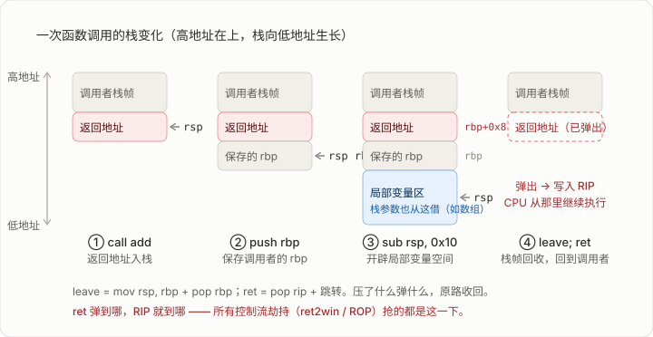

# 04 汇编语言精要
## x86/x64 Assembly Essentials

> [!info]+ 章节信息
> **所属方向**：通用基础 ｜ **难度阶段**：L1 入门期 ｜ **前置要求**：[[02-C语言与内存模型|02 C 语言与内存模型]] · [[03-计算机组成与数据表示|03 计算机组成与数据表示]]
> **本章目标**：能逐行读懂 30 行以内的函数汇编；能认出序言尾声、比较-跳转、循环、数组访问四种"代码形状"；能把简单 C 源码和编译产物互相印证。


> [!danger] 注意事项
> 这里拥有及其严重的历史包袱问题，就是一大坨屎山。由于计算机发展及其快速，导致为了兼容远古屎山，会拥有非常诡异的各种反直觉的设计。本文会尽可能的直接不提及一些东西。
## 1. 其实前面两节只讲了一半

02 讲了 C 怎么排布内存，03 讲了 CPU 怎么执行指令 —— 但夹在中间的那层"语言"没说。02 里出现的 `mov rax, [rbp-0x10]`，本节讲明白。

PWN 和逆向的日常就是读汇编：IDA / Ghidra 的反汇编视图、GDB 的 `disass`、exp 里抄的 gadget，全是汇编。好消息是 ==CTF 需要的是"读懂编译器输出的汇编"，不是"用汇编写程序"==，所以这一章的路线和学校课程相反：不学写 `.asm` 文件，学怎么把 gcc 出来的东西对回 C。

> [!note] 学到什么程度算过关
> 不是背指令集（x86 有上千条指令哦），而是：看到 `push rbp` 知道谁在保存谁，看到 `cmp` 后面的 `jle` 知道走哪边，看到 `[rax+rdx*4]` 知道是数组下标。常用指令就 20 来条，剩下的遇到查手册（见 [[#12. 配套练习与延伸阅读|延伸阅读]]）。

## 2. 两套语法：AT&T 与 Intel

同一条指令有两套写法。**objdump 默认输出 AT&T 语法**，**IDA / Ghidra / Windows 生态默认 Intel 语法**。同一个 `add()` 函数，两套语法的样子（真实产物）：

AT&T（`gcc -S` 默认、`objdump -d` 默认）：

```asm
pushq   %rbp
movq    %rsp, %rbp
movl    %edi, -20(%rbp)
movl    %esi, -24(%rbp)
addl    %edx, %eax
```

Intel（`objdump -M intel`、IDA / Ghidra）：

```asm
push    rbp
mov     rbp, rsp
mov     DWORD PTR [rbp-0x14], edi
mov     DWORD PTR [rbp-0x18], esi
add     eax, edx
```

| 维度 | AT&T | Intel |
| ---- | ---- | ----- |
| 操作数顺序 | ==源在前，目的在后==：`movl %edx, %eax` 是 `eax ← edx` | 目的在前：`mov eax, edx` 同样是 `eax ← edx` |
| 寄存器 | 带 `%` 前缀：`%eax` | 裸名：`eax` |
| 立即数 | 带 `$` 前缀：`$0x10` | 裸数：`0x10` |
| 内存寻址 | 位移(基址)：`-20(%rbp)`；变址：`(%rax,%rdx,4)` | `[rbp-0x14]`；`[rax+rdx*4]` |
| 操作数宽度 | 指令后缀：`movl` / `movq`（l=4 字节，q=8 字节） | 内存操作数前缀：`DWORD PTR` / `QWORD PTR` |

> [!warning] AT&T 读反了，理解就完全相反
> AT&T 的第一个操作数是**源**。把 `mov %edx, %eax` 读成"edx ← eax"，整个函数的逻辑就全歪了。==嫌烦就统一切到 Intel 语法==，命令见 [[#9. 工具实操：一次真实的反汇编|工具实操]]。

>[!danger] 本教学文章约定
>本文所有内容默认均使用 Intel 语法。除非特殊说明。

上面 `-20(%rbp)` 和 `[rbp-0x14]` 是同一个偏移：`gcc -S` 输出十进制，`objdump` 输出十六进制，是同一个数。

## 3. 寄存器全家桶：约定与保存责任

03 只介绍了几个出镜率高的寄存器，这里把 x64 的 16 个通用寄存器一次列全。**用途是"约定"不是"规定"**，但编译器和操作系统都守约定，逆向时可以放心按约定读：

| 寄存器 | 拆分名 | 惯例用途 | 调用后谁负责保值 |
| ------ | ------ | -------- | ---------------- |
| `RAX` | `EAX`/`AX`/`AL` | 函数返回值、累加器 | 调用者（caller） |
| `RBX` | `EBX`/`BX`/`BL` | 通用 | 被调用者（callee） |
| `RCX` | `ECX`/… | 第 4 参数；循环计数 | 调用者 |
| `RDX` | `EDX`/… | 第 3 参数；乘除辅助 | 调用者 |
| `RSI` | `ESI`/… | 第 2 参数 | 调用者 |
| `RDI` | `EDI`/… | 第 1 参数 | 调用者 |
| `RBP` | `EBP`/… | 帧指针（当前栈帧基址） | 被调用者 |
| `RSP` | `ESP`/… | 栈指针（栈顶） | 被调用者 |
| `R8`–`R11` | `R8D`/`R8W`/`R8B`… | 第 5 / 6 参数等 | 调用者 |
| `R12`–`R15` | 同上 | 通用 | 被调用者 |

"谁负责保值"的含义：**调用者保存（caller-saved）** 的寄存器，一次 `call` 之后内容就可能被对方洗掉，想留着就先存起来；**被调用者保存（callee-saved）** 的寄存器，别人想用会先 `push` 存好再还给你。==所以 GDB 里 `call` 完一个函数，发现 `R12` 还在而 `RAX` 变了，不是玄学，是约定==。

x64 参数寄存器这张表（02 的 6.1 出现过）是 PWN 的最重要的基础，再贴一遍加深印象：

> **整型 / 指针参数依次走 `RDI` → `RSI` → `RDX` → `RCX` → `R8` → `R9`，第 7 个起走栈，返回值在 `RAX`。**

`RIP` 和 `RFLAGS` 03 已经讲过（控制 RIP = 控制程序；标志位决定 `jcc` 走不走），本章 [[#6. 比较、跳转与标志位|比较与跳转]]直接拿来用。

## 4. 数据搬运与运算：先认识这二十来条

### 4.1 传送四件套

| 指令     | 例子                    | 作用                                         |
| ------ | --------------------- | ------------------------------------------ |
| `mov`  | `mov eax, edx`        | 复制。源可以是立即数、寄存器、内存                          |
| `lea`  | `lea rax, [rbp-0x10]` | 取地址：算出 `[]` 里的地址放进寄存器，==不真正访存==            |
| `push` | `push rax`            | 压栈：`rsp -= 8`，再把值写入 `rsp` 处（x64 一次固定 8 字节） |
| `pop`  | `pop rbp`             | 弹栈：读出 `rsp` 处的值，`rsp += 8`                 |

`lea` 是容易不明白的指令，记住两件事就 ok了：

1. `mov rax, [rbp-0x10]` 拿的是**内存里的内容**，`lea rax, [rbp-0x10]` 拿的是**这个地址本身** —— 等价于 C 里的 `&`。
2. 编译器发现"基址 + 变址×比例"这个地址算式可以白嫖来做算术，于是 `lea` 也被用来算 `x + y*8` 这类式子，==压根不碰内存、还不动标志位==，所以 -O2 下的算术运算到处是 `lea`。

### 4.2 运算指令速查

| 类别   | 指令                                                                           |
| ---- | ---------------------------------------------------------------------------- |
| 算术   | `add` `sub` `imul`（有符号乘）`idiv`（有符号除，商在 `eax` 余数在 `edx`）`inc` `dec` `neg`（取负） |
| 逻辑   | `and` `or` `xor` `not`                                                       |
| 移位   | `shl`（左移）`shr`（逻辑右移，补 0）`sar`（算术右移，补符号位）                                     |
| 宽度扩展 | `movzx`（补 0 扩展）`movsx`（补符号扩展）`cdqe`（`eax` → `rax` 符号扩展）                      |

`cdqe`（和它的兄弟 `cwde`、`cdq`）单独点名：逆向时看到它，==说明这里的下标或变量是**有符号**的==，编译器在老老实实做符号扩展。[[#8.3 形状四：数组访问|数组访问]]的例子里就会见到它。

### 4.3 为什么清零都用 `xor eax, eax`

写 `EAX` 会把 `RAX` 高 32 位清零（03 讲过的特性），所以 `xor eax, eax` 一条指令就把 64 位整个清零。更重要的是它短 —— 两种写法的真实编码：

```asm
31 c0                   xor    eax,eax        ; 2 字节
48 c7 c0 00 00 00 00    mov    rax,0x0        ; 7 字节
```

编译器从不生成 `mov rax, 0`。逆向时看到 `xor eax, eax` 就是"返回 0 / 清零"。

## 5. 寻址方式

x64 访问内存的地址由这个公式生成：

$$\text{有效地址} = \text{Base} + \text{Index} \times \text{Scale} + \text{Disp} \tag{1}$$

基址 + 变址×比例 + 位移。==比例因子 Scale 只能取 1 / 2 / 4 / 8==（对应 1 / 2 / 4 / 8 字节的元素），这是硬件写死的。五种形态，全部来自真实编码（`objdump` 左列就是机器码字节）：

| 汇编写法                                  | 公式对应               | 编码长度 |
| ------------------------------------- | ------------------ | ---- |
| `mov eax, DWORD PTR [rax]`            | Base               | 2 字节 |
| `mov eax, DWORD PTR [rax+0x10]`       | Base + Disp        | 3 字节 |
| `mov eax, DWORD PTR [rax+rdx*4]`      | Base + Index×Scale | 4 字节 |
| `mov eax, DWORD PTR [rax+rdx*4+0x10]` | 全家福                | 5 字节 |
| `mov rax, QWORD PTR [rip+0x2f4a]`     | RIP 相对寻址           | 7 字节 |
>[!info] 内存操作数尺寸说明符
>|写法|大小|对应寄存器例子|
> |---|---|---|
> |`BYTE PTR`|1 字节 / 8 位|`AL`|
> |`WORD PTR`|2 字节 / 16 位|`AX`|
> |`DWORD PTR`|4 字节 / 32 位|`EAX`|
> |`QWORD PTR`|8 字节 / 64 位|`RAX`|
>有时可以省略，如此处目的寄存器 `EAX` 已经暗示了访问宽度是 32 位所以可以省略。

最后一种单独说：`[rip+0x2f4a]` 意思是"目标地址 = 本条指令下一条的地址 + 0x2f4a"。==开了 PIE 的程序里，全局变量、字符串全靠 RIP 相对寻址访问==，因为程序自己也不知道自己会被加载到哪，只能"相对当前指令找"。你在反汇编里看到 `lea rdi, [rip+0x2f0a]`，肯定大概也许极有可能是取字符串地址准备当参数传。

02 的 4.2 讲过指针运算，现在对上号：`a[i]`（`int` 数组）翻译成汇编就是 `[rax + rcx*4]` —— `rax` 是数组基址，`rcx` 是下标，`×4` 是 `int` 的宽度。==看懂寻址方式 = 看懂汇编里的所有数组和指针==。

## 6. 比较、跳转与标志位

### 6.1 cmp 和 test：只设标志，不跳转

03 说过 `RFLAGS` 里有 ZF / SF / CF / OF 四个关键位。设置它们的两个主力：

- `cmp a, b`：算一遍 `a - b`，==结果丢弃，只留标志位==。
- `test a, b`：算一遍 `a & b`，同样只留标志位。

`test` 最常见的两种用法：

```asm
cmp    QWORD PTR [rbp-0x10], 0    ; 指针判空：p == 0 ?
jne    .L2

and    eax, 1
test   eax, eax                   ; 刚算的结果是 0 吗？(等价 cmp eax, 0 但更短)
je     .L4
```

`test eax, eax` 这个"自己跟自己 AND"是判断零的惯用法，见到就直接读成 `eax == 0 ?`。

### 6.2 jcc 家族：跳不跳看标志

`jcc` 是所有条件跳转的统称（cc = condition code）。==最要命的陷阱在这：无符号和有符号用的是**两套**跳转==：

| 无符号（below / above） | 有符号（less / greater） | 含义 |
| ---- | ---- | ---- |
| `jb` / `jnae` | `jl` / `jnge` | < |
| `jbe` | `jle` | ≤ |
| `jae` / `jnb` | `jge` | ≥ |
| `ja` | `jg` | > |
| `je` / `jne` | 两边通用 | ==/ != |

区分方法：无符号看 `CF`，有符号看 `SF` ⊕ `OF` —— 03 的标志位表格在这里派上用场。逆向时看到 `cmp` 配 `jb` 还是 `jl`，==直接反推出那个变量是 `unsigned` 还是 `int`==，这是猜还原源码类型的重要线索。

配套还有两个家族顺面认一下：`setcc`（按条件把字节设为 0/1）和 `cmovcc`（按条件搬运），-O2 优化"消灭 if 分支"时大量出现，-O0 里少见。

> [!warning] `cmp` 的方向别读反
> `cmp eax, ebx` + `jl` 是 `eax < ebx`（有符号），不是 `ebx < eax`。==`cmp` 永远是"第一个减第二个"，`jcc` 描述的也是这个差的方向==。判断分支含义时，把 `cmp` 和紧跟着的 `jcc` 当一个整体读。

## 7. 函数调用：call / ret / 序言尾声

### 7.1 三个指令的本体

- `call foo` = ==把返回地址（call 的下一条指令地址）压栈，然后跳到 foo==。
- `ret` = ==从栈顶弹出一个值放进 RIP，跳过去==。
- `leave` = `mov rsp, rbp` + `pop rbp` 的缩写，用于回收整个栈帧。

>[!danger] 再次提醒
> 这是 **System V AMD64 ABI约定**（Linux / macOS / *BSD 的 x64 程序通用）。约定不是唯一的 —— Windows x64 前 4 个参数走 `RCX`、`RDX`、`R8`、`R9`，且调用前必须预留 32 字节 shadow space；32 位程序则全部参数走栈。==读反汇编前先 `file` 确认平台，再对号入座==。

先看真实的 `caller()` —— 它调用一个 8 参数函数，完整演示"参数怎么装、栈怎么清"（真实产物）：

```c
int caller(void) {
    return add8(1, 2, 3, 4, 5, 6, 7, 8);
}
```

```asm
caller:                           ; x86-64 Linux · System V AMD64 ABI
  push   rbp
  mov    rbp, rsp
  push   8                        ; 第 8 参数：栈参数要【倒序】压
  push   7                        ; 第 7 参数：压完后它在 rsp 指向处
  mov    r9d, 6                   ; 第 6 参数
  mov    r8d, 5                   ; 第 5 参数
  mov    ecx, 4                   ; 第 4 参数
  mov    edx, 3                   ; 第 3 参数
  mov    esi, 2                   ; 第 2 参数
  mov    edi, 1                   ; 第 1 参数
  call   add8                     ; 压返回地址并跳转
  add    rsp, 16                  ; 调用者把刚才压的 2 个栈参数清掉
  leave
  ret
```

三个要点：

1. 前 6 个参数按 ==`RDI, RSI, RDX, RCX, R8, R9`== 的顺序装寄存器，多出来的**倒序压栈**（保证第 7 个参数在栈参数区的最低处）。
2. 栈参数由**调用者**清理（`add rsp, 16`）。SysV x64 和 Windows x64 都是调用者清栈；==会被调用者清栈的是 32 位 `stdcall`==（函数用 `ret 8` 结尾，8 = 栈参数字节数），32 位 `cdecl` 同样是调用者清。反汇编里见到 `ret 8` 式结尾，基本可以断定是 32 位 Windows 程序。
3. 被调用方眼里，栈参数从 `[rbp+0x10]` 开始（`rbp+0x8` 是返回地址，`rbp` 是保存的 rbp）—— 上面 `add8` 内部就是这样取第 7、8 个参数的。

### 7.2 序言与尾声：一个函数的完整一生

`add()` 函数（就是 [[#2. 两套语法：AT&T 与 Intel|两套语法]]那个）的真实反汇编，逐行注释：

```asm
0000000000401136 <add>:
  401136:  f3 0f 1e fa          endbr64                        ; CET 记号，不做任何事（见下文滤噪指南）
  40113a:  55                   push   rbp                     ; 保存调用者的 rbp
  40113b:  48 89 e5             mov    rbp,rsp                 ; 定格本帧基址：从此 [rbp±x] 随便用
  40113e:  89 7d ec             mov    DWORD PTR [rbp-0x14],edi ; 参数 a 落栈（-O0 的习惯：进函数先落栈）
  401141:  89 75 e8             mov    DWORD PTR [rbp-0x18],esi ; 参数 b 落栈
  401144:  8b 55 ec             mov    edx,DWORD PTR [rbp-0x14]
  401147:  8b 45 e8             mov    eax,DWORD PTR [rbp-0x18]
  40114a:  01 d0                add    eax,edx                 ; a + b
  40114c:  89 45 fc             mov    DWORD PTR [rbp-0x4],eax ; 局部变量 c = a + b
  40114f:  8b 45 fc             mov    eax,DWORD PTR [rbp-0x4]
  401152:  01 c0                add    eax,eax                 ; c * 2
  401154:  5d                   pop    rbp                     ; 恢复调用者的 rbp
  401155:  c3                   ret                            ; 从栈顶取出返回地址并跳转
```

> [!note] 序言和尾声
> 在这段反汇编中，函数开头的 `push rbp` 把调用者的 `rbp` 保存到栈上，`mov rbp, rsp` 让 `rbp` 指向当前栈帧。这两条指令组成常见的**序言（prologue）**。
>
> 函数返回前，`pop rbp` 恢复调用者的 `rbp`，`ret` 从栈顶取出返回地址并跳回调用位置。这两条指令组成这里的**尾声（epilogue）**。
>
> 有些函数还会用 `sub rsp, 0x20` 把 `rsp` 减少 32，为栈上数据预留空间；这条指令不是每个函数都需要。

> [!info]- 为什么这段没有 `sub rsp`
> 这段代码使用 x86-64 Linux 的 System V AMD64 ABI。该 ABI 允许叶函数使用 `rsp` 下方的 128 字节区域（red zone）存放临时数据。本例没有调用其他函数，因此编译器可以把局部数据放在那里，而不必先用 `sub rsp` 调整栈顶。

注意两个细节：`[rbp-0x14]` 存参数 a，`[rbp-0x4]` 存局部变量 c —— ==偏移是编译器随手安排的，没有"参数一定在 [rbp-4]"这类公式==（02 警告过偏移别心算，这里就是实例：换个函数参数就落在 `[rbp-0x4]` 了）。

典型函数的栈变化（这里展示使用 `sub rsp` 显式预留空间的情况）：



> [!info] ret 是所有控制流劫持的终点站
> `ret` 干的事就是"弹出栈顶 → 装进 RIP"。==栈溢出把返回地址覆盖成 `win` 函数的地址，`ret` 就会"名正言顺"地跳过去== —— 这就是 ret2win。往后 ROP 链更狠：把栈上串一排"地址 + gadget"，让每次 `ret` 都弹向下一个安排好的去处。理解了这张图，PWN 的核心思想就通了。

## 8. 四种"代码形状"

读汇编别一行一行看。编译器翻译 C 有固定套路，==认出"形状"再抠细节==。形状一（序言尾声）在 [[#7. 函数调用：call / ret / 序言尾声|函数调用]]里已经拆完。

### 8.1 形状二：比较-跳转（if / else）

```c
int abs_diff(int a, int b) {
    if (a > b)
        return a - b;
    else
        return b - a;
}
```

```asm
abs_diff:
  endbr64
  push   rbp
  mov    rbp, rsp
  mov    DWORD PTR [rbp-0x4], edi     ; a 落栈
  mov    DWORD PTR [rbp-0x8], esi     ; b 落栈
  mov    eax, DWORD PTR [rbp-0x4]     ; eax = a
  cmp    eax, DWORD PTR [rbp-0x8]     ; a ? b
  jle    .L2                          ; 不满足 >（即 a <= b）→ 跳去 else
  mov    eax, DWORD PTR [rbp-0x4]     ; ┐ then 分支
  sub    eax, DWORD PTR [rbp-0x8]     ; ┘ a - b
  jmp    .L3                          ; 跳过 else
.L2:
  mov    eax, DWORD PTR [rbp-0x8]     ; ┐ else 分支
  sub    eax, DWORD PTR [rbp-0x4]     ; ┘ b - a
.L3:
  pop    rbp
  ret
```

识别特征：**`cmp` → `jcc` → 一段 → `jmp` → 另一段 → 汇合标签**。注意 ==if 是"反着翻译"的==：`jle` 跳走的是**不满足**条件的情况。所以读分支时别看 `cmp` 条件本身，看 ==跳过的是哪一段==。

### 8.2 形状三：循环（for / while）

```c
int sum_to(int n) {
    int s = 0;
    for (int i = 1; i <= n; i++)
        s += i;
    return s;
}
```

```asm
sum_to:
  endbr64                            ; （本条起后面各清单均省 endbr64）
  push   rbp
  mov    rbp, rsp
  mov    DWORD PTR [rbp-0x14], edi   ; n 落栈
  mov    DWORD PTR [rbp-0x8], 0      ; s = 0
  mov    DWORD PTR [rbp-0x4], 1      ; i = 1
  jmp    .L2                         ; 先跳去【尾部】判断
.L3:                                ; ┐ 循环体
  mov    eax, DWORD PTR [rbp-0x4]    ; │
  add    DWORD PTR [rbp-0x8], eax    ; │ s += i
  add    DWORD PTR [rbp-0x4], 1      ; │ i++
.L2:                                ; ┘ 判断区（编译器爱放尾部）
  mov    eax, DWORD PTR [rbp-0x4]
  cmp    eax, DWORD PTR [rbp-0x14]   ; i ? n
  jle    .L3                         ; i <= n → 回到循环体
  mov    eax, DWORD PTR [rbp-0x8]    ; 返回 s
  pop    rbp
  ret
```

识别特征：==一条向前跳的 `jmp` + 一条往回跳的 `jcc`==，两者夹住的就是循环体。骨架是"初始化 → 跳去判断 → 体 → 回跳判断"，`while` 同形，`do-while` 少第一条 `jmp`。往回跳的那条 `jcc` 是循环的命门 —— ==算法逆向时搞清楚它跟谁比、变量怎么加，算法逻辑就还原了==。

> [!note] `loop` 指令为什么看不见
> x86 有条专门的 `loop` 指令（`rcx` 自减再判零），但现代 CPU 上它比 `dec + jne` 还慢，==编译器从来不生成它==。所以根本没用，是屎山。

### 8.3 形状四：数组访问

```c
int pick(int *arr, int i) {
    return arr[i + 2];
}
```

```asm
pick:
  push   rbp                         ; （endbr64、mov rbp,rsp 同上，略）
  mov    rbp, rsp
  mov    QWORD PTR [rbp-0x8], rdi    ; arr 落栈：指针 8 字节
  mov    DWORD PTR [rbp-0xc], esi    ; i 落栈：int 4 字节
  mov    eax, DWORD PTR [rbp-0xc]    ; eax = i
  cdqe                               ; eax 符号扩展成 rax（i 是有符号 int）
  add    rax, 2                      ; rax = i + 2
  lea    rdx, [0+rax*4]              ; (i+2) × 4：int 元素宽 4 字节
  mov    rax, QWORD PTR [rbp-0x8]    ; rax = arr
  add    rax, rdx                    ; rax = arr + (i+2)*4
  mov    eax, DWORD PTR [rax]        ; 读出 arr[i+2]
  pop    rbp
  ret
```

识别特征：**符号扩展 → 加偏移 → 乘比例（`lea`）→ 基址相加 → 解引用**。三件事对上号：`cdqe` 说明下标有符号（见 [[#4.2 运算指令速查|4.2]]）、`×4` 是元素宽度（[[#5. 寻址方式|寻址]]公式）、`QWORD` 落栈的是指针而 `DWORD` 是 int。==-O2 下这一串会折叠成一条 `mov eax, DWORD PTR [rax+rdx*4]`==，识别更要靠"基址+变址×比例"这个形状。

## 9. 工具实操：一次真实的反汇编

### 9.1 全流程

```bash
# 1. 写一个最小的 C 文件 add.c（内容见上文 7.2 的 add + main）
gcc -O0 -fno-pie -no-pie add.c -o add
./add          # 输出 14，确认行为

# 2. 反汇编（Intel 语法）
objdump -d -M intel add
# -d 反汇编所有代码节；-M intel 切换语法；加 --no-show-raw-insn 隐藏左边字节列

# 3. 只想看某个函数：管道搜索
objdump -d -M intel add | sed -n '/<add>:/,/^$/p'

# 4. 想看"编译器视角"的汇编文本（带伪指令）：
gcc -S -masm=intel -O0 add.c -o add.s
```

`objdump -d` 和 `gcc -S` 都是"看汇编"，但视角不同：==`-S` 是编译器中间产物，带 `.cfi_*` 之类伪指令；`objdump -d` 面对的是最终成品==，CTF 拿到的二进制没有源码，只能走 `objdump`（或扔进 IDA / Ghidra）。

### 9.2 滤噪指南：那些"多出来"的东西

第一次看真实反汇编，会被三种"垃圾"绊住。认清就不怕了：

| 噪音                       | 是什么                                 | 怎么处理                                          |
| ------------------------ | ----------------------------------- | --------------------------------------------- |
| `endbr64`（`f3 0f 1e fa`） | Intel CET 间接分支跟踪的着陆点标记，==行为上是 nop== | 当不存在即可；patch 时它也是 4 字节 nop 的好素材               |
| `.cfi_*` 伪指令             | 只存在于 `gcc -S` 输出里，给调试器用的栈回溯元数据      | 用 `gcc -S -fno-asynchronous-unwind-tables` 关掉 |
| 函数间长 `nop`（`0f 1f ...`）  | 对齐填充，让函数从对齐地址开始                     | 跳过即可；多字节 nop 同样是 patch 打补丁的常用填充               |

>[!info] NOP
>`NOP` 是汇编里的 **No Operation**，意思是“空操作 / 无操作指令”。

### 9.3 GDB 里看汇编

```bash
gdb ./add
(gdb) set disassembly-flavor intel   # 切 Intel 语法，一次设置永久生效（写入 ~/.gdbinit）
(gdb) disass add                     # 反汇编 add 函数
(gdb) break *0x40114a                # 在具体地址（指令地址）下断点，用 * 前缀
```

装了 pwndbg / gef 插件后（01 章装过），`disass` 输出会自动带寄存器值和跳转目标标注，更好读。

> [!note] 本章实战任务
> 挑 10 个不同形状的小程序：① 两数相加 ② if/else ③ while 循环 ④ 数组遍历求和 ⑤ 结构体成员访问 ⑥ switch ⑦ 递归函数 ⑧ 8 参数调用 ⑨ 乘法与除法 ⑩ 调用 `printf`/`strcpy` 的函数。==每个都自己写 C → `gcc -O0` → `objdump -d -M intel` → 逐行中文注释==。

## 10. 系统调用：程序开口找内核办事

前面二十来条指令全在用户态里打转，但有些事程序自己干不了：写文件、读键盘、开网络、把自己换成另一个程序——这些要碰硬件、要跨过进程边界，只有内核有权干。CPU 把代码分成两圈：==用户态（ring 3）跑你的程序，内核态（ring 0）跑内核==；用户态想越权，硬件直接罢工（03 讲的中断和异常就是干这个的）。`syscall` 是用户态开口找内核办事的正门：调用号和参数装进约定寄存器 → 执行 `syscall` → CPU 切进内核 → 内核按号办事 → 结果放回 `RAX` 切回来。

你以为在调 `printf`，其实格式化是 libc 在用户态干的，最后把字节送出去的是一次 `write` 系统调用——本节末尾用 strace 看。

### 10.1 调用号与参数

> **x86-64 Linux · syscall 约定**：调用号放 `RAX`，参数依次 `RDI` → `RSI` → `RDX` → `R10` → `R8` → `R9`，返回值在 `RAX`，出错时是负的 errno。

跟 [[#7. 函数调用：call / ret / 序言尾声|函数调用约定]]几乎一样，两处别搞混：

1. ==第 4 个参数是 `R10`，不是 `RCX`==——`syscall` 指令自己要征用 `RCX`（存返回地址）和 `R11`（存 RFLAGS），第 4 个参数只好挪到 `R10`。写 `execve` 时这是头号翻车点。
2. glibc 的 `write()`、`open()` 只是薄封装：函数体就是"往寄存器装数 + 一条 `syscall`"。

常用调用号（x86-64）：

| 号 | 名称 | 干什么 | PWN 视角 |
| --- | --- | --- | --- |
| 0 | `read` | 读输入 | 交互、泄露 |
| 1 | `write` | 写输出 | 泄露 libc 地址 |
| 2 | `open` | 打开文件 | 沙箱题里的 orw 链 |
| 9 | `mmap` | 映射内存 | 大块内存 / 文件映射 |
| 10 | `mprotect` | 改页权限 | NX 绕过：把栈改成可执行 |
| 15 | `rt_sigreturn` | 信号返回 | SROP 的引擎，PWN 方向细讲 |
| 59 | `execve` | 把自己替换成新程序 | getshell 的本体 |
| 60 | `exit` | 退出当前线程 | |
| 231 | `exit_group` | 退出整个进程 | glibc 的 `exit()` 实际调它 |

完整清单在 `/usr/include/x86_64-linux-gnu/asm/unistd_64.h`，或者用下文的 `strace -c` 现场统计。

### 10.2 不用 libc 的 hello world

[[05-ELF文件格式与链接|05 章]]说过 `main` 不是入口、`_start` 才是——这次干脆连 libc 都不要，汇编直写系统调用（gas 语法，首行切成 Intel；用 nasm 写法略有差异，思路完全一样）：

```asm
# hello_sys.s —— Linux x86-64 · syscall 约定，不链接 libc
.intel_syntax noprefix
.section .rodata
msg:
    .ascii "hello, syscall\n"
msg_len = . - msg
.section .text
.globl _start
_start:
    mov rax, 1              # sys_write：调用号
    mov rdi, 1              # fd = 1（stdout）
    lea rsi, [rip+msg]      # 缓冲区地址（RIP 相对寻址）
    mov rdx, msg_len        # 长度
    syscall
    mov rax, 60             # sys_exit
    xor rdi, rdi            # 退出码 0
    syscall
```

```bash
as -o hello_sys.o hello_sys.s    # as：binutils 自带的汇编器
ld -o hello_sys hello_sys.o      # 不带 libc、不带 C 启动文件
./hello_sys                      # hello, syscall
```

`_start` 里没有 `main`、没有 `printf`，直接把调用号 1（write）和 60（exit）塞进 `RAX` 办事——程序的全部行为就是两次开门。

### 10.3 strace：亲眼看程序求内核办了哪些事

strace 把程序做的每次系统调用都打印出来（没装的话 `sudo apt install strace`，01 章配环境时顺手装上）：

```bash
strace ./hello_sys        # 逐条打印
strace -c ./hello         # 统计模式：各系统调用次数汇总
```

裸版 hello_sys 的完整 trace 就 3 个系统调用：

```
execve("./hello_sys", ["./hello_sys"], 0x7ffc6d5ab1a0 /* 29 vars */) = 0
write(1, "hello, syscall\n", 15)         = 15
exit(0)                                  = ?
+++ exited with 0 +++
```

第一行是 strace 报告"程序自己是被 `execve` 拉起来的"，随后 write 写 15 字节成功，`exit` 不返回所以标 `?`。

换成 gcc 编出来的 libc 版 hello（正文就一个 `puts`），统计一下：

```
% time     seconds  usecs/call     calls    errors syscall
------ ----------- ----------- --------- --------- ----------------
  0.00    0.000000           0         2           pread64
  0.00    0.000000           0         2           openat
  0.00    0.000000           0         1           execve
  0.00    0.000000           0         1           arch_prctl
  0.00    0.000000           0         1         1 access
  ...（brk、mmap、getrandom 等其余行省略）
------ ----------- ----------- --------- --------- ----------------
100.00    0.000000           0        34         1 total
```

往屏幕写 12 个字节而已，内核给办了 34 件事：加载动态链接器、映射 libc（`openat`/`mmap`）、建堆（`brk`）、初始化线程信息……真正"干活"的 write 只是其中一次。==所以逆向时 strace 一眼能看出程序"摸过哪些文件、连过哪些端口"==——`openat`、`connect` 这些名字全在上面。

> [!note] strace 也是把双刃剑
> strace 靠 ptrace 实现（GDB 附加调试也是同一套机制），==被跟踪的程序自己能感知==。后面讲反调试时，"检测自己是否被 ptrace"就是常见招数——工具和矛是一体的。

### 10.4 PWN 为什么盯着它

- **ret2syscall**：题目不给 `system` 时，自己在 gadget 里凑一次 `execve("/bin/sh", 0, 0)`——`RAX=59`、`RDI`=字符串地址、`RSI=0`、`RDX=0`，最后补一条 `syscall` gadget。凑寄存器的过程就是 ROP，PWN 方向细讲。
- **shellcode**：自己注入的机器码，本体就是"装寄存器 + `syscall`"。pwntools 一行生成：

  ```python
  from pwn import *
  context.arch = 'amd64'
  asm(shellcraft.sh())[:16].hex()
  # '6a6848b82f62696e2f2f2f73504889e7'
  ```

  翻译开头几个字节：`6a 68` = `push 0x68`；`48 b8 2f 62 69 6e 2f 2f 2f 73` = `movabs rax, 0x732f2f2f6e69622f`——按 ASCII 倒着读就是 `"/bin///s"`（凑满 8 字节的小把戏）；`50` = `push rax`；`48 89 e7` = `mov rdi, rsp`。==前 16 字节干的事：把 "/bin/sh" 精确凑成 8 字节压上栈，让 RDI 指着它==，后面接着的就是 `execve` 那一套。
- **seccomp 沙箱**：程序可以给内核下规则"只许这几个系统调用"。于是有些题只放行 open/read/write，你得用 orw 链去读 flag——那时上面那张调用号表就是作战地图。

## 11. 常见问题

| 现象 | 原因与解决 |
| ---- | ---------- |
| objdump 输出全是 `%eax`、`-20(%rbp)` | 默认 AT&T 语法，`objdump -d -M intel` 切换；GDB 用 `set disassembly-flavor intel` |
| AT&T 代码逻辑怎么读都别扭 | 把操作数方向读反了：AT&T 源在前目的在后 |
| 寄存器值"高 32 位丢了" | 写 32 位寄存器（如 `EAX`）自动清零 64 位寄存器高半部（03 的特性） |
| `gcc -S` 输出里一堆 `.cfi_startproc` | 调试元数据伪指令，加 `-fno-asynchronous-unwind-tables` 即可清净 |
| 每个函数开头都有 `endbr64` | CET 着陆点标记，行为上是 nop，忽略即可（见 [[#9.2 滤噪指南：那些"多出来"的东西\|滤噪指南]]） |
| 算出来的局部变量偏移和别人笔记不一样 | 偏移由编译器版本 / 选项决定，没有公式；一律以实际反汇编为准 |
| 分支条件总是读反 | if 是"反着翻译"的：`jcc` 跳走的是不满足的情况，看跳过了哪段（见 [[#8.1 形状二：比较-跳转（if / else）\|8.1]]） |
| 分不清 `jb` 和 `jl` | below/above 是无符号，less/greater 是有符号；看跳转反推变量类型（见 [[#6.2 jcc 家族：跳不跳看标志\|6.2]]） |
| 循环里找不到 `loop` 指令 | 编译器因性能从不生成 `loop`，循环都是 `jcc` 回跳（见 [[#8.2 形状三：循环（for / while）\|8.2]]） |
| `push` 之后栈没对齐 8 字节 | x64 的 `push` 一次固定压 8 字节；`push 8` 压的是立即数 8（见 [[#7.1 三个指令的本体\|7.1]]），别和"压 8 字节"搞混 |
| `syscall` 前参数都放对了却没反应 | 检查第 4 个参数是不是错放了 `RCX`：syscall 约定它在 `R10`，`RCX`/`R11` 被 `syscall` 指令本身征用（见 [[#10.1 调用号与参数\|10.1]]） |
| strace 一开，程序就报"检测到调试器" | strace 靠 ptrace 实现，被跟踪的程序能感知——这个特性反过来就是反调试的检测点（见 [[#10.3 strace：亲眼看程序求内核办了哪些事\|10.3]]） |

