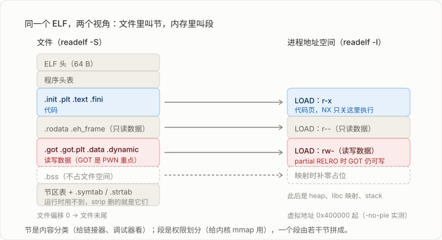

# 05 ELF 文件格式与链接
## Executable File Format & Linking

> [!info]- 章节信息
> **所属方向**：通用基础 ｜ **难度阶段**：L1 入门期 ｜ **前置要求**：[[02-C语言与内存模型|02 C 语言与内存模型]] · [[04-汇编语言精要|04 汇编语言精要]]
> **本章目标**：能用 readelf / objdump 完整描述一个 ELF 的节区与段；能讲清一次 `printf@plt` 调用的完整跳转链；能判断程序的静态/动态、PIE/非 PIE、RELRO 强度。
> **已核验说明**：本章所有地址、字节、输出均来自真实编译的二进制（WSL Ubuntu 26.04 / gcc 15.2.0，源码就一个 printf 的 hello world），不是示意图数据。

## 1. 拿到文件，先问它是什么

逆向的顺序永远是：`file` → `checksec` → 打开分析。前两步读的都是 ELF 格式本身 —— 文件头写着架构和类型，段表写着内存权限，.dynamic 写着依赖哪些库。02 的 5.2 已经分过节（section）和段（segment），说"完整字段留给后面的 ELF 专章"，就是本章。

一个例子贯穿全篇：

```bash
# hello.c：一行 printf 的最小程序
gcc -O0 -fno-pie -no-pie hello.c -o hello
file hello
# ELF 64-bit LSB executable, x86-64, dynamically linked,
# interpreter /lib64/ld-linux-x86-64.so.2, not stripped
```

`file` 这一行输出已经回答了四个问题：64 位 ELF、小端、动态链接（有 interpreter）、没剥符号。后面的分析全是把这四个词展开。

## 2. 两个视角：节与段



同一个文件，两套目录：

- **节区表**（section header table）：按**内容**分类，`.text` 是代码、`.rodata` 是常量、`.symtab` 是符号。给链接器、调试器、IDA 看。
- **程序头表**（program header table）：按**装载**分类，每个 LOAD 段带一块连续文件和一段虚拟地址，附 `rwx` 权限。给内核 loader 看，装载时按段 `mmap`。

>[!info] 内核是什么？
>**内核（Kernel）** 是操作系统的核心。它运行在 CPU 的最高特权级，负责管理整个计算机的硬件资源，并向上层应用程序提供统一的抽象和接口。你在汇编会看到`syscall`这种就是进入内核态干活。

两者的对应关系就一条规则：==若干节按权限相同合并进同一个 LOAD 段==。实测这 4 个 LOAD（`readelf -l`）：

| LOAD | 权限 | 装了哪些节 |
| ---- | ---- | ---------- |
| 1 | `r--` | ELF 头、.interp、.dynsym、.rela.dyn…… |
| 2 | `r-x` | .init .plt .plt.sec .text .fini |
| 3 | `r--` | .rodata .eh_frame |
| 4 | `rw-` | .init_array .fini_array .dynamic .got .got.plt .data .bss |

NX 不是编译选项，就是这张表：代码段 `r-x`，数据段 `rw-`，没有一段同时 `w` 和 `x`。04 章说"控制 RIP 就控制程序"，但 RIP 只能取 `x` 页的指令 —— NX 关掉的正是这个口子，绕它的办法（ROP、mprotect）后面专章讲。

工具分工：`readelf -S` 看节，`readelf -l` 看段。两个字段名容易混：`p_offset` 是段在**文件**里的偏移，`p_vaddr` 是映射到**内存**的虚拟地址，两者差一个固定基址 —— 本例非 PIE，基址 `0x400000`，`.text` 文件偏移 `0x1050` ↔ 虚拟地址 `0x401050`。

## 3. ELF 头：64 个字节的元信息

`readelf -h` 读的就是文件最开头的 `Elf64_Ehdr`，关键字段：

| 字段                    | 本例的值            | 说明                               |
| --------------------- | --------------- | -------------------------------- |
| `e_ident` 前 4 字节      | `7f 45 4c 46`   | 魔数，`45 4c 46` 就是 ASCII "ELF"     |
| `e_ident[4]`          | `02`            | 1 = 32 位，2 = 64 位                |
| `e_ident[5]`          | `01`            | 1 = 小端（03 章的字节序在这里起作用）           |
| `e_type`              | `EXEC`          | 可执行；`DYN` 是 PIE 或共享库，`REL` 是目标文件 |
| `e_machine`           | `x86-64`        | 架构，决定后面反汇编用哪套指令                  |
| `e_entry`             | `0x401050`      | 入口点，[[#7. 入口点：main 不是入口]]        |
| `e_phoff` / `e_phnum` | `64` / `14`     | 程序头表在文件偏移 64，共 14 项              |
| `e_shoff` / `e_shnum` | `0x3698` / `31` | 节区表的位置和项数                        |

`file` 命令读的也是这几个字节，所以它说 "ELF 64-bit LSB executable" 和 `readelf -h` 说 `Class: ELF64 / Data: little endian` 是同一件事。

## 4. 节区清单：名字背后的含义

CTF 会碰到的节，按用途归堆：

| 节                             | 内容          | 备注                                           |
| ----------------------------- | ----------- | -------------------------------------------- |
| `.text`                       | 机器指令        | `readelf -S` 实测：addr `0x401050`，size `0x123` |
| `.rodata`                     | 字符串常量、跳转表   | 只读；`strings` 大部分输出来自这里                       |
| `.data`                       | 已初始化的全局变量   | `int g_init = 42` 在 addr `0x404018`          |
| `.bss`                        | 未初始化的全局变量   | **类型 NOBITS，不占文件空间**，装载时补零；`g_uninit` 只在内存里  |
| `.plt` / `.plt.sec`           | 动态函数跳板      | [[#6. 动态链接：printf@plt 的完整跳转链]]的主角            |
| `.got` / `.got.plt`           | 函数/数据的真实地址表 | 延迟绑定的落点，也是改写攻击的目标                            |
| `.init` / `.fini` / `*_array` | 进程起止时跑的代码   | 构造/析构函数藏身处，加壳和反调试常用                          |
| `.dynamic`                    | 动态链接信息      | 依赖库列表、需要哪些重定位，`readelf -d` 读它                |
| `.dynsym` / `.dynstr`         | 运行时符号表      | 只有动态链接必需的符号，strip 不删                         |
| `.symtab` / `.strtab`         | 完整符号表       | 调试用，strip 删的就是它们                             |
| `.rela.dyn` / `.rela.plt`     | 重定位表        | "这个地址在装载时要填什么"，[[#5. 符号表与重定位]]               |

`.data` 和 `.bss` 的区别值得用一个数记住：本例文件 15960 字节，`.bss` 的 `p_memsiz` 比 `p_filesz` 多 8 —— 那 8 字节就是 `g_uninit`，它存在于内存映射里，文件里一个字节都没有。

## 5. 符号表与重定位

符号 = "名字 ↔ 地址"的对照。`nm hello` 列出的每个符号都来自 `.symtab`，其中：

- **FUNC / OBJECT**：函数和变量，IDA 靠它们命名函数；
- **UND**（undefined）：本文件用但没定义的符号，比如 `printf` —— 这些就是动态链接要解决的；
- **局部 vs 全局**：`static` 函数也在表里，标记为 LOCAL。

重定位解决的是"地址还不知道"的问题。`readelf -r` 的输出（本例全部条目）：

```
.rela.dyn:  000000403fd8  R_X86_64_GLOB_DAT  __libc_start_main@GLIBC_2.34
.rela.plt:  000000404000  R_X86_64_JUMP_SLOT printf@GLIBC_2.2.5
```

两行的差别是整个延迟绑定机制的钥匙：`GLOB_DAT` 类型的重定位（数据地址、被取地址的函数）在**装载时**由动态链接器填好；`JUMP_SLOT` 类型（普通函数调用）在**第一次调用时**才填 —— 这就是 `__libc_start_main` 走 GOT、`printf` 走 PLT 的原因。重定位表同时记录了"填到哪"（Offset 列）和"填谁"（Sym. Name 列），泄露攻击计算 libc 基址用的就是这个对应关系。

## 6. 动态链接：printf@plt 的完整跳转链

04 章的反汇编里出现过 `call 401040 <printf@plt>`。现在把这条调用走到 libc 的每一步列出来，全部地址来自同一个二进制：

```
① main:      call 401040                    ; 名为 printf@plt 的跳板
② 401040:    endbr64
             jmp  QWORD PTR [rip+0x2fb6]    ; 跳到 GOT[0x404000] 里存的地址
③ 首次调用时 [0x404000] = 0x401030，跳进 .plt 的普通表项：
   401030:    endbr64
              push 0                        ; 0 = 本函数在 .rela.plt 里的索引
              jmp  401020                   ; 跳去 PLT 表头
④ 401020:    push QWORD PTR [0x403ff0]      ; 压入 link_map（本模块信息）
             jmp  QWORD PTR [0x403ff8]      ; 跳进动态链接器的解析函数
⑤ 解析器拿索引 0 查 .rela.plt → 符号 printf → 在 libc 里找到真实地址，
   写回 GOT[0x404000]，然后跳到 printf 执行
⑥ 之后再调用：[0x404000] 已经是 libc 地址，② 一步直达，不再经过 ③④
```

这就是**延迟绑定**：程序启动时不解析任何库函数，谁第一次被调到才解析谁，解析结果缓存进 GOT。`.got.plt` 的字节 dump 能直接看到"未解析"状态 —— `0x404000` 处存的是 `30104000 00000000`，即 `0x401030`，一个本文件内 .plt 的地址，而不是 libc 地址。

> [!info] 这条链和 PWN 的关系
> ret2plt 直接把返回地址改成 ① 的 `printf@plt`，让程序"合法地"替你调用 `printf` 泄露 GOT 内容；ret2libc 改成 GOT 里的真实地址；GOT 改写攻击则反过来 —— `printf` 解析过之后 `0x404000` 可写（partial RELRO），把格式化字符串漏洞的 `%n` 打向它，下次调用 `printf` 就执行了任意函数。==一条调用链，三种利用。==

RELRO 决定 GOT 可不可写，判读方法：

```bash
readelf -l hello | grep -A1 GNU_RELRO
# partial：RELRO 覆盖 0x403df8 + 0x208 = 到 0x404000 为止，
#          printf 的 GOT 表项 0x404000 恰好在保护区外 → GOT 仍可写
gcc -z relro -z now hello.c -o hello_now      # 改成 full RELRO
readelf -d hello_now | grep -i bind           # FLAGS 里有 BIND_NOW
# full：.got.plt 一并进保护区，BIND_NOW 让启动时解析全部函数，延迟绑定关闭
```

`checksec` 报的 RELRO 就是从这两个地方读的。带 CET 的工具链会把调用入口放 `.plt.sec`（`endbr64; jmp *GOT` 两行），老二进制没有这一节、`call` 直接进 `.plt` —— 两种形状见多了自然分清。

## 7. 入口点：main 不是入口

ELF 头里 `e_entry = 0x401050`，反汇编它：

```asm
_start:
  xor    ebp,ebp                    ; 标记最外层栈帧
  ...
  pop    rsi                        ; rsi = argc
  mov    rdx,rsp                    ; rdx = argv
  mov    rdi,0x401136               ; main 的地址当第 1 个参数
  call   QWORD PTR [rip+0x2f63]     ; call __libc_start_main（走 GOT，装载时已解析）
  hlt
```

`_start` 把 argc、argv 和 **main 的地址**（`0x401136`，正是 `.symtab` 里 main 的 value）装好，交给 libc 的 `__libc_start_main`；后者完成 libc 初始化、跑 `.init_array`，最后才调用 main。所以：

- 找 main：非 stripped 程序直接查符号表；stripped 程序在 `_start` 里找 `mov rdi, 0x4xxxxx` 那条；
- main 返回后程序从 `__libc_start_main` 里调 `exit` 结束 —— 这也是 `exit` 劫持、FSOP 类攻击的触发路径（后面堆章会回到这里）。

## 8. 静态链接与 stripped

同一个 hello world 的三份产物：

| 产物                | 大小        | 特征                                                               |
| ----------------- | --------- | ---------------------------------------------------------------- |
| `gcc hello.c`（动态） | 15,960 B  | `file` 显示 `interpreter /lib64/ld-linux...`，`ldd` 列出 libc.so.6    |
| `gcc -static`（静态） | 816,968 B | 无 interpreter，`ldd` 报 "not a dynamic executable"，libc 全部打进 .text |
| `gcc -s`（strip）   | 14,496 B  | `file` 显示 `stripped`，`nm` 报 "no symbols"                         |

静态链接把 libc 的几百 KB 函数全塞进来，好处是不依赖目标环境、gadget 多到随便挑（ROP 静态题就是这么来的），坏处是没libc版本对齐问题也不存在 libc 泄露 —— 出题人用哪种链接，本身就决定了题型方向。

strip 删的是 `.symtab`/`.strtab` 和调试信息，**节区表和 `.dynsym` 都还在**（动态链接运行时需要后者）。所以 stripped 程序 `readelf -S` 照样有输出、字符串照样能搜、`printf` 的名字照样在 —— 新人被 stripped 劝退多数是把"没符号"误解成了"没目录"。真把节区表也删掉的是 sstrip 或某些壳，那种文件 `readelf -S` 直接报 "There are no sections"，只能靠程序头和动态段分析。

## 9. PE 速览

Windows 用 PE（Portable Executable），PWN 题很少见，Windows 逆向题绕不开。结构上能和 ELF 一一对上：

| PE 部件 | 对应 ELF 的 | 说什么 |
| ------- | ---------- | ------ |
| DOS 头（`MZ`）+ PE 头（`PE\0\0`） | ELF 头 | 魔数、机器、入口点 `AddressOfEntryPoint` |
| 节表（.text / .rdata / .data / .idata / .reloc） | 节区表 | `.idata` 是导入表所在，对应 `.rela` + `.dynsym` 的角色 |
| 导入表 IAT | GOT | 函数真实地址表，同样可被改写劫持 |
| 导出表 | `.dynsym` 的导出部分 | DLL 给别人用的函数 |
| 基址重定位 | `.rela.dyn` | PE 默认非 PIE，开 ASLR 靠重定位表 |

判读工具：Detect It Easy（查壳）、PE-bear（结构可视化）、x64dbg（动态）。体系化的东西在《逆向工程核心原理》，Windows 方向到 R5 之后自然会碰。

## 10. 实操：手写一个 ELF 解析器

readelf 能做的，用 Python `struct` 模块百来行也能做 —— 这个练习做一遍，ELF 头、节区表、符号表的内存布局就永远忘不掉了。可用版本（在 `hello` 和 `hello_pie` 上实测，输出与 readelf 一致）：

```python
#!/usr/bin/env python3
"""最小 ELF64 解析器：只读头、节区表、符号表。python3 parse_elf.py <file>"""
import struct, sys

SH_TYPES = {0:"NULL",1:"PROGBITS",2:"SYMTAB",3:"STRTAB",4:"RELA",
            6:"DYNAMIC",7:"NOTE",8:"NOBITS",11:"DYNSYM"}
ST_TYPES = {0:"NOTYPE",1:"OBJECT",2:"FUNC",3:"SECTION",4:"FILE"}

data = open(sys.argv[1], "rb").read()

# --- ELF 头（Elf64_Ehdr，前 64 字节）---
assert data[:4] == b"\x7fELF", "not an ELF"
end = "<" if data[5] == 1 else ">"                       # 1 = 小端
(e_type, _mach, _v, e_entry, e_phoff, e_shoff, _f, _e,
 _p, e_phnum, _sz) = struct.unpack_from(end + "HHIQQQIHHHH", data, 16)
e_shentsize, e_shnum, e_shstrndx = struct.unpack_from(end + "HHH", data, 58)
kind = {2:"EXEC（固定地址）", 3:"DYN（PIE/共享库）"}.get(e_type, hex(e_type))
print(f"class={'64' if data[4]==2 else '32'}  type={kind}  entry={e_entry:#x}  "
      f"phoff={e_phoff:#x}({e_phnum}项)  shoff={e_shoff:#x}({e_shnum}项)")

# --- 节区表（Elf64_Shdr，每项 64 字节）---
def shdr(i):
    f = struct.unpack_from(end + "IIQQQQIIQQ", data, e_shoff + i * e_shentsize)
    return dict(name=f[0], type=f[1], addr=f[3], off=f[4], size=f[5], link=f[6])

shstr = shdr(e_shstrndx)                                  # 节区名字符串表
def secname(off):
    e = data.index(b"\0", shstr["off"] + off)
    return data[shstr["off"] + off:e].decode()

print("\n[节区表]")
for i in range(e_shnum):
    s = shdr(i)
    if s["type"]:
        print(f"  {i:2d} {secname(s['name']):<18} {SH_TYPES.get(s['type'], s['type']):<10} "
              f"addr={s['addr']:#010x} off={s['off']:#06x} size={s['size']:#x}")

# --- 符号表（Elf64_Sym，每项 24 字节）---
print("\n[符号表 .symtab]")
sym = next(shdr(i) for i in range(e_shnum) if secname(shdr(i)["name"]) == ".symtab")
strtab = shdr(sym["link"])                                # sh_link 指向关联的 .strtab
for i in range(sym["size"] // 24):
    st_name, st_info, _o, _n, st_value, st_size = struct.unpack_from(
        end + "IBBHQQ", data, sym["off"] + i * 24)
    t = ST_TYPES.get(st_info & 0xF, st_info & 0xF)        # st_info 低 4 位是类型
    if t in ("FUNC", "OBJECT") and st_name:
        e = data.index(b"\0", strtab["off"] + st_name)
        print(f"  {t:<7} {data[strtab['off'] + st_name:e].decode():<24} "
              f"value={st_value:#x} size={st_size}")
```

> [!note] 往上加功能
> 顺着上面的路数补三块就接近 pyelftools 的核心了：程序头表（`e_phoff` 起，每项 56 字节，拿 `p_type=1` 的 LOAD 算权限）；`.dynamic` 段（每项 16 字节，tag `DT_NEEDED=1` 列依赖库）；`.rela.plt`（每项 24 字节，和 [[#6. 动态链接：printf@plt 的完整跳转链|延迟绑定]]的跳转链对上）。写完拿 `readelf` 逐项核对。素不素灰常简单啊（😅写到这里有点绷不住了

## 11. 常见问题

| 现象 | 原因与解决 |
| ---- | ---------- |
| IDA 里地址和 GDB 里对不上 | PIE 程序每次加载基址不同；GDB 默认关 ASLR 所以地址固定，IDA 显示的是文件内偏移 |
| `nm` 报 "no symbols" | 程序被 strip，改用 `readelf -S` 看节、`strings` 搜关键串、动态调试定位 |
| `readelf -S` 报 "There are no sections" | 节区表被 sstrip 或壳删了，按程序头（`readelf -l`）和 `.dynamic` 分析 |
| `.bss` 的变量在文件里找不到 | NOBITS 类型不占文件空间，只在内存映射中存在 |
| `ldd` 对静态程序报错 | 正常，静态程序没有 interpreter，`file` 看链接方式即可 |
| 找不到 main 函数 | 入口是 `_start`，main 的地址在它给 `__libc_start_main` 的第一个参数里（见 [[#7. 入口点：main 不是入口\|入口点]]） |
| GOT 和 PLT 分不清 | PLT 在代码段，是跳板代码；GOT 在数据段，存的是地址。调用经过 PLT，跳转目标查 GOT |
| `checksec` 显示 RELRO 但 GOT 还能写 | partial RELRO 本来就不保护 `.got.plt`（[[#6. 动态链接：printf@plt 的完整跳转链\|延迟绑定]]的 0x404000 例子），full 才只读 |
| 改 `.rodata` 里的字符串程序段错误 | 那页权限 `r--`，只读；想改走运行时 patch 内存页权限 |
| 想知道二进制用了哪个 libc | `ldd` 本机程序直接看；赛题给 `.so` 文件时 `strings libc.so.6` 配 `grep "GNU C"` 看版本号 |
