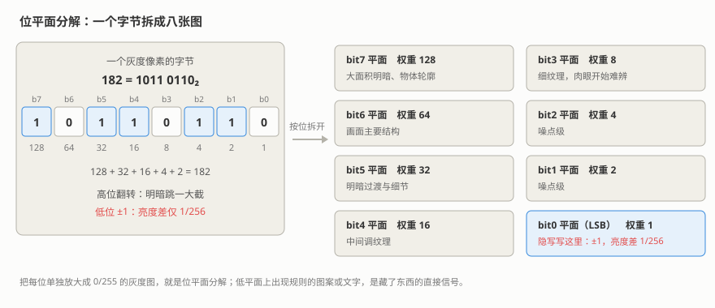

# M05 图片隐写 I：LSB 与位平面
## LSB & Bit-Plane Steganography

> [!info]- 章节信息
> **所属方向**：MISC ｜ **难度阶段**：L2 核心期 ｜ **前置要求**：[[12-隐写与流量取证|12 章]] · [[M01-MISC导论与工具箱|M01]] · [[M02-文件格式深拆I-PNG全解|M02]]
> **本章目标**：把 LSB 隐写从"按写死的顺序抠最低位"推进到全参数化——看懂八个位平面、写出通道/平面号/位序/像素序任换的通用提取器、用 zsteg 一键扫全部组合、识别 alpha 通道隐写、对整目录图片批量扫描；最后算清 LSB 的容量账，划清它与 DCT 域隐写的边界。

## 1. 定位：从手撕 LSB 到组合全解

[[12-隐写与流量取证|12 章 5.1]]用 BMP 把 LSB（Least Significant Bit，最低有效位）隐写的最小闭环走通了：消息按位拆开塞进像素最低位，提取时按同样的固定顺序读回，8 个 0 的哨兵字节负责停机；PNG 的 LSB 给了"解压 → 改 → 重压"的流程一瞥；stegsolve 的 Data Extract 与 zsteg 的装法也各提了一句。这些内容本章不再重讲，需要时回链。

但 12 章那套提取是写死的：固定 R 通道、固定最低位、固定行优先、固定位序。出题人只要换掉四个开关里的任何一个，照原顺序读出来就是乱码。本章把这四个开关全部参数化，并配上自动扫描工具。先看本系列在隐写这条线上的分层：

| 章 | 隐写层 | 管什么 |
| ---- | ---- | ---- |
| [[M02-文件格式深拆I-PNG全解\|M02]] | 容器结构层 | chunk、zlib、滤波——数据在文件里怎么存 |
| 本章 | 像素位层 | 位在像素里怎么藏、八个平面各长什么样、全部组合怎么提 |
| [[M06-图片隐写II-DCT与盲水印\|M06]] | 变换域 | JPEG 的 DCT 系数与盲水印 |
| [[M15-隐写进阶与隐写分析\|M15]] | 统计层 | 隐写的检测与对抗 |

全章在一组自造靶子上展开：2 节造靶并做位平面分解，3 节写通用组合提取器，4 节用 zsteg 全扫并与手撕互相印证，5 节看 alpha 通道隐写，6 节批量扫图，7 节算容量账。

## 2. 位平面：像素字节的八个开关

### 2.1 位结构与视觉贡献

一个 8 位像素字节的位结构在 [[03-计算机组成与数据表示|03 章]]讲过，这里只补隐写视角。字节的值由 8 个位加权求和：

$$V = b_7 \cdot 2^7 + b_6 \cdot 2^6 + \cdots + b_0 \cdot 2^0 \tag{5.1}$$

各位的权重相差 256 倍，翻动不同的位，画面反应完全不同。以灰度图为例，单独翻动某一位造成的亮度变化：

| 位 | 权重 | 翻动这一位，像素值变化 | 占满量程 256 的比例 |
| ---- | ---- | ---- | ---- |
| bit7 | 128 | ±128 | 50% |
| bit6 | 64 | ±64 | 25% |
| bit5 | 32 | ±32 | 12.5% |
| bit4 | 16 | ±16 | 6.25% |
| bit3 | 8 | ±8 | 3.1% |
| bit2 | 4 | ±4 | 1.6% |
| bit1 | 2 | ±2 | 0.8% |
| bit0 | 1 | ±1 | 0.39%（1/256） |

==LSB 隐写的全部底气在这张表里：只动最低位，像素值变化 ±1，亮度差 1/256，肉眼在相邻色块之间分辨不出==。高位平面（bit4 以上）一动就看得见，嵌入时保持原样；低位平面（bit0–bit2）是隐写的常住区。

> [!note] MSB 与 LSB 的两重用法
> MSB（Most Significant Bit）= 最高有效位 bit7，LSB = 最低有效位 bit0。这两个词还会用来描述**位序**——一个字节的 8 位按什么方向进出比特流，3 节起大量出现。看到 lsb/msb 先分清说的是"哪一个位"还是"哪一种顺序"。

### 2.2 自造靶：把图案和消息写进 bit0

后面各节共用四张靶子，一个脚本全部生成。底图是平滑渐变，各通道的值都是 4 的倍数——低两位全 0，写进去的位看得清清楚楚：

```python
# make_targets.py —— 造本章四张靶子（第 2-6 节共用）
import io
import zipfile
import numpy as np
from PIL import Image

W, H = 160, 120

def base_gradient(w=W, h=H):
    """平滑渐变底图：各通道的值都是 4 的倍数，低两位全 0"""
    x, y = np.meshgrid(np.arange(w), np.arange(h))
    r = (96 + 4 * (((x // 8) + (y // 8)) % 32)).astype(np.uint8)
    g = (64 + 4 * ((x // 8) % 48)).astype(np.uint8)
    b = (160 + 4 * ((y // 8) % 24)).astype(np.uint8)
    return np.dstack([r, g, b])

def embed_bits(arr, bits, channel, bit, mode="xy"):
    """把 0/1 位流从平面第一个像素起铺进指定位平面"""
    h, w = arr.shape[:2]
    lin = np.zeros(w * h, dtype=np.uint8)
    lin[: len(bits)] = bits
    plane = lin.reshape(w, h).T if mode == "yx" else lin.reshape(h, w)
    out = arr.copy()
    c = out[:, :, channel]
    out[:, :, channel] = (c & (255 - (1 << bit))) | (plane << bit)
    return out

def embed(arr, data, channel, bit, order="msb", mode="xy"):
    raw = np.frombuffer(data, dtype=np.uint8)
    bits = np.unpackbits(raw)                       # 默认 MSB-first：高位先进
    if order == "lsb":
        bits = bits.reshape(-1, 8)[:, ::-1].ravel()  # 每字节 8 位倒序 = LSB-first
    return embed_bits(arr, bits, channel, bit, mode)

if __name__ == "__main__":
    # 靶 1：R 通道 bit0 画一个十字（位平面分解用）
    arr = base_gradient()
    mask = np.zeros((H, W), dtype=bool)
    mask[52:68, 40:120] = True                      # 横杠
    mask[24:96, 72:88] = True                       # 竖杠
    arr[:, :, 0] |= mask.astype(np.uint8)
    Image.fromarray(arr, "RGB").save("plane_target.png")
    print(f"[1] plane_target.png  {W}x{H}，R bit0 画入十字，覆盖 {int(mask.sum())} 像素")

    # 靶 2：R 通道 bit0 藏字符串（组合提取器与 zsteg 用）
    msg = b"flag{combo_r0_lsb_xy}"
    Image.fromarray(embed(base_gradient(), msg, 0, 0, order="lsb"), "RGB").save("stego_msg.png")
    print(f"[2] stego_msg.png     藏入 {msg}（{len(msg)} 字节 = {len(msg) * 8} 位，R bit0 LSB-first 行优先）")

    # 靶 3：A 通道 bit0 藏字符串（alpha 隐写用），A 基值 254
    msg = b"flag{alpha_hides_here}"
    rgba = np.concatenate([base_gradient(), np.full((H, W, 1), 254, np.uint8)], axis=2)
    Image.fromarray(embed(rgba, msg, 3, 0, order="lsb"), "RGBA").save("alpha_target.png")
    print(f"[3] alpha_target.png  藏入 {msg}（{len(msg)} 字节，A bit0）")

    # 靶 4：R 通道 bit0 塞一个小 zip（看 zsteg 的 file: 识别行）
    mem = io.BytesIO()
    with zipfile.ZipFile(mem, "w", zipfile.ZIP_STORED) as z:
        z.writestr("note.txt", "inside the zip")
    zipb = mem.getvalue()
    Image.fromarray(embed(base_gradient(), zipb, 0, 0, order="msb"), "RGB").save("file_target.png")
    print(f"[4] file_target.png   藏入 zip（{len(zipb)} 字节 = {len(zipb) * 8} 位，R bit0 MSB-first）")
```

```bash
python3 make_targets.py
```

输出：

```
[1] plane_target.png  160x120，R bit0 画入十字，覆盖 2176 像素
[2] stego_msg.png     藏入 b'flag{combo_r0_lsb_xy}'（21 字节 = 168 位，R bit0 LSB-first 行优先）
[3] alpha_target.png  藏入 b'flag{alpha_hides_here}'（22 字节，A bit0）
[4] file_target.png   藏入 zip（128 字节 = 1024 位，R bit0 MSB-first）
```

`embed()` 的四个参数就是 3 节自由度表的四维：`channel` 通道、`bit` 平面号、`order` 位序、`mode` 像素序。`np.unpackbits` 天然按 MSB-first 拆位（[[M01-MISC导论与工具箱|M01 3.2]]），每个字节的 8 位倒一次序就得到 LSB-first——位序这个自由度只差在倒不倒这一下。

### 2.3 位平面分解

把每一个位单独抽出来、放大成 0/255 的灰度图，就得到八张位平面图。==位平面分解是肉眼判断 LSB 隐写的第一步==：

```python
# planes.py —— 位平面分解：R 通道 8 个平面各存一张 PNG
import numpy as np
from PIL import Image

arr = np.array(Image.open("plane_target.png"))     # shape = (120, 160, 3)
c = arr[:, :, 0]                                   # R 通道
for bit in range(8):
    plane = ((c >> bit) & 1).astype(np.uint8) * 255    # 0/1 放大到 0/255
    Image.fromarray(plane).save(f"plane_bit{bit}.png")
    print(f"bit{bit}: 非零像素 {plane.astype(bool).mean() * 100:6.2f}%  -> plane_bit{bit}.png")
```

```bash
python3 planes.py
```

输出：

```
bit0: 非零像素  11.33%  -> plane_bit0.png
bit1: 非零像素   0.00%  -> plane_bit1.png
bit2: 非零像素  50.00%  -> plane_bit2.png
bit3: 非零像素  50.00%  -> plane_bit3.png
bit4: 非零像素  50.33%  -> plane_bit4.png
bit5: 非零像素  49.67%  -> plane_bit5.png
bit6: 非零像素  30.33%  -> plane_bit6.png
bit7: 非零像素  87.00%  -> plane_bit7.png
```

读这组数字：bit0 的 11.33% 恰好是画入十字的 2176 个像素——打开 plane_bit0.png，深色底上亮着一个十字；bit1 全黑（底图低两位本来就是 0）；bit2 起的 50%、87% 是渐变底图自身的块状纹理。对照着看八张图：==有货的平面上出现规则图案或文字，没货的平面要么全黑全白、要么是底图自己的纹理==。



> [!warning] 低平面有纹理不等于有货
> 真实照片噪声大，bit0–bit2 几乎必然满屏噪点，看不出"图案"不奇怪；反过来，平滑渐变自己也会在低平面画出条纹（上面 bit2–bit5 那几个 50%）。分解图只负责缩小范围，确认有货要靠 3 节的提取器把位拼成字节看内容。

## 3. 提取组合全参数化

12 章 5.1 的提取按固定顺序进行：R 通道、最低位、行优先、每字节高位先进。把自由度全部列出来：

| 自由度 | 取值 | 对应 zsteg 组合段 |
| ---- | ---- | ---- |
| 通道 | R / G / B / A 单通道；或 rgb、bgr、rgba 等多通道串行 | 第 2 段：r、g、b、a、rgb… |
| 平面号 | bit0（最低位）到 bit7（最高位）；也可多位串行 | 第 1 段：b1、b2…（含义见 4 节） |
| 位序 | 每个字节的 8 位按什么方向进出比特流 | 第 3 段：lsb / msb |
| 像素序 | 行优先（xy）/ 列优先（yx） | 第 4 段：xy / yx |

单通道单平面时，4 通道 × 8 平面 × 2 位序 × 2 像素序 = 128 种组合。==这张自由度表就是 zsteg 和 stegsolve 内部在扫的东西==：zsteg 把组合打成一行行标注挨个试，stegsolve 的 Data Extract 把同一张表做成勾选框，本质相同。

> [!info]- 多通道串行与多位串行
> 数据量超过单个位平面时，出题人会把比特流按通道依次铺开：先铺满 R 的 bit0，再铺 G 的 bit0……zsteg 组合里的 rgb、bgr 指这个，通道排列顺序就是铺放顺序。提取时把各通道的位平面按同样顺序首尾相接：
>
> ```python
> bits = np.concatenate([((np.array(im)[:, :, c] >> 0) & 1).ravel() for c in (0, 1, 2)])
> ```
>
> 之后的拼字节步骤不变。多位串行（每个像素取低 2 位、低 3 位）同理：把几个平面的位挨个排进流里。zsteg 的 b2、b3 扫的就是这类变体。

### 3.1 通用组合提取器

把 12 章 5.1 那段固定顺序的提取改写成四个参数任换的版本，位与字节的互转交给 numpy（[[M01-MISC导论与工具箱|M01 3.2]]）：

```python
# extract.py —— 通用组合提取器
import numpy as np
from PIL import Image

CH = {"R": 0, "G": 1, "B": 2, "A": 3}

def extract(img, channel, bit, order="msb", mode="xy", nbytes=24):
    arr = np.array(img)
    c = arr[:, :, CH.get(channel, channel)]
    if mode == "yx":
        c = c.T                                    # 列优先：先转置再展平
    bits = ((c >> bit) & 1).ravel()[: nbytes * 8]  # 行优先展平，截取所需位数
    groups = bits.reshape(-1, 8)                   # 每 8 位拼 1 字节
    if order == "lsb":
        groups = groups[:, ::-1]                   # 每组倒序 = LSB-first
    return np.packbits(groups).tobytes()

stego = Image.open("stego_msg.png")
print("(R, bit0, lsb):", extract(stego, "R", 0, order="lsb"))
print("(R, bit0, msb):", extract(stego, "R", 0, order="msb"))
print("(G, bit0, lsb):", extract(stego, "G", 0, order="lsb"))
```

```bash
python3 extract.py
```

输出：

```
(R, bit0, lsb): b'flag{combo_r0_lsb_xy}\x00\x00\x00'
(R, bit0, msb): b'f6\x86\xe6\xde\xc6\xf6\xb6F\xf6\xfaN\x0c\xfa6\xceF\xfa\x1e\x9e\xbe\x00\x00\x00'
(G, bit0, lsb): b'\x00\x00\x00\x00\x00\x00\x00\x00\x00\x00\x00\x00\x00\x00\x00\x00\x00\x00\x00\x00\x00\x00\x00\x00'
```

三行输出对应三个结论：

1. 第一行是正确组合。参数 (R, bit0, LSB-first) 与 2.2 的嵌入参数逐项对应，拼回原串。尾部 3 个 `\x00` 是消息之外的底图残留——12 章 5.1 靠 8 个 0 的哨兵停机，通用提取器不知道消息在哪结束，按 `nbytes` 截取，尾部残留要人工分辨。
2. 第二行位序错。同一条位流按 MSB-first 拼，每个字节内部 8 位全倒过来，出来是乱码。
3. 第三行通道错。G 通道的 bit0 从没被写过（底图低两位是 0），提出来 24 个全 0 字节。

位序的两个方向在这里定死：==MSB-first 是"先读到的位是字节的高位"==（`order="msb"`），[[12-隐写与流量取证|12 章 5.1]]的 `f"{b:08b}"` 天然如此；==LSB-first 是"先读到的位是字节的低位"==（`order="lsb"`）。两种都有人用，所以它必须是自由度表里独立的一维。

==提取出来是乱码时，按自由度表换参数重试，而不是怀疑原理==：通道、平面、位序、像素序挨个换，正确组合下内容自然可读。

## 4. zsteg：全组合自动扫描

zsteg 是 Ruby 写的 PNG/BMP 隐写自动扫描器，装法与验收见 [[M01-MISC导论与工具箱|M01 2.2]]。它把 3 节的自由度表按组合逐个试，每行输出一种组合的判定：

```bash
zsteg stego_msg.png
```

输出（b1–b4 × 各通道集 × 两种位序共四十来行，这里只保留有内容的行）：

```
chunk:0:IHDR        .. file: Adobe Photoshop Color swatch, version 0, 160 colors; 1st RGB space (0), w 0x78, x 0x802, y 0, z 0; 2nd RGB space (0), w 0x100, x 0, y 0, z 0xff00
b1,r,msb,xy         .. text: "flag{combo_r0_lsb_xy}"
b1,rgb,lsb,xy       .. file: Targa image data - Color (16642-32800) 18832 x 36896 x 1 +37408 +8193 - top "\222A \202A \020\001 \222A \222H \020\011 "
b2,rgb,lsb,xy       .. file: Commodore PET BASIC program, offset 0x0100, line 4, token (0)
b2,bgr,msb,xy       .. file: Applesoft BASIC program data, first line number 2
b3,rgb,msb,xy       .. file: Applesoft BASIC program data, first line number 16
b4,bgr,lsb,xy       .. file: GLS_BINARY_LSB_FIRST
```

以 `b1,r,msb,xy` 为例，组合标注用逗号分四段，自左向右：

| 组合段 | 含义 |
| ---- | ---- |
| `b1` | 每个像素取 1 位，从最低位平面起。==bN 不是平面号，是"每像素取低位数"==：b1 就是 bit0，b2、b3 是低 2、3 个平面串行；要单独指认某个高位平面得写掩码，`-b 0x80` 在输出里显示成 `b10000000` |
| `r` | 参与取位的通道及串行顺序（r、g、b、a，rgb、bgr、rgba、abgr） |
| `lsb` / `msb` | 拼字节的位序 |
| `xy` | 像素序；`-a` 下还有 xY、Xy、XY、YX 四种带方向翻转的变体 |

flag 出现在 `b1,r,msb,xy` 行的 `text:` 里。嵌入用的是 LSB-first，zsteg 却报在 msb 行——==这对标注与 3.1 的参数正好反着：本章提取器的 MSB-first 对应 zsteg 的 `lsb`，LSB-first 对应 zsteg 的 `msb`==。两路互证：

```bash
zsteg -E b1,r,lsb,xy stego_msg.png | xxd | head -2
```

输出：

```
00000000: 6636 86e6 dec6 f6b6 46f6 fa4e 0cfa 36ce  f6......F..N..6.
00000010: 46fa 1e9e be                             F....
```

`-E b1,r,lsb,xy` 提出的前 17 个字节，与 3.1 第二行 `(R, bit0, msb)` 的乱码逐字节一致（zsteg 顺带裁掉了尾部全 0 字节）。换成与嵌入一致的组合再提一次：

```bash
zsteg -E b1,r,msb,xy stego_msg.png | xxd | head -2
```

输出：

```
00000000: 666c 6167 7b63 6f6d 626f 5f72 305f 6c73  flag{combo_r0_ls
00000010: 625f 7879 7d                             b_xy}
```

xxd 的 ASCII 列里直接是 flag。==手撕提取器与 zsteg 对同一张图、同一组参数给出同一个串，互相印证==。这对反着命的标注是互认脚本时最容易错的地方：别背名字，拿 `-E` 提 16 字节对一下就清楚了。

输出行尾的三种判定也要会读：

| 判定 | 含义 |
| ---- | ---- |
| `text: "..."` | 该组合提出的数据里有可打印字符串（默认报第一段，最短 8 字符，`-n` 调整） |
| `file: ...` | 提出的字节被 `file` 命令认出了已知格式——内嵌文件的直接信号 |
| `["U" repeated N times]` | 重复字符说明该组合下位呈固定模式，多半是规律底纹而非数据 |

对照靶子验证 file: 行。2.2 的 file_target 在 R bit0 塞了一个 zip：

```bash
zsteg file_target.png | head -3
```

输出：

```
b1,r,lsb,xy         .. file: Zip archive data, at least v2.0 to extract, compression method=store
b1,r,msb,xy         .. 
b1,g,lsb,xy         .. 
```

第一行 `b1,r,lsb,xy`——嵌入是 MSB-first，又是那对反着的标注。至于第一段示例里的 `chunk:0:IHDR` 行：zsteg 不只扫像素，还扫 PNG 各 chunk 的原始字节；IHDR 只有 13 字节，`file` 把这十几个字节强行辨认成不相干的格式，是典型误报。

常用选项一览（`zsteg --help` 可查全）：

| 选项 | 作用 |
| ---- | ---- |
| `-E b1,r,msb,xy` | 按指定组合提取原始字节，写法与扫描输出一致 |
| `-a` | 全量方法：像素序扩到 xy/yx/xY/Xy/XY/YX 六种，叠加素数间隔取样等变体，高位平面也扫 |
| `-c a` / `-c rgba` | 指定参与扫描的通道集与顺序（5 节的 alpha 就靠它单独扫） |
| `-b 0x04` | 指定取位掩码，直指某个平面组合 |
| `-l 0` | 放开默认 256 字节的检查长度，嵌长文件时用 |
| `--no-file` | 关掉 file 识别，减少 file: 误报行 |

> [!warning] zsteg 认得的容器只有 PNG 和 BMP
> 底层的 zpng 解码库不认其他格式：GIF 喂进去直接报 `Unsupported header "GIF87a"`，JPEG 同样无从谈起——它根本没有位平面（7 节）。多帧 PNG（APNG）zsteg 只读 IDAT，即只扫第一帧，后续帧的数据在 fdAT 块里扫不到——逐帧 `seek` 转存后再各自扫，[[M02-文件格式深拆I-PNG全解|M02]]的 APNG 一节拆过三种帧块。

## 5. alpha 通道隐写

RGBA 图比 RGB 多一个 A（alpha）通道，取值 0–255 表示不透明度：255 完全不透明，0 全透明，查看器用它做合成。==A 通道不参与画面内容，却是位平面的一员==——3 节自由度表的通道维里它占其一，而普通的查看与截图流程都不会检查它。

2.2 的 alpha_target 就是这种靶：RGB 照常是渐变，A 通道基值 254（完全不透明），消息按 LSB-first 写进 A 的 bit0——A 只在 254/255 之间跳动，画面与全 255 的原图没有任何肉眼差别。

```python
# alpha.py —— alpha 通道的检查与提取
import numpy as np
from PIL import Image

img = Image.open("alpha_target.png")
arr = np.array(img)                                # (120, 160, 4)
a = arr[:, :, 3]                                   # A 通道
print(img.mode, img.size)
print("alpha 的全部取值:", np.unique(a))
print("最小 alpha 值:", a.min(), "（>=128 即完全不透明，画面与全 255 无差别）")

groups = (a & 1).ravel()[: 22 * 8].reshape(-1, 8)[:, ::-1]   # A bit0，LSB-first
print("A bit0 藏的字节:", np.packbits(groups).tobytes())

rgb = np.array(Image.open("stego_msg.png").convert("RGBA"))
print("RGB 图转 RGBA 后的 alpha 取值:", np.unique(rgb[:, :, 3]))
```

```bash
python3 alpha.py
```

输出：

```
RGBA (160, 120)
alpha 的全部取值: [254 255]
最小 alpha 值: 254 （与 255 的合成差不超过每通道 1/255，肉眼不可见）
A bit0 藏的字节: b'flag{alpha_hides_here}'
RGB 图转 RGBA 后的 alpha 取值: [255]
```

`np.unique` 一行就是 alpha 隐写的探测手段：正常照片的 alpha 几乎总是全 255（RGB 图转 RGBA 后也是，见最后一行对照）。==alpha 全 0 或全 255、或只在 254/255 这类相邻值上跳动，先怀疑透明通道被挪去藏了数据==。

zsteg 扫 RGBA 图时默认就带 a、rgba、abgr 组合；用 `-c a` 只扫 alpha，输出干净得多：

```bash
zsteg -c a alpha_target.png
```

输出：

```
b1,a,lsb,xy         .. 
b1,a,msb,xy         .. text: "flag{alpha_hides_here}"
b2,a,lsb,xy         .. 
b2,a,msb,xy         .. text: ["U" repeated 212 times]
b3,a,lsb,xy         .. 
b3,a,msb,xy         .. 
b4,a,lsb,xy         .. 
b4,a,msb,xy         .. text: ["w" repeated 168 times]
```

flag 在 `b1,a,msb,xy`——嵌入是 LSB-first，与 4 节的对照关系一致。那两条重复字符行也有出处：消息只占了前 176 个像素的 bit0，其后 A=254 的 bit1 恒 1、bit0 恒 0，`b2` 组合每像素取 bit1、bit0 两位，拼出来就是 0x55（"U"）的重复；`b4` 取低 4 位同理拼出 0x77（"w"）。==重复字符行不是货，是底纹的固定模式==，但它恰好说明这个通道的低位"有规律可循"，值得多看一眼。

> [!warning] RGB 图上提取 A 通道是空手
> 图像本身是 RGB 模式时根本没有 A 通道，`convert("RGBA")` 只是补一层全 255 的 alpha（上面输出最后一行），提出来自然是全 0 位。先看 `img.mode` 确认容器真是 RGBA。反过来，A 全 0 的图在查看器里整张"看不见"，不要当作损坏文件处理——全透明正意味着 alpha 通道没被画面占用。

## 6. PIL 批量处理

单图的手工流程会了，批量就是把它包进循环。最常用的两件事：一批图里筛出哪张藏了东西；给一批图导出位平面图目录。

```python
# batch.py —— 造批处理靶 + glob 批量扫描 + 批量导出位平面
import glob
import os
import numpy as np
from PIL import Image
from make_targets import base_gradient, embed

NAME = {0: "R", 1: "G", 2: "B", 3: "A"}
rng = np.random.default_rng(2026)

def noisy_base(w=128, h=128):
    """渐变底图叠加低两位随机噪声，接近真实照片的位平面形态"""
    return base_gradient(w, h) | rng.integers(0, 4, size=(h, w, 3), dtype=np.uint8)

# 一、造靶：三张各藏一种组合，一张干净
os.makedirs("batch", exist_ok=True)
Image.fromarray(embed(noisy_base(), b"flag{batch_r0_lsb}", 0, 0, "lsb"), "RGB").save("batch/s1.png")
Image.fromarray(embed(noisy_base(), b"flag{yx_b2_msb_here}", 2, 2, "msb", "yx"), "RGB").save("batch/s2.png")
s3 = np.concatenate([noisy_base(), np.full((128, 128, 1), 255, np.uint8)], axis=2)
Image.fromarray(embed(s3, b"flag{alpha_batch_a0}", 3, 0, "lsb"), "RGBA").save("batch/s3.png")
Image.fromarray(noisy_base(), "RGB").save("batch/clean.png")
print("已造 4 张 128x128 靶：s1(R,0,lsb,xy) s2(B bit2,msb,yx) s3(A,0,lsb,xy) clean.png 干净\n")

# 二、批量扫描：4 通道 x bit0-2 x 2 位序 x 2 像素序 = 48 种组合
def extract_bits(arr, ch, bit, order, mode, nbytes=32):
    c = arr[:, :, ch]
    if mode == "yx":
        c = c.T                                    # 列优先：先转置再展平
    bits = ((c >> bit) & 1).ravel()[: nbytes * 8]
    g = bits.reshape(-1, 8)
    if order == "lsb":
        g = g[:, ::-1]
    return np.packbits(g).tobytes()

for path in sorted(glob.glob("batch/*.png")):
    arr = np.array(Image.open(path).convert("RGBA"))   # 统一四通道，没有 A 的补 255
    hits = 0
    for ch in range(4):
        for bit in range(3):
            for order in ("lsb", "msb"):
                for mode in ("xy", "yx"):
                    data = extract_bits(arr, ch, bit, order, mode)
                    run = 0
                    while run < len(data) and 0x20 <= data[run] < 0x7F:
                        run += 1
                    if run >= 8:                       # 连续 8 字节可打印才算命中
                        hits += 1
                        combo = f"({NAME[ch]}, bit{bit}, {order}, {mode})"
                        print(f"[命中] {os.path.basename(path)}  {combo}  {data[:run]}")
    if hits == 0:
        print(f"[无命中] {os.path.basename(path)}  （48 种组合无一连续可打印）")

# 三、批量导出位平面：每张图 x 4 通道 x bit0-7
os.makedirs("planes", exist_ok=True)
total = 0
for path in sorted(glob.glob("batch/*.png")):
    name = os.path.splitext(os.path.basename(path))[0]
    arr = np.array(Image.open(path).convert("RGBA"))
    for ch in range(4):
        for bit in range(8):
            plane = ((arr[:, :, ch] >> bit) & 1).astype(np.uint8) * 255
            Image.fromarray(plane).save(f"planes/{name}_{NAME[ch]}{bit}.png")
            total += 1
print(f"\n共导出 {total} 张平面图到 planes/，例如：")
print(sorted(os.listdir("planes"))[:3])
```

```bash
python3 batch.py
```

输出：

```
已造 4 张 128x128 靶：s1(R,0,lsb,xy) s2(B bit2,msb,yx) s3(A,0,lsb,xy) clean.png 干净

[无命中] clean.png  （48 种组合无一连续可打印）
[命中] s1.png  (R, bit0, lsb, xy)  b'flag{batch_r0_lsb}'
[命中] s2.png  (B, bit2, msb, yx)  b'flag{yx_b2_msb_here}'
[命中] s3.png  (R, bit1, msb, yx)  b'cn1Ek6W7'
[命中] s3.png  (A, bit0, lsb, xy)  b'flag{alpha_batch_a0}'

共导出 128 张平面图到 planes/，例如：
['clean_A0.png', 'clean_A1.png', 'clean_A2.png']
```

三个要点：

- 命中条件是"连续 8 字节可打印"，宽松条件必然带进噪声——s3 那条 `(R, bit1, msb, yx)` 的 `cn1Ek6W7` 就是随机噪声拼出来的可打印串。==命中要过目内容，长得像 flag 的才算数==。
- s2 藏在 (B, bit2, MSB-first, 列优先)，批量脚本照抓不误——自由度表里每一维都不能省。它的组合用 zsteg 写出来是掩码加像素序：

```bash
zsteg -b 0x04 -o yx --lsb batch/s2.png | grep text
```

输出：

```
b100,b,lsb,yx        .. text: "flag{yx_b2_msb_here}"
```

掩码 0x04 显示成 `b100`；zsteg 的 `--lsb` 对应脚本里的 `"msb"`——又是那对反着的名字。

- 第三段把每张图的 4 通道 × bit0–7 全部落成 PNG，一图 32 张。肉眼筛异样平面时，批量导出比逐张开工具快得多；筛中的平面再用 3.1 的提取器做字节级确认。

## 7. 容量与适用边界

每像素每个通道贡献 1 位，一张图的 LSB 容量是：

$$\text{容量（字节）} = \frac{W \times H \times C}{8} \tag{5.2}$$

W、H 是宽高，C 是参与隐写的通道数。代进 2.2 的 160×120 靶：160 × 120 × 3 / 8 = 7200 字节，21 字节的消息连零头都占不到——==容量从来不是 LSB 的瓶颈，组合才是==。换算到日常尺寸：

```python
# cap.py —— LSB 容量账
W, H = 1920, 1080
for c, name in ((3, "RGB"), (4, "RGBA")):
    cap = W * H * c // 8
    print(f"{name}: {W} x {H} x {c} / 8 = {cap} 字节 = {cap / 1024:.1f} KiB")
```

```bash
python3 cap.py
```

输出：

```
RGB: 1920 x 1080 x 3 / 8 = 777600 字节 = 759.4 KiB
RGBA: 1920 x 1080 x 4 / 8 = 1036800 字节 = 1012.5 KiB
```

一张 1080p 的图能藏 759 KiB——塞一部小说、一个压缩包都够。容量大、又无损，但适用容器有硬边界：

| 容器 | 像素层存放方式 | LSB 可行性 | 要点 |
| ---- | ---- | ---- | ---- |
| BMP | 未压缩裸排 | 直接改文件字节 | [[12-隐写与流量取证\|12 章 5.1]]的手撕对象 |
| PNG | zlib 压缩的扫描线 | 解压 → 改 → 重压 | 行首滤波字节别忘跳，见 [[M02-文件格式深拆I-PNG全解\|M02]] |
| GIF | LZW 压缩 + 调色板索引 | 可行但少见 | 像素字节是索引号，改低位等于跳色，先 convert 看调色板（[[M03-文件格式深拆II-JPEG与GIF\|M03]]） |
| JPEG | DCT 系数，有损 | ==不可行== | 量化是有损步骤，写入的最低位在重编码时被抹掉；改走 DCT 域，见 [[M06-图片隐写II-DCT与盲水印\|M06]] |

还有一条边界与容器无关：==LSB 数据极其脆弱==。转存成 JPEG、缩放、截图、聊天软件再压缩——任何一步重写像素，藏在最低位的消息就没了。所以 LSB 题的附件一定是原始 PNG/BMP；反过来，拿到一张"照片题材却用无损容器装"的图，可以往 LSB 想一步。出题人再进一步把嵌入顺序随机化、或先把消息加密再嵌入，本章的固定组合就扫不出来了——检测与对抗是 [[M15-隐写进阶与隐写分析|M15]] 的主题。

## 8. 常见问题

| 现象 | 原因与解决 |
| ---- | ---- |
| zsteg 装不上，gem 报错 | 先确认 ruby 在：`apt install ruby-full`；gem 自身太旧先 `gem update --system`；报 mkmf 类编译错误补 `ruby-dev`。装法与验收见 [[M01-MISC导论与工具箱\|M01 2.2]] |
| zsteg 输出一大堆 file: 行，分不清哪条是货 | 先看 text: 行和内容像 flag 的行；IHDR 这类短 chunk 上的 file: 识别基本是误报（4 节）；候选组合用 `-E` 提出来看字节；3.1 的手撕提取器随时可对照 |
| 手撕或批量提取出来是乱码 | 按自由度表换参数：位序、通道、平面、像素序挨个试；zsteg 扫到的组合直接抄进脚本；仍不通就考虑多位串行或多通道串行（3 节折叠块） |
| zsteg 扫 BMP 什么都没有 | BMP 的扫描线自下而上存，zsteg 对 BMP 默认按自下而上的像素序扫；嵌入若按自上而下写位，加 `-o xy` 再扫——本章靶图转成 BMP 后就是这样命中的 |
| GIF 上跑 zsteg 报 Unsupported header | zsteg 底层只解码 PNG 和 BMP；GIF 的像素是调色板索引，`convert("RGB")` 转 PNG 后再扫（GIF 结构见 [[M03-文件格式深拆II-JPEG与GIF\|M03]]） |
| 调色板 PNG 扫出的组合全是乱码 | P 模式的像素字节是调色板索引不是颜色值，位平面的含义完全不同。`convert("RGB")` 重存后再扫（[[M02-文件格式深拆I-PNG全解\|M02]] 常见问题同款） |
| JPEG 上跑 zsteg、手撕 LSB 一无所获 | JPEG 有损，位平面不存在，LSB 无从谈起；改走 DCT 域（[[M06-图片隐写II-DCT与盲水印\|M06]]） |
| APNG 只扫到第一帧 | zsteg 只读 IDAT，后续帧的数据在 fdAT 里。PIL 逐帧 seek 转存，对每帧单独跑（[[M02-文件格式深拆I-PNG全解\|M02]] 的 APNG 一节） |
| alpha 提出来全是 0 或全是 255 | 图是 RGB 模式没有 A 通道，convert("RGBA") 补的全 255 不含数据；先 `img.mode` 确认容器真是 RGBA |
| 转存、截图后再提取就坏了 | LSB 在像素里，重写像素即销毁：转 JPEG、缩放、聊天软件压缩都算。只在原始附件上做 |

## 9. 配套练习与延伸阅读

配套练习：

1. 复刻本章靶场：跑通 make_targets.py、planes.py、extract.py，三段输出与正文一致；把 plane_target 的十字换成自己的字母图案，重新分解并确认 bit0 平面能看出新图案。
2. 给 extract.py 补一个多通道串行模式（3 节折叠块的方向）：把一条 40 字节的消息按 R → G → B 串行藏进 2.2 的底图，再用 zsteg 的 rgb 组合扫出来。
3. 用 5.2 的容量公式给三张真实图片算 LSB 容量，再对每张图跑 `zsteg -a`，记录输出行数——体会组合数随通道数与像素序的变化。
4. 造一张"A 通道只取 0/1"的全透明靶，交给同学，只给一句提示："看图软件里没有的东西，文件里有。"

延伸阅读：

- [[01-练习平台索引|练习平台索引]]：按难度挑 LSB 隐写题，每题都先 zsteg 后手撕走双路，两边结果互相对照；
- [[03-工具清单|工具清单]]：zsteg / stegsolve / stegseek 的装法与同类替代一览；
- [[12-隐写与流量取证|12 章 5.1]]：BMP LSB 手撕的原版，本章一切组合参数的地基；
- [[M02-文件格式深拆I-PNG全解|M02]]：PNG 的 zlib 与滤波层——zsteg 输出看不懂时回头补结构；
- 下一站：[[M06-图片隐写II-DCT与盲水印|M06]] 离开像素位平面，进 DCT 系数域——JPEG 隐写与盲水印的主场，也是 steghide 那套口令隐写的底层。
