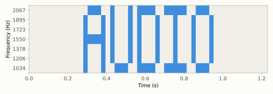

# M08 音频隐写
## Audio Steganography

> [!info]- 章节信息
> **所属方向**：MISC ｜ **难度阶段**：L2 核心期 ｜ **前置要求**：[[12-隐写与流量取证|12 章]] · [[M01-MISC导论与工具箱|M01]] · [[M05-图片隐写I-LSB与位平面|M05]] · [[M06-图片隐写II-DCT与盲水印|M06]]
> **本章目标**：把隐写的载体从像素换到采样——手撕 WAV 容器结构并算清选址空间；把 [[M05-图片隐写I-LSB与位平面|M05]] 的 LSB 与 [[M06-图片隐写II-DCT与盲水印|M06]] 的频域思想平移到音频；解出 Morse、DTMF、SSTV 三类信号语义题；跑通 steghide 与 stegseek 对 WAV 的口令隐写，认识 DeepSound 与 MP3Stego；最后算清无损与有损转换对采样级隐写的存亡账。

## 1. 定位：从像素到采样

图片系列拆完像素层（[[M05-图片隐写I-LSB与位平面|M05]] 位平面、[[M06-图片隐写II-DCT与盲水印|M06]] 变换域），文档系列拆完内容层（[[M07-文档与Office隐写|M07]]），本章把载体换成波形。[[12-隐写与流量取证#6. 音频隐写|12 章 6 节]]用一张三行的表给音频隐写画过速查图：steghide 对 WAV 的口令隐写、Audacity 里看频谱图、MP3Stego——本章把这三条路逐条展开，并补上速查表装不下的 Morse、DTMF、SSTV。

音频与图片的结构是平行的。把概念一一对照，[[M05-图片隐写I-LSB与位平面|M05]]、[[M06-图片隐写II-DCT与盲水印|M06]]的手法就能直接搬家：

| 图片 | 音频 | 对应关系 |
| ---- | ---- | ---- |
| BMP / PNG（无损容器） | WAV（无损 PCM） | 采样值裸排，手撕友好 |
| 像素 | 采样点 | LSB 的选址单位 |
| 位平面（8 个） | 采样值的 16 个位 | 位深翻倍，低位更多 |
| JPEG（有损压缩） | MP3（有损压缩） | 采样级隐写的清除器 |
| DCT 系数域 | 时频域（频谱图） | 信息从"数值"挪进"频率成分" |

按"信息藏在哪"，音频隐写分两大类。**改采样值**：信息写在采样数据的低位里，音频本身听起来可以是一段正常的乐音，LSB、steghide、DeepSound 都属这类；**用音频表达信息**：音频本身就是编码后的内容，Morse 是时序编码、DTMF 是双频编码、SSTV 是逐行调频传图、频谱图是把文字画在时频平面上——人耳听到的是一段怪声，解码靠分析。本章先拆容器与采样值类（2、3、8 节），再逐个解信号语义类（4、5、6、7 节）。

工具全部就位：scipy 的 WAV 读写与 FFT 在 [[M01-MISC导论与工具箱#3.3 scipy：WAV 与频谱|M01 3.3]]铺过底子，sox 与 ffmpeg 来自 [[M01-MISC导论与工具箱|M01]]的装机清单，struct 的完整用法见 [[M01-MISC导论与工具箱#4.1 struct 的完整用法|M01 4.1]]。

## 2. WAV 容器：RIFF 三件套

### 2.1 手写一个最小 WAV

WAV 的魔数 `RIFF....WAVE` 在 [[12-隐写与流量取证#2. 文件格式与魔数|12 章 2 节]]的表里。结构上它与 [[M02-文件格式深拆I-PNG全解|M02]]的 PNG 同族：**RIFF 头 + 一串块（chunk）**。两点差别要记住：RIFF 家族的字段全是小端（PNG 的长度字段是大端），块没有 CRC，改坏了不会立刻报错。

必备的三个块：

| 块 | 内容 |
| ---- | ---- |
| RIFF 头 | `RIFF` + 4 字节大小（文件总长 − 8）+ `WAVE` |
| fmt 块 | `fmt ` + 大小 16 + 六个格式字段 |
| data 块 | `data` + 大小 + PCM 采样值本体 |

fmt 块 16 字节数据区里的六个字段：

| 字段 | 本例取值 | 含义 |
| ---- | ---- | ---- |
| PCM 类型 | 1 | 1 = 无压缩 PCM |
| 声道数 | 1 | mono；stereo 为 2 |
| 采样率 | 8000 | 每秒多少个采样点（Hz） |
| 字节率 | 16000 | 采样率 × 块对齐，播放器按它换算进度 |
| 块对齐 | 2 | 一个采样帧的字节数 = 声道数 × 位深 ÷ 8 |
| 位深 | 16 | 每个采样值的位数 |

用 struct 现场拼一个 0.5 秒 440 Hz 的 WAV，再用 chunk 走查解析器拆回去——解析套路与 [[M02-文件格式深拆I-PNG全解|M02]]数 PNG chunk 同源：从偏移 12 起，按"4 字节类型 + 4 字节小端大小"逐块走，走完 data 为止：

```python
# wav_tool.py -- WAV 容器结构：struct 手写 + chunk 走查解析
import struct
import subprocess

import numpy as np

# ---------- 第 1 部分：用 struct 拼一个最小 WAV（16bit 单声道 8000Hz，0.5 秒 440Hz） ----------
fs, bits, ch = 8000, 16, 1
samples = (20000 * np.sin(2 * np.pi * 440 * np.arange(fs // 2) / fs)).astype(np.int16)
data = samples.tobytes()

block_align = ch * bits // 8            # 一个采样帧（全部声道）的字节数
byte_rate = fs * block_align            # 每秒的字节数
fmt_body = struct.pack("<HHIIHH", 1, ch, fs, byte_rate, block_align, bits)
#                                  PCM   声道  采样率  字节率  块对齐  位深

wav = (b"RIFF" + struct.pack("<I", 4 + 24 + 8 + len(data)) + b"WAVE"
       + b"fmt " + struct.pack("<I", 16) + fmt_body
       + b"data" + struct.pack("<I", len(data)) + data)
open("tone.wav", "wb").write(wav)
print(f"[1] tone.wav 总 {len(wav)} 字节 = 头 12 + fmt 块 24 + data 块 {8 + len(data)}")
print(f"    RIFF 大小字段 = 总长 - 8 = {len(wav) - 8}")

# ---------- 第 2 部分：chunk 走查解析器（M02 的 PNG chunk 解析同源） ----------
def parse_wav(path):
    blob = open(path, "rb").read()
    riff_size, form = struct.unpack("<I4s", blob[4:12])
    print(f"[2] {path}: RIFF 大小字段 {riff_size}，文件实际 {len(blob)} 字节，Form 类型 {form.decode()}")
    pos = 12
    while pos + 8 <= len(blob):
        cid, csz = struct.unpack("<4sI", blob[pos:pos + 8])
        print(f"    chunk {cid.decode():<5} off={pos:<4} size={csz}")
        if cid == b"fmt ":
            af, c, f, br, ba, b = struct.unpack("<HHIIHH", blob[pos + 8:pos + 24])
            print(f"      PCM={af} 声道={c} 采样率={f} 字节率={br} 块对齐={ba} 位深={b}")
        pos += 8 + csz + (csz & 1)            # 奇数长度的块补 1 字节对齐

parse_wav("tone.wav")

# ---------- 第 3 部分：ffmpeg 转存产物里多出来的 LIST 块 ----------
subprocess.run(["ffmpeg", "-y", "-loglevel", "error", "-i", "tone.wav",
                "-c:a", "pcm_s16le", "tone_ff.wav"], check=True)
parse_wav("tone_ff.wav")
blob = open("tone_ff.wav", "rb").read()
i = blob.find(b"LIST")
csz = struct.unpack("<I", blob[i + 4:i + 8])[0]
print(f"    LIST 块内容: {blob[i + 8:i + 8 + csz]!r}")
```

```bash
python3 wav_tool.py
```

输出：

```
[1] tone.wav 总 8044 字节 = 头 12 + fmt 块 24 + data 块 8008
    RIFF 大小字段 = 总长 - 8 = 8036
[2] tone.wav: RIFF 大小字段 8036，文件实际 8044 字节，Form 类型 WAVE
    chunk fmt   off=12   size=16
      PCM=1 声道=1 采样率=8000 字节率=16000 块对齐=2 位深=16
    chunk data  off=36   size=8000
[2] tone_ff.wav: RIFF 大小字段 8070，文件实际 8078 字节，Form 类型 WAVE
    chunk fmt   off=12   size=16
      PCM=1 声道=1 采样率=8000 字节率=16000 块对齐=2 位深=16
    chunk LIST  off=36   size=26
    chunk data  off=70   size=8000
    LIST 块内容: b'INFOISFT\r\x00\x00\x00Lavf62.3.100\x00\x00'
```

fmt 里两个派生字段值得单独看：字节率 16000 = 8000 × 2，块对齐 2 = 1 × 16 ÷ 8；data 的 8000 字节除以字节率正好 0.5 秒。==采样率、位深、声道数三个字段决定了 data 区每个字节怎么摆，头与 data 对不上，播放器就把字节摆错位置==。

第 3 部分的转存产物里，fmt 与 data 之间多出一个 LIST 块。LIST 是 RIFF 的元数据块：`INFO` 子块里 `ISFT` 记录写入软件（ffmpeg 的 Lavf62），注释类信息写在 ICMT 字段。图片的 EXIF（[[12-隐写与流量取证|12 章]] 5.2）、文档的 docProps（[[M07-文档与Office隐写|M07]] 3 节）都是同一件事——容器自带的简历。老题会把 flag 塞进 INFO 的注释字段，2.1 的解析器走一遍 chunk 就能看到。

### 2.2 选址空间：三个旋钮

sox 自带的 soxi 一条命令把格式字段全部读出来：

```bash
soxi tone.wav
```

输出：

```
Input File     : 'tone.wav'
Channels       : 1
Sample Rate    : 8000
Precision      : 16-bit
Duration       : 00:00:00.50 = 4000 samples ~ 37.5 CDDA sectors
File Size      : 8.04k
Bit Rate       : 129k
Sample Encoding: 16-bit Signed Integer PCM
```

对隐写来说，三个格式字段就是选址空间的三个旋钮：

| 旋钮 | 决定什么 | 隐写含义 |
| ---- | ---- | ---- |
| 采样率 | 每秒多少个采样点 | LSB 的"像素总数"，选址数量随它涨 |
| 位深 | 每个采样值多少位 | LSB 只动最低 1 位；位深越高，低位越多 |
| 声道数 | 同一时刻几个采样值 | 左右声道可以各藏一份，或只动其中一个 |

"采样帧"指一个时刻上全部声道的采样值，块对齐就是它的字节数。3.2 的容量公式直接从这三个旋钮算出来。

> [!info]- 位深与读回来的类型
> scipy 的 `wavfile.read` 返回类型跟着位深走：8bit 是 uint8（无符号），16bit 是 int16（有符号），32bit 是 int32。做位运算前先 `print(data.dtype)` 确认，别拿图片章节的 uint8 套路直接套 int16；冷门位深（如 24bit）同样先看 dtype。

## 3. WAV LSB：采样值的最低位

### 3.1 嵌入与提取

[[12-隐写与流量取证|12 章 5.1]]用 BMP 手撕过像素 LSB 的最小闭环，[[M05-图片隐写I-LSB与位平面#3. 提取组合全参数化|M05 3 节]]把提取参数化。平移到音频只换一个对象：像素换成采样点。16bit PCM 的采样值是 −32768~32767 的整数，把消息按位拆开写进每个采样值的最低位，采样值只被挪动 ±1——65536 级满量程里的最小变化：

```python
# lsb_wav.py -- WAV LSB：16bit PCM 采样值最低位的嵌入与提取 + 容量账
import numpy as np
from scipy.io import wavfile

fs = 44100
t = np.linspace(0, 2, fs * 2, endpoint=False)
carrier = (12000 * np.sin(2 * np.pi * 440 * t)          # 三个正弦的混合，
           + 6000 * np.sin(2 * np.pi * 880 * t)          # 当"人声谐波"的替身
           + 3000 * np.sin(2 * np.pi * 1760 * t)).astype(np.int16)
wavfile.write("cover.wav", fs, carrier)

MSG = b"flag{wav_lsb_int16}"
bits = np.unpackbits(np.frombuffer(MSG, dtype=np.uint8))            # MSB-first，M01 3.2 同款
stego = carrier.copy()
seg = stego[:len(bits)]
stego[:len(bits)] = (seg & np.int16(-2)) | bits.astype(np.int16)    # 清最低位，或上数据位
wavfile.write("stego.wav", fs, stego)
diff = np.abs(stego.astype(np.int32) - carrier.astype(np.int32))

print(f"[1] 嵌入 {MSG!r}：{len(MSG)} 字节 = {len(bits)} 位，写进前 {len(bits)} 个采样点的最低位")
print(f"[2] 与载体逐采样最大差值 {int(diff.max())}（满量程 65536 级里挪 1 级）")

_, back = wavfile.read("stego.wav")
got = np.packbits((back[:len(bits)] & 1).astype(np.uint8)).tobytes()
print(f"[3] 提取: {got}  还原一致: {got == MSG}")

print("[4] 容量 = 采样率 x 时长 x 声道数 / 8 字节：")
for f_, sec, c_, name in ((8000, 60, 1, "8kHz mono"), (44100, 60, 1, "44.1kHz mono"),
                          (44100, 60, 2, "44.1kHz stereo")):
    cap = f_ * sec * c_ // 8
    print(f"    {name:<15} 60s -> {cap:>7} 字节" + (f" = {cap / 1024:.0f} KiB" if cap > 500000 else ""))
```

```bash
python3 lsb_wav.py
```

输出：

```
[1] 嵌入 b'flag{wav_lsb_int16}'：19 字节 = 152 位，写进前 152 个采样点的最低位
[2] 与载体逐采样最大差值 1（满量程 65536 级里挪 1 级）
[3] 提取: b'flag{wav_lsb_int16}'  还原一致: True
[4] 容量 = 采样率 x 时长 x 声道数 / 8 字节：
    8kHz mono       60s ->   60000 字节
    44.1kHz mono    60s ->  330750 字节
    44.1kHz stereo  60s ->  661500 字节 = 646 KiB
```

三处细节：

1. 位流方向沿用 [[M01-MISC导论与工具箱#3.2 numpy：图像变数组|M01 3.2]]的 `np.unpackbits`，MSB-first，与图片 LSB 题的默认一致；[[M05-图片隐写I-LSB与位平面#3. 提取组合全参数化|M05 3 节]]的四个自由度（通道、平面号、位序、像素序）在这里对应"声道、位、位序、时间顺序"。
2. `& np.int16(-2)` 是"清最低位"：−2 的补码是 `...11111110`，按位与之后只抹掉最低一位，对负的采样值同样成立。
3. 差值统计先 `astype(np.int32)` 再相减：int16 直接相减会溢出回绕（[[M01-MISC导论与工具箱#3.2 numpy：图像变数组|M01 3.2]]提过的坑）。

> [!warning] zsteg 不认音频
> zsteg 0.2.14 只扫 PNG 和 BMP 的位平面（[[M05-图片隐写I-LSB与位平面|M05]] 4 节），喂 WAV 直接不支持。音频也没有现成的一键扫描器，提取就是 3.1 这十几行脚本。好消息是音频 LSB 的自由度远比图片少：位深只有一种读法、没有调色板、通常就一两个声道，手写成本很低。

### 3.2 容量账

每个采样点贡献 1 位，WAV LSB 的容量是：

$$\text{容量（字节）} = \frac{f_s \times T \times C}{8} \tag{8.1}$$

$f_s$ 是采样率，T 是时长（秒），C 是参与隐写的声道数。代进 [4] 的三行：8 kHz 电话音质的 1 分钟藏 58.6 KiB，44.1 kHz 立体声的 1 分钟藏 646 KiB——比 [[M05-图片隐写I-LSB与位平面#7. 容量与适用边界|M05 7 节]]算过的一张 1080p 图片（759 KiB）同一量级。==容量从来不是音频 LSB 的瓶颈，瓶颈是附件有没有被转码==。

### 3.3 无损与有损转码：一组对照

LSB 藏在采样值里，转码是否保命取决于编码器是否无损。两个极端各走一遍：FLAC（无损压缩，解码还原原采样值）与 mp3 128k（有损压缩，解码重建采样值）：

```python
# transcode_test.py -- 无损与有损转码后，各自提取 LSB：一组对照实验
import subprocess

import numpy as np
from scipy.io import wavfile

MSG = b"flag{wav_lsb_int16}"
bits = np.unpackbits(np.frombuffer(MSG, dtype=np.uint8))

def extract(path):
    _, x = wavfile.read(path)
    return np.packbits((x[:len(bits)] & 1).astype(np.uint8)).tobytes()

# FLAC：无损压缩，采样值原样还原
subprocess.run(["sox", "stego.wav", "stego.flac"], check=True)
subprocess.run(["sox", "stego.flac", "stego_flacback.wav"], check=True)
# MP3：有损压缩，采样值重建
subprocess.run(["ffmpeg", "-y", "-loglevel", "error", "-i", "stego.wav", "-b:a", "128k",
                "stego.mp3"], check=True)
subprocess.run(["ffmpeg", "-y", "-loglevel", "error", "-i", "stego.mp3",
                "stego_mp3back.wav"], check=True)

got_flac = extract("stego_flacback.wav")
got_mp3 = extract("stego_mp3back.wav")
print(f"[1] FLAC 无损往返:  {got_flac}  一致: {got_flac == MSG}")
print(f"[2] mp3 有损往返:   {got_mp3!r}")
print(f"    一致: {got_mp3 == MSG}")
```

```bash
python3 transcode_test.py
```

输出：

```
[1] FLAC 无损往返:  b'flag{wav_lsb_int16}'  一致: True
[2] mp3 有损往返:   b'\xec\nI\xa2\xbe\x8a1o\x00A\xc9}\xcdAB>>&\x0f'
    一致: False
```

FLAC 往返后逐位一致，mp3 往返后是乱码。原因与 [[M05-图片隐写I-LSB与位平面#7. 容量与适用边界|M05 7 节]]的 JPEG 行、[[M09-视频隐写#4. 逐帧隐写与压缩的有损账|M09 4 节]]的 H.264 是同一笔账：==有损编码器重建信号时，写入最低位的信息必然被抹掉==。落到做题上：

- 附件是 WAV / FLAC / AIFF 这类无损容器 → 跑 3.1 的提取；
- 附件是 MP3 / M4A / OGG → 采样级隐写已经死了，不要浪费时间，往频谱图（4 节）、元数据（8.3 节）和 MP3Stego（8.3 节）想。

## 4. 频谱图隐写：把文字画进时频平面

### 4.1 原理与造靶

[[12-隐写与流量取证#6. 音频隐写|12 章 6 节]]说的"打开频谱图就能看见 flag"是这件事：一段听着像噪音的音频，切到频谱图视图，字直接画在上面。原理是短时傅里叶——把信号按帧切开，每帧做一次 FFT 得到各频率的幅度，帧按时间排开就是"横轴时间、纵轴频率"的图。画字是它的逆过程：字模的第 r 行对应一个频率 $f_r$，某一列字模上有墨，就让这一帧在对应的 $f_r$ 上有能量。一列信号写成：

$$x_c[n] = \sum_{r:\ \text{grid}[r,c]\,=\,1} A \cdot \sin\!\left(2\pi f_r \cdot \frac{n}{f_s}\right) \tag{8.2}$$

合成有一个关键技巧：行频率全部取 $f_s/N$ 的整数倍（N 是帧长），每个正弦在帧内凑满整数个周期，FFT 能量精确落在单个 bin 上，行与行、帧与帧互不泄漏，解码时阈值怎么定都不会糊。下面的造靶取 $f_s = 22050$、N = 512（bin 间隔 43.1 Hz），行间隔 4 个 bin（约 172 Hz），7 行落在 1034~2067 Hz：

```python
# spec_wav.py -- 频谱图隐写：把文字合成进频谱，再用分帧 FFT 还原
import subprocess

import numpy as np
from scipy.io import wavfile

# ---------- 5x7 点阵字模：每个字母 7 行，每行 5 位，1 = 有墨 ----------
FONT = {
    "A": [0b01110, 0b10001, 0b10001, 0b11111, 0b10001, 0b10001, 0b10001],
    "U": [0b10001, 0b10001, 0b10001, 0b10001, 0b10001, 0b10001, 0b01110],
    "D": [0b11110, 0b10001, 0b10001, 0b10001, 0b10001, 0b10001, 0b11110],
    "I": [0b11111, 0b00100, 0b00100, 0b00100, 0b00100, 0b00100, 0b11111],
    "O": [0b01110, 0b10001, 0b10001, 0b10001, 0b10001, 0b10001, 0b01110],
}
TEXT = "AUDIO"
ROWS = 7

# ---------- 第 1 部分：参数与字模图（全部频率按 FFT bin 对齐） ----------
fs = 22050
N = 512                                   # 每列一帧 512 采样
K0, KSTEP = 24, 4                         # 行 r 的频率 = (24 + 4r) * fs / N
ks = K0 + KSTEP * np.arange(ROWS)
freqs = ks * fs / N

grid = []                                 # (ROWS, T) 的 0/1 图，行 0 = 字母顶部
for col in range(len(TEXT) * 6 - 1):      # 每个字母占 5 列 + 1 列间隔
    ch, c = TEXT[col // 6], col % 6
    grid.append([0 if c == 5 else FONT[ch][r] >> (4 - c) & 1 for r in range(ROWS)])
grid = np.array(grid).T                   # (ROWS, T)，行 0 = 字母顶部
freqmap = grid[::-1]                      # 频率序：行 0 = 最低频（频谱图的底部）
T = grid.shape[1]
print(f"[1] 字模图 {ROWS}x{T}，行频率 {[round(f) for f in freqs]} Hz，每列 {N/fs*1000:.1f} ms")

# ---------- 第 2 部分：逐列合成正弦和 ----------
pad = int(0.3 * fs // N)                  # 前后各垫 0.3 秒静音
cols = []
for c in range(T):
    seg = np.zeros(N)
    for r in np.where(freqmap[:, c] == 1)[0]:
        seg += 4000 * np.sin(2 * np.pi * freqs[r] * np.arange(N) / fs)
    cols.append(seg)
sig = np.concatenate([np.zeros(pad * N)] + cols + [np.zeros(pad * N)])
wavfile.write("spec_target.wav", fs, np.clip(sig, -32768, 32767).astype(np.int16))
print(f"[2] spec_target.wav：{len(sig) / fs:.2f} 秒，{len(sig)} 个采样")

# ---------- 第 3 部分：解靶 -- 分帧 FFT 读幅度，重建位图 ----------
def decode(path, tag):
    _, x = wavfile.read(path)
    x = x.astype(np.float64)
    nframe = len(x) // N
    spec = np.abs(np.fft.rfft(x[:nframe * N].reshape(nframe, N), axis=1))
    band = spec[:, ks]                                 # 只看 7 个行频率
    fmax = band.max(axis=1, keepdims=True)
    hit = (band > 0.5 * fmax).T                        # 逐帧相对阈值：过半即有墨
    hit[:, fmax[:, 0] < band.max() * 0.05] = False     # 静音帧整体清零
    idx = np.where(hit.any(axis=0))[0]
    art = hit[:, idx[0]:idx[0] + T][::-1]              # 翻回"行 0 = 字母顶部"
    for r in range(ROWS):
        print("    " + "".join("#" if v else "." for v in art[r]))
    return art.shape == grid.shape and (art == grid).all()

ok = decode("spec_target.wav", "spec_target.wav")
print(f"[3] 重建 {grid.shape}，与字模逐位一致: {ok}")

# ---------- 第 4 部分：mp3 有损往返对照 ----------
subprocess.run(["ffmpeg", "-y", "-loglevel", "error", "-i", "spec_target.wav",
                "-b:a", "128k", "spec_target.mp3"], check=True)
subprocess.run(["ffmpeg", "-y", "-loglevel", "error", "-i", "spec_target.mp3",
                "spec_back.wav"], check=True)
ok2 = decode("spec_back.wav", "mp3 往返后")
print(f"[4] mp3 128k 往返后仍逐位一致: {ok2}")
```

```bash
python3 spec_wav.py
```

输出：

```
[1] 字模图 7x29，行频率 [1034, 1206, 1378, 1550, 1723, 1895, 2067] Hz，每列 23.2 ms
[2] spec_target.wav：1.23 秒，27136 个采样
    .###..#...#.####..#####..###.
    #...#.#...#.#...#...#...#...#
    #...#.#...#.#...#...#...#...#
    #####.#...#.#...#...#...#...#
    #...#.#...#.#...#...#...#...#
    #...#.#...#.#...#...#...#...#
    #...#..###..####..#####..###.
[3] 重建 (7, 29)，与字模逐位一致: True
    .###..#...#.####..#####..###.
    #...#.#...#.#...#...#...#...#
    #...#.#...#.#...#...#...#...#
    #####.#...#.#...#...#...#...#
    #...#.#...#.#...#...#...#...#
    #...#.#...#.#...#...#...#...#
    #...#..###..####..#####..###.
[4] mp3 128k 往返后仍逐位一致: True
```

### 4.2 解靶与读图

解靶四步：分帧 `reshape` → 每帧一次 `rfft` → 只看 7 个行频率的幅度 → 逐帧定阈值重建位图。阈值是**相对**的：幅度超过本帧最大值的一半记为有墨，静音帧（连同 mp3 混进去的底噪）整体清零——绝对阈值会在 mp3 往返后失效，相对阈值不会。重建的 7×29 位图与字模逐位一致，ASCII 画里 AUDIO 四行三列的字形清晰可读；[4] 的第二张画与第一张完全相同。

把解码所用的幅度谱条带画出来，就是 Audacity 频谱图视图里的画面：



> [!note] Audacity：看频谱的图形界面
> Audacity 把这套流程做成了视图：拖入音频，点音轨左上菜单选频谱图（Spectrogram），字直接画在窗口里，[[12-隐写与流量取证#6. 音频隐写|12 章 6 节]]的速查说的就是它。肉眼看图用 Audacity，批量验证与自动还原用本节的 scipy 脚本——"要看、要听的动作放图形界面，要跑很多遍的动作放命令行"是 [[M01-MISC导论与工具箱|M01]] 2.1 定下的分工。

### 4.3 抗有损转码

[4] 那一行是本节的结论：mp3 128k 往返后位图仍逐位一致。对照 3.3 里 LSB 的全灭：==频谱隐写把信息放在强能量的频率成分上，有损编码器为了保住听感会原样保留这些主频，字活得下来；采样 LSB 放在数值精度的最底层，一压就没==。这也是频谱图题比音频 LSB 题常见的原因之一。

sox 与 ffmpeg 的转换在前几节已经各就各位：sox 管无损格式之间的转换（3.3 的 FLAC 往返），ffmpeg 管转有损格式（mp3 往返）。转换之前先想清楚要保留哪一层，判据就是 3.3 那组对照。

## 5. Morse 电码：时序编码

### 5.1 规则与造靶

Morse 把字符编成点（·）与划（—）的序列，音频上用发音与静音的**时长**表达。时序规则一张表：

| 单元 | 时长（单位 U 的倍数） |
| ---- | ---- |
| 点 | 1 |
| 划 | 3 |
| 符号内静音 | 1 |
| 字母间静音 | 3 |
| 单词间静音 | 7 |

音调频率与单位时长都是自由参数，常用 600 Hz 与 40~80 ms。造一个 "SOS FLAG" 的靶（码表只列用到的六个字母，完整码表现查）：

```python
# morse_wav.py -- Morse 电码音频：正弦 + 静音造靶，包络 + 阈值解码
import numpy as np
from scipy.io import wavfile

MORSE = {"S": "...", "O": "---", "F": "..-.", "L": ".-..", "A": ".-", "G": "--."}
INV = {v: k for k, v in MORSE.items()}
MSG = "SOS FLAG"

# ---------- 第 1 部分：造靶 ----------
fs, U = 8000, 0.06                       # 单位时长 60 ms
def tone(sec):
    return np.sin(2 * np.pi * 600 * np.arange(int(sec * fs)) / fs)   # 600 Hz 音调
def silence(sec):
    return np.zeros(int(sec * fs))

sig = []
words = MSG.split(" ")
for i, word in enumerate(words):
    for j, letter in enumerate(word):
        for sym in MORSE[letter]:
            sig.append(tone(U if sym == "." else 3 * U))
            sig.append(silence(U))                # 符号间隔，后面按需加长
        if j < len(word) - 1:
            sig[-1] = silence(3 * U)              # 字母间隔
    if i < len(words) - 1:
        sig[-1] = silence(7 * U)                  # 单词间隔
audio = (np.concatenate(sig) * 18000).astype(np.int16)
wavfile.write("morse.wav", fs, audio)
print(f"[1] morse.wav：报文 {MSG!r}，时长 {len(audio) / fs:.2f} 秒")

# ---------- 第 2 部分：包络提取 ----------
_, x = wavfile.read("morse.wav")
env = np.convolve(np.abs(x.astype(np.float64)), np.ones(80) / 80, mode="same")
on = env > env.max() * 0.4               # 幅度阈值：包络峰的 40%

# ---------- 第 3 部分：切 run，按时长分类 ----------
runs = []                                # (是否发音, 采样数)
cur, cnt = on[0], 1
for v in on[1:]:
    if v == cur:
        cnt += 1
    else:
        runs.append((cur, cnt)); cur, cnt = v, 1
runs.append((cur, cnt))
unit = min(c for v, c in runs if v) / fs          # 最短发音 = 1 单位（点）
print(f"[2] 发音段 {sum(1 for v, _ in runs if v)} 个，最短 {unit * 1000:.0f} ms -> 单位时长")

text, cur = "", ""
for voiced, n in runs:
    L = n / fs
    if voiced:
        cur += "." if L < 2 * unit else "-"       # 发音：短点长划
    elif L >= 2 * unit:                           # 静音：短=符号内，中=字母间，长=单词间
        text += INV.get(cur, "?") + (" " if L >= 6 * unit else "")
        cur = ""
if cur:
    text += INV.get(cur, "?")
print(f"[3] 解码结果: {text!r}  与原文一致: {text == MSG}")
```

```bash
python3 morse_wav.py
```

输出：

```
[1] morse.wav：报文 'SOS FLAG'，时长 4.56 秒
[2] 发音段 22 个，最短 61 ms -> 单位时长
[3] 解码结果: 'SOS FLAG'  与原文一致: True
```

### 5.2 包络解码

解码三步。**包络**：对 |x| 做滑动平均——正弦的绝对值是两倍频的波峰，10 ms 量级的平均窗口把它压平，得到"发音高、静音低"的包络线。**阈值**：取包络峰的 40%，切出 True/False 交替的段（run），每段记长度。**分类**：最短的发音段就是 1 个单位（点），其余按倍数归类——发音不足 2U 是点、超过是划；静音不足 2U 是符号内间隔、2U~6U 是字母间隔、6U 以上是单词间隔。

输出里的两个数字都有出处：22 个发音段 = S、O、S 各 3 个符号 + F、L、A、G 的 4+4+2+3 个符号；最短段 61 ms 而不是 60 ms，是滑动平均把段的边缘圆了一下。单位从"最短发音段"估出来，==解码全程不依赖出题人告诉你单位时长==。

> [!note] 阈值与单位都自适应
> 出题人会改频率、改速度、加底噪，但时序结构不变：脚本里的 unit 那一行就是自适应估计单位时长。卡住时把全部 run 长度打印出来看分布——点、划与三档静音会各自聚成一簇，簇的边界就是分类阈值；底噪大就把包络的滑动窗口加宽再切。

## 6. DTMF：双音多频与 Goertzel 检测

### 6.1 频率表与造靶

DTMF（Dual-Tone Multi-Frequency，双音多频）是电话拨号音：每个按键同时发一个行频与一个列频，4×4 共 16 键：

| Hz | 1209 | 1336 | 1477 | 1633 |
| ---- | ---- | ---- | ---- | ---- |
| **697** | 1 | 2 | 3 | A |
| **770** | 4 | 5 | 6 | B |
| **852** | 7 | 8 | 9 | C |
| **941** | * | 0 | # | D |

每键的音频就是两个正弦的和。造一段按键序列：

```python
# dtmf_wav.py -- DTMF 双音多频：Goertzel 检测 8 个频率，解出按键序列
import numpy as np
from scipy.io import wavfile

ROWS = [697, 770, 852, 941]              # 行频（低频组）
COLS = [1209, 1336, 1477, 1633]          # 列频（高频组）
KEYS = [["1", "2", "3", "A"],
        ["4", "5", "6", "B"],
        ["7", "8", "9", "C"],
        ["*", "0", "#", "D"]]
SEQ = "20261024"

# ---------- 第 1 部分：造靶 -- 每键一个双音 ----------
fs = 8000
seg_on, seg_off = int(0.12 * fs), int(0.08 * fs)     # 发音 120 ms + 静音 80 ms
sig = []
for k in SEQ:
    r, c = [(i, j) for i in range(4) for j in range(4) if KEYS[i][j] == k][0]
    t = np.arange(seg_on) / fs
    tone = (np.sin(2 * np.pi * ROWS[r] * t) + np.sin(2 * np.pi * COLS[c] * t)) / 2
    sig += [tone * 20000, np.zeros(seg_off)]
audio = np.concatenate(sig).astype(np.int16)
wavfile.write("dtmf.wav", fs, audio)
print(f"[1] dtmf.wav：按键序列 {SEQ}（{len(SEQ)} 键），时长 {len(audio) / fs:.2f} 秒")

# ---------- 第 2 部分：Goertzel 单频能量（式 8.3） ----------
def goertzel(seg, f, fs):
    w = 2 * np.pi * f / fs
    coeff = 2 * np.cos(w)
    s1 = s2 = 0.0
    for x in seg:                        # 递推：s0 = x + coeff*s1 - s2
        s0 = x + coeff * s1 - s2
        s2, s1 = s1, s0
    return s1 * s1 + s2 * s2 - coeff * s1 * s2

# ---------- 第 3 部分：按段检测 ----------
_, x = wavfile.read("dtmf.wav")
x = x.astype(np.float64)
seglen = seg_on + seg_off
decoded, table_row = "", None
for s in range(len(x) // seglen):
    seg = x[s * seglen: s * seglen + seg_on]          # 只取发音段
    if np.abs(seg).max() < 100:                       # 静音段跳过
        continue
    rp = [goertzel(seg, f, fs) for f in ROWS]
    cp = [goertzel(seg, f, fs) for f in COLS]
    r, c = int(np.argmax(rp)), int(np.argmax(cp))
    decoded += KEYS[r][c]
    if table_row is None:
        table_row = (rp, cp, r, c)                    # 留第一段做能量表展示
rp, cp, r, c = table_row
print(f"[2] Goertzel 解码: {decoded}  与原文一致: {decoded == SEQ}")
print(f"[3] 第 1 段（键 {decoded[0]}）的能量分布:")
for f, p in zip(ROWS, rp):
    print(f"    行频 {f:>4} Hz: {p:.3e}" + ("  <-命中" if f == ROWS[r] else ""))
for f, p in zip(COLS, cp):
    print(f"    列频 {f:>4} Hz: {p:.3e}" + ("  <-命中" if f == COLS[c] else ""))
```

```bash
python3 dtmf_wav.py
```

输出：

```
[1] dtmf.wav：按键序列 20261024（8 键），时长 1.60 秒
[2] Goertzel 解码: 20261024  与原文一致: True
[3] 第 1 段（键 2）的能量分布:
    行频  697 Hz: 2.293e+13  <-命中
    行频  770 Hz: 1.428e+10
    行频  852 Hz: 4.790e+09
    行频  941 Hz: 1.224e+09
    列频 1209 Hz: 3.949e+09
    列频 1336 Hz: 2.296e+13  <-命中
    列频 1477 Hz: 9.158e+08
    列频 1633 Hz: 1.713e+09
```

### 6.2 Goertzel 逐频点检测

检测"一段信号里有没有某个频率"不必做整条 FFT。Goertzel 算法用一组递推直接算指定频点的能量：

$$P = s_1^2 + s_2^2 - 2\cos(\omega)\, s_1 s_2, \qquad \omega = \frac{2\pi f}{f_s} \tag{8.3}$$

$s_1$、$s_2$ 是递推 $s_0 = x + 2\cos(\omega)\, s_1 - s_2$ 走完全段后的最后两项。每段采样对 8 个频点各递推一遍，行频取最大、列频取最大，查 6.1 的表得到按键。能量表里两个命中频点比其余频点高出三个数量级，argmax 没有悬念。

==DTMF 题的解码自由度只有"分段"一个==：段对齐了，频点检测几乎不出错；段没对齐（发音跨段、静音混进发音段）才会解出怪键。检测前的能量分段（幅度低于阈值的区段当静音跳过）就是干这个的。

> [!info]- 为什么不用整条 FFT
> 960 个采样做一次 FFT 能得到全部频点，Goertzel 只递推 8 个指定频点，每频点一趟循环、不需要整块频谱数组。检测频率已知且数量少（DTMF 正好 8 个）时，Goertzel 是逐频点检测的标配；要"看"整段频谱找未知频率时，才轮到 4 节的 FFT。

## 7. SSTV：把图片调成音频

SSTV（Slow-Scan Television，慢扫描电视）是业余无线电的传图协议：图片逐行扫描，每个像素的亮度与色度调制成音频频率，一行像素串成一段音，模式规定分辨率与总时长。CTF 里最常见的是 Robot 36 模式：320×240，每张固定 36 秒。

### 7.1 生成端：pysstv

pysstv 把 PIL 图片编码成 SSTV 音频（`pip install pysstv`，项目主页 github.com/dnet/pySSTV）。先画一张 320×240 的卡片——复用 4 节的 5×7 字模，放大 12 倍铺在画布中央：

```python
# sstv_card.py -- SSTV 第 1 步：画一张 320x240 的卡片（Robot 36 原生分辨率）
from PIL import Image

FONT = {
    "F": [0b11111, 0b10000, 0b11110, 0b10000, 0b10000, 0b10000, 0b10000],
    "L": [0b10000, 0b10000, 0b10000, 0b10000, 0b10000, 0b10000, 0b11111],
    "A": [0b01110, 0b10001, 0b10001, 0b11111, 0b10001, 0b10001, 0b10001],
    "G": [0b01110, 0b10000, 0b10000, 0b10011, 0b10001, 0b10001, 0b01110],
}
SCALE = 12

img = Image.new("RGB", (320, 240), (235, 235, 230))
px = img.load()
x0, y0 = 22, 78
for ci, ch in enumerate("FLAG"):
    for r in range(7):
        for c in range(5):
            if FONT[ch][r] >> (4 - c) & 1:
                for dy in range(SCALE):
                    for dx in range(SCALE):
                        px[x0 + (ci * 6 + c) * SCALE + dx, y0 + r * SCALE + dy] = (40, 50, 60)
img.save("sstv_card.png")
print(f"sstv_card.png: {img.size}")
```

```bash
python3 sstv_card.py
```

输出：

```
sstv_card.png: (320, 240)
```

再走 pysstv 的命令行入口编码成音频：

```bash
python3 -m pysstv --mode Robot36 --rate 44100 --bits 16 sstv_card.png sstv.wav
ls -l sstv.wav
```

输出：

```
-rwxrwxrwx 1 hua hua 3255506 Oct 24 22:10 sstv.wav
```

`--mode` 可选 MartinM1、ScottieS1、Robot36 等（`--help` 有全表），`--rate` 与 `--bits` 指定输出采样率与位深。36 秒、3.2 MB——SSTV 的传输率就是这么低，36 秒传一张 320×240，音频本身就是图片。

### 7.2 解码端：sstv 包

> [!warning] sstv 包没有命令行入口
> pip 装的 sstv 0.2.0 是纯 API 库（Rust 实现），`python3 -m sstv` 直接报错：
>
> ```
> /usr/bin/python3: No module named sstv.__main__; 'sstv' is a package and cannot be directly executed
> ```
>
> 网上教程里的 `sstv -d audio.wav` 命令在这个包上不存在，解码走 `sstv.decode_from_wav()`。

`decode_from_wav` 返回解码出的 PIL 图片序列：采样率从 WAV 头读取，多声道只取第一声道。每张图的 info 字典带两个元数据——`sstv_mode`（自动识别出的模式，识别依据是传输开头的 VIS 头）与 `sstv_complete`（信号是否完整）：

```python
# sstv_decode.py -- SSTV 第 3 步：sstv 包 API 解码（无命令行入口）
import numpy as np
import sstv
from PIL import Image

imgs = list(sstv.decode_from_wav("sstv.wav"))
im = imgs[0]
print(f"解码出 {len(imgs)} 张图：尺寸 {im.size}，模式 {im.info.get('sstv_mode')}，"
      f"信号完整: {im.info.get('sstv_complete')}")
im.save("sstv_decoded.png")

# 数值验收：与卡片各自二值化算相关系数
d = np.array(im.convert("L"))
card = np.array(Image.open("sstv_card.png").convert("L"))
print(f"与原卡片二值图的相关系数: {np.corrcoef((d < 128).ravel(), (card < 128).ravel())[0, 1]:.3f}")
```

```bash
python3 sstv_decode.py
```

输出：

```
解码出 1 张图：尺寸 (320, 240)，模式 Mode.ROBOT_36，信号完整: True
与原卡片二值图的相关系数: 0.971
```

320×240 与卡片一致，模式自动识别为 ROBOT_36，信号完整；二值化后与原卡片的相关系数 0.971——解码图就是那张 FLAG 卡片。不是 1.0 是因为 SSTV 解码自带轻微的行对位偏差与边缘噪声，逐像素不会全等，==图片可读即为解出==。

> [!note] 解码输入的要求
> 解码端直接信 WAV 头里的采样率，多声道只取第一声道。录音被截断时 sstv_complete 会是 False、图片底部是残行。真题的 SSTV 音频一般直接给 WAV；从收音机、对讲机翻录的音频带底噪与频偏，解码质量看录制条件。

## 8. 口令隐写与专用工具

### 8.1 steghide 对 WAV

[[12-隐写与流量取证#5.3 steghide：口令隐写|12 章 5.3]]给过三条命令，[[M06-图片隐写II-DCT与盲水印#2.1 参数全家福|M06 2.1]]补全了参数表——对 WAV 用同一套命令，换一下载体扩展名：

```bash
echo "flag{steghide_wav}" > flag.txt
steghide embed -cf cover.wav -ef flag.txt -sf stego_hide.wav -p ctf2026
steghide info stego_hide.wav -p ctf2026
steghide extract -sf stego_hide.wav -xf back.txt -p ctf2026
cat back.txt
```

输出：

```
embedding "flag.txt" in "cover.wav"... done
writing stego file "stego_hide.wav"... done
"stego_hide.wav":
  format: wave audio, PCM encoding
  capacity: 5.4 KB
  embedded file "flag.txt":
    size: 19.0 Byte
    encrypted: rijndael-128, cbc
    compressed: yes
wrote extracted data to "back.txt".
flag{steghide_wav}
```

info 的 format 行变成 `wave audio, PCM encoding`，capacity 按载体的采样位算（44.1 kHz 单声道 2 秒的载体报 5.4 KB）。口令爆破照搬 [[M06-图片隐写II-DCT与盲水印#3. stegseek：口令爆破全流程|M06 3 节]]的 stegseek 流程，对 WAV 同样适用：`stegseek stego_hide.wav 字典`，命中后自动落盘提取。

### 8.2 DeepSound

DeepSound 是 Windows 图形界面工具（jpinsoft.net 出品）：选一个 WAV，把文件或文本嵌进去，可选口令加密，另存为 WAV。嵌入口令与解开载荷都在 GUI 里点，命令行能做的是**检测与爆破**这条链。

DeepSound 2.0 把载荷写进采样值低位，质量分低/普通/高三档（各自按不同的位深取位），解码出的流以 4 字节 `DSCF` 开头，后跟 1 字节质量（2/4/8 对应低/普通/高）与 1 字节加密标志（0/1），加密时再跟口令的 SHA1。这套头格式写在 john 自带的 deepsound2john.py 里：脚本把 WAV 全文按 DeepSound 的取位方式扫一遍，命中头部就吐出 john 格式的哈希。对一个没有嵌入过的 WAV 跑它，只有一行判定：

```bash
python3 /usr/share/john/deepsound2john.py -v cover.wav
```

干净文件没有 DSCF 头，只有一行判定（脚本还会同时打印一条 Python 的 DeprecationWarning，与判定无关，略去）：

输出：

```
WARNING:cover.wav:does not appear to be a DeepSound file
```

对疑似 DeepSound 的文件，链路固定：`deepsound2john.py target.wav > hash.txt` → `john hash.txt` 爆口令 → 口令拿到后回 Windows 侧用 DeepSound 本体解开载荷。==检测与爆破在命令行，取货要回 GUI 工具本体==。

### 8.3 MP3Stego 与 MP3 的明面夹带

MP3Stego 是 Windows exe 工具（Encode.bat / Decode.bat 一对批处理），把文件藏进 MP3 压缩流程的量化环节：`Encode.bat -E hidden.txt in.wav out.mp3 -P 口令` 嵌入，Decode 用配对的口令提取。它的写入发生在编码器内部，本环境没有 wine，命令不展开。识别思路留一条：一份又小又正常的 MP3，exiftool 与频谱图都空、题面又暗示"专用工具"时，往 MP3Stego 想。

MP3 明面上的夹带位是 ID3 标签——音频版的 docProps（[[M07-文档与Office隐写|M07]] 3 节）。exiftool 直接读写：

```bash
ffmpeg -y -loglevel error -i cover.wav -b:a 128k -metadata comment='flag{id3_comment}' -metadata title='demo' song.mp3
exiftool -Title -Comment song.mp3
```

输出：

```
Title                           : demo
Comment                         : flag{id3_comment}
```

Comment 与 Lyrics 字段是 flag 常住地。拿到 MP3 先 exiftool 一遍再谈别的——这与 [[12-隐写与流量取证|12 章 5.2]]给图片定的习惯是同一条。

有损账到本章收口：==MP3 之于采样 LSB，等于 JPEG 之于像素 LSB、H.264 之于帧像素==——两组对照分别写在 [[M05-图片隐写I-LSB与位平面|M05]] 7 节与 [[M09-视频隐写#4. 逐帧隐写与压缩的有损账|M09 4 节]]。有损编码器重建信号时都会清掉采样级隐写；频谱图这种强能量形态活得下来（4.3），MP3Stego 这类编码器内部隐写是另一条路。

## 9. 常见问题

| 现象 | 原因与解决 |
| ---- | ---- |
| steghide 提取报 could not extract | 口令错或不是 steghide 嵌的（[[M06-图片隐写II-DCT与盲水印#2.3 info 探测的三种结果\|M06 2.3]]：这个报错证明不了没货）。先 info 探测，再上 stegseek |
| WAV LSB 提出来是乱码 | 位序、起始偏移或声道不对（按 [[M05-图片隐写I-LSB与位平面#3. 提取组合全参数化\|M05 3 节]]的自由度思路换参数）；更常见的是附件被转过有损格式，LSB 已被清空——先确认容器链 |
| wavfile.read 出来不是 int16 | 返回类型跟着位深走（2.2 的折叠块）：8bit 是 uint8、16bit 是 int16、32bit 是 int32。先 print dtype 再做位运算 |
| 频谱图上全是竖线，看不出字 | 帧太长把时间轴糊掉了：N 调小（用频率分辨率换时间分辨率）；或行间隔太密、相邻行混进同一 bin：拉大 KSTEP |
| Morse 解出问号或乱串 | 单位估计错或阈值切掉了弱音：把全部 run 长度打印出来看分布，单位从最短发音段自适应估计（5.2）；底噪大就把包络的滑动窗口加宽 |
| DTMF 解出错误按键 | 分段没对齐键界：发音跨段或静音混进发音段。先按能量切出发音段再逐段检测；两频点能量差不到两个数量级，说明音量或采样率有问题 |
| SSTV 解出雪花 | 模式识别失败或采样率不符：确认 WAV 头的采样率、确认模式与分辨率对应（Robot 36 对应 320×240）；sstv_complete 为 False 说明录音被截断 |
| MP3 里找不到 flag | 先 exiftool 扫 ID3（8.3 的 Comment / Lyrics）；MP3Stego 的提取要原工具配口令；采样级隐写在 MP3 里必死（3.3） |
| sox/ffmpeg 转换后隐写没了 | 先分无损（WAV / FLAC / AIFF）与有损（MP3 / AAC / OGG）：无损转换保采样值，有损转换清最低位。判据是 3.3 的对照实验 |

## 10. 配套练习与延伸阅读

配套练习：

1. 复刻本章靶场：wav_tool.py、lsb_wav.py、transcode_test.py、spec_wav.py、morse_wav.py、dtmf_wav.py、sstv_card.py、sstv_decode.py 逐一跑出与正文一致的输出；把 4 节的字模换成自己的字母组合（改 FONT 与 TEXT），重新造靶解靶。
2. 把 3.1 的消息只藏进立体声的右声道（左声道原样），写出对应的提取端；再用 steghide 对同一个载体嵌一次，对比两种 WAV 隐写产物在 `lsb_wav.py` 提取下的表现。
3. 用 6.1 的频率表造一段含 `*`、`#` 与字母键的拨号音交给同学，只给"这是电话音"一句提示；等他解出后，把单位时长缩短一半再造一版，检验他的分段逻辑是否自适应。
4. 走通一条"用音频传图"的完整链：qrencode 生成一张二维码 PNG → pysstv 编码成 SSTV 音频 → sstv 解码 → zbarimg 扫码还原内容。图经过整条音频链还能扫出来，本章的环节就都通了。

练习场：

- [[01-练习平台索引|练习平台索引]]：MISC 分区里音频隐写题按套路分类，对照本章各节逐个练
- [[03-工具清单|工具清单]]：sox、ffmpeg、Audacity、pysstv、DeepSound 的装法与同类替代

延伸阅读：

- [[12-隐写与流量取证|12 章 6 节]]：音频隐写三条路的速查原版，本章是它的全展开
- [[M05-图片隐写I-LSB与位平面|M05]] / [[M06-图片隐写II-DCT与盲水印|M06]]：位平面与变换域的图片版，本章 3、4 节手法的来源
- [[M09-视频隐写|M09]]：下一站——容器换成 MP4，有损账换成 H.264 的帧编码
- Gong 等的论文 Detecting Fingerprints of Audio Steganography Software（Forensic Science International: Digital Investigation, 2020）：DeepSound 等音频隐写工具的头部指纹分析，8.2 的 DSCF 格式另有一个学术出处
- Goertzel 的论文 An Algorithm for the Evaluation of Finite Trigonometric Series（American Mathematical Monthly, 1958）：6.2 递推式的原始出处
- pySSTV 仓库（github.com/dnet/pySSTV）：7.1 生成端的实现与模式说明
