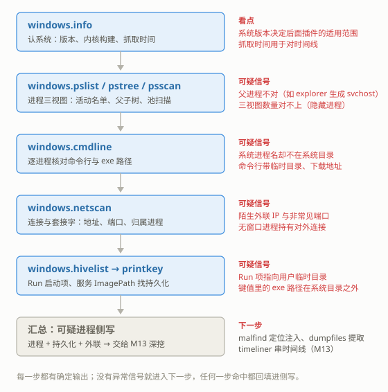

# M12 内存取证 I：Volatility 基础
## Memory Forensics I: Volatility Basics

> [!info]- 章节信息
> **所属方向**：MISC ｜ **难度阶段**：L3 进阶期 ｜ **前置要求**：[[12-隐写与流量取证|12 章]] · [[M01-MISC导论与工具箱|M01]] · [[M10-流量取证I-协议还原深挖|M10]]
> **本章目标**：知道内存镜像从哪来、怎么识别；把 [[M01-MISC导论与工具箱|M01]] 装好的 vol 用成一套完整的排查动作——认系统、枚举进程、核对命令行、查网络、翻注册表；并在一份公开内存镜像上走完"认系统 → 进程三视图 → 命令行 → 持久化键值"的完整解题线。

## 1. 定位：从流量容器到内存镜像

[[M11-流量取证II-加密流量与USB|M11]]收掉了流量线。[[M10-流量取证I-协议还原深挖|M10]]与 [[M11-流量取证II-加密流量与USB|M11]]分析的 pcap 记录的是机器对外说过什么；本章换一种材料：内存镜像，机器断电那一刻整块 RAM 的逐字节副本。进程列表、每条网络连接、注册表内容、用户敲过的命令，在里面都是一个个数据结构，取证工具的工作是按规则把它们解析出来。

[[12-隐写与流量取证|12 章 8.2]]给过 Volatility 的第一印象：三条 v2 语法的命令（`imageinfo` 拿 profile、`pslist` 看进程、`filescan` 扫文件名）。[[M01-MISC导论与工具箱#2.2 四条安装渠道|M01 2.2]]的警告框说明了版本差异：pip 装的 Volatility 3 入口是 `vol`，插件全部带 `windows.` 前缀，不再需要 `--profile`。本章在 v3 上把这套动作完整展开，再补上 12 章没碰的三块：镜像从哪来、符号表机制、注册表视角。

取证方向各章的分工：

| 章 | 材料 | 内容 |
| ---- | ---- | ---- |
| 本章 | 内存镜像 | Volatility 3 基础：认系统、进程、网络、注册表 |
| [[M13-内存取证II-进阶\|M13]] | 同一份镜像 | 进阶：注入检测、文件提取、时间线、剪贴板 |
| [[M14-磁盘与文件系统取证\|M14]] | 磁盘镜像 | 文件系统、删除恢复 |
| [[M18-取证综合-多源关联\|M18]] | 多源材料 | 磁盘 + 内存 + 流量 + 日志的联合作业 |

==内存镜像不是文件系统，是一台机器在某一瞬间的 RAM 快照==。RAM 的内容断电即失，运行中的恶意代码、明文口令、加密前的数据往往只存在于内存里；把 RAM 抓成镜像，这一瞬间的全部状态就固定成了文件。

本章所有命令都在同一份公开练习镜像上执行，镜像的来历与获取方式在 2.3 节交代。

## 2. 内存镜像从哪来

### 2.1 常见来源

CTF 里的内存镜像常见四种来源，扩展名与容器形态各不相同：

| 来源 | 典型扩展名 | 形态 |
| ---- | ---- | ---- |
| VMware 虚拟机暂停/快照 | `.vmem` | 裸内存平铺，无文件头；配套的 `.vmss`/`.vmsn` 是快照元数据 |
| VirtualBox 核心转储 | `.elf-core` | ELF 格式的 core 文件，带标准 ELF 头（[[12-隐写与流量取证\|12 章 2.1]]魔数表里的 `7F 45 4C 46`） |
| Windows 系统崩溃转储 | `.dmp` | 系统蓝屏时落盘的完整内存转储，头 8 字节是 `PAGEDU64`（32 位系统为 `PAGEDUMP`） |
| 采集工具直接抓取 | `.raw` / `.mem` | winpmem、FTK Imager 等工具写出的平铺字节，无文件头 |

后两种没有统一的扩展名约定，出题人想叫什么都行——和 [[12-隐写与流量取证|12 章 1 节]]的道理一样，==后缀不算数，看内容==。

### 2.2 file 认镜像：有魔数与没魔数

按 [[M01-MISC导论与工具箱#5.2 固定动作清单|M01 5.2]]的清单第 1 步，`file` 先问真身。raw 平铺镜像没有魔数，`file` 直接放弃理解：

```bash
file cridex.vmem
ls -la cridex.vmem
```

输出：

```text
cridex.vmem: data
-rw-r--r-- 1 hua hua 536870912 Oct 24 22:43 cridex.vmem
```

`data` 的含义 [[12-隐写与流量取证|12 章 2.2]]说过：file 认不出。这不是文件坏了，是 raw 镜像本来就没有文件头——512 MiB 恰好是目标机器 RAM 的容量，逐字节平铺。`xxd` 看开头能看到低地址内存的原始字节（x86 实模式中断向量表所在的区域，表项都是"段：偏移"形式，所以 `00f0` 一类的段值反复出现）：

```bash
xxd cridex.vmem | head -3
```

输出：

```text
00000000: 53ff 00f0 53ff 00f0 c3e2 00f0 53ff 00f0  S...S.......S...
00000010: 53ff 00f0 54ff 00f0 5a84 00f0 53ff 00f0  S...T...Z...S...
00000020: a5fe 00f0 87e9 00f0 9809 00f0 9809 00f0  ................
```

`.dmp` 就不一样了，头 8 字节是魔数 `PAGEDU64`。写一个只含这个头部的小文件验证 `file` 的识别行为：

```bash
python3 - <<'EOF'
open("demo_dump.dmp", "wb").write(b"PAGEDU64" + b"\x00" * 4088)
EOF
file demo_dump.dmp
xxd demo_dump.dmp | head -2
rm -f demo_dump.dmp
```

输出：

```text
demo_dump.dmp: MS Windows 64bit crash dump, version 0.0, MachineImageType 0, 0 processors, DumpType (0), 0 pages
00000000: 5041 4745 4455 3634 0000 0000 0000 0000  PAGEDU64........
00000010: 0000 0000 0000 0000 0000 0000 0000 0000  ................
```

`PAGEDU64` 一出现 `file` 就报出 crash dump。三种形态的识别要点汇总：

| 形态 | 头部特征 | `file` 的反应 |
| ---- | ---- | ---- |
| raw / vmem | 无魔数 | `data` |
| Windows crash dump | `50 41 47 45 44 55 36 34`（`PAGEDU64`） | 直接报 MS Windows 64bit crash dump |
| ELF core（VirtualBox） | `7F 45 4C 46` + core 类型程序头 | 报 ELF core file |

识别出形态只是开始：raw 镜像没有元数据，Windows crash dump 头里带着机器与内存布局信息。Volatility 对这三种形态都能直接读（crash dump 会在解析时先剥掉文件头）。

### 2.3 本章镜像：cridex.vmem

本章与 [[M13-内存取证II-进阶|M13]]共用同一份公开镜像 cridex.vmem——Volatility Foundation 长期公开的练习样本，取自 2012 年 7 月一台感染了网银木马 Cridex 的 Windows XP 虚拟机（VMware 内存快照）。基本信息：

| 属性 | 值 |
| ---- | ---- |
| 文件名 | cridex.vmem |
| 大小 | 536,870,912 字节（512 MiB） |
| 系统 | Windows XP SP3 x86（3.2 节的 `windows.info` 会读出同样结论） |
| SHA-256 | `02a63be2fcf3a63446c3c8ca9151aff963f888204d141e46c6be60ddde7c3e8d` |
| 获取 | Volatility Foundation 公开样清单（见 9 节延伸阅读的直链） |

> [!warning] 样本含真实恶意软件痕迹
> cridex.vmem 不是出题人合成的数据，里面是一台真实被感染机器的内存。分析全程在隔离环境（虚拟机/一次性容器）进行；本章只做取证视角的描述——发现什么、记录什么，不展开恶意样本本身的行为细节，也不提供样本之外的任何获取途径。

## 3. Volatility 3 基础

### 3.1 入口与插件命名

volatility3 随 [[M01-MISC导论与工具箱#2.2 四条安装渠道|M01 2.2]]的 pip 清单装好，入口命令是 `vol`。用法框架：

```bash
vol -f 镜像文件 插件名 [插件参数]
```

- `-f` 指定内存镜像，所有插件共用这一个参数；
- 插件按目标系统命名：`windows.*`、`linux.*`、`mac.*` 三个前缀各管一族，CTF 里绝大多数镜像跑 `windows.*`；
- v2 时代的 `imageinfo`、`--profile` 都不存在了——系统识别是自动的，3.2 节会看到 `windows.info` 的输出里连符号表路径都直接给出。

插件记不全没关系，`vol -h` 列出全部插件名，`vol 插件名 -h` 看单个插件的参数。

### 3.2 windows.info：先认系统

第一步永远是认系统。后续所有判断——这个插件能不能用、这个进程名在这个系统上正不正常——都建立在"这是什么系统"之上：

```bash
vol -f cridex.vmem windows.info
```

输出：

```text
Variable	Value

Kernel Base	0x804d7000
DTB	0x2fe000
Symbols	file:///home/hua/.cache/volatility3/symbols/windows/ntkrnlpa.pdb/30B5FB31AE7E4ACAABA750AA241FF331-1.json.xz
Is64Bit	False
IsPAE	True
layer_name	0 WindowsIntelPAE
memory_layer	1 FileLayer
KdDebuggerDataBlock	0x80545ae0
NTBuildLab	2600.xpsp.080413-2111
CSDVersion	3
KdVersionBlock	0x80545ab8
Major/Minor	15.2600
MachineType	332
KeNumberProcessors	1
SystemTime	2012-07-22 02:45:08+00:00
NtSystemRoot	C:\WINDOWS
NtProductType	NtProductWinNt
NtMajorVersion	5
NtMinorVersion	1
PE MajorOperatingSystemVersion	5
PE MinorOperatingSystemVersion	1
```

逐行读关键项：

| 变量 | 读法 |
| ---- | ---- |
| `NtMajorVersion` / `NtMinorVersion` | 5.1 = Windows XP（5.0 是 2000，6.0 是 Vista，6.1 是 Win7，10.x 是 Win10/11） |
| `CSDVersion` | 3 = SP3，配合上一行得出 XP SP3 |
| `NTBuildLab` | 内核构建号 2600 加构建标签 `xpsp.080413-2111`，同样指向 SP3 |
| `Is64Bit` / `MachineType` | 32 位系统（MachineType 332 即十六进制 0x14C，i386） |
| `SystemTime` | 关机/抓取那一刻的系统时钟：2012-07-22 02:45 UTC |
| `Symbols` | 当前使用的符号表文件（3.3 节） |
| `Kernel Base` / `DTB` | 内核虚拟基址与页目录基址，vol 自己用，排查时不用管 |

==拿到镜像先跑 info，把"系统版本、位数、抓取时间"记下来==，后面每一步都要用。

### 3.3 符号表：名字到偏移的映射

Windows 内核把进程、连接、注册表 hive 等一切都组织成结构体（`_EPROCESS`、`_KPROCESS`……），Volatility 要解析这些结构体，就得知道每种结构体的字段在内存里偏移多少。这套"名字 → 偏移"的映射就是符号表。Windows 的符号表按 PDB 文件组织，每种内核构建（版本 + 补丁级别）一份，靠 PDB 的 GUID 精确匹配——差一个补丁号偏移就可能不同。

vol 的运行流程：

1. 打开镜像，先定位内核在内存里的位置，从内核文件头读出它声明的 PDB 名与 GUID（本镜像是 `ntkrnlpa.pdb` + `30B5FB31…`）；
2. 在本地缓存里找匹配的符号表文件；
3. 找不到就从远端拉取：向微软公共符号服务器（msdl.microsoft.com）下载对应 PDB，本地转成 ISF 格式的压缩 JSON 存进缓存——ISF（Intermediate Symbol Format）就是 vol 使用的符号表格式；
4. 之后所有插件直接复用缓存，不再联网。

缓存的位置在用户缓存目录下：本章环境里是 `~/.cache/volatility3/`，Windows 端在用户 AppData 对应目录。info 输出的 `Symbols` 一行给出了实际生效的那个文件。`find` 看一眼缓存里实际有什么：

```bash
find ~/.cache/volatility3 -type f
```

输出：

```text
/home/hua/.cache/volatility3/data_6f05716b77426abb0f04d6819ae8eb1d69d0de5a84bcedde3de8a606b9cda04f38f9d497d2fd98363f0e6c4312647193afcec2648d01280d98862a6c1ebb860a.cache
/home/hua/.cache/volatility3/identifier.cache
/home/hua/.cache/volatility3/symbols/windows/ntkrnlpa.pdb/30B5FB31AE7E4ACAABA750AA241FF331-1.json.xz
/home/hua/.cache/volatility3/valid_isf.hashcache
```

四个文件，认两个就够：`identifier.cache` 是"内核特征 → 符号文件"的索引缓存；`symbols/windows/ntkrnlpa.pdb/<GUID>-1.json.xz` 是 ISF 符号表本体，目录名就是 PDB 名，文件名里的 GUID 对应 3.2 节 info 读出的这份内核；剩下两个是 vol 的内部缓存文件。

==没有匹配的符号表，vol 解析不了任何内核结构，所有插件都出不了结果==。所以首跑会多花一段下载与转换符号的时间，这是正常流程；网络不通时给 `vol` 挂代理环境变量（本库的代理是 `http://127.0.0.1:7897`）：

```bash
https_proxy=http://127.0.0.1:7897 http_proxy=http://127.0.0.1:7897 vol -f cridex.vmem windows.info
```

> [!warning] 报 Unsatisfied requirement，先查符号
> 插件报 `Unsatisfied requirement plugins.X.kernel.layer_name` 或 `...symbol_table_name`，意思是它要的内存层或符号表没就位。常见原因按顺序排查：镜像路径写错、镜像不是支持的格式（先跑 `windows.info` 确认）、符号没匹配上（走代理重跑）、`--offline` 禁了联网但本地又没有符号。`info` 能跑通而别的插件报这个，重跑一次通常就过。

> [!info]- v2 与 v3 的对照速查
> 网上教程与老 writeup 大量使用 v2 语法，动作对照：
>
> | 动作 | v2（[[12-隐写与流量取证#8. 磁盘与内存取证一瞥\|12 章 8.2]]） | v3（本章） |
> | ---- | ---- | ---- |
> | 入口 | `vol.py` | `vol` |
> | 认系统 | `imageinfo` 拿 profile，之后每条命令带 `--profile=WinXPSP2x86` | `windows.info`，自动识别 |
> | 插件名 | `pslist`、`netscan` | `windows.pslist`、`windows.netscan`（前缀化） |
> | XP 网络证据 | `connscan` / `sockets` 可用 | vol3 无对应插件（5.1 节） |
> | 扫文件名 | `filescan` | `windows.filescan`（[[M13-内存取证II-进阶\|M13]]） |
>
> v2 已停止维护；只有分析 vol3 不支持的老镜像时才临时装 v2。另外 `vol -vv` 会打印全部加载过程，排查符号问题时用它；`--offline` 强制不联网。

## 4. 进程视角

### 4.1 三种枚举，三个视角

vol 有三个进程枚举插件，差别不在输出格式，而在数据来源：

| 插件 | 数据来源 | 特点 |
| ---- | ---- | ---- |
| `windows.pslist` | 内核的进程双向链表（活动进程都挂在上面） | 快、结果可信，但只能看到链表上的活动进程 |
| `windows.pstree` | 同一份链表，按父子关系排成树 | 看进程的父进程是谁、层级是否合理 |
| `windows.psscan` | 池标签扫描：按进程结构体的特征在整块内存里搜索 | 慢，可能误报，但==不依赖任何列表==——被从链表上摘掉的隐藏进程、刚退出的进程都能扫到 |

==三个视图的差异就是它们的价值==：正常的机器三个视图的进程名单一致；隐藏进程的题，`pslist` 与 `psscan` 的差集直接给出答案。

先跑 pslist：

```bash
vol -f cridex.vmem windows.pslist
```

输出：

```text
PID	PPID	ImageFileName	Offset(V)	Threads	Handles	SessionId	Wow64	CreateTime	ExitTime	File output

4	0	System	0x823c89c8	53	240	N/A	False	N/A	N/A	Disabled
368	4	smss.exe	0x822f1020	3	19	N/A	False	2012-07-22 02:42:31.000000 UTC	N/A	Disabled
584	368	csrss.exe	0x822a0598	9	326	0	False	2012-07-22 02:42:32.000000 UTC	N/A	Disabled
608	368	winlogon.exe	0x82298700	23	519	0	False	2012-07-22 02:42:32.000000 UTC	N/A	Disabled
652	608	services.exe	0x81e2ab28	16	243	0	False	2012-07-22 02:42:32.000000 UTC	N/A	Disabled
664	608	lsass.exe	0x81e2a3b8	24	330	0	False	2012-07-22 02:42:32.000000 UTC	N/A	Disabled
824	652	svchost.exe	0x82311360	20	194	0	False	2012-07-22 02:42:33.000000 UTC	N/A	Disabled
908	652	svchost.exe	0x81e29ab8	9	226	0	False	2012-07-22 02:42:33.000000 UTC	N/A	Disabled
1004	652	svchost.exe	0x823001d0	64	1118	0	False	2012-07-22 02:42:33.000000 UTC	N/A	Disabled
1056	652	svchost.exe	0x821dfda0	5	60	0	False	2012-07-22 02:42:33.000000 UTC	N/A	Disabled
1220	652	svchost.exe	0x82295650	15	197	0	False	2012-07-22 02:42:35.000000 UTC	N/A	Disabled
1484	1464	explorer.exe	0x821dea70	17	415	0	False	2012-07-22 02:42:36.000000 UTC	N/A	Disabled
1512	652	spoolsv.exe	0x81eb17b8	14	113	0	False	2012-07-22 02:42:36.000000 UTC	N/A	Disabled
1640	1484	reader_sl.exe	0x81e7bda0	5	39	0	False	2012-07-22 02:42:36.000000 UTC	N/A	Disabled
788	652	alg.exe	0x820e8da0	7	104	0	False	2012-07-22 02:43:01.000000 UTC	N/A	Disabled
1136	1004	wuauclt.exe	0x821fcda0	8	173	0	False	2012-07-22 02:43:46.000000 UTC	N/A	Disabled
1588	1004	wuauclt.exe	0x8205bda0	5	132	0	False	2012-07-22 02:44:01.000000 UTC	N/A	Disabled
```

17 个进程。表尾的 `File output` 列是提取开关的回显（`--dump` 才会提取可执行文件本体，[[M13-内存取证II-进阶|M13]]用）。排查方法是拿这份名单对照系统的标准启动顺序：System → smss → csrss / winlogon → lsass / services → 一组 svchost → spoolsv → alg → explorer → 用户程序。名单上每个名字都是标准组件：5 个 svchost 是服务宿主（4.2 节看它们的 `-k` 分组参数）、wuauclt 是 Windows 更新客户端、reader_sl 是 Adobe Reader 的加速器。==名单干净不代表机器干净==——恶意代码可以不新建进程，而藏进已有的合法进程里，这要靠 [[M13-内存取证II-进阶|M13]]的注入检测来确认；本章先继续把静态信息核完。

pstree 把同一份名单排成树（输出列多，用 `cut` 保留 PID、PPID、进程名、创建时间四列）：

```bash
vol -f cridex.vmem windows.pstree | cut -f1,2,3,9
```

输出：

```text
PID	PPID	ImageFileName	CreateTime

4	0	System	N/A
* 368	4	smss.exe	2012-07-22 02:42:31.000000 UTC
** 584	368	csrss.exe	2012-07-22 02:42:32.000000 UTC
** 608	368	winlogon.exe	2012-07-22 02:42:32.000000 UTC
*** 664	608	lsass.exe	2012-07-22 02:42:32.000000 UTC
*** 652	608	services.exe	2012-07-22 02:42:32.000000 UTC
**** 1056	652	svchost.exe	2012-07-22 02:42:33.000000 UTC
**** 1220	652	svchost.exe	2012-07-22 02:42:35.000000 UTC
**** 1512	652	spoolsv.exe	2012-07-22 02:42:36.000000 UTC
**** 908	652	svchost.exe	2012-07-22 02:42:33.000000 UTC
**** 1004	652	svchost.exe	2012-07-22 02:42:33.000000 UTC
***** 1136	1004	wuauclt.exe	2012-07-22 02:43:46.000000 UTC
***** 1588	1004	wuauclt.exe	2012-07-22 02:44:01.000000 UTC
**** 788	652	alg.exe	2012-07-22 02:43:01.000000 UTC
**** 824	652	svchost.exe	2012-07-22 02:42:33.000000 UTC
1484	1464	explorer.exe	2012-07-22 02:42:36.000000 UTC
* 1640	1484	reader_sl.exe	2012-07-22 02:42:36.000000 UTC
```

树上每一层缩进是子进程，`*` 个数是深度。父子关系是强约束：System 之下只该有 smss，services.exe 之下只该有服务类进程，explorer.exe 之下是用户双击启动的程序。哪一行的父子关系与身份不符，哪一行就有问题——比如 explorer 直接生成 svchost、csrss 出现了不该有的子进程，都是典型的异常信号。

psscan 从物理内存里按特征再找一遍：

```bash
vol -f cridex.vmem windows.psscan
```

输出：

```text
PID	PPID	ImageFileName	Offset(V)	Threads	Handles	SessionId	Wow64	CreateTime	ExitTime	File output

908	652	svchost.exe	0x2029ab8	9	226	0	False	2012-07-22 02:42:33.000000 UTC	N/A	Disabled
664	608	lsass.exe	0x202a3b8	24	330	0	False	2012-07-22 02:42:32.000000 UTC	N/A	Disabled
652	608	services.exe	0x202ab28	16	243	0	False	2012-07-22 02:42:32.000000 UTC	N/A	Disabled
1640	1484	reader_sl.exe	0x207bda0	5	39	0	False	2012-07-22 02:42:36.000000 UTC	N/A	Disabled
1512	652	spoolsv.exe	0x20b17b8	14	113	0	False	2012-07-22 02:42:36.000000 UTC	N/A	Disabled
1588	1004	wuauclt.exe	0x225bda0	5	132	0	False	2012-07-22 02:44:01.000000 UTC	N/A	Disabled
788	652	alg.exe	0x22e8da0	7	104	0	False	2012-07-22 02:43:01.000000 UTC	N/A	Disabled
1484	1464	explorer.exe	0x23dea70	17	415	0	False	2012-07-22 02:42:36.000000 UTC	N/A	Disabled
1056	652	svchost.exe	0x23dfda0	5	60	0	False	2012-07-22 02:42:33.000000 UTC	N/A	Disabled
1136	1004	wuauclt.exe	0x23fcda0	8	173	0	False	2012-07-22 02:42:33.000000 UTC	N/A	Disabled
1220	652	svchost.exe	0x2495650	15	197	0	False	2012-07-22 02:42:35.000000 UTC	N/A	Disabled
608	368	winlogon.exe	0x2498700	23	519	0	False	2012-07-22 02:42:32.000000 UTC	N/A	Disabled
584	368	csrss.exe	0x24a0598	9	326	0	False	2012-07-22 02:42:32.000000 UTC	N/A	Disabled
368	4	smss.exe	0x24f1020	3	19	0	False	2012-07-22 02:42:31.000000 UTC	N/A	Disabled
1004	652	svchost.exe	0x25001d0	64	1118	0	False	2012-07-22 02:42:33.000000 UTC	N/A	Disabled
824	652	svchost.exe	0x2511360	20	194	0	False	2012-07-22 02:42:33.000000 UTC	N/A	Disabled
4	0	System	0x25c89c8	53	240	N/A	False	2012-07-22 02:42:32.000000 UTC	N/A	Disabled
```

17 个，与 pslist 一致——本镜像没有从链表上摘掉的进程。这份输出的价值在方法上：把 pslist 和 psscan 的 PID 各自列出来做差集，两边都有的是正常进程，只在 psscan 里出现的就是候选隐藏对象。CTF 里"找出隐藏进程"一类题就是这个动作。

> [!info]- 两份输出的偏移不是同一种地址
> pslist 的 `Offset(V)` 是虚拟地址（0x8 开头，内核空间），psscan 的偏移是从物理内存里扫描得到的物理偏移（0x20 开头一段）。两列数值没有换算关系，对照进程只能比 PID 与结构体内容，不能拿偏移互查。

### 4.2 cmdline：命令行与路径

进程名单之外，每个进程的命令行是第二份证据。数据来源是进程的 PEB（进程环境块）里的参数结构：

```bash
vol -f cridex.vmem windows.cmdline
```

输出：

```text
PID	Process	Args

4	System	-
368	smss.exe	\SystemRoot\System32\smss.exe
584	csrss.exe	C:\WINDOWS\system32\csrss.exe ObjectDirectory=\Windows SharedSection=1024,3072,512 Windows=On SubSystemType=Windows ServerDll=basesrv,1 ServerDll=winsrv:UserServerDllInitialization,3 ServerDll=winsrv:ConServerDllInitialization,2 ProfileControl=Off MaxRequestThreads=16
608	winlogon.exe	winlogon.exe
652	services.exe	C:\WINDOWS\system32\services.exe
664	lsass.exe	C:\WINDOWS\system32\lsass.exe
824	svchost.exe	C:\WINDOWS\system32\svchost -k DcomLaunch
908	svchost.exe	C:\WINDOWS\system32\svchost -k rpcss
1004	svchost.exe	C:\WINDOWS\System32\svchost.exe -k netsvcs
1056	svchost.exe	C:\WINDOWS\system32\svchost.exe -k NetworkService
1220	svchost.exe	C:\WINDOWS\system32\svchost.exe -k LocalService
1484	explorer.exe	C:\WINDOWS\Explorer.EXE
1512	spoolsv.exe	C:\WINDOWS\system32\spoolsv.exe
1640	reader_sl.exe	"C:\Program Files\Adobe\Reader 9.0\Reader\Reader_sl.exe"
788	alg.exe	C:\WINDOWS\System32\alg.exe
1136	wuauclt.exe	"C:\WINDOWS\system32\wuauclt.exe" /RunStoreAsComServer Local\[3ec]SUSDSb81eb56fa3105543beb3109274ef8ec1
1588	wuauclt.exe	"C:\WINDOWS\system32\wuauclt.exe"
```

这一列要核两件事。一是路径：系统进程（csrss、winlogon、services、lsass、svchost……）的 exe 都该在系统目录里，名字是系统进程而路径在用户目录或临时目录，是伪装进程的典型形态——CTF 里把 flag 藏在恶意进程命令行参数里的题，这里一眼可见。二是参数：5 个 svchost 靠 `-k` 参数分成 DcomLaunch / rpcss / netsvcs / NetworkService / LocalService 五组，这是 svchost 的正常工作方式（一个宿主跑一组服务）；`-k` 后面跟着陌生分组名、或者 svchost 不带 `-k`，就要记录。

### 4.3 dlllist：进程加载的模块

dlllist 列出每个进程加载的模块清单（exe 本体加全部 DLL），数据来自 PEB 里的加载器模块表。以 PID 664 的 lsass 为例（输出取前 10 行）：

```bash
vol -f cridex.vmem windows.dlllist --pid 664
```

输出：

```text
PID	Process	Base	Size	Name	Path	LoadCount	LoadTime	File output

664	lsass.exe	0x1000000	0x6000	lsass.exe	C:\WINDOWS\system32\lsass.exe	-1	N/A	Disabled
664	lsass.exe	0x7c900000	0xaf000	ntdll.dll	C:\WINDOWS\system32\ntdll.dll	-1	N/A	Disabled
664	lsass.exe	0x7c800000	0xf6000	kernel32.dll	C:\WINDOWS\system32\kernel32.dll	-1	N/A	Disabled
664	lsass.exe	0x77dd0000	0x9b000	ADVAPI32.dll	C:\WINDOWS\system32\ADVAPI32.dll	-1	N/A	Disabled
664	lsass.exe	0x77e70000	0x92000	RPCRT4.dll	C:\WINDOWS\system32\RPCRT4.dll	-1	N/A	Disabled
664	lsass.exe	0x77fe0000	0x11000	Secur32.dll	C:\WINDOWS\system32\Secur32.dll	-1	N/A	Disabled
664	lsass.exe	0x75730000	0xb5000	LSASRV.dll	C:\WINDOWS\system32\LSASRV.dll	-1	N/A	Disabled
664	lsass.exe	0x71b20000	0x12000	MPR.dll	C:\WINDOWS\system32\MPR.dll	-1	N/A	Disabled
664	lsass.exe	0x7e410000	0x91000	USER32.dll	C:\WINDOWS\system32\USER32.dll	-1	N/A	Disabled
664	lsass.exe	0x77f10000	0x49000	GDI32.dll	C:\WINDOWS\system32\GDI32.dll	-1	N/A	Disabled
```

这份清单按加载基址排列，能看出进程"由哪些代码组成"。排查时看两类异常：陌生 DLL 的路径不在系统目录、同名系统 DLL 却加载自其他路径。==dlllist 只覆盖 PEB 里登记过的模块==——不经过正常加载器写入的代码（注入）不在这张表上，检测注入要靠 [[M13-内存取证II-进阶|M13]]的 malfind 与 ldrmodules 对照。

## 5. 网络视角

### 5.1 netscan：连接与套接字表

`windows.netscan` 在内存里扫描网络对象池，输出当时的 TCP/UDP 连接与监听端口，每行一条：

| 列 | 含义 |
| ---- | ---- |
| `Proto` / `State` | 协议（TCPv4/TCPv6/UDPv4）与连接状态（ESTABLISHED、LISTENING……） |
| `LocalAddr` / `ForeignAddr` | 本地与对端地址端口 |
| `PID` / `Owner` | 归属进程及其用户 |
| `Created` | 连接建立时间 |

CTF 的用法：对端地址陌生、端口非常见、归属进程与它的身份不符（比如一个无窗口的系统工具进程持有对外连接），逐条记录。==netscan 的适用范围是 Vista 及以后==——它扫描的池对象结构从 Vista 起才存在。

> [!warning] XP 时代的镜像跑不了 netscan
> 本镜像正是这种情况：`windows.netscan` 打出表头后插件直接中止，报错文本为 `NotImplementedError: This version of Windows is not supported: 5.1 15.2600!`——vol3 的网络插件只实现了 Vista 以后的系统。XP 镜像的网络证据，v2 时代用 `connscan` / `sockets` 两个插件获取（v2 已停维护，只在分析老镜像时临时装用）；留在 vol3 里时，网络线索要绕道其他证据源，下一小节的 strings 是常用的一条。

### 5.2 替代证据源：strings 扫可见串

netscan 缺位时，[[M01-MISC导论与工具箱#4.2 二进制里的正则打靶|M01 4.2]]的字节检索可以直接对整块镜像做——内存里的明文 URL、域名、路径字符串照样能被 strings 扫出来：

```bash
strings -a cridex.vmem | grep -E 'https?://' | sort -u | head -3
```

输出：

```text
			url:  "https://chaseonline.chase.com/gw/secure/ena",
		<td class="spacerw25"> <iframe name="ifr1" id="ifr1" src="https://www.chase.com/online/Home/images/chaseNewlogo.gif" frameborder="0" width="1px" height="1px" style="display:none"></iframe></td>
	
```

排序后前几行已经是证据：内存里残留着多家网银站点的 URL，还有完整的 HTML 片段——隐藏的 iframe 元素、银行站点的页面图片。这些不是用户浏览记录那么简单：一段"要求用户更新账户信息"的表单模板也存在于同一片内存里。取证结论写到这一层就够：==这台机器的内存里存在针对网银页面的伪造页面片段，指向网银欺诈活动==。片段属于攻击活动的痕迹物证，本章到此为止，不展开它的实现。

同一串检索换个关键词，就能和 4.1 节的进程名单、6.2 节的注册表证据对上：

```bash
strings -a cridex.vmem | grep -i 'KB00207877' | sort -u
```

输出：

```text
C:\Documents and Settings\Robert\Application Data\KB00207877.exe(,
KB00207877.EXEn
KB00207877.exe
```

一个"KB"开头、长得像 Windows 补丁编号的文件名 `KB00207877.exe`，完整路径在用户 Robert 的 Application Data 目录下。行尾的杂字符是相邻内存字节被 strings 顺带扫出的正常现象。记住这个文件名，6.2 节的注册表输出里它会再次出现。

> [!info]- vmem 的快照元数据提示
> 每次 vol 读这份镜像，日志里都会出现一条 WARNING：`No metadata file found alongside VMEM file. A VMSS or VMSN file may be required to correctly process a VMEM file.`——VMware 快照目录里 vmem 旁边通常还有同名的 .vmss/.vmsn 元数据文件，缺了它们 vol 只能当纯裸内存读。对 cridex.vmem 这类单独分发的样本来说没有元数据是常态，照常分析，只是快照级的恢复信息（比如 vCPU 状态）拿不到。

## 6. 注册表视角

### 6.1 hivelist：内存里的 hive

注册表的存储单元是 hive——一个独立的数据文件（NTUSER.DAT、SOFTWARE、SYSTEM……）。系统运行时这些 hive 的副本驻留在内存里，`windows.registry.hivelist` 把它们全部列出：

```bash
vol -f cridex.vmem windows.registry.hivelist
```

输出：

```text
Offset	FileFullPath	File output

0xe18e5b60	\Device\HarddiskVolume1\Documents and Settings\Robert\Local Settings\Application Data\Microsoft\Windows\UsrClass.dat	Disabled
0xe1a19b60	\Device\HarddiskVolume1\Documents and Settings\Robert\NTUSER.DAT	Disabled
0xe18398d0	\Device\HarddiskVolume1\Documents and Settings\LocalService\Local Settings\Application Data\Microsoft\Windows\UsrClass.dat	Disabled
0xe18614d0	\Device\HarddiskVolume1\Documents and Settings\LocalService\NTUSER.DAT	Disabled
0xe183bb60	\Device\HarddiskVolume1\Documents and Settings\NetworkService\Local Settings\Application Data\Microsoft\Windows\UsrClass.dat	Disabled
0xe17f2b60	\Device\HarddiskVolume1\Documents and Settings\NetworkService\NTUSER.DAT	Disabled
0xe1570510	\Device\HarddiskVolume1\WINDOWS\system32\config\software	Disabled
0xe1571008	\Device\HarddiskVolume1\WINDOWS\system32\config\default	Disabled
0xe15709b8	\Device\HarddiskVolume1\WINDOWS\system32\config\SECURITY	Disabled
0xe15719e8	\Device\HarddiskVolume1\WINDOWS\system32\config\SAM	Disabled
0xe13ba008		Disabled
0xe1035b60	\Device\HarddiskVolume1\WINDOWS\system32\config\system	Disabled
```

12 个 hive 分两组：用户侧的 NTUSER.DAT 与 UsrClass.dat（本机只有一个真实用户 Robert，另两个是系统内置服务账号），系统侧的 software、system、SAM、SECURITY、default 五件套。`Offset` 是 hive 在内存里的基址，6.2 的 printkey 输出靠它区分数据来自哪个 hive。注意插件名带 `windows.registry.` 前缀——写 `windows.hivelist` 会报插件不存在。

### 6.2 printkey：查键值

`windows.registry.printkey` 按路径查键，把键值一起打印。取证最常查的是启动项——`CurrentVersion\Run` 键下列出的每个值都会在用户登录时被自动执行：

```bash
vol -f cridex.vmem windows.registry.printkey --key "Software\Microsoft\Windows\CurrentVersion\Run"
```

输出：

```text
Last Write Time	Hive Offset	Type	Key	Name	Data	Volatile

2012-07-22 02:31:51.000000 UTC	0xe1a19b60	REG_SZ	\Device\HarddiskVolume1\Documents and Settings\Robert\NTUSER.DAT\Software\Microsoft\Windows\CurrentVersion\Run	KB00207877.exe	"C:\Documents and Settings\Robert\Application Data\KB00207877.exe"	False
-	0xe1570510	Key	\Device\HarddiskVolume1\WINDOWS\system32\config\software\Software\Microsoft\Windows\CurrentVersion\Run	-	-	-
-	0xe15709b8	Key	\Device\HarddiskVolume1\WINDOWS\system32\config\SECURITY\Software\Microsoft\Windows\CurrentVersion\Run	-	-	-
-	0xe15719e8	Key	\Device\HarddiskVolume1\WINDOWS\system32\config\SAM\Software\Microsoft\Windows\CurrentVersion\Run	-	-	-
-	0xe13ba008	Key	[NONAME]\Software\Microsoft\Windows\CurrentVersion\Run	-	-	-
-	0xe1035b60	Key	\Device\HarddiskVolume1\WINDOWS\system32\config\system\Software\Microsoft\Windows\CurrentVersion\Run	-	-	-
-	0xe102e008	Key	[NONAME]\Software\Microsoft\Windows\CurrentVersion\Run	-	-	-
```

printkey 会把同名键在每个 hive 里各列一行，==有键值数据的行才是答案==：数据来自用户 Robert 的 NTUSER.DAT，Run 键下有一个值，值名 `KB00207877.exe`，数据指向 `C:\Documents and Settings\Robert\Application Data\KB00207877.exe`——正是 5.2 节 strings 捞出的那个文件。其余 hive 里的同名键都是空的（Type 列为 Key、Data 列为 `-`）。

三处细节拼在一起就是结论：

1. 值名伪装成微软补丁编号（KB 前缀），降低被注意的概率；
2. exe 位于用户的 Application Data 目录，不在系统目录；
3. 它挂在 Run 键下，用户每次登录都会执行——==启动项指向用户目录而不是系统目录，这个组合本身就是可疑信号==。

`Last Write Time` 显示这个键最后写入于 2012-07-22 02:31:51 UTC，比进程列表里最早一批系统进程的启动时间（02:42）早，与"先写入注册表、之后重启登录拉起"的时间顺序一致。查键时先把 6.1 的 hive 清单看一眼，用户名有了再去对应用户的 NTUSER.DAT，路径就不盲猜了。

### 6.3 svcscan 与服务 ImagePath

注册表里另一类常查的键是服务。每个服务在 `SYSTEM\ControlSet001\Services\` 下有一个同名子键，其中的 `ImagePath` 值写明启动这个服务用的是哪个二进制——服务也是恶意软件常用的持久化位置。`windows.svcscan` 从注册表活动服务清单读出全部服务，Binary 列就是 ImagePath：

```bash
vol -f cridex.vmem windows.svcscan | grep -E 'Spooler|Tcpip'
```

输出：

```text
0x3863c8	125	N/A	SERVICE_SYSTEM_START	SERVICE_RUNNING	SERVICE_KERNEL_DRIVER	NetBT	NetBios over Tcpip	\Driver\NetBT	-	-
0x388a80	194	1512	SERVICE_AUTO_START	SERVICE_RUNNING	SERVICE_WIN32_OWN_PROCESS|SERVICE_INTERACTIVE_PROCESS	Spooler	Print Spooler	C:\WINDOWS\system32\spoolsv.exe	-	-
0x389368	210	N/A	SERVICE_SYSTEM_START	SERVICE_RUNNING	SERVICE_KERNEL_DRIVER	Tcpip	TCP/IP Protocol Driver	\Driver\Tcpip	-	-
```

驱动类服务显示 `\Driver\` 名字（NetBT、Tcpip），普通服务显示 exe 路径——Spooler 服务的二进制正是 4.1 节进程列表里的 spoolsv.exe（PID 1512），进程、服务、注册表三份证据在这里对上。排查服务持久化时，把 svcscan 的 Name 与 Binary 两列整体过一遍，找 exe 路径不在系统目录、名字仿冒系统服务的那几行。本镜像的服务清单干净，持久化走的是 6.2 的 Run 键。

## 7. 一条 CTF 解题线

把本章的插件排成固定顺序，任何内存镜像都能按此开拆：



对应到本章镜像，五步走查的完整记录：

| 步骤 | 命令 | 本镜像的答案 |
| ---- | ---- | ---- |
| 1 认系统 | `windows.info` | XP SP3 x86（5.1 / `2600.xpsp.080413-2111`），抓取于 2012-07-22 02:45 UTC |
| 2 进程三视图 | `pslist` / `pstree` / `psscan` | 17 个进程全部符合 XP 基线，父子关系正常，无隐藏进程 |
| 3 命令行 | `cmdline` | 路径全部在系统目录，svchost 的 `-k` 分组正常 |
| 4 持久化 | `printkey` | Robert 的 Run 键指向 `Application Data\KB00207877.exe` |
| 5 网络与佐证 | `netscan`（Vista+）/ `strings` | netscan 不适用（XP）；strings 扫出网银 URL、仿冒表单片段与 KB00207877.exe 路径 |

三步排查得到同一个名字后，侧写收口：==这是一台用户 Robert 的 XP 主机，恶意程序以仿补丁编号的文件名位于用户 Application Data 目录，由 Run 键在每次登录时启动，内存里残留着网银仿冒页面的片段==。再往下——恶意代码本体藏在哪个进程、怎么把它从内存里提取出来——是 [[M13-内存取证II-进阶|M13]]的 malfind 与 dumpfiles 的工作。

CTF 内存题里 flag 的常见藏点与对应入口：

| 藏点 | 入口 |
| ---- | ---- |
| 进程命令行参数 | `cmdline` 直接看 |
| 注册表键值数据 | `printkey` 查 Run、RunOnce、服务键 |
| 环境变量 | `windows.envars` |
| 网络外联与监听 | `netscan`（Vista+ 镜像） |
| 文件名与文件内容 | `filescan` + `dumpfiles`（[[M13-内存取证II-进阶\|M13]]） |
| 剪贴板、时间线 | `clipboard`、`timeliner`（[[M13-内存取证II-进阶\|M13]]） |

前两行用本章的工具就能覆盖；后半部分在 [[M13-内存取证II-进阶|M13]]展开。把 2–6 节用到的命令汇成清单，做题时从头到尾过一遍：

```bash
vol -f 镜像 windows.info                                       # 认系统
vol -f 镜像 windows.pslist                                    # 进程名单
vol -f 镜像 windows.pstree | cut -f1,2,3,9                    # 父子树
vol -f 镜像 windows.psscan                                    # 池扫描，对照隐藏
vol -f 镜像 windows.cmdline                                   # 命令行与路径
vol -f 镜像 windows.netscan                                   # 连接与套接字（Vista+）
vol -f 镜像 windows.registry.hivelist                         # hive 清单
vol -f 镜像 windows.registry.printkey --key "Software\Microsoft\Windows\CurrentVersion\Run"
vol -f 镜像 windows.svcscan                                   # 服务与 ImagePath
strings -a 镜像 | grep -E 'https?://' | sort -u | head        # 明文 URL 侧路
```

## 8. 常见问题

| 现象 | 原因与解决 |
| ---- | ---- |
| 插件报 Unsatisfied requirement plugins.X.kernel.… | 内存层或符号表没就位（3.3 节）。先确认 `windows.info` 能出结果；网络不通给 vol 挂代理环境变量重跑；`info` 能跑而单个插件偶报时，重跑一次即可 |
| 首次运行很慢才开始出结果 | 首跑要定位内核并下载、转换符号表（3.3 节），之后走本地缓存。等这一次，别中途打断 |
| 每个插件都要跑几分钟 | 池扫描类插件（psscan、netscan）是整镜像扫描，速度由镜像大小决定；镜像放 WSL 原生目录而非 /mnt/c，IO 快很多（[[M01-MISC导论与工具箱#6. 常见问题\|M01]]的 DrvFS 说明） |
| netscan 报 NotImplementedError: This version of Windows is not supported: 5.1 | XP 镜像不被 vol3 网络插件支持，netscan 只覆盖 Vista+（5.1 节）。网络证据换 strings 侧路，或临时装 v2 用 connscan/sockets |
| `windows.hivelist` 报 invalid choice | 插件名写错，注册表族插件都带 `windows.registry.` 前缀（6.1 节） |
| printkey 只有一堆 Data 为 `-` 的行 | 那些是各 hive 里同名的空键；只有带键值数据的行才是命中（6.2 节） |
| pslist 和 psscan 的 Offset 对不上 | 两者不同源：前者是内核虚拟地址，后者是物理扫描偏移，不能互查（4.1 节） |
| WARNING: No metadata file found alongside VMEM file | vmem 缺少配套快照元数据（.vmss/.vmsn），照常分析，快照级信息拿不到（5.2 节折叠框） |
| strings 扫出的行尾有杂字符 | 相邻内存字节混入，strings 的正常行为，按可读主体判断即可（5.2 节） |
| v2 教程的命令全部报错 | v2 与 v3 语法不通约（3.3 节折叠框的对照表）；pip 装的入口是 `vol`，插件带 `windows.` 前缀（[[M01-MISC导论与工具箱#2.2 四条安装渠道\|M01 2.2]]） |

## 9. 配套练习与延伸阅读

配套练习：

1. 在 cridex.vmem 上把 7 节清单从头跑一遍，每一步的输出对照正文；再对 pstree 的树手工标注一遍 XP 的标准启动顺序，说明每层为什么在那个位置。
2. 用 printkey 查 `Software\Microsoft\Windows\CurrentVersion\RunOnce` 与 `ControlSet001\Services\` 下的键，确认 6 节"持久化只有 Run 键一处"的结论。
3. 把 `strings -a` 的两组检索（URL、KB00207877）改写成 [[M01-MISC导论与工具箱#4.2 二进制里的正则打靶|M01 4.2]]的正则版：文件名参数化、命中打印偏移，并入自己的 scan.py。
4. 换一份公开镜像重复五步：Volatility Foundation 样本清单里的 Stuxnet、Shylock 等都是 XP 系；[[M13-内存取证II-进阶|M13]]会继续用 cridex.vmem 深挖。
5. 有 VMware 的读者：开一台 Windows 虚拟机（或让同学协作），暂停后从虚拟机目录取出 .vmem，对"自己的机器"完整跑一遍清单。

练习场：

- [[01-练习平台索引|练习平台索引]]：取证分区按材料分类，内存题按 7 节清单逐题过
- [[03-工具清单|工具清单]]：volatility3 的装法与同类工具

延伸阅读：

- Volatility 3 官方文档与代码仓库（volatility3.readthedocs.io / github.com/volatilityfoundation/volatility3）：插件全集与符号表机制的权威出处；
- volatilityfoundation/volatility 仓库的 Memory Samples wiki 页：公开练习镜像清单（本章镜像出自这里）；
- 本章镜像直链与校验：HuggingFace 数据集 jhenning/dfir-validation-data 中的 cridex.vmem（SHA-256 见 2.3 节表格）；
- 《The Art of Memory Forensics》（Michael Hale Ligh 等）：Windows/Linux/Mac 内存取证的系统教材，本章插件的原理篇；
- [[M14-磁盘与文件系统取证|M14]]：内存之外的另一半取证材料——磁盘镜像与文件系统；
- 下一站：[[M13-内存取证II-进阶|M13]] 继续用同一份镜像——malfind 定位注入、dumpfiles 提取恶意程序本体、timeliner 串出完整时间线，把本章留下的"代码本体在哪"补完。
