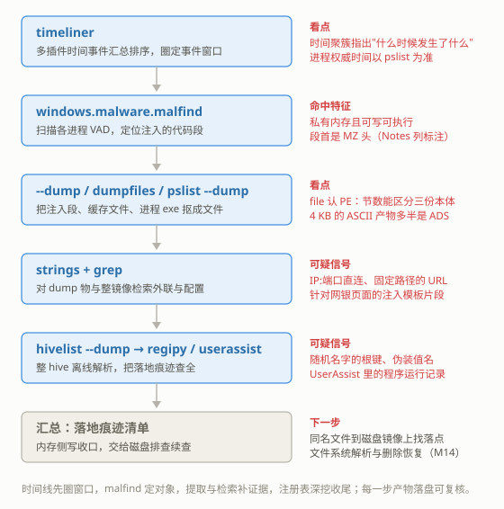

# M13 内存取证 II：进阶
## Memory Forensics II: Advanced

> [!info]- 章节信息
> **所属方向**：MISC ｜ **难度阶段**：L3 进阶期 ｜ **前置要求**：[[M12-内存取证I-Volatility基础|M12]] · [[M01-MISC导论与工具箱|M01]]
> **本章目标**：接住 [[M12-内存取证I-Volatility基础|M12]] 收尾时留下的两个悬念——"注入的代码本体在哪个进程里"与"这个程序落地之后还留了什么痕迹"；把时间线、注入检测、对象提取、注册表深挖四组进阶动作用成固定流程，在同一份 cridex.vmem 上走完，并在结尾与 [[M14-磁盘与文件系统取证|M14]] 的磁盘排查衔接。

## 1. 定位：从清单到对象

[[M12-内存取证I-Volatility基础|M12]]的五步走查（认系统 → 进程三视图 → 命令行 → 持久化键值 → 网络与佐证）产出的是一份份**对象清单**：17 个进程、12 个 hive、一个可疑的 Run 键值。清单收口于一个名字——`KB00207877.exe`，[[M12-内存取证I-Volatility基础#6.2 printkey：查键值|M12 6.2]]确认它由用户 Robert 的 Run 键在每次登录时拉起，[[M12-内存取证I-Volatility基础#5.2 替代证据源：strings 扫可见串|M12 5.2]]的 strings 检索也在内存里捞到了它的完整路径。但清单回答不了两个问题：

1. 这个程序（或它派生的代码）此刻藏在哪个进程的内存里？进程三视图全干净的结论只说明"没有独立的新进程"，不排除代码被注入进已有进程。
2. 它落地之后还留下了什么？一个 Run 键值只是持久化位置，执行痕迹、外联配置、注册表其他角落的变化都要继续挖。

本章把这四个动作排成固定顺序：

| 动作 | 工具 | 解决什么 |
| ---- | ---- | ---- |
| 时间线 | `timeliner`（+ python 汇总） | 先看"什么时候发生了什么"，圈出事件窗口再决定查哪个对象 |
| 注入检测 | `windows.malware.malfind`、`vadinfo`、`ldrmodules` | 在合法进程的内存里找到无名的代码本体 |
| 对象提取 | `--dump`、`windows.dumpfiles`、`windows.pslist --dump`、strings | 把内存里的代码、文件、配置抠成磁盘上的文件，接回 [[M01-MISC导论与工具箱#5.2 固定动作清单\|M01 5.2]]的固定清单 |
| hive 深挖 | `windows.registry.hivelist --dump`、`windows.registry.userassist`、regipy | 从 [[M12-内存取证I-Volatility基础#6.2 printkey：查键值\|M12 6.2]]的单键查询推进到整 hive 离线解析 |

镜像与环境沿用 [[M12-内存取证I-Volatility基础#2.3 本章镜像：cridex.vmem|M12 2.3]]的 cridex.vmem（512 MiB，Windows XP SP3 x86，2012-07-22 抓取）；`vol` 入口、符号表机制、进程三视图、printkey 的用法都是 [[M12-内存取证I-Volatility基础|M12]]讲过的内容，本章直接使用。以下命令都在工作目录里执行，镜像以 `cridex.vmem` 指代，提取物统一放进子目录 `out/`（`-o` 参数指定）。

> [!note] 本章的材料边界
> cridex.vmem 里是一台真实被感染机器的内存，本章延续 [[M12-内存取证I-Volatility基础|M12]]的取证视角：发现痕迹、记录痕迹、把痕迹串成事件顺序。恶意样本自身的代码逻辑、攻击手法不在讨论范围，文中出现的外联地址与配置片段只作为"内存里存在这些残留"的证据使用。

## 2. 时间线：先看时间，再定位对象

### 2.1 为什么时间线排在最前

基础插件一章一节地跑，每一步都在回答"有什么"；时间线回答的是"什么时候、按什么顺序"。把它放在进阶排查的第一步，有三个理由：

1. **排先后**。注册表键的修改时间、进程创建时间、文件落地时间各来自不同的插件，单独看都是孤立数字；排到一起才能判断因果——比如一个键的写入时间早于一批进程的启动时间，说明"先持久化、后重启拉起"。
2. **圈窗口**。把所有事件按时间排序后，异常会聚成簇。某一分钟里同时出现进程启动、键值写入、文件修改，这一分钟就是事件窗口，后续所有查询都围绕窗口里的对象展开。
3. **交叉验证**。同一个时刻往往有多个数据源各自留了记录，时间线让它们直接对表——对不上的就是值得深挖的疑点。

[[M12-内存取证I-Volatility基础#6.2 printkey：查键值|M12 6.2]]已经手工做过一次最小规模的对时：Run 键的 `Last Write Time`（02:31:51）早于进程列表里最早一批系统进程的启动时间（02:42），于是得出"先写入、后重启拉起"。时间线就是把这个手工动作工具化。

对时依赖统一的时间表示。Windows 内部时间一律存成 **FILETIME**：自 1601-01-01 起、以 100 纳秒为单位的 64 位整数。换算成常见的 Unix 时间戳（1970 起的秒数）只有一个固定偏移：

$$\text{Unix 秒} = \frac{\text{FILETIME}}{10^7} - 11644473600 \tag{1}$$

其中 $11644473600$ 是 1601 到 1970 之间的秒数。vol 的输出已经把 FILETIME 转成了人类可读格式，但用 regipy 之类直接读 hive 的工具时拿到的仍是原始整数，6.2 节会用到式 (1)。

### 2.2 timeliner：多源事件汇总

vol3 的 `timeliner` 插件把各插件产出的带时间对象收拢到一张按时间排序的表里：

```bash
vol -f cridex.vmem timeliner > timeline.txt
grep -acE '^(PsList|PsScan|ThrdScan|Threads|ShimcacheMem|UserAssist|Sessions|SymlinkScan|UnloadedModules)' timeline.txt
```

输出：

```text
6327
```

6327 条事件，来源与条数：

| 来源插件 | 条数 | 事件内容 |
| ---- | ---- | ---- |
| ThrdScan / Threads | 2898 / 2149 | 线程的创建与退出 |
| SymlinkScan | 564 | 内核符号链接对象 |
| PsList / PsScan | 204 / 187 | 进程的创建与退出（[[M12-内存取证I-Volatility基础#4.1 三种枚举，三个视角\|M12 4.1]]的两个来源） |
| ShimcacheMem | 192 | 系统兼容性缓存里的文件执行痕迹 |
| UnloadedModules | 90 | 已卸载的内核模块 |
| UserAssist | 31 | 注册表里记录的程序运行痕迹（6.3 节） |
| Sessions | 12 | 登录会话 |

输出表有六列：`Plugin`（来源）、`Description`（对象描述）、四个时间列 `Created / Modified / Accessed / Changed`。一个对象能提供哪种语义的时间就填哪列，填不了的为 `N/A`。直接检索本章关心的对象名：

```bash
grep -aE '^(ShimcacheMem|UserAssist)' timeline.txt | grep -aE 'cridex1|KB00207877' | grep -av 2008
```

输出：

```text
ShimcacheMem	Shimcache: File \??\C:\Documents and Settings\Robert\Application Data\KB00207877.exe executed	2012-07-22 02:44:01.000000 UTC	N/A	N/A	N/A
ShimcacheMem	Shimcache: File \??\C:\Documents and Settings\Robert\Application Data\KB00207877.exe modified	2012-07-22 02:44:01.000000 UTC	N/A	N/A	N/A
ShimcacheMem	Shimcache: File \??\C:\WINDOWS\cridex1.exe executed	2012-07-22 02:44:01.000000 UTC	N/A	N/A	N/A
ShimcacheMem	Shimcache: File \??\C:\WINDOWS\cridex1.exe modified	2012-07-22 02:44:01.000000 UTC	N/A	N/A	N/A
ShimcacheMem	Shimcache: File \??\C:\Documents and Settings\Robert\Application Data\KB00207877.exe executed	N/A	2012-07-22 02:31:51.000000 UTC	N/A	N/A
ShimcacheMem	Shimcache: File \??\C:\Documents and Settings\Robert\Application Data\KB00207877.exe modified	N/A	2012-07-22 02:31:51.000000 UTC	N/A	N/A
ShimcacheMem	Shimcache: File \??\C:\WINDOWS\cridex1.exe executed	N/A	2012-07-22 02:31:51.000000 UTC	N/A	N/A
ShimcacheMem	Shimcache: File \??\C:\WINDOWS\cridex1.exe modified	N/A	2012-07-22 02:31:51.000000 UTC	N/A	N/A
UserAssist	UserAssist: UEME_RUNPATH:C:\WINDOWS\cridex1.exe NTUSER.DAT\Software\Microsoft\Windows\CurrentVersion\Explorer\UserAssist\{75048700-EF1F-11D0-9888-006097DEACF9}\Count (1)	N/A	2012-07-22 02:31:51.000000 UTC	N/A	N/A
```

出现了两个新名字。`KB00207877.exe` 是 [[M12-内存取证I-Volatility基础|M12]]的老熟人；`C:\WINDOWS\cridex1.exe` 是时间线带来的新线索——UserAssist 记录它在 2012-07-22 02:31:51 被运行过，与 Run 键的写入时间（同为 02:31:51）精确同秒。==一个陌生的样本名加上与已知事件同秒的时间戳，这就是时间线给出的定位==。

所有带时间的事件按时刻统计，异常聚簇一眼可见：

```bash
grep -aE '^(PsList|PsScan|ThrdScan|Threads|ShimcacheMem|UserAssist|Sessions|SymlinkScan|UnloadedModules)' timeline.txt | cut -f3 | grep -av N/A | sort | uniq -c | sort -rn | head -3
```

输出：

```text
   2916 2012-07-22 02:44:01.000000 UTC
    813 2012-07-22 02:42:37.000000 UTC
    730 2012-07-22 02:42:24.000000 UTC
```

三簇时间——02:42:24、02:42:37、02:44:01——与 [[M12-内存取证I-Volatility基础#4.1 三种枚举，三个视角|M12 4.1]]进程表里的启动时间段（02:42:31–02:44:01）衔接：这是一次重启加登录后系统的活跃窗口，02:44:01 恰好也是 [[M12-内存取证I-Volatility基础#4.1 三种枚举，三个视角|M12 4.1]]表里第二个 `wuauclt.exe`（PID 1588）的创建时刻。时间线先圈窗口、再定对象的用法到这里已经完整。

> [!note] timeliner 的行会重复，进程时间以 pslist 为准
> 同一个进程在输出里会出现多行、带不同的时间值——timeliner 把进程对象与每个能配时间的事件源配对输出。查单个进程的权威创建时间，仍以 [[M12-内存取证I-Volatility基础#4.1 三种枚举，三个视角|M12 4.1]]的 `pslist` 直接输出为准。

> [!info]- Shimcache 是什么
> Shimcache（又称 AppCompatCache）是 Windows 为应用兼容性修复维护的缓存，系统每执行一个文件都会在里面留一条记录（文件路径 + 执行标志 + 文件修改时间）。它存在于注册表 SYSTEM hive 里，但同时有内核内存中的副本——`windows.shimcachemem` 插件读的就是内存副本。对取证者它是"这个文件被系统加载过"的痕迹来源；条目里的时间是文件属性时间，不等于执行时刻，解读时按"有记录即加载过"使用。

> [!info]- XP 镜像上的 timeliner
> timeliner 是汇总器，它自己不解析内存，而是调用各来源插件。[[M12-内存取证I-Volatility基础#5.1 netscan：连接与套接字表|M12 5.1]]讲过 vol3 的网络插件只支持 Vista 以后，本镜像上 NetScan/NetStat 没有产出，Amcache 在 XP 上同样为空——6327 条事件全部来自 XP 可用的那几个来源。换 Win7 以后的镜像，同一条命令会自动多出网络事件。timeliner 还有 `--create-bodyfile` 开关，把输出转成 TSK body 格式（`MD5|路径|大小|时间...` 每行一条），可交给 mactime 等工具继续处理。

### 2.3 简易时间线：python 汇总三份输出

timeliner 之外，还有一条更透明的路：把三份基础插件输出落盘，用 python 抽时间、合并、排序。这个做法的价值在于**每一步可检查**——时间从哪一列来、哪些行被丢弃都写在脚本里，出题人构造的畸形时间也躲不过正则。

三份输入先用 vol 重定向得到：

```bash
vol -f cridex.vmem windows.pslist > pslist.txt
vol -f cridex.vmem windows.registry.printkey --key "Software\Microsoft\Windows\CurrentVersion\Run" > printkey_run.txt
vol -f cridex.vmem windows.registry.userassist > userassist.txt
```

（printkey 与 userassist 的输出格式在 6.3 节细看，这里先当作三张表。）汇总脚本：

```python
# mini_timeline.py —— 合并 pslist / printkey / userassist 的时间字段
import re
from datetime import datetime, timezone

events = []  # (datetime, 来源, 描述)

def parse_utc(s):
    # "2012-07-22 02:42:31.000000 UTC" -> datetime
    return datetime.strptime(s.replace(" UTC", ""),
                             "%Y-%m-%d %H:%M:%S.%f").replace(tzinfo=timezone.utc)

TIME = re.compile(r"^\d{4}-\d{2}-\d{2} \d{2}:\d{2}:\d{2}")

# 1) pslist：每个进程的 CreateTime 在第 9 列
for line in open("pslist.txt", encoding="utf-8", errors="replace"):
    f = line.rstrip("\n").split("\t")
    if len(f) > 8 and f[0].isdigit() and TIME.match(f[8]):
        events.append((parse_utc(f[8]), "pslist",
                       f"进程启动: {f[2]} (PID {f[0]})"))

# 2) printkey：带时间的行是键值写入记录（Type 列为 Key 的空键行跳过）
for line in open("printkey_run.txt", encoding="utf-8", errors="replace"):
    f = line.rstrip("\n").split("\t")
    if len(f) > 5 and TIME.match(f[0]) and f[2] != "Key":
        events.append((parse_utc(f[0]), "printkey",
                       f"Run 键写入: {f[4]} = {f[5][:60]}"))

# 3) userassist：UEME_RUN 开头的值名带 Last Updated 时间（第 11 列）
for line in open("userassist.txt", encoding="utf-8", errors="replace"):
    f = line.rstrip("\n").split("\t")
    if len(f) > 10 and f[4] == "Value" and f[5].startswith("UEME_RUN") \
            and TIME.match(f[10]):
        events.append((parse_utc(f[10]), "userassist",
                       f"程序运行: {f[5]}"))

events.sort(key=lambda e: e[0])
for dt, src, text in events:
    print(dt.strftime("%m-%d %H:%M:%S"), f"[{src:9s}]", text)
```

```bash
python3 mini_timeline.py
```

输出：

```text
04-13 00:51:21 [userassist] 程序运行: UEME_RUNPIDL:%csidl2%\MSN.lnk
04-13 00:51:21 [userassist] 程序运行: UEME_RUNPIDL:%csidl2%\Windows Media Player.lnk
04-13 00:51:21 [userassist] 程序运行: UEME_RUNPIDL:%csidl2%\Windows Messenger.lnk
04-13 00:51:21 [userassist] 程序运行: UEME_RUNPIDL:%csidl2%\Accessories\Tour Windows XP.lnk
04-13 00:51:21 [userassist] 程序运行: UEME_RUNPIDL:%csidl2%\Accessories\System Tools\Files and Settings Transfer Wizard.lnk
04-13 00:54:24 [userassist] 程序运行: UEME_RUNCPL:"C:\WINDOWS\system32\appwiz.cpl",Add or Remove Programs
04-13 00:56:56 [userassist] 程序运行: UEME_RUNPIDL:%csidl2%\Accessories\Windows Explorer.lnk
02-18 19:57:30 [userassist] 程序运行: UEME_RUNPATH:WinSCP.lnk
02-18 19:57:30 [userassist] 程序运行: UEME_RUNPATH:C:\Program Files\WinSCP\WinSCP.exe
02-18 20:02:04 [userassist] 程序运行: UEME_RUNPATH:C:\Documents and Settings\Robert\My Documents\AdbeRdr90_en_US.exe
02-18 20:12:36 [userassist] 程序运行: UEME_RUNPATH:Adobe Reader 9.lnk
02-18 20:12:36 [userassist] 程序运行: UEME_RUNPATH:C:\Program Files\Adobe\Reader 9.0\Reader\AcroRd32.exe
02-18 20:16:09 [userassist] 程序运行: UEME_RUNPIDL:%csidl2%\Accessories
07-22 02:25:41 [userassist] 程序运行: UEME_RUNCPL:"C:\WINDOWS\system32\inetcpl.cpl",Internet Options
07-22 02:25:48 [userassist] 程序运行: UEME_RUNCPL:"C:\WINDOWS\system32\wscui.cpl",Security Center
07-22 02:26:06 [userassist] 程序运行: UEME_RUNCPL
07-22 02:26:19 [userassist] 程序运行: UEME_RUNCPL:"C:\WINDOWS\system32\firewall.cpl",Windows Firewall
07-22 02:26:27 [userassist] 程序运行: UEME_RUNPIDL:%csidl2%\Accessories\Command Prompt.lnk
07-22 02:26:27 [userassist] 程序运行: UEME_RUNPATH:C:\WINDOWS\system32\cmd.exe
07-22 02:30:20 [userassist] 程序运行: UEME_RUNPATH:C:\WINDOWS\explorer.exe
07-22 02:30:20 [userassist] 程序运行: UEME_RUNPATH:Windows Explorer.lnk
07-22 02:31:28 [userassist] 程序运行: UEME_RUNPIDL
07-22 02:31:28 [userassist] 程序运行: UEME_RUNPATH:C:\Program Files\Internet Explorer\iexplore.exe
07-22 02:31:28 [userassist] 程序运行: UEME_RUNPIDL:::{2559A1F4-21D7-11D4-BDAF-00C04F60B9F0}
07-22 02:31:51 [printkey ] Run 键写入: KB00207877.exe = "C:\Documents and Settings\Robert\Application Data\KB0020787
07-22 02:31:51 [userassist] 程序运行: UEME_RUNPATH
07-22 02:31:51 [userassist] 程序运行: UEME_RUNPATH:C:\WINDOWS\cridex1.exe
07-22 02:42:31 [pslist   ] 进程启动: smss.exe (PID 368)
07-22 02:42:32 [pslist   ] 进程启动: csrss.exe (PID 584)
07-22 02:42:32 [pslist   ] 进程启动: winlogon.exe (PID 608)
07-22 02:42:32 [pslist   ] 进程启动: services.exe (PID 652)
07-22 02:42:32 [pslist   ] 进程启动: lsass.exe (PID 664)
07-22 02:42:33 [pslist   ] 进程启动: svchost.exe (PID 824)
07-22 02:42:33 [pslist   ] 进程启动: svchost.exe (PID 908)
07-22 02:42:33 [pslist   ] 进程启动: svchost.exe (PID 1004)
07-22 02:42:33 [pslist   ] 进程启动: svchost.exe (PID 1056)
07-22 02:42:35 [pslist   ] 进程启动: svchost.exe (PID 1220)
07-22 02:42:36 [pslist   ] 进程启动: explorer.exe (PID 1484)
07-22 02:42:36 [pslist   ] 进程启动: spoolsv.exe (PID 1512)
07-22 02:42:36 [pslist   ] 进程启动: reader_sl.exe (PID 1640)
07-22 02:43:01 [pslist   ] 进程启动: alg.exe (PID 788)
07-22 02:43:46 [pslist   ] 进程启动: wuauclt.exe (PID 1136)
07-22 02:44:01 [pslist   ] 进程启动: wuauclt.exe (PID 1588)
```

43 行读下来是一段完整的叙事：

- **2012-02-18 20:02:04**：用户 Robert 运行过 `AdbeRdr90_en_US.exe`（Adobe Reader 9 安装包）——两个半月前的一次软件安装；
- **2012-07-22 02:25:41–02:31:28**：用户活动密集，打开 Internet 选项、安全中心、防火墙面板、cmd、IE——像是发现机器不对劲在排查；
- **02:31:51**：`C:\WINDOWS\cridex1.exe` 被运行，**同一秒** Run 键写入了 `KB00207877.exe`——这是事件的核心时刻；
- **02:42:31–02:44:01**：机器重启，系统进程按标准顺序启动，02:44:01 最后一个进程出现。

==孤立看每个插件都只见局部，排进时间线后"感染—重启—拉起"的顺序自己站了出来==。后面三节做的事，都是围绕 02:31:51 这个时刻和 `cridex1.exe`/`KB00207877.exe` 这两个名字继续取证。

## 3. malfind：找到藏进进程里的代码

### 3.1 VAD：进程内存的管理账本

[[M12-内存取证I-Volatility基础#4.1 三种枚举，三个视角|M12 4.1]]确认过进程名单干净——17 个进程全是 XP 标准组件。但"名单干净"不等于"内存干净"：恶意代码可以不开新进程，而是把自己的代码写进已有进程的内存里运行，这就是**代码注入**。注入的代码没有名字、没有文件路径，[[M12-内存取证I-Volatility基础#4.3 dlllist：进程加载的模块|M12 4.3]]讲过 dlllist 只覆盖加载器登记过的模块，注入的代码不会出现在那张表上。

要找它，得看进程内存的管理账本——**VAD（Virtual Address Descriptor，虚拟地址描述符）**。内核为每个进程的每一段用户态内存区域维护一个 VAD 结构，记录起止地址、保护属性（可读/可写/可执行）、类型（映射文件还是私有内存）。加载器加载模块、程序申请堆和栈，内核都会记账；注入代码占下的内存段同样会留下 VAD 条目。VAD 不记录"这段内存是谁的代码"，只记录属性——所以检测注入靠的是属性组合而非名字：

1. **保护属性可写且可执行**（`PAGE_EXECUTE_READWRITE`）。正常程序的可执行代码段是只读可执行的，加载器加载完就把代码页设成不可写；"又要写又要执行"的私有内存区，是自修改/自解压代码的典型需求。
2. **段首是 PE 头**。Windows 可执行文件以 `MZ`（`4D 5A`，[[12-隐写与流量取证#2.1 魔数速查表|12 章 2.1]]魔数表的同族思路）开头，一段私有可写内存的开头出现完整 PE 头，说明整个 PE 文件被映射进了这段内存。

malfind 把两个条件同时命中的内存段列出来。插件在 vol3 2.28 起更名为 `windows.malware.malfind`（旧名 `windows.malfind` 仍在，调用时会有更名提示），本章用新名。

### 3.2 扫描与判定

输出里每个命中段后面还跟着十六进制与反汇编块，篇幅很大；命令里的 awk 过滤只保留表头、命中行和 `4d 5a` 开头的 MZ 头行：

```bash
vol -f cridex.vmem -o out windows.malware.malfind --dump | awk -F'\t' '$1=="PID" || $1 ~ /^[0-9]+$/ || /^4d 5a/'
```

输出：

```text
PID	Process	Start VPN	End VPN	Tag	Protection	CommitCharge	PrivateMemory	File output	Notes	Hexdump	Disasm
584	csrss.exe	0x7f6f0000	0x7f7effff	Vad 	PAGE_EXECUTE_READWRITE	0	0	pid.584.vad.0x7f6f0000-0x7f7effff.dmp	N/A	
608	winlogon.exe	0x580000	0x59ffff	Vad 	PAGE_EXECUTE_READ	0	0	pid.608.vad.0x580000-0x59ffff.dmp	N/A	
608	winlogon.exe	0x13410000	0x13413fff	VadS	PAGE_EXECUTE_READWRITE	4	1	pid.608.vad.0x13410000-0x13413fff.dmp	N/A	
608	winlogon.exe	0xf9e0000	0xf9e3fff	VadS	PAGE_EXECUTE_READWRITE	4	1	pid.608.vad.0xf9e0000-0xf9e3fff.dmp	N/A	
608	winlogon.exe	0x4ee0000	0x4ee3fff	VadS	PAGE_EXECUTE_READWRITE	4	1	pid.608.vad.0x4ee0000-0x4ee3fff.dmp	N/A	
608	winlogon.exe	0x554c0000	0x554c3fff	VadS	PAGE_EXECUTE_READWRITE	4	1	pid.608.vad.0x554c0000-0x554c3fff.dmp	N/A	
608	winlogon.exe	0x4dc40000	0x4dc43fff	VadS	PAGE_EXECUTE_READWRITE	4	1	pid.608.vad.0x4dc40000-0x4dc43fff.dmp	N/A	
608	winlogon.exe	0x4c540000	0x4c543fff	VadS	PAGE_EXECUTE_READWRITE	4	1	pid.608.vad.0x4c540000-0x4c543fff.dmp	N/A	
608	winlogon.exe	0x5de10000	0x5de13fff	VadS	PAGE_EXECUTE_READWRITE	4	1	pid.608.vad.0x5de10000-0x5de13fff.dmp	N/A	
608	winlogon.exe	0x6a230000	0x6a233fff	VadS	PAGE_EXECUTE_READWRITE	4	1	pid.608.vad.0x6a230000-0x6a233fff.dmp	N/A	
608	winlogon.exe	0x73f40000	0x73f43fff	VadS	PAGE_EXECUTE_READWRITE	4	1	pid.608.vad.0x73f40000-0x73f43fff.dmp	N/A	
608	winlogon.exe	0x7f6f0000	0x7f7effff	Vad 	PAGE_EXECUTE_READ	0	0	pid.608.vad.0x7f6f0000-0x7f7effff.dmp	N/A	
1484	explorer.exe	0x1460000	0x1480fff	VadS	PAGE_EXECUTE_READWRITE	33	1	pid.1484.vad.0x1460000-0x1480fff.dmp	MZ header	
4d 5a 90 00 03 00 00 00 04 00 00 00 ff ff 00 00 MZ..............
1640	reader_sl.exe	0x3d0000	0x3f0fff	VadS	PAGE_EXECUTE_READWRITE	33	1	pid.1640.vad.0x3d0000-0x3f0fff.dmp	MZ header	
4d 5a 90 00 03 00 00 00 04 00 00 00 ff ff 00 00 MZ..............
```

14 个候选段里，==只有 `Notes` 列标了 `MZ header` 的两行是真命中==：explorer.exe（PID 1484）的 `0x1460000–0x1480fff` 和 reader_sl.exe（PID 1640）的 `0x3d0000–0x3f0fff`。判定依据逐列读：

| 列 | 命中行的值 | 读法 |
| ---- | ---- | ---- |
| `Tag` | `VadS` | 短 VAD，普通私有内存段 |
| `Protection` | `PAGE_EXECUTE_READWRITE` | 可写可执行，3.1 节的条件 1 |
| `CommitCharge` | `33` | 33 个页已提交，段里真有内容 |
| `PrivateMemory` | `1` | 私有内存，不是映射的文件 |
| `Hexdump` | `4d 5a 90 00 …` | 段首是 `MZ`，条件 2 |

其余 12 行都是合理存在的可写可执行内存，不构成注入证据：csrss 与 winlogon 里 `Tag` 为 `Vad`、`CommitCharge` 为 0 的三段是系统共享内存段（多进程共享的只读数据，可执行属性来自映射视图），winlogon 里 9 个 16 KB 的小段内容以零填充为主。==malfind 的输出是"候选清单"不是"结论清单"，用 CommitCharge、PrivateMemory 和 MZ 头三道筛子过完才收==。

`--dump` 把命中的段写成文件，命名规则是 `pid.<PID>.vad.<起始>-<结束>.dmp`，落在 `-o` 指定的目录里。两段注入内存的"身份"等 4 节提取完再认。

### 3.3 vadinfo 与 ldrmodules：两个对照视角

malfind 给出一行摘要，`windows.vadinfo` 能展开单段的完整账目——`--pid` 圈进程，`--address` 圈那一段：

```bash
vol -f cridex.vmem windows.vadinfo --pid 1484 --address 0x1460000
```

输出：

```text
PID	Process	Offset	Start VPN	End VPN	Tag	Protection	CommitCharge	PrivateMemory	Parent	File	File output

1484	explorer.exe	0x81e77108	0x1460000	0x1480fff	VadS	PAGE_EXECUTE_READWRITE	33	1	0x82319d68	N/A	Disabled
```

`File` 列是 `N/A`——这段内存**不对应任何文件**。explorer.exe 正常加载的每个 DLL 都会在这里显示映射的文件路径；一段可执行、有内容、却无文件来源的内存，配合 malfind 的 MZ 头，注入的判定就闭环了。

`windows.ldrmodules` 提供第二个视角：把 PEB 三张模块加载表（InLoad、InInit、InMem）与内存里的 VAD 对照，标出每个模块基址在哪些表里登记过。输出按基址排列，这里取前 9 行：

```bash
vol -f cridex.vmem windows.ldrmodules --pid 1484
```

输出：

```text
Pid	Process	Base	InLoad	InInit	InMem	MappedPath

1484	explorer.exe	0x478c0000	True	True	True	\WINDOWS\system32\dot3api.dll
1484	explorer.exe	0x1000000	True	False	True	\WINDOWS\explorer.exe
1484	explorer.exe	0x1100000	True	True	True	\WINDOWS\system32\xpsp2res.dll
1484	explorer.exe	0x1460000	False	False	False	N/A
1484	explorer.exe	0x5b860000	True	True	True	\WINDOWS\system32\netapi32.dll
1484	explorer.exe	0x5ad70000	True	True	True	\WINDOWS\system32\uxtheme.dll
1484	explorer.exe	0x4d4f0000	True	True	True	\WINDOWS\system32\winhttp.dll
1484	explorer.exe	0x7c800000	True	True	True	\WINDOWS\system32\kernel32.dll
1484	explorer.exe	0x77c10000	True	True	True	\WINDOWS\system32\msvcrt.dll
```

正常模块三列全 True、路径在系统目录；`0x1460000` 这一行三列全 False、路径 `N/A`——它在 VAD 里有账（malfind 命中的就是它），在 PEB 的任何一张模块表里却查无此名。[[M12-内存取证I-Volatility基础#4.3 dlllist：进程加载的模块|M12 4.3]]留下的"dlllist 之外还有代码"在这里看到了缺口本身。==malfind 说"这里有段可疑内存"，vadinfo 说"它没有文件来源"，ldrmodules 说"它不在任何登记表里"——三个插件对同一段内存各证一面==。

## 4. 提取：把内存对象抠成文件

### 4.1 三种提取对象与对应命令

| 目标 | 命令 | 产物命名 |
| ---- | ---- | ---- |
| 注入的 VAD 段 | `windows.malware.malfind --dump`（3.2 节已用） | `pid.<PID>.vad.<起>-<止>.dmp` |
| 缓存里的文件 | `windows.dumpfiles --physaddr <偏移>` | `file.<偏移>.<对象地址>.<缓存类型>.<文件名>.dat` |
| 进程 exe 本体 | `windows.pslist --dump --pid <PID>` | `<PID>.<进程名>.<基址>.dmp` |

dump 出来的文件只是"内存里那一段的字节"，**回到 [[M01-MISC导论与工具箱#5.2 固定动作清单|M01 5.2]]的固定动作**：file 问真身、strings 扫可见串，识别与检索的套路原样适用。

### 4.2 dumpfiles：按文件对象提取

提取文件分两步：先 `windows.filescan` 扫出内存里所有文件对象的路径与偏移（[[M12-内存取证I-Volatility基础|M12]]挖出的那个路径在这里再核一遍）：

```bash
vol -f cridex.vmem windows.filescan > filescan.txt
grep -i KB00207877 filescan.txt
```

输出：

```text
0x238c778	\Documents and Settings\Robert\Application Data\KB00207877.exe
0x2410c78	\Documents and Settings\Robert\Application Data\KB00207877.exe
0x24abd80	\Documents and Settings\Robert\Application Data\KB00207877.exe
```

同名路径出现三个偏移——内存里同一个文件可能有多个文件对象（打开过多次），也可能包含同名但不同内容的对象。逐个 dump，`--physaddr` 接 filescan 给出的偏移：

```bash
vol -f cridex.vmem -o out windows.dumpfiles --physaddr 0x238c778
```

输出：

```text
Cache	FileObject	FileName	Result

DataSectionObject	0x238c778	KB00207877.exe	file.0x238c778.0x81e46b08.DataSectionObject.KB00207877.exe.dat
```

```bash
file out/file.0x238c778.0x81e46b08.DataSectionObject.KB00207877.exe.dat
strings out/file.0x238c778.0x81e46b08.DataSectionObject.KB00207877.exe.dat
```

输出：

```text
out/file.0x238c778.0x81e46b08.DataSectionObject.KB00207877.exe.dat: ASCII text, with CRLF line terminators
[ZoneTransfer]
ZoneId=3
```

第一个对象只有 4 KB、内容是两行文本：`[ZoneTransfer]` / `ZoneId=3`。这不是 exe 本体，而是 Windows 给"从互联网下载的文件"打的标记——存放在 NTFS 的**附加数据流**（Alternate Data Stream，ADS）`Zone.Identifier` 里，filescan 列路径时不区分数据流，dump 出来才现形。`ZoneId=3` 对应"互联网区域"。==取证含义：这个 exe 是从网络下载到这台机器上的，而不是系统自带或用户复制==。

> [!info]- NTFS 附加数据流与 Mark of the Web
> NTFS 的文件主数据之外可以挂多条命名数据流，路径写成 `文件名:流名`。IE/浏览器下载文件时会写入 `Zone.Identifier` 流，记录来源安全区域（3 = Internet），即 Mark of the Web 机制；系统据此弹"运行未知发布者"警告。这个机制让"文件从哪来"在文件系统里留了痕——M14 的磁盘取证在 NTFS 镜像上能找到同一个流。CTF 里"flag 藏在 ADS"也是经典题：`dir /r`（Windows）或 `streams.exe`/`getfattr` 能列出。

继续第二个偏移：

```bash
vol -f cridex.vmem -o out windows.dumpfiles --physaddr 0x2410c78
file out/file.0x2410c78.0x821ebea8.DataSectionObject.KB00207877.exe.dat
```

输出：

```text
Cache	FileObject	FileName	Result

DataSectionObject	0x2410c78	KB00207877.exe	file.0x2410c78.0x821ebea8.DataSectionObject.KB00207877.exe.dat
out/file.0x2410c78.0x821ebea8.DataSectionObject.KB00207877.exe.dat: PE32 executable for MS Windows 4.00 (GUI), Intel i386, 6 sections
```

这次是 112 KB 的 **PE32 可执行文件**（i386，6 个节）——`KB00207877.exe` 的本体从文件缓存里拿到了。第三个偏移 `0x24abd80` dump 出同尺寸的同名产物；==同名文件对象多偏移是常态，逐个 dump、按 file 结果取舍==。

> [!warning] dump 出来的文件可能不完整
> dumpfiles 抠的是**内存里驻留的页**。文件只有一部分被读进过内存时，dump 产物就只有那几页——本例拿到 112 KB，恰好覆盖了 PE 头与主要节；换一个文件可能只拿到 4 KB 的开头。产物大小与 file 的识别结果就是完整性的第一道判断；需要完整文件时，把目标转到磁盘镜像（[[M14-磁盘与文件系统取证|M14]]）。

### 4.3 pslist --dump：进程 exe 本体

v3 把 v2 时代的 procdump 合并成了 `pslist` 的 `--dump` 开关，把进程的可执行文件本体从内存里抠出来。explorer.exe 是注入的宿主，把它也提出来对照：

```bash
vol -f cridex.vmem -o out windows.pslist --dump --pid 1484
file out/1484.explorer.exe.0x1000000.dmp
```

输出：

```text
PID	PPID	ImageFileName	Offset(V)	Threads	Handles	SessionId	Wow64	CreateTime	ExitTime	File output

1484	1464	explorer.exe	0x821dea70	17	415	0	False	2012-07-22 02:42:36.000000 UTC	N/A	1484.explorer.exe.0x1000000.dmp
out/1484.explorer.exe.0x1000000.dmp: PE32 executable for MS Windows 4.10 (GUI), Intel i386, 4 sections
```

到现在手里有四份二进制，file 的输出直接给出区分：

| 产物 | 来源 | file 判定 |
| ---- | ---- | ---- |
| `pid.1484.vad.0x1460000-0x1480fff.dmp` | explorer.exe 里注入的 VAD 段 | PE32（GUI），5 sections |
| `pid.1640.vad.0x3d0000-0x3f0fff.dmp` | reader_sl.exe 里注入的 VAD 段 | PE32（GUI），5 sections |
| `file.0x2410c78.….dat` | 文件缓存里的 KB00207877.exe | PE32（GUI），6 sections |
| `1484.explorer.exe.0x1000000.dmp` | explorer.exe 本体 | PE32（GUI），4 sections |

同一台机器上四份 PE 三种节数：落地文件（6 节）、注入段（5 节）、系统 explorer（4 节）互不相同。==file 的这行输出就是"提取物各是什么"的第一份证据==，注入段与落地文件是两个不同的 PE——内存里跑的代码和磁盘上持久化的文件不是同一份。

> [!info]- 磁盘 PE 与内存 PE 为什么节数不同
> PE 文件在磁盘与内存里的布局由两个对齐粒度控制：磁盘上按 `FileAlignment`（常为 0x200）对齐，载入内存后按 `SectionAlignment`（x86 上即页大小 0x1000）对齐，节与节之间补出的空隙不同；加载器还会丢弃不再需要的节、合并相邻节。所以同一个模块的磁盘副本与内存副本大小、节数都可能对不上。对比两者时按"节名 + 入口点"对表，不按字节比对——字节级对比属于样本分析，超出本章范围。

### 4.4 strings：从 dump 物与整镜像捞外联与配置

对注入段先扫可见串（[[M12-内存取证I-Volatility基础#5.2 替代证据源：strings 扫可见串|M12 5.2]]的手法，[[M01-MISC导论与工具箱#4.2 二进制里的正则打靶|M01 4.2]]的正则同样适用）：

```bash
strings -a out/pid.1484.vad.0x1460000-0x1480fff.dmp | sort -u | wc -l
strings -a out/pid.1484.vad.0x1460000-0x1480fff.dmp | grep -aE '%u\.%u\.%u|%S" /c' | sort -u
```

输出：

```text
614
"%S" /c "%S"
%u.%u.%u.%u:%u
```

614 个可见串，其中两个格式串值得记录：`%u.%u.%u.%u:%u` 是"四个整数加点分端口"的拼串模板——程序内部构造 `IP:端口` 字符串的痕迹；`"%S" /c "%S"` 是调用 cmd 执行命令的模板。**格式串说明程序具备外联与执行能力，但具体的 IP 不在这段内存里**——把检索换到整个镜像：

```bash
strings -a cridex.vmem | grep -aoE '([0-9]{1,3}\.){3}[0-9]{1,3}:[0-9]{2,5}' | sort | uniq -c | sort -rn | head -5
```

输出：

```text
      5 41.168.5.140:8080
      5 239.255.255.250:1900
      3 188.40.0.138:8080
      1 8.40.0.138:8080
      1 125.19.103.198:8080
```

五组 `IP:端口`。逐条辨认：`239.255.255.250:1900` 是 SSDP 协议的固定组播地址，任何 Windows 机器的内存里都有，属于背景噪声；出现 1 次的两组是零散残留；==反复出现、且与非常见端口组合的 `41.168.5.140:8080` 与 `188.40.0.138:8080` 是候选外联点==。上下文检索把性质定下来：

```bash
strings -a cridex.vmem | grep -aE '41\.168\.5\.140|188\.40\.0\.138' | sort -u | head -6
strings -a cridex.vmem | grep -aB3 'cp\.php' | sort -u | head -8
```

输出：

```text
41.168.5.140
: 41.168.5.140:8080
://41.168.5.140:8080/zb/v_01_a/in/
Host: 41.168.5.140:8080
http://188.40.0.138:8080/zb/v_01_a/in/cp.php
q CKM41.168.5.140
*/Web_Bank*
*cm.netteller.com*
*jqueryaddonsv2.js*
--
8.40.0.138:8080/zb/v_01_a/in/cp.php
DecodePointer
http://188.40.0.138:8080/zb/v_01_a/in/cp.php
x`N<
```

证据链成形：`Host: 41.168.5.140:8080` 是 HTTP 请求头残留，说明这台机器真的向该地址发起过请求；`/zb/v_01_a/in/cp.php` 是固定的远端路径；`*/Web_Bank*`、`*cm.netteller.com*`、`*jqueryaddonsv2.js*` 这类通配模式串与 [[M12-内存取证I-Volatility基础#5.2 替代证据源：strings 扫可见串|M12 5.2]]看到的网银页面片段同源——是程序里配置的"在哪些网页上生效"的规则残留。取证结论到此收口：==内存里存在指向 41.168.5.140:8080 与 188.40.0.138:8080 的通信残留，以及针对网银页面的配置规则==。外联地址与配置写进报告供阻断与排查使用；样本如何使用它们属于恶意软件行为分析，不在本库范围。

> [!note] 检索策略：dump 物与整镜像并行
> 注入段 dump 只覆盖"那一段内存"，格式串在里面、明文配置在外面（配置在运行时才解密，落在数据缓冲区）。所以 strings 要两头跑：dump 物看程序自带了什么模板，整镜像捞通信与配置的实际残留。[[M01-MISC导论与工具箱#4.2 二进制里的正则打靶|M01 4.2]]的 `-t d` 参数（打印偏移）在整镜像检索时有用，偏移能粗判残留靠近哪个进程的内存区域。

## 5. 剪贴板：v3 缺位的插件怎么办

剪贴板是 CTF 内存题的经典藏点——出题人把 flag 复制进剪贴板后抓镜像，`pslist`、`cmdline` 都看不到，专用的 clipboard 插件才能读出来。原理上剪贴板内容驻留在 win32k（图形子系统内核部分）管理的全局内存对象里，取证工具按对象特征扫描恢复。

但这个插件在本库的 vol3 2.28.2 里**不存在**：插件清单里没有 `windows.clipboard`，直接调用会报"invalid choice"。这是 v2 到 v3 迁移的缺位之一（v2 的 `clipboard` 插件未移植）；XP/Win7 老镜像恰恰是它最常用的场合。

> [!warning] vol3 没有 clipboard 插件，别在报错上耗时间
> 遇到"flag 在剪贴板"的内存题，两条可行路：一是临时装 volatility 2（pip 包 `volatility`，v2 与 v3 可共存，[[M12-内存取证I-Volatility基础#3.3 符号表：名字到偏移的映射|M12 3.3]]的对照框说明过两者语法不通约），用 `--profile` 加 `clipboard` 插件读取；二是土办法——对镜像做 `strings -e l`（UTF-16LE，[[12-隐写与流量取证#9. 常见问题|12 章 9 节]]的说明）加关键词检索，剪贴板里的文本内容仍以明文躺在内存里，代价是噪声多、要人工过滤。

同样的缺位还有两个本章用到的动作，v3 有替代写法：v2 的 `dumpregistry`（整 hive 导出）对应 v3 的 `windows.registry.hivelist --dump`（6.1 节）；v2 的 `procdump`（进程 exe 提取）对应 v3 的 `windows.pslist --dump`（4.3 节）。==v2 教程里的插件名先在 `vol -h` 里查一遍再动手==。

## 6. 注册表 hive 深挖

### 6.1 hivelist --dump：把 hive 拿到手

[[M12-内存取证I-Volatility基础#6.1 hivelist：内存里的 hive|M12 6.1]]用 hivelist 列过 12 个 hive、printkey 按路径查过单个键。进阶一步：把 hive 整个导出成文件，用独立工具离线解析——不依赖 vol、能写脚本批量处理、还能交给没有 vol 的协作者。v3 的入口是 `hivelist` 的 `--dump` 开关：

```bash
vol -f cridex.vmem -o out windows.registry.hivelist --dump
```

输出：

```text
Offset	FileFullPath	File output

0xe18e5b60	\Device\HarddiskVolume1\Documents and Settings\Robert\Local Settings\Application Data\Microsoft\Windows\UsrClass.dat	registry.UsrClassdat.0xe18e5b60.hive
0xe1a19b60	\Documents and Settings\Robert\NTUSER.DAT	registry.NTUSERDAT.0xe1a19b60.hive
0xe18398d0	\Device\HarddiskVolume1\Documents and Settings\LocalService\Local Settings\Application Data\Microsoft\Windows\UsrClass.dat	registry.UsrClassdat.0xe18398d0.hive
0xe18614d0	\Device\HarddiskVolume1\Documents and Settings\LocalService\NTUSER.DAT	registry.NTUSERDAT.0xe18614d0.hive
0xe183bb60	\Device\HarddiskVolume1\Documents and Settings\NetworkService\Local Settings\Application Data\Microsoft\Windows\UsrClass.dat	registry.UsrClassdat.0xe183bb60.hive
0xe17f2b60	\Device\HarddiskVolume1\Documents and Settings\NetworkService\NTUSER.DAT	registry.NTUSERDAT.0xe17f2b60.hive
0xe1570510	\Device\HarddiskVolume1\WINDOWS\system32\config\software	registry.software.0xe1570510.hive
0xe1571008	\Device\HarddiskVolume1\WINDOWS\system32\config\default	registry.default.0xe1571008.hive
0xe15709b8	\Device\HarddiskVolume1\WINDOWS\system32\config\SECURITY	registry.SECURITY.0xe15709b8.hive
0xe15719e8	\Device\HarddiskVolume1\WINDOWS\system32\config\SAM	registry.SAM.0xe15719e8.hive
0xe13ba008		registry.NONAME.0xe13ba008.hive
0xe1035b60	\Device\HarddiskVolume1\WINDOWS\system32\config\system	registry.system.0xe1035b60.hive
0xe102e008		registry.NONAME.0xe102e008.hive
```

13 个 hive 落盘成 `registry.<名>.<偏移>.hive` 文件。重点取三个：用户 Robert 的 `NTUSER.DAT`（704 KB）、账号库 `SAM`（24 KB）、软件库 `software`（9.1 MB）。

> [!note] 这份清单比 M12 多一行
> [[M12-内存取证I-Volatility基础#6.1 hivelist：内存里的 hive|M12 6.1]]的 hivelist 输出是 12 行，这里是 13 行——多出的 `0xe102e008` 无名 hive 在 [[M12-内存取证I-Volatility基础#6.2 printkey：查键值|M12 6.2]]的 printkey 输出里出现过（`[NONAME]` 行）。无名内核 hive 的列出在两次运行间存在一行之差；排查时以 printkey 里实际命中的键值行为准。

### 6.2 regipy：离线解析 hive

hive 文件格式是公开规范，解析库用 python 的 **regipy**（pip 安装；新版 Ubuntu 的 pip 受系统保护，加 `--break-system-packages`，[[M01-MISC导论与工具箱#2.2 四条安装渠道|M01 2.2]]的同款说明）：

```bash
pip install --break-system-packages regipy
```

解析脚本做两件事：在 Robert 的 NTUSER.DAT 里复读 Run 键（与 [[M12-内存取证I-Volatility基础#6.2 printkey：查键值|M12 6.2]]的 printkey 结果对表），在 SAM 里列出系统账号：

```python
# regipy_walk.py —— 离线解析 dump 出的 hive
from regipy.registry import RegistryHive

# 1) NTUSER.DAT：M12 用 printkey 查过的 Run 键，现在离线复读
hive = RegistryHive("out/registry.NTUSERDAT.0xe1a19b60.hive")
run = hive.get_key("\\Software\\Microsoft\\Windows\\CurrentVersion\\Run")
print("[NTUSER.DAT] Run key last write:", run.header.last_modified)
for v in run.iter_values():
    print("  value:", v.name, "=", v.value, "type:", v.value_type)

# 2) SAM：账号名清单
sam = RegistryHive("out/registry.SAM.0xe15719e8.hive")
names = sam.get_key("\\SAM\\Domains\\Account\\Users\\Names")
print("[SAM] account names:")
for sk in names.iter_subkeys():
    print("  user:", sk.name)
```

```bash
python3 regipy_walk.py
```

输出：

```text
[NTUSER.DAT] Run key last write: 129873979114687500
  value: KB00207877.exe = "C:\Documents and Settings\Robert\Application Data\KB00207877.exe" type: REG_SZ
[SAM] account names:
  user: Administrator
  user: Guest
  user: HelpAssistant
  user: Robert
  user: SUPPORT_388945a0
```

两条结果：Run 键的键名、值、类型与 [[M12-内存取证I-Volatility基础#6.2 printkey：查键值|M12 6.2]]的 printkey 输出逐字一致——离线解析与内存直读互为印证；SAM 里本机共 5 个账号（Administrator、Guest、HelpAssistant、Robert、SUPPORT_388945a0），真实用户只有 Robert 一个，与 [[M12-内存取证I-Volatility基础#6.1 hivelist：内存里的 hive|M12 6.1]]"只有一个真实用户"的观察吻合。

`last write` 打出来的是原始 FILETIME 整数 `129873979114687500`，用式 (1) 换算：

```python
from datetime import datetime, timedelta, timezone
ft = 129873979114687500
print((datetime(1601, 1, 1, tzinfo=timezone.utc)
       + timedelta(microseconds=ft // 10)).strftime("%Y-%m-%d %H:%M:%S UTC"))
```

输出：

```text
2012-07-22 02:31:51 UTC
```

与 printkey 显示的 `Last Write Time` 一致，也与时间线里 cridex1.exe 的运行时刻同秒。

software hive 里还有一个值得单列的发现。它的根键正常是 `Adobe`、`Classes`、`Microsoft` 这类软件商名字，逐个枚举时多出一个不在任何软件商命名习惯里的随机名：

```python
# regipy_c07.py —— software hive 里的异常根键
from regipy.registry import RegistryHive

hive = RegistryHive("out/registry.software.0xe1570510.hive")
k = hive.get_key("\\C07ft5Y")
print("C07ft5Y subkeys:")
for sk in k.iter_subkeys():
    print("  ", sk.name)
for v in k.iter_values():
    print("  value:", v.name, "=", v.value, "type:", v.value_type)
```

```bash
python3 regipy_c07.py
```

输出：

```text
C07ft5Y subkeys:
   WinXP
  value: (default) = SafeDisc RefCount type: REG_SZ
```

`C07ft5Y` 是 7 个大小写字母加数字的随机组合，子键叫 `WinXP`，默认值却写着 `SafeDisc RefCount`——SafeDisc 是 Windows XP 时代的光盘版权保护组件，这个名字看起来像系统遗留。但 ==HKLM\SOFTWARE 的根键位被一个随机名占用、再用系统组件的名字伪装，这个组合本身就是可疑信号==；它与 `KB00207877.exe`（仿补丁编号）是同一类手法。该键的实际用途（存储什么数据）需要样本分析才能定论，取证记录到"存在伪装键名"即可。

> [!warning] dump 出的 hive 不是每个都能完整解析
> hive 在内存里只驻留了被访问过的页，`--dump` 只能导出驻留部分。本例四个大 hive 离线解析的表现：NTUSER.DAT、SAM、software 三份键树完整可走；**system hive 导出的文件里根键为空**，regipy 读不出任何子键。这不是 regipy 的问题，是导出物本身不完整。系统侧的键（服务、Shimcache 所在的 ControlSet）需要完整结构时，两条路：回到 vol 用 printkey 直读内存（[[M12-内存取证I-Volatility基础#6.2 printkey：查键值|M12 6.2]]），或转到磁盘镜像上取完整 hive 文件（[[M14-磁盘与文件系统取证|M14]]）。

### 6.3 userassist：执行痕迹

Run 键回答"开机自动启动什么"，**UserAssist 回答"用户（或程序）从资源管理器启动过什么"**。Windows 在每个用户的 NTUSER.DAT 里维护 `Software\Microsoft\Windows\CurrentVersion\Explorer\UserAssist` 键，其 `Count` 子键下每个值对应一个启动过的程序：值名是程序路径或快捷方式，值数据里有运行次数与最后运行时间。vol 的 `windows.registry.userassist` 直接读内存里的 hive 并解码输出；输出列多，`cut` 只保留 Name、Count、Last Updated 三列：

```bash
vol -f cridex.vmem windows.registry.userassist 2>/dev/null | grep -a UEME_RUNPATH | cut -f6,8,11
```

输出：

```text
UEME_RUNPATH	18	2012-07-22 02:31:51.000000 UTC
UEME_RUNPATH:C:\WINDOWS\explorer.exe	4	2012-07-22 02:30:20.000000 UTC
UEME_RUNPATH:C:\Program Files\Internet Explorer\iexplore.exe	3	2012-07-22 02:31:28.000000 UTC
UEME_RUNPATH:WinSCP.lnk	1	2012-02-18 19:57:30.000000 UTC
UEME_RUNPATH:C:\Program Files\WinSCP\WinSCP.exe	1	2012-02-18 19:57:30.000000 UTC
UEME_RUNPATH:Windows Explorer.lnk	3	2012-07-22 02:30:20.000000 UTC
UEME_RUNPATH:C:\Documents and Settings\Robert\My Documents\AdbeRdr90_en_US.exe	1	2012-02-18 20:02:04.000000 UTC
UEME_RUNPATH:Adobe Reader 9.lnk	1	2012-02-18 20:12:36.000000 UTC
UEME_RUNPATH:C:\Program Files\Adobe\Reader 9.0\Reader\AcroRd32.exe	1	2012-02-18 20:12:36.000000 UTC
UEME_RUNPATH:C:\WINDOWS\system32\cmd.exe	2	2012-07-22 02:26:27.000000 UTC
UEME_RUNPATH:C:\WINDOWS\cridex1.exe	1	2012-07-22 02:31:51.000000 UTC
```

时间线一节已经用过这份输出，这里补全它的读法。`UEME_RUNPATH` 表示"按完整路径启动"（另有两类：`UEME_RUNPIDL` 按快捷方式启动、`UEME_RUNCPL` 启动控制面板项）；Count 是运行次数；Last Updated 是最后一次运行时刻。三行与本案直接相关：

- `C:\Documents and Settings\Robert\My Documents\AdbeRdr90_en_US.exe`，2012-02-18 20:02:04 运行 1 次——Adobe Reader 9 安装包，2.3 节时间线里那个"两个半月前的安装"；
- `C:\WINDOWS\cridex1.exe`，2012-07-22 02:31:51 运行 1 次——**这就是样本的执行落点**：它以 `C:\WINDOWS\cridex1.exe` 的名字被启动，同秒写下了 Run 键；
- `KB00207877.exe` **不在**表里——它由 Run 键拉起，不经过资源管理器，UserAssist 自然无记录。

==同一个样本，落地执行留下 UserAssist 记录，持久化拉起不留——每类痕迹各覆盖一段行为，查全靠交叉==。

> [!info]- UserAssist 的编码细节
> XP/Win7 时代的 UserAssist 值名以 ROT13 编码存储（字母循环移位 13 位），老教程里都要手工解码；vol 已自动解码，直接输出明文。`{75048700-EF1F-11D0-9888-006097DEACF9}` 这类 GUID 是 UserAssist 的分组键（按桌面/资源管理器等来源分组），排查时不用展开，值名里的路径才是主体。

## 7. 一条 CTF 解题线：把落地痕迹查全

四组动作在同一个镜像上跑完，排成固定顺序：



| 步骤 | 命令 | 本镜像的答案 |
| ---- | ---- | ---- |
| 1 时间线 | `timeliner` / python 汇总 | 事件窗口 02:42:24 / 02:42:37 / 02:44:01；`cridex1.exe` 运行与 Run 键写入同在 02:31:51 |
| 2 注入检测 | `windows.malware.malfind` | explorer.exe（`0x1460000`）与 reader_sl.exe（`0x3d0000`）两段 MZ 头注入 |
| 3 对象提取 | `--dump` / `dumpfiles` / `pslist --dump` | 注入段是 PE32（5 节）；落地文件 PE32（6 节）；4 KB 的 `Zone.Identifier` ADS 证明网络下载来源 |
| 4 外联与配置 | strings + grep | `Host: 41.168.5.140:8080`、`/zb/v_01_a/in/cp.php`、网银页面注入模板 |
| 5 hive 深挖 | `hivelist --dump` + regipy + `userassist` | Run 键离线复现、SAM 账号清单、`C07ft5Y` 伪装根键、`cridex1.exe` 执行记录 |

[[M12-内存取证I-Volatility基础#7. 一条 CTF 解题线|M12 7 节]]收口时侧写停留在"持久化指向用户目录的可疑文件"；本章把它补成完整链条：**2012-02-18 用户运行 Adobe Reader 安装包 → 2012-07-22 02:31:51 `C:\WINDOWS\cridex1.exe` 执行并写入 Run 键（同秒）→ 02:42 机器重启 → 02:44:01 持久化文件活动、宿主进程内存里驻留两份注入的 PE → 内存中残留指向 41.168.5.140:8080 的通信与网银页面配置**。每一步都有插件输出与落盘产物支撑。

把 2–6 节的命令汇成清单，换镜像时从头到尾过一遍：

```bash
vol -f 镜像 windows.info                                        # 认系统（M12）
vol -f 镜像 timeliner > timeline.txt                            # 时间线总览
grep -aE '^(PsList|PsScan|ThrdScan|Threads|ShimcacheMem|UserAssist|Sessions|SymlinkScan|UnloadedModules)' timeline.txt | cut -f3 | grep -av N/A | sort | uniq -c | sort -rn | head    # 时间聚簇
vol -f 镜像 -o out windows.malware.malfind --dump               # 注入段定位+提取
vol -f 镜像 windows.vadinfo --pid PID --address 0x起始           # 单段 VAD 详情
vol -f 镜像 windows.ldrmodules --pid PID                        # PEB 模块表对照
vol -f 镜像 windows.filescan > filescan.txt                     # 文件对象全量清单
vol -f 镜像 -o out windows.dumpfiles --physaddr 0x偏移           # 按偏移提取文件
vol -f 镜像 -o out windows.pslist --dump --pid PID              # 进程 exe 本体
file out/*                                                      # 产物逐个认真身
strings -a out/产物 | grep -aE '正则'                            # dump 物检索
strings -a 镜像 | grep -aoE '([0-9]{1,3}\.){3}[0-9]{1,3}:[0-9]+' | sort | uniq -c | sort -rn    # IP:端口直方图
vol -f 镜像 -o out windows.registry.hivelist --dump             # 全部 hive 落盘
vol -f 镜像 windows.registry.userassist                         # 资源管理器执行痕迹
```

内存能查的到此查全，但取证还剩最后一环：==内存里的每个名字都该到磁盘上找落点==。`C:\WINDOWS\cridex1.exe`、`KB00207877.exe`、`AdbeRdr90_en_US.exe` 三个文件在磁盘镜像上是否还在、文件系统元数据（创建/修改时间）与内存时间线是否吻合、被删除的能否恢复——这些是 [[M14-磁盘与文件系统取证|M14]]的磁盘排查与文件系统取证的工作，内存时间线正是那边逐项核对的对照表；两边证据合并的多源联合作业在 [[M18-取证综合-多源关联|M18]]完成。

## 8. 常见问题

| 现象 | 原因与解决 |
| ---- | ---- |
| `windows.malfind` 跑出一屏 FutureWarning | 插件已更名为 `windows.malware.malfind`（3.1 节），旧名暂可用但会提示；脚本里直接用新名 |
| malfind 命中一大排 `CommitCharge 0` 的大段 | 系统共享内存段（csrss/winlogon 常见），合法存在的可执行映射，不是注入；看 CommitCharge、PrivateMemory 与 MZ 头三道筛子（3.2 节） |
| timeliner 输出里同一进程出现多次、时间还不同 | timeliner 把进程对象与各事件源配对输出，属正常行为；进程权威创建时间以 `pslist` 为准（2.2 节提示框） |
| timeliner 刷一屏 Progress 才出表 | 汇总器要依次调用十几个来源插件，每个都要扫一遍镜像；重定向到文件再 grep，别盯着终端等 |
| dumpfiles 产物只有 4 KB、file 报 ASCII text | 可能只 dump 到部分驻留页，或命中的是 ADS（`Zone.Identifier` 一类附加流）；filescan 的同名多偏移逐个试，完整文件去磁盘镜像找（4.2 节） |
| dump 出的 PE 和磁盘上的同名文件大小、节数对不上 | 磁盘布局与内存布局按不同粒度对齐，加载后节表会变化；按节名与入口点对表，不做字节比对（4.3 节折叠框） |
| `windows.clipboard` / `windows.registry.hivedump` 报 invalid choice | vol3 没有这两个插件（5 节）：剪贴板走 v2 或 strings 检索，整 hive 导出用 `windows.registry.hivelist --dump` |
| `windows.procdump` 报 invalid choice | v3 合并进 `windows.pslist --dump`（4.3 节） |
| hivelist --dump 出的 system hive 用 regipy 打开后没有键 | 导出物只含内存驻留页，大 hive 常不完整；系统侧键回 printkey 直读，或取磁盘上的原始 hive（6.2 节警告框） |
| regipy 装不上，报 externally-managed-environment | 新版 Ubuntu 的 pip 保护，`pip install --break-system-packages regipy`（6.2 节） |
| regipy 读出的时间是 `129873979114687500` 一类整数 | 原始 FILETIME，按式 (1) 换算：除以 10⁷ 减 11644473600（2.1、6.2 节） |
| strings 扫注入段找不到任何 IP | 配置在运行时才解密，明文残留在数据缓冲区而非代码段；dump 物与整镜像两头检索（4.4 节） |

## 9. 配套练习与延伸阅读

配套练习：

1. 在 cridex.vmem 上把 7 节清单完整跑一遍，产物与正文逐一对表；重点复算 2.2 节的三簇时间与 [[M12-内存取证I-Volatility基础#4.1 三种枚举，三个视角|M12 4.1]]进程表的时间衔接。
2. 用 `windows.vadinfo --pid 1640 --address 0x3d0000` 展开 reader_sl 的注入段，确认它同样 `File N/A`；再用 ldrmodules 的 `--pid 1640` 找它的 PEB 缺口，与 3.3 节 explorer 的结果并列。
3. 给 4.2 节的三个偏移各算一次 SHA-256，确认 `0x2410c78` 与 `0x24abd80` 的产物是否同物；再把两段注入 VAD 的 dump 互相比对，说明"两处注入、两份 PE"的关系。
4. 用 regipy 在 dump 出的 software hive 里枚举 `Microsoft\Windows\CurrentVersion\Uninstall` 子键，列出这台机器装过哪些软件，对照 userassist 里出现过的程序名。
5. 把 2.3 节的 mini_timeline.py 扩展一列：解析 `timeline.txt` 里的 ShimcacheMem 行并入时间线，重跑后看 02:44:01 一分钟内多出哪些执行痕迹。
6. 换一份公开 XP/Win7 镜像（Volatility Foundation 样本清单）重复 1–2 步，体会"流程固定、答案随镜像变"。

练习场：

- [[01-练习平台索引|练习平台索引]]：取证分区按材料分类，内存题按 7 节清单逐题过
- [[03-工具清单|工具清单]]：volatility3 与 regipy 的装法、同类工具

延伸阅读：

- Volatility 3 官方文档与代码仓库（volatility3.readthedocs.io / github.com/volatilityfoundation/volatility3）：malfind、timeliner、dumpfiles 的参数与实现细节；
- 《The Art of Memory Forensics》（Michael Hale Ligh 等）：VAD 结构与注入检测的系统原理篇，本章 3 节的展开版；
- regipy 文档与仓库（github.com/msuhanov/regipy）：hive 格式解析、事务日志与恢复能力；
- 下一站：[[M14-磁盘与文件系统取证|M14]] 把视角从内存换到磁盘——文件系统解析、按名检索与删除恢复，给本章清单上的每个文件名找落点。
