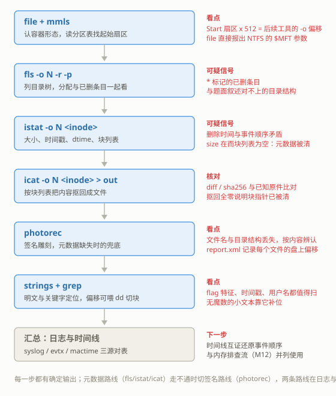

# M14 磁盘与文件系统取证
## Disk and Filesystem Forensics

> [!info]- 章节信息
> **所属方向**：MISC ｜ **难度阶段**：L3 进阶期 ｜ **前置要求**：[[M01-MISC导论与工具箱|M01]] · [[M12-内存取证I-Volatility基础|M12]]
> **本章目标**：把磁盘镜像当结构读——认镜像形态、读分区表、看超级块；在 ext 文件系统上走通"删除 → 定位 → 恢复"的元数据路线与 photorec 签名路线；认识 NTFS 的 MFT 结构与交换数据流；把文本日志、evtx、文件系统时间线三个来源对齐；最后收束成拿到磁盘镜像的固定走查清单。

## 1. 定位：从内存镜像到磁盘镜像

[[M12-内存取证I-Volatility基础|M12]]收的是内存线：内存断电即失，镜像抓住的是某一瞬间的 RAM。磁盘镜像补上另一半——==存储介质的逐字节副本，断电不丢==。进程列表会随关机消失，而文件、日志、注册表 hive 都以文件形式躺在盘上，取证要找的"历史"在磁盘上比内存里完整。

[[12-隐写与流量取证#8. 磁盘与内存取证一瞥|12 章 8 节]]给过磁盘取证的第一印象（binwalk 分离嵌入文件）。本章把"镜像里面是一个文件系统"这件事展开成体系。取证方向各章的分工：

| 章 | 材料 | 内容 |
| ---- | ---- | ---- |
| [[M12-内存取证I-Volatility基础\|M12]] | 内存镜像 | Volatility 基础：进程、网络、注册表 |
| [[M13-内存取证II-进阶\|M13]] | 同一份内存镜像 | 进阶：注入检测、文件提取、时间线 |
| 本章 | 磁盘镜像 | 分区与文件系统、删除恢复、ADS、日志与时间线 |
| [[M18-取证综合-多源关联\|M18]] | 多源材料 | 磁盘 + 内存 + 流量 + 日志的联合作业 |

CTF 里磁盘镜像的常见形态：`dd` 出来的 `.img`/`.raw` 平铺文件、取证压缩包 E01、虚拟机磁盘（vmdk/vdi）。TSK 与 photorec 对这几种都直接支持，本章用最朴素的平铺镜像。

本章工具全部来自 [[M01-MISC导论与工具箱#2.2 四条安装渠道|M01 2.2]] 的清单：sleuthkit（fls / mmls / istat / icat / mactime / fsstat）、testdisk（内含 photorec）；dumpe2fs / debugfs / mkfs.ext3 由 e2fsprogs 自带；NTFS 部分另需 ntfs-3g 包提供的 mkfs.ntfs（`sudo apt install ntfs-3g`）。

本章五张镜像全部自造：一张 MBR 分区的 ext3 主镜像 `case.img`、一张整镜像 ext4 的 `ext4.img`、一张 8 MiB 的 ext2 对照镜像、一张 16 MiB 的 GPT 镜像、一张 32 MiB 的 NTFS 镜像。日志材料自造，evtx 用一份公开小样本。所有命令在 WSL 的 `~/m14/` 目录下执行。

> [!warning] 取证纪律
> 本章只做取证分析视角：所有操作对象是镜像和镜像的副本，不涉及对他人系统的任何访问。分析阶段一律不写原镜像——TSK 工具与 photorec 都是只读的，唯一的写操作发生在造靶阶段和恢复结果的输出目录。拿到来历重要的镜像，先 `dd` 留一份副本、核对哈希，之后的动作都在副本上做。

> [!warning] 镜像放 WSL 原生目录
> dd、mkfs、photorec 都是高频 IO 操作，放在 `/mnt/c` 下会慢很多。把镜像放到 WSL 原生目录（`~/`），结果再拷回 Windows 侧。原因见 [[M01-MISC导论与工具箱#6. 常见问题|M01]] 的 DrvFS 说明。

## 2. 磁盘镜像与分区结构

### 2.1 造一张磁盘镜像

先备好一批普通文件放在 `orig/` 目录：`readme.txt`、`flag.txt`（写一行 `flag{fls_istat_icat_chain}`）、`secret.zip`，以及 `docs/report.txt`、`docs/notes.md`、`pics/photo1.jpg`、`pics/photo2.png`。原件留在原地，恢复阶段要比对。

`dd` 切一块 64 MiB 的空白文件，它就是一张"磁盘"：

```bash
dd if=/dev/zero of=case.img bs=1M count=64
file case.img
```

输出：

```text
case.img: data
```

全零文件没有任何魔数，`file` 报 `data`（[[12-隐写与流量取证#2. 文件格式与魔数|12 章 2 节]]说过：`data` 的意思是 file 放弃理解）。用 `sfdisk` 写入一张 MBR 分区表，划一个从扇区 2048 开始的主分区：

```bash
sfdisk case.img <<'SFD'
label: dos
start=2048, type=83
SFD
```

输出：

```text
Checking that no-one is using this disk right now ... OK

Disk case.img: 64 MiB, 67108864 bytes, 131072 sectors
Units: sectors of 1 * 512 = 512 bytes

>>> Script header accepted.
>>> Created a new DOS (MBR) disklabel with disk identifier 0x4a88fb15.
case.img1: Created a new partition 1 of type 'Linux' and of size 63 MiB.

New situation:
Disklabel type: dos
Disk identifier: 0x4a88fb15

Device     Boot Start    End Sectors Size Id Type
case.img1        2048 131071  129024  63M 83 Linux

The partition table has been altered.
```

分区从扇区 2048（即 1 MiB 处）开始，这是现代分区工具的默认对齐。再用 `mkfs.ext3` 在这个偏移上创建文件系统，`-E offset` 的单位是字节：

```bash
mkfs.ext3 -F -L ctfcase -E offset=1048576 case.img
file case.img
```

输出：

```text
Creating filesystem with 16128 4k blocks and 16128 inodes
Allocating group tables: 0/1   done
Writing inode tables: 0/1   done
Creating journal (1024 blocks): done
Writing superblocks and filesystem accounting information: 0/1   done
case.img: DOS/MBR boot sector; partition 1 : ID=0x83, start-CHS (0x0,32,33), end-CHS (0x8,40,32), startsector 2048, 129024 sectors, extended partition table (last)
```

`file` 现在读出了分区表：类型 `0x83`（Linux）、起始扇区 2048、共 129024 个扇区。分区表是磁盘的"目录页"，文件系统住在这页指出的偏移上。

### 2.2 file 与 mmls：先问形态，再问布局

镜像分析的前两步固定：`file` 认形态，`mmls` 读布局。本章四张镜像的 `file` 结果放在一起看：

```bash
file case.img ext4.img gpt.img ntfs.img
```

输出：

```text
case.img: DOS/MBR boot sector; partition 1 : ID=0x83, start-CHS (0x0,32,33), end-CHS (0x8,40,32), startsector 2048, 129024 sectors, extended partition table (last)
ext4.img: Linux rev 1.0 ext4 filesystem data, UUID=bd812c3b-2c10-434e-9b92-d8e32aceec8c, volume name "case4" (extents) (64bit) (large files) (huge files)
gpt.img:  DOS/MBR boot sector; partition 1 : ID=0xee, start-CHS (0x0,0,2), end-CHS (0x3ff,255,63), startsector 1, 32767 sectors, extended partition table (last)
ntfs.img: DOS/MBR boot sector, code offset 0x52+2, OEM-ID "NTFS    ", sectors/cluster 8, Media descriptor 0xf8, sectors/track 0, dos < 4.0 BootSector (0x80), FAT (1Y bit by descriptor); NTFS, sectors 65535, $MFT start cluster 4, $MFTMirror start cluster 4095, bytes/RecordSegment 2^(-1*246), clusters/index block 1, serial number 070bf89e67512f29f
```

三种形态一眼可分：带分区表的镜像报 `DOS/MBR boot sector` 加分区明细；没有分区表、整张镜像就是一个文件系统的 `ext4.img` 直接报 ext4，连 UUID 和卷标都给出；NTFS 镜像更详细，`$MFT start cluster 4` 这类关键参数直接写在报告里。拿到镜像先看这一行，就决定了后面所有工具的用法。

分区布局用 sleuthkit 的 `mmls` 读，输出以 512 字节扇区为单位：

```bash
mmls case.img
```

输出：

```text
DOS Partition Table
Offset Sector: 0
Units are in 512-byte sectors

      Slot      Start        End          Length       Description
000:  Meta      0000000000   0000000000   0000000001   Primary Table (#0)
001:  -------   0000000000   0000002047   0000002048   Unallocated
002:  000:000   0000002048   0000131071   0000129024   Linux (0x83)
```

这张表是本章所有命令的锚点。后续 fls / istat / icat 都要靠 `-o` 参数告诉它们"文件系统从镜像的哪个扇区开始"，换算就是：

$$\text{分区起始偏移（字节）} = \text{Start 扇区} \times 512 \tag{1}$$

本镜像 $2048 \times 512 = 1048576$ 字节，与 2.1 节 mkfs 的 `-E offset=1048576` 对上。`Slot` 列的 `Meta` 行是分区表自身占用的结构，`-------` 行是分区之间的空隙。

GPT 镜像的 `mmls` 输出另是一种格式。再造一张 16 MiB 的小镜像试一遍（注意 GPT 脚本里类型写 `linux` 别名——GPT 用 GUID 表示分区类型，写 `8300` 这种 MBR 类型码会报 Invalid argument）：

```bash
dd if=/dev/zero of=gpt.img bs=1M count=16
sfdisk gpt.img <<'SFD'
label: gpt
start=2048, size=30656, type=linux
SFD
mmls gpt.img
```

输出：

```text
GUID Partition Table (EFI)
Offset Sector: 0
Units are in 512-byte sectors

      Slot      Start        End          Length       Description
000:  Meta      0000000000   0000000000   0000000001   Safety Table
001:  -------   0000000000   0000002047   0000002048   Unallocated
002:  Meta      0000000001   0000000001   0000000001   GPT Header
003:  Meta      0000000002   0000000033   0000000032   Partition Table
004:  000       0000002048   0000032703   0000030656
005:  -------   0000032704   0000032767   0000000064   Unallocated
```

> [!info]- GPT 与 MBR 的差别
> MBR 分区表只有 64 字节，最多 4 个主分区，没有备份。GPT 把表放在 LBA 2–33，每个分区一条 128 字节的记录，磁盘末尾还存一份完整的头部与表备份——盘头的表被清了还能从盘尾恢复，这正是 4.3 节 testdisk 的用武之地。`file` 对 GPT 镜像报的 `ID=0xee` 是"保护性 MBR"：GPT 规范要求 LBA 0 仍放一张只含一个 `0xee` 类型分区的 MBR，让不认识 GPT 的老工具把整盘当成分区避开。所以 GPT 镜像在 `mmls` 里能看到 `GPT Header`、`Partition Table` 两条 Meta 记录，而 `file` 眼里仍是 MBR。

### 2.3 超级块：文件系统的身份证

ext 家族的元数据从超级块（superblock）读起，它记录块大小、inode 总数、挂载历史。dumpe2fs 是 e2fsprogs 的读取器；对带分区表的镜像，先用 `losetup` 把分区映射成一个块设备再交给它（`-o` 是字节偏移，`--sizelimit` 按公式 (1) 的同款算法取分区长度）：

$$\text{分区大小（字节）} = \text{Length 扇区} \times 512 \tag{2}$$

```bash
losetup -f --show -o 1048576 --sizelimit 66060288 case.img
dumpe2fs -h /dev/loop0
losetup -d /dev/loop0
```

输出：

```text
Filesystem volume name:   ctfcase
Last mounted on:          /mnt/m14
Filesystem UUID:          3c0dda48-30e2-4b72-8da8-69621692e9dc
Filesystem magic number:  0xEF53
Filesystem features:      has_journal ext_attr resize_inode dir_index filetype sparse_super large_file
Filesystem state:         clean
Inode count:              16128
Block count:              16128
Free blocks:              14075
Free inodes:              16111
Block size:               4096
Filesystem created:       Sat Oct 24 23:35:44 2026
Last mount time:          Sat Oct 24 23:35:44 2026
Last write time:          Sat Oct 24 23:35:44 2026
Mount count:              1
Maximum mount count:      -1
Inode size:               256
```

逐项读：

| 字段 | 读法 |
| ---- | ---- |
| `Block size` / `Block count` | 块大小 4096、共 16128 块——后面 istat 里的"Direct Blocks"编号都按这个块算 |
| `Inode count` / `Free inodes` | inode 总数与空闲数；两者差值就是"存在过多少文件"的下限 |
| `has_journal` | 带日志，3.8 节的主角 |
| `Filesystem state` | `clean` 表示卸载时正常收尾；`not clean` 说明镜像是在异常断电状态下抓的 |
| `Last mounted on` / `Mount count` | ==这张盘最后一次挂在哪、挂过几次== |
| `Last mount time` / `Filesystem created` | 时间线的两个锚点 |

==挂载历史本身就是取证点==。`Last mounted on: /mnt/m14` 写明了这张镜像上一次挂在哪个目录，`Mount count` 每次读写挂载加一。Sleuthkit 的 fsstat 给的是另一份摘要，两者可以互相印证：

```bash
fsstat -o 2048 case.img
```

输出：

```text
FILE SYSTEM INFORMATION
--------------------------------------------
File System Type: Ext3
Volume Name: ctfcase
Volume ID: dce992166269a88d724be23048da0d3c

Last Written at: 2026-10-24 23:35:44 (CST)
Last Mounted at: 2026-10-24 23:35:44 (CST)
Unmounted properly
Last mounted on: /mnt/m14

Journal ID: 00
Journal Inode: 8
```

`-o 2048` 就是公式 (1) 的扇区形式。TSK 工具不依赖内核，直接按偏移读镜像，这是"分析不挂载"主路线的入口。

> [!warning] 这些字段会随挂载更新
> `Mount count`、`Last mounted on`、`Last mount time` 都在每次读写挂载时被内核改写。分析别人的镜像不会留下痕迹（TSK 直读不挂载），但造靶时自己挂载自己卸载，这些字段记录的是你的操作。CTF 镜像里若看到陌生的挂载点路径，那就是出题环境留下的。

## 3. ext 文件系统：删除与恢复

### 3.1 删除在盘上动了什么

先立三个概念：

- **inode**：文件的元数据结构，编号唯一。大小、时间戳、归属、数据块位置全在 inode 里；文件名不在。
- **目录项**：目录是"文件名 → inode 号"的对照表。删除文件时，内核把对应目录项作废——名字与 inode 的联系断开。
- **块位图**：记录每个数据块是否被占用。删除时把该文件的数据块标回"空闲"，但这些块上的字节一个都不会被擦除，直到被新文件重用。

所以"删除"断的是三处联系：目录项、inode 的块指针、块位图。==数据块的内容原地不动==。恢复工具的全部工作，就是从没被断掉的某一处联系出发，把块号找回来：

- inode 里块指针还在 → 按元数据恢复（fls / istat / icat，3.5–3.6 节）；
- inode 被清空 → 按内容特征扫描未分配空间（photorec，4.1 节）。

### 3.2 造靶：写入一批文件

把 2.1 备好的文件写进 `case.img` 的文件系统（读写挂载只发生在造靶阶段）：

```bash
mount -o loop,offset=1048576 case.img /mnt/m14
cp -v orig/readme.txt orig/flag.txt orig/secret.zip /mnt/m14/
mkdir -p /mnt/m14/docs /mnt/m14/pics
cp -v orig/docs/report.txt orig/docs/notes.md /mnt/m14/docs/
cp -v orig/pics/photo1.jpg orig/pics/photo2.png /mnt/m14/pics/
sync
umount /mnt/m14
```

输出：

```text
'orig/readme.txt' -> '/mnt/m14/readme.txt'
'orig/flag.txt' -> '/mnt/m14/flag.txt'
'orig/secret.zip' -> '/mnt/m14/secret.zip'
'orig/docs/report.txt' -> '/mnt/m14/docs/report.txt'
'orig/docs/notes.md' -> '/mnt/m14/docs/notes.md'
'orig/pics/photo1.jpg' -> '/mnt/m14/pics/photo1.jpg'
'orig/pics/photo2.png' -> '/mnt/m14/pics/photo2.png'
```

七个文件、两个目录。inode 从 11（lost+found）之后按创建顺序分配：readme.txt 是 12、flag.txt 是 13、secret.zip 是 14，docs 与 pics 两个目录占 15、16，其余依次排下去。记住这个对应关系，后面 istat 要用。

### 3.3 内核 rm：元数据被清干净

先看现代内核做删除的真实后果。造一张 ext4 镜像，写入同样的文件后用 `rm` 删除：

```bash
dd if=/dev/zero of=ext4.img bs=1M count=48
mkfs.ext4 -F -L case4 ext4.img
mount -o loop ext4.img /mnt/m14
cp orig/readme.txt orig/secret.zip /mnt/m14/
echo 'flag{photorec_carved_me}' > /mnt/m14/flag.txt
mkdir -p /mnt/m14/docs /mnt/m14/pics
cp orig/docs/report.txt orig/docs/notes.md /mnt/m14/docs/
cp orig/pics/photo1.jpg orig/pics/photo2.png /mnt/m14/pics/
sync
umount /mnt/m14
mount -o loop ext4.img /mnt/m14
rm -rfv /mnt/m14/readme.txt /mnt/m14/flag.txt /mnt/m14/secret.zip /mnt/m14/docs /mnt/m14/pics
sync
umount /mnt/m14
```

输出：

```text
removed '/mnt/m14/readme.txt'
removed '/mnt/m14/flag.txt'
removed '/mnt/m14/secret.zip'
removed '/mnt/m14/docs/report.txt'
removed '/mnt/m14/docs/notes.md'
removed directory '/mnt/m14/docs'
removed '/mnt/m14/pics/photo1.jpg'
removed '/mnt/m14/pics/photo2.png'
removed directory '/mnt/m14/pics'
```

flag.txt 是第三个创建的文件，inode 是 14。读它现在的状态：

```bash
istat ext4.img 14
```

输出：

```text
inode: 14
Not Allocated
Group: 0
Generation Id: 3942369907
uid / gid: 0 / 0
mode: rrw-r--r--
Flags: Extents,
size: 0
num of links: 0

Inode Times:
Accessed:	2026-10-24 23:28:01.006589110 (CST)
File Modified:	2026-10-24 23:28:01.035105955 (CST)
Inode Modified:	2026-10-24 23:28:01.035105955 (CST)
File Created:	2026-10-24 23:28:01.006589110 (CST)
Deleted:	2026-10-24 23:28:01 (CST)

Direct Blocks:
```

`Deleted` 时间在、`Not Allocated` 在，但 ==size 归零、Direct Blocks 一行全空==——ext4 的 inode 用"extent"描述数据位置，删除时内核把 extent 树整个清掉。没有块指针，icat 无从下手：

```bash
icat ext4.img 14 > rec_flag_ext4.bin
wc -c rec_flag_ext4.bin
```

输出：

```text
0 rec_flag_ext4.bin
```

按 inode 抠回的是 0 字节。但文件内容一个字节都没少，还在镜像里：

```bash
grep -abo 'flag{photorec_carved_me}' ext4.img
```

输出：

```text
7548928:flag{photorec_carved_me}
```

`-a` 把镜像当文本扫，`-b` 给出命中字节偏移 7548928。==块指针被清，icat 拿不到块号；字节仍躺在未分配空间，等按内容特征工作的 photorec 来找（4.1 节）==。这就是 ext4 上"删除即恢复难"的直接原因。

> [!note] 老教程为什么能"ext3 一删一恢复"
> 早年内核的 ext2/ext3 驱动删除时只作废目录项和位图，不清 inode 的块指针，所以 fls → istat → icat 一路畅通，大量老教程基于此。现在的内核用 ext4 驱动统一处理 ext2/3/4，删除时清空元数据，老教程的命令原样照搬会得到 0 字节。分清"删除态是谁制造的"，才知道元数据路线还走不走得通。

### 3.4 可恢复的删除态：ext2 对照与 debugfs 代删

并不是所有删除都会清块指针。两种情形保留完整元数据：

**情形一：ext2 镜像。** ext2 由独立的内核驱动处理，删除后块指针保留。造一张 8 MiB 的 ext2 镜像、写入后用内核 `rm` 删除：

```bash
dd if=/dev/zero of=e2.img bs=1M count=8
mkfs.ext2 -F -b 1024 -O ^dir_index -L e2case e2.img
mount -o loop e2.img /mnt/m14
echo 'flag{ext2_dead_entry_keeps_name}' > /mnt/m14/flag.txt
echo 'flag{ext2_dead_entry_keeps_name}' > e2_flag_orig.txt
echo 'plain text' > /mnt/m14/readme.txt
sync
rm -v /mnt/m14/flag.txt
sync
umount /mnt/m14
```

输出：

```text
removed '/mnt/m14/flag.txt'
```

读已删文件的 inode（同样是按创建顺序编号：lost+found 11、flag.txt 12、readme.txt 13）：

```bash
istat e2.img 12
icat e2.img 12 > rec_e2_flag.txt
cat rec_e2_flag.txt
diff rec_e2_flag.txt e2_flag_orig.txt && echo IDENTICAL
```

输出：

```text
inode: 12
Not Allocated
Group: 0
Generation Id: 1864622604
uid / gid: 0 / 0
mode: rrw-r--r--
size: 33
num of links: 0

Inode Times:
Accessed:	2026-10-24 23:32:47 (CST)
File Modified:	2026-10-24 23:32:47 (CST)
Inode Modified:	2026-10-24 23:32:47 (CST)
Deleted:	2026-10-24 23:32:47 (CST)

Direct Blocks:
7681
flag{ext2_dead_entry_keeps_name}
IDENTICAL
```

`size: 33`、`Direct Blocks: 7681` 都在，icat 抠回的内容与原件逐字节一致（`e2_flag_orig.txt` 是删除前留的原件）。==内核删除不一定清元数据，取决于驱动==。

**情形二：用 debugfs 代做删除。** debugfs 是 e2fsprogs 自带的文件系统调试器，`-w` 以写方式打开镜像。它的 `rm` 命令解除目录项、把 inode 标为已删（dtime 置位、链接数清零），但不动 size 与块指针——复现的正是老内核留下的那种删除态。CTF 镜像里"可恢复的删除"多半就是这种形态。在主镜像 case.img 上做：

```bash
losetup -f --show -o 1048576 --sizelimit 66060288 case.img
printf 'rm flag.txt\nrm docs/report.txt\nrm pics/photo1.jpg\nquit\n' > /tmp/rmcmds.txt
debugfs -w -f /tmp/rmcmds.txt /dev/loop0
losetup -d /dev/loop0
```

输出：

```text
debugfs 1.47.2 (1-Jan-2025)
debugfs:  rm flag.txt

debugfs:  rm docs/report.txt

debugfs:  rm pics/photo1.jpg

debugfs:  quit
```

删除了三个文件：`flag.txt`（inode 13）、`docs/report.txt`（inode 17）、`pics/photo1.jpg`（inode 19）。原件都还在 `orig/` 里，等恢复后比对。

> [!note] 为什么不用内核 rm 删 case.img
> case.img 是 ext3，现代内核同样用 ext4 驱动处理，`rm` 的后果与 3.3 的 ext4 相同：size 与块指针清零，元数据路线作废。要在它上面练习"按元数据恢复"，删除就得交给 debugfs。做真实取证时遇到"块指针还在"的删除态，说明删除发生在一个不清元数据的环境里——这本身就是一条环境信息。

### 3.5 fls 与 istat：定位已删文件

fls 列出文件系统的目录树。已删条目带 `*` 号，inode 号照常给出：

```bash
fls -o 2048 -r -p case.img
```

输出：

```text
d/d 11:	lost+found
r/r 12:	readme.txt
r/r * 13:	flag.txt
r/r 14:	secret.zip
d/d 15:	docs
r/r * 17:	docs/report.txt
r/r 18:	docs/notes.md
d/d 16:	pics
r/r * 19:	pics/photo1.jpg
r/r 20:	pics/photo2.png
V/V 16129:	$OrphanFiles
```

`-r` 递归、`-p` 输出完整路径。三个 `*` 条目与 3.4 的删除一一对应；只看已删条目加 `-d`：

```bash
fls -o 2048 -r -p -d case.img
```

输出：

```text
r/r * 13:	flag.txt
r/r * 17:	docs/report.txt
r/r * 19:	pics/photo1.jpg
```

每行开头 `r/r * 13` 的读法：前一个 `r` 是目录项记录的类型（regular file），后一个 `r` 是 inode 的类型，`*` 表示已删除，`13` 是 inode 号。有了 inode 号，istat 读出全部元数据：

```bash
istat -o 2048 case.img 13
istat -o 2048 case.img 19
```

输出：

```text
inode: 13
Not Allocated
Group: 0
Generation Id: 1579292862
uid / gid: 0 / 0
mode: rrw-r--r--
size: 27
num of links: 0

Inode Times:
Accessed:	2026-10-24 23:35:44 (CST)
File Modified:	2026-10-24 23:35:44 (CST)
Inode Modified:	2026-10-24 23:35:44 (CST)
Deleted:	2026-10-24 23:35:44 (CST)

Direct Blocks:
15361

inode: 19
Not Allocated
Group: 0
Generation Id: 850506758
uid / gid: 0 / 0
mode: rrw-r--r--
size: 6861
num of links: 0

Inode Times:
Accessed:	2026-10-24 23:35:44 (CST)
File Modified:	2026-10-24 23:35:44 (CST)
Inode Modified:	2026-10-24 23:35:44 (CST)
Deleted:	2026-10-24 23:35:44 (CST)

Direct Blocks:
14848 14849
```

对照 3.3 的 ext4 输出，这份 inode 是完整的：size 分别是 27 和 6861（与 2.1 节的 cp 清单对得上），`Deleted` 时间在，块列表给出数据块号——inode 13 占 1 块（15361），inode 19 占 2 块（14848、14849）。按 2.3 节的 `Block size: 4096` 换算，块 15361 在分区内的偏移是 $15361 \times 4096 = 62918656$ 字节。

### 3.6 icat：按 inode 抠回内容

icat 按 inode 的块指针把内容从镜像里拼出来：

```bash
icat -o 2048 case.img 13 > rec_flag.txt
icat -o 2048 case.img 17 > rec_report.txt
icat -o 2048 case.img 19 > rec_photo1.jpg
cat rec_flag.txt
diff rec_flag.txt orig/flag.txt && echo FLAG_IDENTICAL
diff rec_report.txt orig/docs/report.txt && echo REPORT_IDENTICAL
cmp rec_photo1.jpg orig/pics/photo1.jpg && echo PHOTO_IDENTICAL
sha256sum rec_photo1.jpg orig/pics/photo1.jpg
```

输出：

```text
flag{fls_istat_icat_chain}
FLAG_IDENTICAL
REPORT_IDENTICAL
PHOTO_IDENTICAL
c3bedb89f6ad3ed78a9cf2b57744d55f99950af2fb46fe1b2f00ad475b456abe  rec_photo1.jpg
c3bedb89f6ad3ed78a9cf2b57744d55f99950af2fb46fe1b2f00ad475b456abe  orig/pics/photo1.jpg
```

三个已删文件全部恢复：两个文本 diff 无差异，一个二进制 cmp 无差异，SHA-256 相同。==元数据路线的完整链条：fls 找 inode → istat 确认块指针还在 → icat 按块号抠内容 → diff 收口==。

### 3.7 debugfs 路线：lsdel 与 dump

没有 TSK 的环境里，e2fsprogs 自带的 debugfs 也能走完同样的路。`lsdel` 扫描 inode 表，列出所有"标记已删且块指针完整"的 inode：

```bash
losetup -f --show -o 1048576 --sizelimit 66060288 case.img
debugfs -R 'lsdel' /dev/loop0
```

输出：

```text
debugfs 1.47.2 (1-Jan-2025)
 Inode  Owner  Mode    Size      Blocks   Time deleted
    13      0 100644     27      1/     1 Sat Oct 24 23:35:44 2026
    17      0 100644     49      1/     1 Sat Oct 24 23:35:44 2026
    19      0 100644   6861      2/     2 Sat Oct 24 23:35:44 2026
3 deleted inodes found.
```

`Blocks` 列的 `1/1` 是"块指针数 / 块总数"。`dump` 按 inode 导出内容，与 icat 同源同果：

```bash
debugfs -R 'dump <13> /home/hua/m14/rec_debug_flag.txt' /dev/loop0
losetup -d /dev/loop0
diff rec_debug_flag.txt orig/flag.txt && echo IDENTICAL
```

输出：

```text
debugfs 1.47.2 (1-Jan-2025)
IDENTICAL
```

注意 3.3 的 ext4 镜像上 `lsdel` 会报 `0 deleted inodes found`——内核清掉的 inode 不满足"块指针完整"这个条件，lsdel 找不到它们。lsdel 与 istat 看到的是同一个事实的两面：==块指针完整，元数据路线才存在==。

### 3.8 journal：为什么删得快恢复概率就低

2.3 节的 dumpe2fs 和 fsstat 都显示了 `has_journal` / `Journal Inode: 8`。日志（journal）是 ext 家族的元数据记账本：每次元数据改动先写进日志、提交，再落到最终位置。它的两个取证含义：

1. **日志里有删除前的 inode 副本。** 删除是一次事务，提交后 inode 的新版本（块指针被清的那份）写进 inode 表，而旧版本（块指针完整的那份）在日志区还留有一段时间。extundelete、ext4magic 这类工具的原理就是翻日志找删除前的 inode 副本，按它记录的块号把数据抠出来——相当于给 3.6 节的 icat 补回一份块指针。
2. **日志是环形覆盖的。** 新事务不断覆盖旧记录，每次读写挂载都会重放与回收；数据块一旦被新文件占用，内容就真的没了。==恢复窗口从删除那一刻起就开始关闭：删除后越早分析、盘上写入越少，恢复概率越高==。

所以处理疑似要恢复的镜像，纪律只有一条：拿到手立刻停止一切写入、先留副本。这也是本章把"分析不挂载"定为主路线的原因——挂载读写哪怕只是浏览一遍，都在消耗恢复窗口。

## 4. photorec 与 testdisk

### 4.1 photorec：按签名雕刻

元数据路线断掉时（3.3 的 ext4），最后一条路是**文件雕刻（file carving）**：不看任何文件系统结构，直接按文件头尾魔数在字节流里切文件。魔数表见 [[12-隐写与流量取证#2. 文件格式与魔数|12 章 2 节]]，[[12-隐写与流量取证#8. 磁盘与内存取证一瞥|12 章 8.1]]的 binwalk/foremost 做的是同一类事，photorec 是其中对"整块磁盘镜像"支持最完整的。

```bash
photorec /log /d carved ext4.img
```

photorec 是字符界面工具，方向键与回车操作。针对本章镜像的按键流程：

> [!info]- photorec 的五步按键流程
> 1. 介质选择屏：选中 `Disk /home/hua/m14/ext4.img`，回车 `Proceed`；
> 2. 分区屏：photorec 直接认出 `P ext4 [case4]`，选 `[Search]` 回车；
> 3. 文件系统类型屏：选 `[ ext2/ext3 ]` 回车；
> 4. 扫描范围屏：`[ Free ]`（只扫未分配空间）或 `[ Whole ]`（连已分配一起扫）。本镜像文件全部已删，选 `Free` 足够；
> 5. 扫描完成后按 `Quit`。文件落在 `/d` 参数指定目录下的 `carved.1/` 里。

看产出：

```bash
ls -la carved.1/
file carved.1/f*
```

输出：

```text
-rw-r--r-- 1 hua hua  139 Oct 25  2026 f0014736_inside.zip
-rw-r--r-- 1 hua hua 6861 Oct 24 23:46 f0014768.jpg
-rw-r--r-- 1 hua hua 7883 Oct 24 23:46 f0014784.png
-rw-r--r-- 1 hua hua 2447 Oct 24 23:46 report.xml
f0014736_inside.zip: Zip archive data, made by v2.0 UNIX, extract using at least v2.0, last modified Oct 24 2026 23:28:00, uncompressed size 19, method=deflate
f0014768.jpg:        JPEG image data, JFIF standard 1.01, aspect ratio, density 1x1, segment length 16, baseline, precision 8, 128x96, components 3
f0014784.png:        PNG image data, 128 x 96, 8-bit/color RGB, non-interlaced
```

ext4.img 上 icat 拿不到的三个文件，photorec 全雕了出来。核对内容：

```bash
cmp carved.1/f0014768.jpg orig/pics/photo1.jpg && echo JPG_IDENTICAL
cmp carved.1/f0014784.png orig/pics/photo2.png && echo PNG_IDENTICAL
cmp carved.1/f0014736_inside.zip orig/secret.zip && echo ZIP_IDENTICAL
```

输出：

```text
JPG_IDENTICAL
PNG_IDENTICAL
ZIP_IDENTICAL
```

三个文件逐字节一致。命名规则读一下：`f` 后的数字是**扇区号**（乘 512 得字节偏移，如 $14768 \times 512 = 7561216$）；扩展名来自命中的签名；zip 的文件名会取包内第一个条目名（`_inside`）。目录结构、原文件名在雕刻里一概不保留，辨认全靠内容。每个雕出文件在盘上的位置写在 `report.xml`（DFXML 格式的雕刻报告）：

```bash
head -c 2000 carved.1/report.xml
```

输出：

```text
<?xml version='1.0' encoding='UTF-8'?>
<dfxml xmloutputversion='1.0'>
  <creator>
    <package>PhotoRec</package>
    <version>7.2</version>
  </creator>
  <source>
    <image_filename>/home/hua/m14/ext4.img</image_filename>
    <sectorsize>512</sectorsize>
    <image_size>50331648</image_size>
    <volume>
      <byte_runs>
        <byte_run offset='0' img_offset='0' len='50331648'/>
      </byte_runs>
      <block_size>4096</block_size>
    </volume>
  </source>
  <fileobject>
    <filename>f0014712.ext</filename>
    <filesize>4096</filesize>
    <byte_runs>
      <byte_run offset='0' img_offset='7532544' len='4096'/>
    </byte_runs>
  </fileobject>
```

`img_offset` 就是该文件在镜像里的字节偏移。报告里还有 `f0014712.ext` 这类 `.ext` 文件——4 KiB 的整块数据，头尾都对不上任何已知签名，photorec 原样切出来留人辨认，纯文本文件（readme.txt、report.txt）的数据块就在其中。==没有魔数的内容雕刻工具接不住，这类文件靠 3.3 节的 `grep -abo` 定位偏移、再 dd 切块==：

```bash
grep -abo 'flag{photorec_carved_me}' ext4.img
dd if=ext4.img of=flag_carved.txt bs=1 skip=7548928 count=25 status=none
cat flag_carved.txt
```

输出：

```text
7548928:flag{photorec_carved_me}
flag{photorec_carved_me}
```

grep 给偏移、dd 按偏移切块，是雕刻之外处理无签名内容的标准动作（`m.start()` 的用法在 [[M01-MISC导论与工具箱#4.2 二进制里的正则打靶|M01 4.2]] 也用过）。

### 4.2 两条恢复路线对比

| | 元数据恢复（fls / istat / icat） | 签名雕刻（photorec） |
| ---- | ---- | ---- |
| 前提 | inode 的块指针还在 | 文件头尾魔数完整 |
| 拿到什么 | 原文件名、目录结构、时间戳、内容 | 只有内容；文件名是扇区号 |
| 失效条件 | 块指针被清（3.3），或数据块被重用 | 文件被覆盖、加密、无魔数（纯文本） |
| 典型工具 | fls / istat / icat、debugfs | photorec、binwalk / foremost（[[12-隐写与流量取证#8. 磁盘与内存取证一瞥\|12 章 8.1]]） |
| 组合方式 | 先走元数据路线，漏掉的交给雕刻 | 两者结果按内容去重合并 |

解题时两条路都跑一遍再合并：元数据路线给出的文件名与时间戳是证据，雕刻路线负责把元数据已损的文件捞回来。

### 4.3 testdisk：分区表修复

photorec 的同门工具 testdisk 管另一半问题：分区表本身坏了。它扫描整个盘面、按文件系统特征定位每个分区的真实边界，然后把 MBR 分区表或 GPT 重写回去。两个常用场景：

- **MBR 被清零**：`testdisk 镜像` → Analyse → Quick Search，testdisk 按 ext/FAT/NTFS 的超级块或引导扇区特征找分区，找到后 Write 回写分区表；
- **GPT 头损坏**：GPT 在盘尾有完整备份（2.2 节折叠框），testdisk 会利用备份头重建。

CTF 里"分区表被清、但文件系统还在"的镜像，先过一遍 testdisk 重建布局，再回到本章的 mmls → fls 流程。交互界面与 photorec 同风格，具体按键不展开。

## 5. NTFS：MFT 与交换数据流

### 5.1 MFT 与属性

Windows 的 NTFS 把"一切都是记录"做到极致：文件系统开机先读 `$MFT`（Master File Table，主文件表），每个文件与目录各占一条记录（默认 1 KiB），连 `$MFT` 自己也是 0 号记录。2.2 节 `file` 对 ntfs.img 的报告里 `$MFT start cluster 4` 指的就是它的位置。表里还能看到一批以 `$` 开头的名字——`$MFTMirr`（$MFT 的备份）、`$LogFile`（NTFS 的日志）、`$Bitmap`（簇位图）——它们是元数据文件，与 ext 的超级块、日志、位图一一对应。

每条 MFT 记录内部由**属性（attribute）**组成：`$STANDARD_INFORMATION`（时间戳、权限）、`$FILE_NAME`（文件名、父目录）、`$DATA`（内容本体）。$DATA 有两种形态：

- **常驻（resident）**：内容小，直接住进 MFT 记录里；
- **非常驻（non-resident）**：内容大，记录里只存簇号列表，数据在数据区。

造一张 NTFS 镜像验证。ntfs-3g 挂载时加 `streams_interface=windows`，才能用 `文件名:流名` 语法写交换数据流（5.3 节）：

```bash
dd if=/dev/zero of=ntfs.img bs=1M count=32
mkfs.ntfs -F -f -L WINCASE ntfs.img
mount -t ntfs-3g -o loop,streams_interface=windows ntfs.img /mnt/m14
cp orig/video.bin /mnt/m14/video.bin
echo 'plain text body' > /mnt/m14/notes.txt
echo 'flag{ntfs_ads_hidden_stream}' > /mnt/m14/notes.txt:hidden
ls -l /mnt/m14
sync
umount /mnt/m14
```

输出：

```text
total 600
-rwxrwxrwx 1 root root     16 Oct 24 23:28 notes.txt
-rwxrwxrwx 1 root root 614400 Oct 24 23:28 video.bin
```

> [!warning] mkfs.ntfs 对文件目标要加 -F
> `mkfs.ntfs -f`（快速格式化）遇到普通文件会拒绝："ntfs.img is not a block device. Refusing to make a filesystem here!"。镜像不是块设备，要加 `-F` 强制。另外 ntfs-3g 默认 `streams_interface=xattr`，不加 `streams_interface=windows` 时 `notes.txt:hidden` 这种路径打不开。

`ls` 显示 notes.txt 只有 16 字节——写入的第二条 `flag{ntfs_ads_hidden_stream}` 在 `ls` 里完全不可见。这就是 5.3 节的伏笔。

### 5.2 fls / istat：常驻与非常驻

TSK 读 NTFS 要显式指定 `-f ntfs`。fls 列出的第一批名字就是 MFT 的元数据文件：

```bash
fls -f ntfs -r -p ntfs.img
```

输出：

```text
r/r 4-128-1:	$AttrDef
r/r 8-128-2:	$BadClus
r/r 8-128-1:	$BadClus:$Bad
r/r 6-128-1:	$Bitmap
r/r 7-128-1:	$Boot
d/d 11-144-2:	$Extend
……
r/r 2-128-1:	$LogFile
r/r 0-128-1:	$MFT
r/r 1-128-1:	$MFTMirr
r/r 9-128-2:	$Secure:$SDS
r/r 10-128-1:	$UpCase
r/r 3-128-3:	$Volume
r/r 65-128-2:	notes.txt
r/r 65-128-4:	notes.txt:hidden
r/r 64-128-2:	video.bin
V/V 66:	$OrphanFiles
```

NTFS 的条目号是三段式"记录号-属性类型-属性实例"，如 `65-128-2`：65 号 MFT 记录、属性类型 128（$DATA）、实例 2。**注意 `notes.txt:hidden` 单独占一行**——目录列表里看不见的数据流，fls 直接列了出来。

先用 64 号（video.bin，600 KB）看非常驻形态：

```bash
istat -f ntfs ntfs.img 64
```

输出：

```text
MFT Entry Header Values:
Entry: 64        Sequence: 1
Allocated File
Links: 1

$STANDARD_INFORMATION Attribute Values:
Created:	2026-10-24 23:28:01.065862600 (CST)
File Modified:	2026-10-24 23:28:01.071815200 (CST)
MFT Modified:	2026-10-24 23:28:01.071815200 (CST)
Accessed:	2026-10-24 23:28:01.065862600 (CST)

$FILE_NAME Attribute Values:
Name: video.bin
Parent MFT Entry: 5 	Sequence: 5
Allocated Size: 614400   	Actual Size: 0

Attributes:
Type: $STANDARD_INFORMATION (16-0)   Name: N/A   Resident   size: 48
Type: $FILE_NAME (48-3)   Name: N/A   Resident   size: 84
Type: $SECURITY_DESCRIPTOR (80-1)   Name: N/A   Resident   size: 80
Type: $DATA (128-2)   Name: N/A   Non-Resident   size: 614400  init_size: 614400
4608 4609 4610 4611 4612 4613 4614 4615
4616 4617 4618 4619 4620 4621 4622 4623
……
```

614400 字节的内容放不进 1 KiB 的记录，`$DATA (128-2)` 标为 `Non-Resident`，下面列出的簇号串（4608 起）就是数据真正的住址。icat 照常提取：

```bash
icat -f ntfs ntfs.img 65 > rec_ntfs_notes.txt
cat rec_ntfs_notes.txt
icat -f ntfs ntfs.img 64 > rec_ntfs_video.bin
cmp rec_ntfs_video.bin orig/video.bin && echo VIDEO_IDENTICAL
```

输出：

```text
plain text body
VIDEO_IDENTICAL
```

600 KB 的二进制逐字节一致。icat 不带属性参数时取默认 $DATA，也就是文件的本体内容。

### 5.3 ADS：藏在属性里的第二条数据流

NTFS 允许在 `$DATA` 上挂多个有名实例——默认实例存文件本体，有名实例叫**交换数据流（Alternate Data Stream，ADS）**。5.1 节写入的 `flag{ntfs_ads_hidden_stream}` 就住在 notes.txt 的名为 `hidden` 的 ADS 里：目录不显示、`ls -l` 的 16 字节不算它、拷贝到非 NTFS 介质时直接丢弃。

istat 看 65 号记录的属性清单：

```bash
istat -f ntfs ntfs.img 65
```

输出：

```text
MFT Entry Header Values:
Entry: 65        Sequence: 1
Allocated File
Links: 1

$STANDARD_INFORMATION Attribute Values:
Created:	2026-10-24 23:28:01.073351600 (CST)
File Modified:	2026-10-24 23:28:01.073634400 (CST)
MFT Modified:	2026-10-24 23:28:01.073634400 (CST)
Accessed:	2026-10-24 23:28:01.073351600 (CST)

$FILE_NAME Attribute Values:
Name: notes.txt
Parent MFT Entry: 5 	Sequence: 5
Allocated Size: 16   	Actual Size: 0

Attributes:
Type: $STANDARD_INFORMATION (16-0)   Name: N/A   Resident   size: 48
Type: $FILE_NAME (48-3)   Name: N/A   Resident   size: 84
Type: $SECURITY_DESCRIPTOR (80-1)   Name: N/A   Resident   size: 80
Type: $DATA (128-2)   Name: N/A   Resident   size: 16
Type: $DATA (128-4)   Name: hidden   Resident   size: 29
```

最后两行是关键：同一个 `$DATA` 类型挂了两个实例——无名的 16 字节（文件本体）和名为 `hidden` 的 29 字节（ADS）。两个都常驻，内容直接住在 MFT 记录里。icat 用"记录号-属性类型-属性实例"语法指定取哪条流：

```bash
icat -f ntfs ntfs.img 65-128-4
strings ntfs.img | grep 'ntfs_ads'
```

输出：

```text
flag{ntfs_ads_hidden_stream}
flag{ntfs_ads_hidden_stream}
```

icat 按 `65-128-4` 抠出 ADS 内容；strings 直接扫镜像也命中——常驻内容就在 MFT 区里，是明文。NTFS 取证检查 ADS 的固定三步：==fls 看有没有 `文件名:流名` 条目 → istat 看属性清单里有没有有名 `$DATA` → icat 按属性号取内容==。

## 6. 日志取证与时间线

文件系统回答"盘上有什么"，日志回答"发生过什么"。三种日志材料按来源分：Linux 文本日志、Windows 事件日志（evtx）、文件系统自身的时间线。

### 6.1 文本日志：解析与排序

CTF 里最常见的 Linux 日志是 `/var/log/auth.log` 一类的纯文本，格式为"月 日 时:分:秒 主机 进程[pid]: 消息"。自造一份打乱顺序的样本：

```bash
cat auth_sample.log
```

输出：

```text
Oct 24 08:47:56 case01 systemd-logind[912]: New session 3 of user hua.
Oct 24 09:02:11 case01 sshd[1022]: Accepted password for hua from 192.168.1.7 port 51022 ssh2
Oct 24 09:14:33 case01 sudo:     hua : TTY=pts/0 ; PWD=/home/hua ; USER=root ; COMMAND=/usr/bin/cat /root/flag.txt
Oct 23 21:05:40 case01 sshd[980]: Accepted password for hua from 192.168.1.7 port 50011 ssh2
Oct 24 09:15:02 case01 su: (to root) hua on pts/0
Oct 24 09:41:20 case01 sshd[1180]: Failed password for root from 192.168.1.9 port 55012 ssh2
Oct 23 21:06:12 case01 systemd-logind[912]: New session 1 of user hua.
```

注意两件事：syslog 格式**没有年份**，解析时补上；样本跨了两天且顺序是乱的，直接读会得出错误的先后关系。解析加排序的脚本：

```python
import re
from datetime import datetime

PAT = re.compile(r"^([A-Z][a-z]{2}) ([ \d]?\d) (\d\d:\d\d:\d\d) (.*)$")
MONTHS = {m: i for i, m in enumerate(
    "Jan Feb Mar Apr May Jun Jul Aug Sep Oct Nov Dec".split(), 1)}

rows = []
for line in open("auth_sample.log"):
    m = PAT.match(line.rstrip("\n"))
    if m:
        mon, day, hms, rest = m.groups()
        ts = datetime(2026, MONTHS[mon], int(day),
                      *(int(x) for x in hms.split(":")))
        rows.append((ts, line.rstrip("\n")))

rows.sort(key=lambda r: r[0])
for ts, line in rows:
    print(ts.strftime("%Y-%m-%d %H:%M:%S"), "|", line)
print("total:", len(rows), "lines")
```

输出：

```text
2026-10-23 21:05:40 | Oct 23 21:05:40 case01 sshd[980]: Accepted password for hua from 192.168.1.7 port 50011 ssh2
2026-10-23 21:06:12 | Oct 23 21:06:12 case01 systemd-logind[912]: New session 1 of user hua.
2026-10-24 08:47:56 | Oct 24 08:47:56 case01 systemd-logind[912]: New session 3 of user hua.
2026-10-24 09:02:11 | Oct 24 09:02:11 case01 sshd[1022]: Accepted password for hua from 192.168.1.7 port 51022 ssh2
2026-10-24 09:14:33 | Oct 24 09:14:33 case01 sudo:     hua : TTY=pts/0 ; PWD=/home/hua ; USER=root ; COMMAND=/usr/bin/cat /root/flag.txt
2026-10-24 09:15:02 | Oct 24 09:15:02 case01 su: (to root) hua on pts/0
2026-10-24 09:41:20 | Oct 24 09:41:20 case01 sshd[1180]: Failed password for root from 192.168.1.9 port 55012 ssh2
total: 7 lines
```

排序后时间顺序成立。关键字检索是第二步：`grep -E "sudo|su:" auth_sample.log` 直接给出"提权发生过两次、sudo 那次读了 /root/flag.txt"。文本日志的优势是人类可读、grep 即用；弱点是格式松散、没有年份、行本身可被改写。

### 6.2 Windows 事件日志：evtx

Windows 的日志容器是 evtx（`C:\Windows\System32\winevt\Logs\*.evtx`），二进制格式，用 python-evtx 解析成 XML。取一份公开小样本（omerbenamram/evtx 仓库 samples 目录下的 `system.evtx`，约 1.1 MiB，直链见延伸阅读），先看 `file` 认它：

```bash
file System.evtx
```

输出：

```text
System.evtx: MS Windows Vista-8.1 Event Log, 3 chunks (no. 2 in use), next record no. 309, DIRTY
```

解析脚本（python-evtx 的 API 用法）：

```python
import Evtx.Evtx as evtx

with evtx.Evtx("System.evtx") as log:
    n = 0
    for record in log.records():
        n += 1
        if n <= 2:
            print(record.xml())
    print("total records:", n)
```

输出：

```text
<Event xmlns="http://schemas.microsoft.com/win/2004/08/events/event"><System><Provider Name="EventLog"></Provider>
<EventID Qualifiers="32768">6009</EventID>
<Level>4</Level>
<Task>0</Task>
<Keywords>0x0080000000000000</Keywords>
<TimeCreated SystemTime="2017-07-12 17:16:28.214161+00:00"></TimeCreated>
<EventRecordID>1</EventRecordID>
<Channel>System</Channel>
<Computer>WIN-P4SIAA0SQCO</Computer>
<Security UserID=""></Security>
</System>
<EventData><Data>&lt;string&gt;10.00.&lt;/string&gt;
&lt;string&gt;15063&lt;/string&gt;
&lt;string&gt;&lt;/string&gt;
&lt;string&gt;Multiprocessor Free&lt;/string&gt;
&lt;string&gt;0&lt;/string&gt;
</Data>
<Binary></Binary>
</EventData>
</Event>

----------------------------------------
<Event xmlns="http://schemas.microsoft.com/win/2004/08/events/event"><System><Provider Name="EventLog"></Provider>
<EventID Qualifiers="32768">6005</EventID>
<Level>4</Level>
<Task>0</Task>
<Keywords>0x0080000000000000</Keywords>
<TimeCreated SystemTime="2017-07-12 17:16:28.214161+00:00"></TimeCreated>
<EventRecordID>2</EventRecordID>
<Channel>System</Channel>
<Computer>WIN-P4SIAA0SQCO</Computer>
<Security UserID=""></Security>
</System>
<EventData><Data></Data>
<Binary>4QcHAAMADAARABAAHADWAAAAAAAAAAAA</Binary>
</EventData>
</Event>

----------------------------------------
total records: 326
```

每条事件是一段 XML：`EventID` 是事件类型号（6009 开机版本信息、6005 事件日志服务启动——两个经典的开机锚点），`TimeCreated` 带完整年份与时区，`Computer` 给主机名。与 6.1 的文本日志比，evtx 的时间戳可靠、结构化、可按 EventID 体系检索，代价是必须经解析器读出。326 条记录逐条过 `EventID` 与 `TimeCreated`，就能排出这台机器的开关机与服务启停序列。

> [!warning] pip 版 python-evtx 的 evtx_dump 入口是坏的
> `pip install python-evtx` 装出的 `evtx_dump` 命令一跑就报 `ModuleNotFoundError: No module named 'scripts'`——上游打包缺了 `scripts` 包，入口脚本引用不到。替代两条路：用上文 `Evtx.Evtx` 的 API（稳）；或改装 Rust 实现的同名工具 `pip install evtx`（import 名不同，入口命令 `evtx_dump` 可用）。

### 6.3 文件系统时间线：bodyfile 与 mactime

文件系统自己也记了账：每个 inode 的四个时间戳（atime 访问、mtime 内容修改、ctime 元数据修改、crtime 创建），加上 3.5 节的删除时间 dtime。TSK 用 `-m` 把 fls 的输出转成 **bodyfile**——一行一文件的管道分隔格式：

```bash
fls -o 2048 -r -p -m /mnt/ctfcase/ case.img > body_full.txt
fls -o 2048 -r -p -d -m /mnt/ctfcase/ case.img > body_del.txt
cat body_del.txt
```

输出：

```text
0|/mnt/ctfcase/flag.txt (deleted)|13|r/rrw-r--r--|0|0|27|1792856144|1792856144|1792856144|0
0|/mnt/ctfcase/docs/report.txt (deleted)|17|r/rrw-r--r--|0|0|49|1792856144|1792856144|1792856144|0
0|/mnt/ctfcase/pics/photo1.jpg (deleted)|19|r/rrw-r--r--|0|0|6861|1792856144|1792856144|1792856144|0
```

字段依次是 md5 | 路径 | inode | 模式 | uid | gid | 大小 | atime | mtime | ctime | crtime，时间一律 Unix 秒；`-m` 的参数是路径前缀（给时间线里的路径一个挂载点名），`-d` 只收已删条目。mactime 把 bodyfile 排成时间线：

```bash
mactime -b body_del.txt
```

输出：

```text
Sat Oct 24 2026 23:35:44       27 mac. r/rrw-r--r-- 0        0        13       /mnt/ctfcase/flag.txt (deleted)
                               49 mac. r/rrw-r--r-- 0        0        17       /mnt/ctfcase/docs/report.txt (deleted)
                             6861 mac. r/rrw-r--r-- 0        0        19       /mnt/ctfcase/pics/photo1.jpg (deleted)
```

同一秒内三个文件的时间合并成一行，`mac.` 四个字母分别标明该时刻发生了哪些动作（M 改内容、A 访问、C 改元数据、B 创建——字母在即发生，`.` 即未发生）。去掉 `-d` 的全量 body 同理出时间线，多出 lost+found、readme.txt 等在册条目。

> [!info]- bodyfile 与 mactime 的两个细节
> 1. mactime 在新版 Perl 下会向 stderr 打两条 `Old package separator "'" deprecated` 警告，不影响结果；上面的输出只取了 stdout。
> 2. crtime 为 0 的条目在时间线里会落到一行 `Xxx Xxx 00 0000` 的占位日期下（0 秒被当成 1900 年前），解读时跳过即可。全量时间线里还可以加 `-z UTC` 指定时区，避免本地时区与镜像时区混排。

### 6.4 三源互证

| 来源 | 记录什么 | 强项 | 盲区 |
| ---- | ---- | ---- | ---- |
| 文本日志（syslog 类） | 行级事件：登录、提权、服务启停 | 人类可读，grep 即用 | 无年份、格式松散、行可被改写 |
| evtx | 结构化事件（XML），带事件 ID 体系 | 时间戳可靠、可按 ID 检索 | Windows 专属、二进制容器 |
| 文件系统时间线（bodyfile + mactime） | 每个文件的 MACB 四时间 | 覆盖全部文件操作，含已删文件 | 只有时间没有"谁"，时钟可被改动 |

三类来源记录的是同一批事件的不同侧面：6.1 的 sudo 行说明"有人以 root 读了 /root/flag.txt"，6.3 的时间线说明"flag.txt 在几点几分被改过"，evtx 的开机锚点把两段时间钉进同一台机器的运行史。互证的标准动作是把三份时间线放进同一张表按时间排序：同一时刻多源都有记录的事件可信度高；只有一个来源孤立记录、且时间贴近关键事件（删除、下载、提权）的条目值得追问。内存时间线（vol 的 timeliner，[[M13-内存取证II-进阶|M13]]）是第四个来源，四源联合作业在 [[M18-取证综合-多源关联|M18]]。

## 7. 一条 CTF 解题线

把本章的动作排成固定顺序，任何磁盘镜像都按此走查：



对应到本章镜像，七步走查的完整记录：

| 步骤 | 命令 | 本镜像的答案 |
| ---- | ---- | ---- |
| 1 认形态 | `file` | MBR 分区表 / ext4 整镜像 / NTFS，各报各的 |
| 2 读布局 | `mmls` | 分区 1 起始扇区 2048，$-o = 2048 \times 512$ |
| 3 列目录 | `fls -o 2048 -r -p` | 三个 `*` 已删条目：13 / 17 / 19 |
| 4 元数据恢复 | `istat` + `icat` | flag.txt、report.txt、photo1.jpg 全部 diff 一致 |
| 5 签名雕刻 | `photorec` | ext4 上 icat 失效的三个文件雕出，cmp 一致 |
| 6 明文定位 | `grep -abo` + `dd` | flag 字符串在偏移 7548928 |
| 7 时间线 | `fls -m` + `mactime` | 已删条目进时间线，与日志对表 |

全套命令清单：

```bash
file 镜像                                   # 认形态
mmls 镜像                                   # 分区表，Start × 512 = -o 偏移
fls -o N -r -p 镜像                          # 全量目录，* 为已删
fls -o N -r -p -d 镜像                       # 只看已删
istat -o N 镜像 <inode>                      # 元数据与块列表
icat -o N 镜像 <inode> > out.bin             # 按元数据恢复
debugfs -R 'lsdel' 镜像                      # e2fsprogs 路线：已删清单
debugfs -R 'dump <inode> out' 镜像           # e2fsprogs 路线：恢复
photorec /log /d carved 镜像                 # 签名雕刻（TUI）
grep -abo 'flag{' 镜像                       # 明文定位，偏移喂 dd
fls -o N -r -p -m /mnt/x/ 镜像 > body.txt    # bodyfile
mactime -b body.txt                          # 时间线
```

这份清单与 [[M12-内存取证I-Volatility基础#7. 一条 CTF 解题线|M12 7 节]]的内存排查流并列使用：内存答"运行中发生过什么"，磁盘答"盘上留下过什么"。flag 的常见藏点与入口：

| 藏点 | 入口 |
| ---- | ---- |
| 已删文件的内容 | fls → istat → icat（3.5–3.6） |
| 元数据被清的残余数据 | photorec / grep + dd（4.1） |
| NTFS 交换数据流 | fls 的 `文件名:流名` 条目 + icat 属性号（5.3） |
| 日志文本 | strings / grep 关键字（6.1） |
| evtx 事件 | python-evtx 解析后按 EventID 检索（6.2） |
| 时间线上的异常时刻 | bodyfile + mactime（6.3） |

磁盘、内存、流量、日志四个单项到本章收齐，[[M18-取证综合-多源关联|M18]]把它们合成一份联合作业。下一章 [[M15-隐写进阶与隐写分析|M15]] 回到隐写主线。

## 8. 常见问题

| 现象 | 原因与解决 |
| ---- | ---- |
| `mount` 报 failed to setup loop device: No such device | 内核 loop 支持不可用或权限不足。分析阶段本就不必挂载：TSK 全家与 photorec 直读镜像；造靶需要写入时，重试 root 挂载或改用 debugfs 的 write 命令写入 |
| fls 报 Cannot determine file system type | 文件系统不在镜像开头，漏了 `-o`。按 mmls 的 Start 扇区乘 512（公式 (1)），用扇区数作 `-o` 值 |
| mmls 报 Cannot determine partition type | 镜像没有分区表——整张镜像就是一个文件系统（2.2 节 ext4.img 的形态），fls 直接跑、所有工具不加 `-o` |
| icat 抠回 0 字节或全零 | inode 的块指针被删除时清掉（3.3 节）。转 photorec（4.1）或 grep + dd；要元数据路线，找日志里的 inode 副本（3.8） |
| fls 的条目带 `(realloc)` | 死目录条目所在的目录块被新条目重用，名字不可靠。以 inode 号加 istat 的 dtime、size 为准 |
| photorec 雕出一堆 `f0014712.ext` | 无签名的数据块，photorec 按块原样切出。看内容辨认；纯文本用 `grep -abo` 定位后 dd 切块（4.1 节） |
| photorec 找不到纯文本文件 | 无头尾魔数，雕刻对它天然失灵。`grep -abo '关键字' 镜像` 给出偏移，dd 按偏移切（4.1 节） |
| dumpe2fs 打不开带分区的镜像 | e2fsprogs 要读的是分区不是整盘。先 `losetup -o 偏移 --sizelimit 长度` 映射（2.3 节），或试 `镜像?offset=字节数` 设备语法（版本间支持不一） |
| debugfs lsdel 报 0 deleted inodes found | lsdel 只列块指针完整的已删 inode；内核清过元数据的删除态不满足（3.3、3.7 节） |
| evtx_dump 报 ModuleNotFoundError: No module named 'scripts' | pip 版 python-evtx 的入口脚本坏（6.2 节）。用 `Evtx.Evtx` API，或改装 Rust 版 `pip install evtx` |
| mactime 时间线是空的 | bodyfile 本身为空（fls 的 `-m` 前缀或 `-o` 写错），或给 mactime 传了不含数据的日期范围。先 `cat body.txt` 验明有行，mactime 不带日期参数会自动取全部范围 |
| `cat 文件名:流名` 报错找不到 | ntfs-3g 默认 `streams_interface=xattr`，`文件名:流名` 语法要挂载时加 `streams_interface=windows`（5.1 节） |
| mkfs.ntfs 报 not a block device. Refusing | 镜像是普通文件不是块设备，加 `-F` 强制（5.1 节） |
| /mnt/c 下分析特别慢 | DrvFS 的 IO 开销大。镜像移到 WSL 原生目录再跑（[[M01-MISC导论与工具箱#6. 常见问题\|M01]]） |

## 9. 配套练习与延伸阅读

配套练习：

1. 从 2.1 节的 dd 开始，把五张镜像的完整流程重走一遍：造靶 → 删除 → fls/istat/icat → diff 收口 → photorec → 时间线。每个输出与正文对照，三个 `IDENTICAL` 与两个 `cmp` 一致是验收线。
2. 造一个"ADS 加删除"的组合靶：NTFS 镜像里把 flag 写进某个文件的 ADS，再用 `rm` 删除宿主文件。分别用 fls、istat、icat 检查 ADS 是否还能整条取回，记录哪一环断了。
3. 把 4.1 节的"grep 定位 + dd 切块"写成脚本：参数收关键字与镜像名，命中后自动切出前后各一 KiB、`file` 识别切块类型——它是 [[M01-MISC导论与工具箱#4.2 二进制里的正则打靶|M01 4.2]] scan.py 的磁盘版。
4. 对 case.img 跑一遍 testdisk 的 Analyse → Quick Search，把它的分区识别结果与 mmls 输出对照；再把 case.img 的 MBR 扇区（前 512 字节）清零后重跑，体验 4.3 节的修复场景。
5. 把 6.1 与 6.3 的两个脚本合成 timeline.sh：参数收日志文件与镜像，输出按时间排序的三源合并表。

练习场：

- [[01-练习平台索引|练习平台索引]]：取证分区里磁盘镜像类题目按 7 节清单逐题过
- [[03-工具清单|工具清单]]：sleuthkit 与 testdisk 套件的装法与同类工具

延伸阅读：

- The Sleuth Kit 官方文档（wiki.sleuthkit.org）：fls / istat / icat / mactime 的参数全集与文件系统支持范围；
- CGSecurity 的 TestDisk & PhotoRec 文档（www.cgsecurity.org）：雕刻原理、Free/Whole 两种扫描模式、testdisk 的分区修复手册；
- Brian Carrier《File System Forensic Analysis》：ext 与 NTFS 内部结构的权威教材，TSK 的设计出处；
- omerbenamram/evtx 仓库 samples 目录：本章 system.evtx 的出处，直链 `https://fastly.jsdelivr.net/gh/omerbenamram/evtx@master/samples/system.evtx`；
- ext4magic 项目页：基于 journal 的删除恢复原理，3.8 节思路的工具化实现；
- 下一站：[[M15-隐写进阶与隐写分析|M15]] 离开磁盘回到隐写主线——自适应隐写的原理与隐写分析，教你怎么对"看起来正常的文件"起疑。
