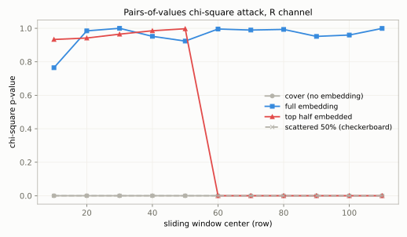
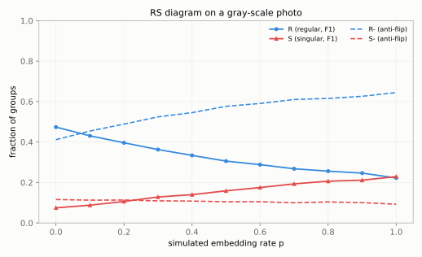

# M15 隐写进阶与隐写分析
## Steganography Analysis

> [!info]- 章节信息
> **所属方向**：MISC ｜ **难度阶段**：L3 进阶期 ｜ **前置要求**：[[M05-图片隐写I-LSB与位平面|M05]] · [[M06-图片隐写II-DCT与盲水印|M06]] · [[M01-MISC导论与工具箱|M01]]
> **本章目标**：把视角从"怎么藏"转到"怎么查"——理解隐写安全性的统计含义；手撕值对卡方攻击（整图检验、滑动窗口定位嵌入边界）与 RS 分析（估计散布嵌入的嵌入率）；认识自适应隐写为什么能抗统计检测；划清频域工具的检测边界；完整解一个"隐写 + 加密"的多层嵌套靶；最后收拢成一张拿到图就能照做的检测决策清单。

## 1. 定位：从"怎么藏"到"怎么查"

[[M05-图片隐写I-LSB与位平面|M05]]拆了位平面与组合提取，[[M06-图片隐写II-DCT与盲水印|M06]]进了 DCT 系数域，[[M08-音频隐写|M08]]把同一套手法平移到采样值。这三章站在嵌入者一侧，回答"怎么藏"。本章站到另一侧：

| 章 | 侧别 | 管什么 |
| ---- | ---- | ---- |
| [[M05-图片隐写I-LSB与位平面\|M05]] | 嵌入 | 位平面、组合全解、zsteg 扫描 |
| [[M06-图片隐写II-DCT与盲水印\|M06]] | 嵌入 | DCT 系数域、口令隐写、盲水印 |
| [[M08-音频隐写\|M08]] | 嵌入 | WAV 采样、频谱图、信号语义 |
| 本章 | 检测 | 统计检验、嵌入率估计、多层靶的完整解链 |
| [[M16-脑洞与算法杂项\|M16]] | 检测之外 | 常规手段穷尽后的脑洞与算法 |

隐写安全性的基本概念一句话：==嵌入改变了载体的统计分布，检测器找的就是这个偏差==。像素最低位被随机数据替换后，值直方图上相邻值对（2v 与 2v+1）的频数趋于相等；局部波动、位平面纹理、DCT 系数分布，各有各的偏差形态。检测器不认识 flag，它只认"这块统计不像自然图像"。

这条原理带来两个不对称，全章都会反复出现：

1. **出题人对抗解题人**：嵌入者在藏数据时会留下统计痕迹（出题人往往直接用 zsteg 可扫的原始 LSB，反而好办）；解题人的检验手段越准，出题人就得藏得越散、越深。
2. **检测不等于提取**：卡方检验能判定"这张图藏过东西"，却给不出内容——载荷若是加密或压缩过的字节流，提取出来是乱码。==检出有货与拿出明文是两件事，中间隔着识别与破解==，6 节的嵌套靶专门走这条完整链。

全章在一组自造靶上展开：2 节造四张卡方靶并手撕卡方攻击，3 节用真实照片载体做 RS 分析，6 节造两张"隐写 + 加密"的多层嵌套靶并完整解出。工具全部来自 [[M01-MISC导论与工具箱|M01]] 的装机清单，无需新装。

## 2. 卡方攻击：值对的均衡化

### 2.1 值对与统计量

值对（Pairs of Values，PoV）指直方图上相邻的两个值 (2v, 2v+1)。LSB 嵌入的机制决定了它与值对的关系：均匀 LSB 嵌入把像素最低位替换成随机位，一个像素的值在 2v 与 2v+1 之间等概率跳——嵌入率足够高时，==每个值对内的两个频数趋于相等==。

设 h_x 是值 x 的像素频数。若值对 (2v, 2v+1) 合计 $n_{2v} + n_{2v+1}$ 个像素且完全嵌入，两个值的频数都应等于合计的一半：

$$n^{*}_{v} = \frac{h_{2v} + h_{2v+1}}{2} \tag{15.1}$$

把每个值对的实际偏离 $h_{2v} - n^{*}_v$ 平方求和，就是卡方统计量。设 $V$ 是合计频数足够大（取 $\ge 5$）的值对集合，共 k 个：

$$\chi^{2}_{k-1} = \sum_{v \in V} \frac{\left(h_{2v} - n^{*}_{v}\right)^{2}}{n^{*}_{v}} \tag{15.2}$$

统计量服从自由度 k − 1 的卡方分布。p 值取右尾概率 $p = P(\chi^{2}_{k-1} \ge \chi^{2})$，方向要记牢：

| p 值 | 统计含义 | 判读 |
| ---- | ---- | ---- |
| 接近 1 | 实际偏离完全在"值对趋平"的预期之内 | ==有嵌入迹象== |
| 接近 0 | 值对显著失衡，与"趋平"假设矛盾 | 未见嵌入 |
| 中间地带 | 窗口横跨嵌入边界，或载体自身统计模糊 | 结合窗口位置判读 |

还有一个定量关系贯穿本章：散布嵌入率 r 的均匀 LSB 嵌入，把值对频数差 $h_{2v} - h_{2v+1}$ 缩到原来的 $(1 - r)$ 倍——==只有全嵌（r = 1）才让值对完全趋平，嵌入一半只是把失衡砍半==。这直接解释了 2.3 里"棋盘隔点嵌入漏检"的现象。

### 2.2 造靶与整图检验

四张靶共用一张色块渐变底图（各通道取值都是 4 的倍数，低位全 0，值对失衡极端、机制看得清楚），R 通道 bit0 各嵌一种形态：

```python
# make_targets.py —— 造本章卡方靶：色块渐变底图 + 四种嵌入形态
import numpy as np
from PIL import Image

rng = np.random.default_rng(2026)

W, H = 160, 120


def base_gradient(w=W, h=H):
    """色块渐变底图：各通道取值都是 4 的倍数，值对 (2v, 2v+1) 严重失衡"""
    x, y = np.meshgrid(np.arange(w), np.arange(h))
    r = (96 + 4 * (((x // 8) + (y // 8)) % 32)).astype(np.uint8)
    g = (64 + 4 * ((x // 8) % 48)).astype(np.uint8)
    b = (160 + 4 * ((y // 8) % 24)).astype(np.uint8)
    return np.dstack([r, g, b])


def embed_random_lsb(arr, positions):
    """把随机位写进指定像素集合的 R 通道 bit0（模拟均匀 LSB 嵌入）"""
    out = arr.copy()
    c = out[:, :, 0]
    bits = rng.integers(0, 2, size=c.size, dtype=np.uint8).reshape(c.shape)
    flat = c.ravel()
    sel = positions.ravel()
    flat[sel] = (flat[sel] & np.uint8(254)) | bits.ravel()[sel]
    out[:, :, 0] = flat.reshape(c.shape)
    return out


def all_pos():
    return np.ones((H, W), dtype=bool)


def top_pos(frac):
    m = np.zeros((H, W), dtype=bool)
    m[: int(H * frac), :] = True
    return m


def checker_pos():
    """棋盘隔点：(x+y) 为偶数的像素，占一半"""
    return ((np.add.outer(np.arange(H), np.arange(W)) % 2) == 0)


if __name__ == "__main__":
    import os
    os.makedirs("targets", exist_ok=True)
    a = base_gradient()
    Image.fromarray(a, "RGB").save("targets/cover.png")
    Image.fromarray(embed_random_lsb(a, all_pos()), "RGB").save("targets/stego_full.png")
    Image.fromarray(embed_random_lsb(a, top_pos(0.5)), "RGB").save("targets/stego_half.png")
    Image.fromarray(embed_random_lsb(a, checker_pos()), "RGB").save("targets/stego_scatter.png")
    print("[1] 卡方靶 4 张：cover / stego_full(全嵌) / stego_half(前 60 行) / stego_scatter(棋盘隔点)")
```

```bash
python3 make_targets.py
```

```text
输出：
[1] 卡方靶 4 张：cover / stego_full(全嵌) / stego_half(前 60 行) / stego_scatter(棋盘隔点)
```

卡方检验本身十几行：`np.bincount` 数直方图，按式 (15.1)(15.2) 求统计量，`scipy.stats.chi2` 的生存函数给 p 值：

```python
# chi2.py —— 值对卡方攻击：整图检验 + 滑动窗口
import numpy as np
from PIL import Image
from scipy.stats import chi2 as chi2_dist
import matplotlib
matplotlib.use("Agg")
import matplotlib.pyplot as plt

GRAY, BLUE, RED = "#B4B2A9", "#378ADD", "#E24B4A"


def chi2_stat(c):
    """对单通道 2-D 数组做值对卡方检验，返回 (χ², 自由度, p 值)"""
    h = np.bincount(c.ravel(), minlength=256)      # 值直方图
    pair_sum = h[0::2] + h[1::2]                   # 每对 (2v, 2v+1) 的合计频数
    use = pair_sum >= 5                            # 期望频数太小的对不参与
    n_star = pair_sum[use] / 2                     # 完全嵌入时每个值的期望频数
    dev = h[0::2][use] - n_star
    x2 = float((dev ** 2 / n_star).sum())
    dof = int(use.sum()) - 1
    return x2, dof, float(chi2_dist.sf(x2, dof))


def load_r(name):
    return np.array(Image.open("targets/" + name))[:, :, 0]


if __name__ == "__main__":
    # 值对频数对照：嵌入前 (2v, 2v+1) 一边倒，全嵌后趋平
    print("[0] 值对频数对照（R 通道前 4 个非空值对）：")
    for n in ("cover.png", "stego_full.png"):
        h = np.bincount(load_r(n).ravel(), minlength=256)
        vs = [v for v in range(128) if h[2 * v] + h[2 * v + 1] > 0][:4]
        row = "  ".join(f"({h[2 * v]:>3},{h[2 * v + 1]:>3})" for v in vs)
        print(f"    {n:<18} {row}")

    names = ["cover.png", "stego_full.png", "stego_half.png", "stego_scatter.png"]
    print("[1] 整图卡方（R 通道，值对 (2v, 2v+1)，合计频数 < 5 的对不参与）：")
    for n in names:
        x2, dof, p = chi2_stat(load_r(n))
        print(f"    {n:<20} chi2 = {x2:9.1f}   dof = {dof}   p = {p:.4f}")

    # 滑动窗口：20 行一个窗，每次下移 10 行
    WIN, STEP, H = 20, 10, 120
    centers = np.arange(WIN // 2, H - WIN // 2 + 1, STEP)
    print(f"[2] 滑动窗口（窗高 {WIN} 行，步距 {STEP} 行）：")
    curves = {}
    for n in names:
        r = load_r(n)
        ps = []
        for c0 in centers:
            w0 = c0 - WIN // 2
            ps.append(chi2_stat(r[w0:w0 + WIN, :])[2])
        curves[n] = ps
        row = "  ".join(f"{p:4.2f}" for p in ps)
        print(f"    {n:<20} {row}")

    # 检测曲线图
    fig, ax = plt.subplots(figsize=(7.2, 4.2), dpi=100)
    fig.patch.set_facecolor("#FCFCFB")
    ax.set_facecolor("#FCFCFB")
    styles = {"cover.png": dict(color=GRAY, marker="o", label="cover (no embedding)"),
              "stego_full.png": dict(color=BLUE, marker="s", label="full embedding"),
              "stego_half.png": dict(color=RED, marker="^", label="top half embedded"),
              "stego_scatter.png": dict(color=GRAY, marker="x", ls="--",
                                        label="scattered 50% (checkerboard)")}
    for n in names:
        ax.plot(centers, curves[n], **styles[n], ms=5, lw=1.8)
    ax.set_xlabel("sliding window center (row)")
    ax.set_ylabel("chi-square p-value")
    ax.set_ylim(-0.05, 1.05)
    ax.grid(color="#F1EFE8", lw=0.8)
    for s in ax.spines.values():
        s.set_color(GRAY)
    ax.tick_params(colors="#6B6A5F")
    ax.legend(frameon=False, fontsize=9, loc="center right")
    ax.set_title("Pairs-of-values chi-square attack, R channel", fontsize=11)
    fig.tight_layout()
    fig.savefig("chi2_curves.svg", facecolor=fig.get_facecolor())
    print("[3] 检测曲线图已存 chi2_curves.svg")
```

```bash
python3 chi2.py
```

```text
输出：
[0] 值对频数对照（R 通道前 4 个非空值对）：
    cover.png          (192,  0)  (192,  0)  (192,  0)  (256,  0)
    stego_full.png     ( 80,112)  ( 93, 99)  (100, 92)  (138,118)
[1] 整图卡方（R 通道，值对 (2v, 2v+1)，合计频数 < 5 的对不参与）：
    cover.png            chi2 =    9600.0   dof = 31   p = 0.0000
    stego_full.png       chi2 =      14.5   dof = 31   p = 0.9948
    stego_half.png       chi2 =    3049.0   dof = 31   p = 0.0000
    stego_scatter.png    chi2 =    2351.9   dof = 31   p = 0.0000
[2] 滑动窗口（窗高 20 行，步距 10 行）：
    cover.png            0.00  0.00  0.00  0.00  0.00  0.00  0.00  0.00  0.00  0.00  0.00
    stego_full.png       0.76  0.98  1.00  0.95  0.92  1.00  0.99  0.99  0.95  0.96  1.00
    stego_half.png       0.93  0.94  0.97  0.99  1.00  0.00  0.00  0.00  0.00  0.00  0.00
    stego_scatter.png    0.00  0.00  0.00  0.00  0.00  0.00  0.00  0.00  0.00  0.00  0.00
[3] 检测曲线图已存 chi2_curves.svg
```

三段输出对应三个结论：

1. **[0] 是机制本身**：底图每个非空值对都是 (192, 0) 一边倒——4 的倍数满员、奇数邻居空无一人；全嵌后变成 (80, 112)、(93, 99)，随机位把一半像素推到了奇数邻居那边。合计频数不为零的值对只有 32 个（取值从 96 起步、步长 4），所以自由度 = 32 − 1 = 31。
2. **[1] 整图检验的分水岭**：cover 的 χ² 高达 9600（p = 0），stego_full 的 χ² = 14.5 反而低于自由度 31（p = 0.9948）——==卡方攻击下"像嵌入"的是那个偏离更小的图==。而 stego_half 与 stego_scatter 各嵌了一半像素，整图检验全是 p = 0：一半的干净像素把失衡重新拉了回来，单值检验对局部嵌入不敏感。
3. **[2] 滑动窗口救回局部嵌入**：20 行一个窗、每次下移 10 行，stego_half 的 p 在窗口中心行 50 之前全部接近 1，中心行 60 起骤降到 0——嵌入区在上半图的结论和边界位置（第 60 行）直接从 p 序列读出来。



曲线图把四个靶的行为放在一起：全嵌（蓝）全程高位；半图（红）在嵌入边界处断崖下跌，==断崖位置就是嵌入的截止行==；棋盘隔点（灰虚线）全程低位——这就是 2.1 末尾那个 $(1-r)$ 关系的图形化：嵌入一半只把失衡砍半，砍不平等于检不出。卡方对"连续整段嵌入"定位能力强，对"散布的低密度嵌入"存在盲区，补位的是 3 节的 RS 分析。

### 2.3 p 值判读与已知局限

滑窗判读的操作规则：p 从高位跌到低位的窗口就是嵌入边界；窗口在嵌入区内部时 p 应接近 1（本例全嵌的窗口 p 在 0.76～1.00 之间波动，窗口越小噪声越大——样本少了，χ² 的波动自然大）。把窗口从 20 行加大到 40 行能压波动，代价是边界定位变粗。

> [!warning] 真实照片会让卡方误报
> 卡方攻击的前提是"载体值对失衡"。真实照片的低位本来就被传感器噪声和量化搅动，尤其经过 JPEG 压缩的图，量化已经把值对推平——对它跑同样的检验，没嵌入也报 p 接近 1。拿 3.2 节造的无嵌入照片靶直接一测：
>
> ```python
> # photo_fp.py —— 用 2.2 的卡方检验测一张真实照片
> import numpy as np
> from PIL import Image
> from chi2 import chi2_stat
>
> x2, dof, p = chi2_stat(np.array(Image.open("targets/photo_cover.png")))
> print(f"photo_cover（无嵌入，JPEG 壁纸转灰度）：chi2 = {x2:.1f}，dof = {dof}，p = {p:.4f}")
> ```
>
> ```bash
> python3 photo_fp.py
> ```
>
> ```text
> 输出：
> photo_cover（无嵌入，JPEG 壁纸转灰度）：chi2 = 78.0，dof = 107，p = 0.9842
> ```
>
> 没有嵌入，p 却是 0.98。==卡方是特定载体上的放大镜：对低位结构化的图（平滑合成图、色块图）可靠，对真实照片的 p 值只能当参考==。这也是本章把靶子造成色块渐变的原因——先把机制在干净载体上看清，再带着局限上真题。

> [!note] 检测不等于提取
> p 接近 1 只说明"这个区域的最低位像随机数据"。载荷是加密或压缩字节流时恰恰就是这个形态——所以卡方常能"检出有货"而 zsteg 提不出可读内容。检出之后怎么走，见 6 节。

## 3. RS 分析：估计嵌入率

### 3.1 分组、翻转与判别函数

卡方回答"有没有"，RS 分析（Regular/Singular）进一步回答"嵌了多少"。机制分三层：

1. **分组**：像素按行切成 4 个一组。
2. **翻转**：给定掩码 M（每个位置取 −1、0、1），对组内选中的像素施加翻转。正翻 F1 把 LSB 取反（0↔1）；反翻 F−1 把偶数值减一、奇数值加一（0↔−1、1↔2、…，向另一个方向挪动 ±1）。
3. **判别函数**：$f(G) = \sum_i |x_{i+1} - x_i|$，组内相邻像素差值的绝对值之和，衡量局部起伏。对每组比较翻转前后的 f：

| 判定 | 条件 | 含义 |
| ---- | ---- | ---- |
| 规则组 R | $f(F_M(G)) > f(G)$ | 翻转让局部更起伏 |
| 奇异组 S | $f(F_M(G)) < f(G)$ | 翻转让局部更平滑 |
| 无用组 U | 相等 | 不携带信息 |

自然图像里 R 占比明显高于 S（局部起伏对 ±1 扰动不对称）。LSB 嵌入把一部分像素的最低位换成随机值，这些像素再怎么翻转都不改变统计形态——==嵌入率越高，R 与 S 的差越小==。在载体上模拟不同嵌入率，四条统计曲线随嵌入率单调移动、在 p = 1 附近交汇，这就是 RS 分析的检测依据：



估计端的问题在于真实解题时==没有载体==，四条曲线只能从隐写图自身的测量反推。论文的做法是四个测量量加一个二次方程：对隐写图本身和它的 F1 全翻转图（翻转占比恰好变成 $1 - p/2$，因为嵌入已经把占比 p/2 的像素翻转过一次）各测一轮正翻与反翻的 R − S，得到 $d_0, d_1, d_{-0}, d_{-1}$；在"两组交点横坐标相同、正翻曲线在翻转占比 1/2 处 R = S"两条假设下，交点位置满足一个二次方程：

$$2\,(d_{1} + d_{0})\,z^{2} + \left(d_{-0} - d_{-1} - d_{1} - 3d_{0}\right)z + \left(d_{0} - d_{-0}\right) = 0 \tag{15.3}$$

取绝对值较小的根 z，嵌入率由交点的重标定坐标反解：

$$p = \frac{z}{z - 1/2} \tag{15.4}$$

> [!info]- 式 (15.3)(15.4) 从哪来
> 论文把 RS 图的横轴 x（翻转占比）重标定为 $z = (x - p/2) / (1 - p)$，隐写图自身落在 z = 0、全翻转图落在 z = 1。四条曲线按二次（正翻）与线性（反翻）建模后，"正翻规则组曲线与反翻规则组曲线的交点、正翻奇异组曲线与反翻奇异组曲线的交点横坐标相同"这一假设给出式 (15.3) 的二次方程；交点的重标定坐标 z 再由 $p = z/(z - 1/2)$ 换回嵌入率（式 15.4）。两个假设都只在自然图像统计上近似成立，这是估计有系统偏差的根源。完整推导见 Fridrich、Goljan、Du 2001 年的论文（本章末延伸阅读），简化实现以"真实跑出估计值"为准。

### 3.2 简化实现与估计结果

实现沿用 [[M05-图片隐写I-LSB与位平面|M05]] 的 numpy 风格。载体换成真实照片——系统自带的壁纸文件，中心裁剪缩放成 256×192 灰度，再散布嵌入四种比例：

```python
# rs.py —— RS 分析：分组/翻转/判别函数 + 嵌入率估计（Fridrich-Goljan-Du 2001）
import numpy as np
from PIL import Image
import matplotlib
matplotlib.use("Agg")
import matplotlib.pyplot as plt

GRAY, BLUE, RED = "#B4B2A9", "#378ADD", "#E24B4A"

M = np.array([0, 1, 1, 0], np.uint8)       # 翻转掩码：翻组内第 2、3 个像素（论文示例）


def group4(c):
    """单通道 2-D 数组按行切成 4 像素一组，shape = (行数, 每行组数, 4)"""
    h, w = c.shape
    return c[:, : w - w % 4].reshape(h, -1, 4).astype(np.int16)


def f_score(g):
    """判别函数：组内相邻像素差值的绝对值之和（局部起伏越大值越大）"""
    return np.abs(np.diff(g, axis=-1)).sum(-1)


def rs_bias(c, anti=False):
    """对组内掩码位置施加翻转（anti=False 正翻 F1 / anti=True 反翻 F-1），
    比较翻转前后判别函数，返回 (R, S, U) 占比"""
    g = group4(c)
    f0 = f_score(g)
    if anti:
        g1 = g - 1 + 2 * (g & 1)           # F-1：偶数值减一、奇数值加一
    else:
        g1 = g ^ M                          # F1：LSB 翻转
    f1 = f_score(g1)
    R = float((f1 > f0).mean())
    S = float((f1 < f0).mean())
    return R, S, 1 - R - S


def measure(c):
    """四个测量量：正翻/反翻 x 原图/F1 全翻转图（对应论文 d0, d1, d-0, d-1）"""
    R0, S0, _ = rs_bias(c)                 # d0  = RM(p/2)  - SM(p/2)
    R1, S1, _ = rs_bias(c ^ 1)             # d1  = RM(1-p/2) - SM(1-p/2)
    Ra0, Sa0, _ = rs_bias(c, anti=True)    # d-0 = R-M(p/2)  - S-M(p/2)
    Ra1, Sa1, _ = rs_bias(c ^ 1, anti=True)
    return dict(d0=R0 - S0, d1=R1 - S1, dm0=Ra0 - Sa0, dm1=Ra1 - Sa1,
                R=R0, S=S0)


def estimate(c):
    """解论文的二次方程 2(d1+d0)z^2 + (d-0 - d-1 - d1 - 3d0)z + (d0 - d-0) = 0，
    取绝对值较小的根 z，嵌入率 p = z / (z - 1/2)"""
    m = measure(c)
    a = 2 * (m["d1"] + m["d0"])
    b = m["dm0"] - m["dm1"] - m["d1"] - 3 * m["d0"]
    q = m["d0"] - m["dm0"]
    disc = b * b - 4 * a * q
    if a == 0 or disc < 0:
        return None, m
    roots = [(-b - disc ** 0.5) / (2 * a), (-b + disc ** 0.5) / (2 * a)]
    z = min(roots, key=abs)
    if abs(z - 0.5) < 1e-9:
        return None, m
    return z / (z - 0.5), m


def make_photo_targets():
    """照片载体：系统自带壁纸，中心裁剪成 4:3 再缩放到 256x192 灰度"""
    src = Image.open("wallpaper.jpg").convert("L")
    w, h = src.size
    cw = h * 4 // 3
    src = src.crop(((w - cw) // 2, 0, (w + cw) // 2, h)).resize((256, 192))
    cover = np.array(src)
    Image.fromarray(cover).save("targets/photo_cover.png")
    rng = np.random.default_rng(2026)
    for name, rate in [("photo_r10.png", 0.1), ("photo_r25.png", 0.25),
                       ("photo_r50.png", 0.5), ("photo_r75.png", 0.75)]:
        st = cover.copy()
        sel = rng.random(cover.shape) < rate          # 随机选像素，散布嵌入
        st[sel] = (st[sel] & np.uint8(254)) | rng.integers(
            0, 2, size=int(sel.sum()), dtype=np.uint8)
        Image.fromarray(st).save("targets/" + name)
    return cover


if __name__ == "__main__":
    cover = make_photo_targets()
    print("[1] 照片靶 5 张：photo_cover / r10 / r25 / r50 / r75（散布嵌入）")

    print("[2] RS 估计（R=S 为正翻 F1 下的规则/奇异组占比）：")
    for n, true_p in [("photo_cover.png", 0.0), ("photo_r10.png", 0.1),
                      ("photo_r25.png", 0.25), ("photo_r50.png", 0.5),
                      ("photo_r75.png", 0.75)]:
        c = np.array(Image.open("targets/" + n))
        R, S, _ = rs_bias(c)
        p, m = estimate(c)
        ps = "n/a" if p is None else f"{p:.3f}"
        print(f"    {n:<18} R={R:.3f} S={S:.3f}   p = {ps}（真值 {true_p}）")

    print("[3] 色块靶上同一估计器的表现（对照组）：")
    for n, true_p in [("cover.png", 0.0), ("stego_scatter.png", 0.5)]:
        c = np.array(Image.open("targets/" + n))[:, :, 0]
        p, m = estimate(c)
        ps = "n/a" if p is None else f"{p:.3f}"
        print(f"    {n:<18} d0={m['d0']:+.4f} d1={m['d1']:+.4f} "
              f"d-0={m['dm0']:+.4f} d-1={m['dm1']:+.4f}   p = {ps}（真值 {true_p}）")

    # 在照片载体上模拟不同嵌入率的四条 RS 曲线（教学演示：真实解题时没有载体）
    print("[4] 在照片载体上模拟嵌入率 0.0-1.0 的 R/S 与 R-/S-：")
    rng = np.random.default_rng(2026)
    rates, curves = [], [[] for _ in range(4)]
    for pr in np.linspace(0, 1, 11):
        st = cover.copy()
        sel = rng.random(cover.shape) < pr
        st[sel] = (st[sel] & np.uint8(254)) | rng.integers(
            0, 2, size=int(sel.sum()), dtype=np.uint8)
        R, S, _ = rs_bias(st)
        Rm, Sm, _ = rs_bias(st, anti=True)
        rates.append(pr)
        for vals, v in zip(curves, (R, S, Rm, Sm)):
            vals.append(v)
        print(f"    p={pr:.1f}  R={R:.3f} S={S:.3f} R-={Rm:.3f} S-={Sm:.3f}")

    fig, ax = plt.subplots(figsize=(7.2, 4.4), dpi=100)
    fig.patch.set_facecolor("#FCFCFB")
    ax.set_facecolor("#FCFCFB")
    ax.plot(rates, curves[0], color=BLUE, marker="o", ms=4, lw=1.8,
            label="R (regular, F1)")
    ax.plot(rates, curves[1], color=RED, marker="^", ms=4, lw=1.8,
            label="S (singular, F1)")
    ax.plot(rates, curves[2], color=BLUE, ls="--", lw=1.6, label="R- (anti-flip)")
    ax.plot(rates, curves[3], color=RED, ls="--", lw=1.6, label="S- (anti-flip)")
    ax.set_xlabel("simulated embedding rate p")
    ax.set_ylabel("fraction of groups")
    ax.set_ylim(0, 1.0)
    ax.grid(color="#F1EFE8", lw=0.8)
    for s in ax.spines.values():
        s.set_color(GRAY)
    ax.tick_params(colors="#6B6A5F")
    ax.legend(frameon=False, fontsize=8, ncol=2)
    ax.set_title("RS diagram on a gray-scale photo", fontsize=11)
    fig.tight_layout()
    fig.savefig("rs_curves.svg", facecolor=fig.get_facecolor())
    print("[5] RS 曲线图已存 rs_curves.svg")
```

```bash
python3 rs.py
```

```text
输出：
[1] 照片靶 5 张：photo_cover / r10 / r25 / r50 / r75（散布嵌入）
[2] RS 估计（R=S 为正翻 F1 下的规则/奇异组占比）：
    photo_cover.png    R=0.474 S=0.075   p = -0.165（真值 0.0）
    photo_r10.png      R=0.433 S=0.093   p = -0.000（真值 0.1）
    photo_r25.png      R=0.373 S=0.115   p = 0.218（真值 0.25）
    photo_r50.png      R=0.307 S=0.159   p = 0.500（真值 0.5）
    photo_r75.png      R=0.256 S=0.207   p = 0.837（真值 0.75）
[3] 色块靶上同一估计器的表现（对照组）：
    cover.png          d0=+1.0000 d1=+1.0000 d-0=+0.0000 d-1=+0.0000   p = n/a（真值 0.0）
    stego_scatter.png  d0=-0.0117 d1=-0.0117 d-0=+0.7585 d-1=+0.7585   p = n/a（真值 0.5）
[4] 在照片载体上模拟嵌入率 0.0-1.0 的 R/S 与 R-/S-：
    p=0.0  R=0.474 S=0.075 R-=0.412 S-=0.116
    p=0.1  R=0.431 S=0.088 R-=0.454 S-=0.113
    p=0.2  R=0.396 S=0.106 R-=0.489 S-=0.113
    p=0.3  R=0.363 S=0.128 R-=0.524 S-=0.109
    p=0.4  R=0.334 S=0.140 R-=0.545 S-=0.108
    p=0.5  R=0.306 S=0.159 R-=0.577 S-=0.105
    p=0.6  R=0.288 S=0.175 R-=0.591 S-=0.105
    p=0.7  R=0.268 S=0.193 R-=0.610 S-=0.100
    p=0.8  R=0.256 S=0.206 R-=0.615 S-=0.104
    p=0.9  R=0.246 S=0.211 R-=0.626 S-=0.101
    p=1.0  R=0.222 S=0.229 R-=0.644 S-=0.093
[5] RS 曲线图已存 rs_curves.svg
```

[2] 的五档估计怎么读：嵌入率 0.25 估出 0.218、0.5 估出 0.500、0.75 估出 0.837——==中高嵌入率的估计可用==；未嵌入的载体估出负值，0.1 的低嵌入率估成 −0.000，分辨不出。负值的来源：这个载体经过了 JPEG 压缩，正翻与反翻两套统计不再对称，方程把这份先天不对称折算成了负嵌入率。判读规则定为：==p ≤ 0 一律当"未检出"；中等正值（0.2～0.8 区间）可信度最高==。这组偏差是方法本身的：四个测量量加两条假设的模型误差，在论文的大样本实验里未嵌入载体的读数波动也在几个百分点量级，单张图更明显。拿它做题时，==RS 给出的是"嵌了多少"的量级，不是精确长度==。

[3] 的对照组同样有信息量：色块靶上四个测量量两两相等（d0 = d1、d−0 = d−1），二次方程退化成重根，估计器只能给出空值。原因在 3.1 的假设：它们建立在自然图像的统计对称性上，色块这种人工对称结构不满足——==RS 类检验认照片不认色块==，与 2.3 的卡方正好互补（卡方认色块不认照片）。

> [!note] 散布与连续的区别
> 造靶用的是随机选点的散布嵌入，这是 RS 估计最准的场景（论文原话：随机散布的消息长度估计最可靠）。连续整段嵌入时，2.3 的滑窗卡方反而更擅长——两件工具按嵌入形态分工，见 3.3。

### 3.3 与卡方的互补

把两件工具的适用面并排放：

| | 值对卡方 | RS 分析 |
| ---- | ---- | ---- |
| 回答的问题 | 有没有嵌入；边界在哪 | 散布嵌入的嵌入率是多少 |
| 擅长的形态 | 连续整段嵌入（滑窗定位边界） | 随机散布嵌入（估长度） |
| 检不出的形态 | 散布低密度嵌入（失衡只被砍半） | 连续嵌入的全局估计偏差大 |
| 载体偏好 | 低位结构化的合成图 | 自然照片 |
| 盲区来源 | 值对失衡被稀释；照片载体误报 | 模型假设在非自然图上失效 |

实际做题的组合拳：先滑窗卡方看有没有整段嵌入的边界；无果再用 RS 估计散布嵌入率；两者都指向"有货"后，回到 [[M05-图片隐写I-LSB与位平面|M05]] 的组合提取器把字节拿出来。

## 4. 自适应隐写：为什么统计检测会失效

M05 的 LSB 嵌入对每个像素一视同仁——平坦处和纹理处同等对待，统计痕迹在全域均匀分布。2010 年起的主流隐写换了思路：给每个像素算一个**改动代价**，纹理复杂、局部方差大的位置代价低，平滑位置代价高，嵌入只挑代价最低的位置。三个代表（一句话级）：

| 方案 | 一句话 |
| ---- | ---- |
| HUGO（2010） | 用高维图像模型给每个像素标价，把改动推进纹理复杂区 |
| WOW（2012） | 用小波方向滤波的残差当代价，几个方向都要"看不见" |
| S-UNIWARD（2014） | 把方向小波代价推广成通用失真函数，空域频域一套通吃 |

对应的编码层是 STC（伴随式格码）：给定每个像素的代价，把"总改动代价最小的嵌入方式"实际编码出来。检测侧相应升级成富媒体模型加机器学习分类器，检的就是"改动位置与纹理的相关性"。

CTF 场景的现实是：==自适应隐写基本不出现，出现了也不会被卡方或 RS 检出==。原因有两层。一是没有提取工具：提取需要嵌入时的代价模型与密钥，出题人给不出"解题人能解"的自适应题；二是原理上，自适应嵌入刻意把改动塞进统计最混乱的位置，值对均衡化和 R − S 偏移都被压到最低——==这正是它的设计目标==。所以在真题里，看到"低位有随机痕迹但卡方、RS、zsteg 全部安静"时，先别往自适应隐写想，回头检查容器结构与元数据（[[M02-文件格式深拆I-PNG全解|M02]]、[[M03-文件格式深拆II-JPEG与GIF|M03]]），那些才是 CTF 的主战场。

## 5. 频域与工具的检测边界

### 5.1 JPEG 系：JSteg 与 stegdetect

JPEG 里没有像素，只有 DCT 系数（[[M03-文件格式深拆II-JPEG与GIF|M03]]第 4 节），检测对象随之换成系数直方图。JSteg 这类顺序系数隐写把消息写进系数的最低位，效果与空域 LSB 同构：==系数直方图上的相邻值对 (2v, 2v+1) 趋平==——2.2 的卡方检验原封不动地搬到系数直方图上就能用，这便是 JSteg 检测的经典手段。F5 之所以引入矩阵编码（n 个系数最多改 1 个来表达 k 位），最初动机就是压低这类值对痕迹（[[M06-图片隐写II-DCT与盲水印|M06]]第 4 节的工具谱系）。

stegdetect 是 Provos 在 2001 年前后写的 JPEG 隐写检测器，对 jsteg、outguess、F5 各做一组统计检验。现状要如实说：项目二十多年无人维护，apt 源里已经没有这个包，现代 JPEG 上的误报漏报都很常见；==知道它测什么（值对痕迹与系数分布）比装上它更重要==。做题时 JPEG 隐写的现实路径还是 [[M06-图片隐写II-DCT与盲水印|M06]] 的工具族排查。

### 5.2 steghide 载体：有口令走爆破，无口令靠种子穷举

steghide 的嵌入用图论交换把改动摊平在 DCT 系数间，==无口令时没有值对均衡化这类明显统计特征==——这是如实说明，别指望卡方在 steghide 载体上给信号。实用手段按口令知情度分两档：

**有口令线索**：直接 [[M06-图片隐写II-DCT与盲水印|M06]] 第 3 节的 stegseek 字典爆破，rockyou 走起。

**无口令**：stegseek 的 `--seed` 模式不试口令，穷举嵌入种子本身（2³² 个），能判定"这文件是不是 steghide 处理过"；载荷未加密时命中后直接提取。用 [[M06-图片隐写II-DCT与盲水印|M06]] 造过的一对载体做对照（嵌入参数 `-e none -Z`，空口令）：

```bash
stegseek --seed cover.jpg 2>&1 | tail -1
stegseek --seed stego.jpg 2>&1 | grep -E 'Found|Algorithm|Original|Extract'
cat stego.jpg.out
```

```text
输出：
[!] error: Could not find a valid seed.
[i] Found (possible) seed: "3b75655e"
	Encryption Algorithm: none
[i] Original filename: "secret.txt".
[i] Extracting to "stego.jpg.out".
flag{steghide_seed_found}
```

干净载体把 42 亿个种子跑满后报 `Could not find a valid seed`，steghide 产物在种子 3b75655e 处命中并吐出原文件名与载荷。==`--seed` 跑满无命中只能说明"不是未加密的 steghide"，不能说明"没有隐写"==——口令加密的载荷种子穷举提不出来，仍要回到字典爆破或结构层排查。

## 6. 多层嵌套靶：检测 → 提取 → 识别 → 破解

前五节的工具各管一段。真题里出题人把各段串成一环扣一环：隐写藏载荷，载荷是密文，密文解开后还有一层。本节造两张这样的靶并完整解出，把决策链跑通。

### 6.1 靶一：LSB 藏加密 zip

两张靶一个脚本全造。靶面都是色块渐变：靶一 quest.png（200×150），载荷链三层——内层是两个文件的 zip（ZipCrypto 口令加密）；zip 用 AES-128-CTR 加密（密钥由提示词派生）；密文连同 8 字节 nonce 铺进 R 通道 bit0。靶二 quest_nested.png（240×180）是隐写套隐写，留到 6.3 解。另外靶一在 PNG 的 tEXt 块里藏一句提示——"藏另一处"的短提示，exiftool 一眼可见：

```python
# make_quest.py —— 造两张多层嵌套靶
import hashlib
import io
import subprocess
import zipfile

import numpy as np
from PIL import Image
from PIL.PngImagePlugin import PngInfo
from Crypto.Cipher import AES


def base_gradient(w, h):
    """平滑渐变底图：各通道取值都是 4 的倍数"""
    x, y = np.meshgrid(np.arange(w), np.arange(h))
    r = (96 + 4 * (((x // 8) + (y // 8)) % 32)).astype(np.uint8)
    g = (64 + 4 * ((x // 8) % 48)).astype(np.uint8)
    b = (160 + 4 * ((y // 8) % 24)).astype(np.uint8)
    return np.dstack([r, g, b])


def embed_bits_msb(arr, channel, bit, data, bits_per_pixel=1):
    """字节流按 MSB-first 铺进位平面；bits_per_pixel=2 时每像素铺两位，
    流内先到位的写 bit1、后到位的写 bit0（zsteg b2 的取位顺序），
    返回 (图像, 用掉的像素数)"""
    stream = np.unpackbits(np.frombuffer(data, dtype=np.uint8))
    h, w = arr.shape[:2]
    need = (len(stream) + bits_per_pixel - 1) // bits_per_pixel
    assert need <= w * h, "载体太小"
    pad = need * bits_per_pixel - len(stream)
    pix = np.concatenate([stream, np.zeros(pad, np.uint8)]).reshape(need, bits_per_pixel)
    out = arr.copy()
    flat = out[:, :, channel].ravel().copy()
    for k in range(bits_per_pixel):
        bitpos = bit + (bits_per_pixel - 1 - k)    # k=0 -> 最高位平面
        mask_clear = np.uint8(255 - (1 << bitpos))
        flat[:need] = (flat[:need] & mask_clear) | (pix[:, k] << np.uint8(bitpos)).astype(np.uint8)
    out[:, :, channel] = flat.reshape(h, w)
    return out, need


if __name__ == "__main__":
    # ---------- 靶一：LSB 藏 AES-CTR 加密的 zip ----------
    open("flag.txt", "wb").write(b"flag{detect_extract_crack}\n")
    open("note.txt", "wb").write(b"second stage inside\n")
    subprocess.run(["7z", "a", "-tzip", "-p1024", "-mem=ZipCrypto",
                    "inner.zip", "flag.txt", "note.txt"],
                   check=True, stdout=subprocess.DEVNULL)
    zipb = open("inner.zip", "rb").read()
    zf = zipfile.ZipFile(io.BytesIO(zipb))
    enc = zf.getinfo("flag.txt").flag_bits & 0x1
    print(f"[1] inner.zip {len(zipb)} 字节，加密标志位 = {enc}，条目 = {zf.namelist()}")

    key = hashlib.sha256(b"st3g0").digest()[:16]
    nonce = bytes([0x31, 0x41, 0x59, 0x26, 0x53, 0x58, 0x97, 0x93])
    ct = AES.new(key, AES.MODE_CTR, nonce=nonce).encrypt(zipb)
    payload = nonce + ct
    print(f"[2] AES-128-CTR：key = sha256(b'st3g0')[:16]，nonce = {nonce.hex()}，"
          f"密文 {len(ct)} 字节，payload 共 {len(payload)} 字节 = {len(payload) * 8} 位")

    W, H = 200, 150
    quest, used = embed_bits_msb(base_gradient(W, H), 0, 0, payload)
    meta = PngInfo()
    meta.add_text("Hint", "aes key word = st3g0; zip pass = 4-digit number")
    Image.fromarray(quest, "RGB").save("quest.png", pnginfo=meta)
    print(f"[3] quest.png {W}x{H}：payload 占前 {used} 像素 = {used / W:.1f} 行，"
          f"tEXt(Hint) 已写入")

    # ---------- 靶二：两层 LSB 嵌套 ----------
    inner = base_gradient(80, 60)
    flag2 = b"flag{two_lsb_layers}"
    bits = np.unpackbits(np.frombuffer(flag2, dtype=np.uint8))
    ib = inner[:, :, 2].ravel().copy()
    ib[: len(bits)] = (ib[: len(bits)] & np.uint8(254)) | bits.astype(np.uint8)
    inner[:, :, 2] = ib.reshape(60, 80)
    Image.fromarray(inner, "RGB").save("inner.png")

    mem = io.BytesIO()
    Image.fromarray(inner, "RGB").save(mem, "PNG")
    innerb = mem.getvalue()
    nested, used2 = embed_bits_msb(base_gradient(240, 180), 0, 0, innerb,
                                   bits_per_pixel=2)
    Image.fromarray(nested, "RGB").save("quest_nested.png")
    print(f"[4] inner.png {len(innerb)} 字节（B bit0 藏 {flag2!r}）")
    print(f"[5] quest_nested.png 240x180：R 低两位串行（每像素先 bit1 后 bit0，"
          f"zsteg b2 取位顺序）藏 inner.png，占前 {used2} 像素 = {used2 / 240:.1f} 行")
```

```bash
python3 make_quest.py
```

```text
输出：
[1] inner.zip 349 字节，加密标志位 = 1，条目 = ['flag.txt', 'note.txt']
[2] AES-128-CTR：key = sha256(b'st3g0')[:16]，nonce = 3141592653589793，密文 349 字节，payload 共 357 字节 = 2856 位
[3] quest.png 200x150：payload 占前 2856 像素 = 14.3 行，tEXt(Hint) 已写入
[4] inner.png 278 字节（B bit0 藏 b'flag{two_lsb_layers}'）
[5] quest_nested.png 240x180：R 低两位串行（每像素先 bit1 后 bit0，zsteg b2 取位顺序）藏 inner.png，占前 1112 像素 = 4.6 行
```

造靶的三个要点：zip 用 7z 打包并指定 `-mem=ZipCrypto`（老式 ZipCrypto，[[M04-压缩包全解|M04]]拆过它的结构；7-Zip 新版默认 AES 加密 zip，zipfile 解不开）；payload 只占前 2856 个像素（约 14.3 行），==整图有 94% 的像素是干净的，2.2 已示范这种局部嵌入会躲过整图卡方==；tEXt 是明面上的，[[M01-MISC导论与工具箱|M01]]的工具一条命令就能看到：

```bash
exiftool -Hint quest.png
zsteg -E b1,r,lsb,xy quest.png | xxd | head -3
```

```text
输出：
Hint                            : aes key word = st3g0; zip pass = 4-digit number
00000000: 3141 5926 5358 9793 4b79 cda8 5fb7 5f00  1AY&SX..Ky.._._.
00000010: a186 934e 765d 356c 3f65 3ba5 6bb7 38b8  ...Nv]5l?e;.k.8.
00000020: 3fb9 7a61 027a c372 eb4a a6b7 4bb3 90e5  ?.za.z.r.J...K...
```

zsteg 的 `b1,r,lsb,xy` 行只给出一小段可打印串（密文里的偶合字节），`-E` 提出的字节流前 8 字节 `31 41 59 26 53 58 97 93` 就是 nonce，后面全是高熵数据。zsteg 组合标注与本节嵌入参数的对应关系沿用 [[M05-图片隐写I-LSB与位平面|M05]] 第 4 节的结论：手撕的 MSB-first 对应 zsteg 的 `lsb`。

### 6.2 解链：检测 → 提取 → 识别 → 破解

解靶脚本的六步，每步对应前文一个工具：

```python
# solve_quest.py —— 解靶一：卡方定位 → LSB 提取 → 识别密文 → AES-CTR → zip 爆破
import hashlib
import io
import zipfile

import numpy as np
from PIL import Image
from scipy.stats import chi2 as chi2_dist
from Crypto.Cipher import AES


def chi2_stat(c):
    """值对卡方检验（同 chi2.py）"""
    h = np.bincount(c.ravel(), minlength=256)
    pair_sum = h[0::2] + h[1::2]
    use = pair_sum >= 5
    n_star = pair_sum[use] / 2
    dev = h[0::2][use] - n_star
    x2 = float((dev ** 2 / n_star).sum())
    return x2, int(use.sum()) - 1, float(chi2_dist.sf(x2, int(use.sum()) - 1))


img = np.array(Image.open("quest.png"))
r = img[:, :, 0]

# [1] 整图卡方与滑动窗口
x2, dof, p = chi2_stat(r)
print(f"[1] 整图卡方：chi2 = {x2:.1f}，dof = {dof}，p = {p:.4f} —— 局部嵌入被稀释，整图看不出")
WIN, STEP, H, W = 8, 2, 150, 200
for c0 in range(WIN // 2, 26, STEP):
    w0 = c0 - WIN // 2
    _, _, pw = chi2_stat(r[w0:w0 + WIN, :])
    print(f"    窗口中心行 {c0:>3}: p = {pw:.4f}")

# [2] 按定位出的边界提取字节（M05 的通用提取器：R、bit0、MSB-first）
nbytes = 400
bits = ((r & 1).ravel()[: nbytes * 8]).reshape(-1, 8)
data = np.packbits(bits).tobytes()
print(f"[2] 提取前 {nbytes} 字节，头部 hex：")
print("   ", data[:32].hex(" "))

# [3] 读 tEXt 提示
hint = Image.open("quest.png").text["Hint"]
print(f"[3] tEXt(Hint)：{hint}")
key = hashlib.sha256(b"st3g0").digest()[:16]

# [4] AES-128-CTR 解密，按 zip 头尾签名裁出 zip
nonce, ct = data[:8], data[8:]
blob = AES.new(key, AES.MODE_CTR, nonce=nonce).decrypt(ct)
start = blob.find(b"PK\x03\x04")
end = blob.rfind(b"PK\x05\x06") + 22
zipb = blob[start:end]
open("inner_out.zip", "wb").write(zipb)
print(f"[4] 解密 {len(blob)} 字节，PK 签名定位：起点 {start}，EOCD 终点 {end}，"
      f"裁出 zip {len(zipb)} 字节 -> inner_out.zip")

# [5] 识别 zip 并四位数字爆破
zf = zipfile.ZipFile(io.BytesIO(zipb))
print(f"[5] 条目 {zf.namelist()}，加密标志位 = {zf.getinfo('flag.txt').flag_bits & 1}")
for n in range(10000):
    pwd = f"{n:04d}".encode()
    try:
        out = zf.read("flag.txt", pwd=pwd)
        print(f"[6] 命中口令 {pwd.decode()}，flag.txt 内容: {out.decode().strip()}")
        break
    except (RuntimeError, zipfile.BadZipFile):
        continue
```

```bash
python3 solve_quest.py
file inner_out.zip
```

```text
输出：
[1] 整图卡方：chi2 = 12346.8，dof = 31，p = 0.0000 —— 局部嵌入被稀释，整图看不出
    窗口中心行   4: p = 0.9571
    窗口中心行   6: p = 0.9710
    窗口中心行   8: p = 0.9120
    窗口中心行  10: p = 0.9136
    窗口中心行  12: p = 0.0006
    窗口中心行  14: p = 0.0000
    窗口中心行  16: p = 0.0000
    窗口中心行  18: p = 0.0000
    窗口中心行  20: p = 0.0000
    窗口中心行  22: p = 0.0000
    窗口中心行  24: p = 0.0000
[2] 提取前 400 字节，头部 hex：
    31 41 59 26 53 58 97 93 4b 79 cd a8 5f b7 5f 00 a1 86 93 4e 76 5d 35 6c 3f 65 3b a5 6b b7 38 b8
[3] tEXt(Hint)：aes key word = st3g0; zip pass = 4-digit number
[4] 解密 392 字节，PK 签名定位：起点 0，EOCD 终点 349，裁出 zip 349 字节 -> inner_out.zip
[5] 条目 ['flag.txt', 'note.txt']，加密标志位 = 1
[6] 命中口令 1024，flag.txt 内容: flag{detect_extract_crack}
```

`file inner_out.zip` 的输出：

```text
输出：
inner_out.zip: Zip archive data, made by v6.3 UNIX, extract using at least v2.0, last modified Oct 25 2026 01:03:00, uncompressed size 27, method=store
```

逐段读这条链：

1. **检测**：整图卡方 p = 0（94% 干净像素稀释了失衡），窗口缩小到 8 行后顶部四个窗 p 全部高于 0.91，中心行 12 断崖——嵌入区在前 12～14 行，与造靶时 payload 占 14.3 行吻合。==窗口越小定位越准，本例窗高 8 行、步距 2 行==。
2. **提取**：按边界取 400 字节留足余量（覆盖到第 16 行）。M05 的通用提取器配 (R, bit0, MSB-first)。
3. **识别**：头部 hex 无已知魔数、高熵——是密文。AES-CTR 的 nonce 取最常见切法 8 字节（拿不准就 8/16 两种切法各试一次）。
4. **找线索**：tEXt 提示给出密钥词，`sha256(b"st3g0")[:16]` 派生 AES-128 密钥（[[C06-分组模式攻击全集|C06]]讲过 CTR 模式的结构与 nonce 的角色）。
5. **再识别**：解密后明文以 `PK\x03\x04` 开头——zip 的本地文件头签名；尾部按 `PK\x05\x06`（EOCD）裁齐，多余的字节是提取余量带进来的载体数据，解密后是垃圾，签名裁剪正好去掉。
6. **破解**：提示说口令是四位数，zipfile 的口令循环从 0000 试到 9999（[[12-隐写与流量取证|12 章 4.1]]的同款套路），命中 1024。

==检测 → 提取 → 识别 → 破解==，每一环的工具与出处：

| 环节 | 动作 | 工具 | 出处 |
| ---- | ---- | ---- | ---- |
| 检测 | 滑窗卡方确认隐写并定位边界 | chi2_stat | 本章 2.3 |
| 提取 | 按边界提取 LSB 字节流 | 通用提取器 / zsteg -E | [[M05-图片隐写I-LSB与位平面\|M05]] |
| 识别 | 看魔数判容器；无魔数 = 密文 | xxd / file | [[12-隐写与流量取证\|12 章 2 节]] |
| 找线索 | chunk 与元数据扫描 | exiftool / zsteg | [[M02-文件格式深拆I-PNG全解\|M02]] |
| 解密 | 按提示派生密钥，解 AES-CTR | pycryptodome | [[C06-分组模式攻击全集\|C06]] |
| 破解 | 容器口令爆破 | zipfile 循环 | [[12-隐写与流量取证\|12 章 4.1]] |

### 6.3 靶二：两层 LSB 嵌套

第二张靶不加密，改成隐写套隐写：外层 quest_nested.png 的 R 通道低两位串行（每像素铺 2 位，`b2` 组合）藏一张 80×60 的小图 inner.png，flag 藏在小图的 B 通道 bit0（造靶见 6.1 的 make_quest.py，`[4][5]` 两行输出）。解法先扫平面组合：只看每种组合提出的头 8 个字节认不认得文件头：

```python
# solve_nested.py —— 解靶二：扫全部平面组合 → b2 取出内层 PNG → 内层 B bit0 取 flag
import io
import re

import numpy as np
from PIL import Image

img = np.array(Image.open("quest_nested.png"))
c = img[:, :, 0].ravel()

PNG_MAGIC = b"\x89PNG\r\n\x1a\n"


def head_bytes(bits, nbytes):
    return np.packbits(bits[: nbytes * 8].reshape(-1, 8)).tobytes()


print("[1] 平面组合扫描（只看前 8 字节是否认出文件头）：")
cands = {
    "b1  (只取 bit0)":        (c & 1).astype(np.uint8),
    "b1' (只取 bit1)":        ((c >> 1) & 1).astype(np.uint8),
    "b2  (每像素 bit1,bit0)":  np.stack([(c >> 1) & 1, c & 1], axis=1).ravel().astype(np.uint8),
    "b2' (每像素 bit0,bit1)":  np.stack([c & 1, (c >> 1) & 1], axis=1).ravel().astype(np.uint8),
}
hit = None
for name, bits in cands.items():
    head = head_bytes(bits, 8)
    ok = head == PNG_MAGIC
    print(f"    {name:<22} 前 8 字节 = {head.hex(' ')}"
          + ("   <- PNG 文件头命中" if ok else ""))
    if ok:
        hit = bits

# [2] 取出内层 PNG：多提一些字节，按 IEND 块收尾裁剪
data = head_bytes(hit, 2000)
end = data.find(b"IEND") + 8                      # IEND 类型 + CRC 共 8 字节收尾
innerb = data[:end]
open("inner_out.png", "wb").write(innerb)
inner = np.array(Image.open(io.BytesIO(innerb)))
print(f"[2] 裁出 inner_out.png {len(innerb)} 字节，尺寸 {inner.shape[1]}x{inner.shape[0]}")

# [3] 内层 B 通道 bit0 提取
b = inner[:, :, 2].ravel()
bb = (b & 1).astype(np.uint8)
back = np.packbits(bb[: 64 * 8].reshape(-1, 8)).tobytes()
m = re.search(rb"flag\{[^}]*\}", back)
print(f"[3] 内层 B bit0 提取：{m.group().decode()}")
```

```bash
python3 solve_nested.py
file inner_out.png
```

```text
输出：
[1] 平面组合扫描（只看前 8 字节是否认出文件头）：
    b1  (只取 bit0)          前 8 字节 = 1c ab 30 40 00 03 98 ac
    b1' (只取 bit1)          前 8 字节 = a0 31 23 33 00 02 22 01
    b2  (每像素 bit1,bit0)    前 8 字节 = 89 50 4e 47 0d 0a 1a 0a   <- PNG 文件头命中
    b2' (每像素 bit0,bit1)    前 8 字节 = 46 a0 8d 8b 0e 05 25 05
[2] 裁出 inner_out.png 278 字节，尺寸 80x60
[3] 内层 B bit0 提取：flag{two_lsb_layers}
```

`file inner_out.png` 的输出：

```text
输出：
inner_out.png: PNG image data, 80 x 60, 8-bit/color RGB, non-interlaced
```

zsteg 对这张靶的全扫描里，`b1` 各组合全部为空，`b2` 一行有货：

```bash
zsteg quest_nested.png | grep 'PNG image'
```

```text
输出：
b2,r,lsb,xy         .. file: PNG image data, 80 x 60, 8-bit/color RGB, non-interlaced
```

> [!warning] b2 的取位顺序：先 bit1 后 bit0
> `b2` 每像素取低两位，但流内顺序是==先取 bit1、再取 bit0==——脚本里命中 PNG 文件头的是 `b2 (每像素 bit1,bit0)` 这个方向，反方向（`b2'`）提出的是乱码。单 bit 时代"手撕 MSB-first 对应 zsteg 标注 lsb"的错位（[[M05-图片隐写I-LSB与位平面|M05]]第 4 节）在 b2 上同样成立：本靶嵌入是手撕 MSB-first，zsteg 报在 `lsb` 行。==两套标注的对应关系不要背，拿 `zsteg -E` 提 8 个字节对一下就清楚==。

这张靶的教训在检测环节：==bit0 干净不等于没隐写==。外层 bit0 单独提出来是一堆垃圾（内层 PNG 字节流的隔位片段），b1 各组合全空；把低两位串起来（b2）才现出内层文件。做题时 b1 扫完无果，b2、b3 和高位平面都要过一遍——[[M05-图片隐写I-LSB与位平面|M05]]的自由度表，每一维都是出题人的可动开关。

### 6.4 通用决策链

两张靶合成一张图。拿到"疑似隐写"的图后，向下走每一环，断在哪里就从那里分叉：

```text
检测（卡方/RS/zsteg 判定有货）
  → 提取（组合定位 + 字节流）
      → 识别（魔数认容器）
          → 是明文/编码 → 读完即出（M05/M01）
          → 是 zip/图片/嵌套文件 → 裁剪保存，递归进下一层
          → 是高熵密文 → 找线索（chunk/元数据/题面）→ 解密（C06）
      → 识别失败 → 口令爆破（stegseek）/ 结构异常排查（M02/M04）
```

==决策链的每一步都有明确的"下一步"，卡住的位置就是缺线索的位置==——回头补那条线（元数据、chunk、题面提示），而不是换掉整条链。

## 7. 检测决策清单

把全章收拢成拿到一张图就能照做的动作序。假设附件已按 [[M01-MISC导论与工具箱|M01]] 的流程过了 file / xxd / binwalk 三件套，确认是干净的图片容器：

| 步 | 动作 | 判据与工具 | 出处 |
| ---- | ---- | ---- | ---- |
| 1 | 元数据快扫 | exiftool 看 Comment / Artist / Description；tEXt 块 | [[12-隐写与流量取证\|12 章 5.2]] |
| 2 | zsteg 快扫（PNG/BMP） | text: / file: 行；GIF、调色板 PNG 先转格式 | [[M05-图片隐写I-LSB与位平面\|M05]] 4 节 |
| 3 | 位平面目检 | stegsolve 逐平面翻，低平面有无图案 | [[M05-图片隐写I-LSB与位平面\|M05]] 2 节 |
| 4 | 手撕全组合提取 | M05 自由度表：b1–b3、rgb/bgr、双位序、双像素序 | [[M05-图片隐写I-LSB与位平面\|M05]] 3 节 |
| 5 | 统计检验 | 滑窗卡方定位整段嵌入；RS 估计散布嵌入率 | 本章 2、3 节 |
| 6 | JPEG 专项 | stegseek --seed 与字典爆破；DCT 工具族排查 | [[M06-图片隐写II-DCT与盲水印\|M06]] 3 节、本章 5 节 |
| 7 | 音频/视频同源 | WAV 低位与频谱、口令隐写同套思路 | [[M08-音频隐写\|M08]] |

==判定"无隐写"的标准要全过才算数==：全组合提取无可读内容、值对无均衡化（卡方安静）、RS 无偏移、容器链无结构异常、元数据无夹带。五条全绿仍不收工的，换赛道：磁盘镜像与文件系统残留交给 [[M14-磁盘与文件系统取证|M14]]，非常规编码与算法脑洞交给 [[M16-脑洞与算法杂项|M16]]，多个附件互为线索的题走 [[M18-取证综合-多源关联|M18]] 的关联流程。

两个提醒放在清单末尾。第一，==容器链先于隐写==：转存过 JPEG 或截图的图，低位隐写必死（[[M05-图片隐写I-LSB与位平面|M05]]第 7 节的有损账），先确认附件是原始无损容器，再谈检测。第二，==检出不等于提取==（1 节的两个不对称），p 值和 RS 读数只是"有货"的证据，flag 永远在提取与破解那一侧。

## 8. 常见问题

| 现象 | 原因与解决 |
| ---- | ---- |
| 卡方对真实照片全报 p 接近 1 | 载体低位本就被噪声和 JPEG 历史推平（2.3 的 photo_fp.py 对照）。卡方只对低位结构化的图可靠；照片先走 zsteg 与位平面目检 |
| 卡方 p 接近 1 但 zsteg 提不出可读内容 | 检出不等于提取：载荷是加密或压缩数据（6.1 的靶一就是这样）。继续走识别 → 找线索 → 解密链 |
| 整图卡方 p = 0 但图里确实有货 | 局部嵌入被干净像素稀释（2.2 的 stego_half）。缩小窗口做滑动检验，边界从 p 的断崖读出 |
| RS 估计出负值 | 模型底噪或确实未嵌入。p ≤ 0 一律判"未检出"；0.1 以下的嵌入率超出这套简化实现的分辨率 |
| RS 在色块图上给不出估计 | 四个测量量在人工对称结构上退化（3.2 的对照组）。RS 的假设建立在自然图像统计上，换照片载体 |
| zsteg 一行有货都没有，但统计检验说有 | 嵌入在 b2/b3 或高位平面（6.3 的靶二）。扫全自由度表：多平面组合、rgb/bgr、双位序 |
| zsteg b2 提出的字节和手撕对不上 | b2 每像素先取 bit1 再取 bit0，且 msb/lsb 标注与手撕约定相反（6.3 的警告）。拿 zsteg -E 提 8 字节对照，别背对应表 |
| stegseek --seed 跑满报 Could not find a valid seed | 不是"未加密的 steghide 载体"：可能是别的工具、或载荷带口令加密（5.2）。回字典爆破或结构层排查 |
| 7z 打包的加密 zip 用 zipfile 解不开 | 7-Zip 新版默认 AES 加密 zip，zipfile 只认 ZipCrypto。打包时加 `-mem=ZipCrypto`，遇到 AES zip 换 7z 本体 |
| matplotlib 图里中文变方块 | WSL 无 CJK 字体。图内文字一律用英文（本章两幅图的写法） |

## 9. 配套练习与延伸阅读

配套练习：

1. 复刻本章靶场：make_targets.py、chi2.py、rs.py、make_quest.py、solve_quest.py、solve_nested.py 逐一跑出与正文一致的输出；把 make_targets.py 里 stego_half 的嵌入比例从 0.5 改成 0.3，重跑滑窗，看断崖位置怎么移动。
2. 调滑窗参数：把 2.3 的窗高从 20 行改成 40 行、步距改成 20 行，对 stego_half 重跑——记录边界定位从"哪一行"变成"哪一段"，体会窗口大小与定位精度的互换。
3. 连续与散布对照：把 photo_r25 的随机选点嵌入改成"前 25% 行连续嵌入"，重跑 rs.py 的估计并对照 3.3 的分工表——散布读数还准吗？换成滑窗卡方呢？
4. 自造 b3 变体：把 6.3 靶二的外层改成低三位串行（每像素先 bit2、再 bit1、最后 bit0），内层换成 96×72 的小图，重走一遍解链；确认 zsteg 的 b3 组合标注行为。
5. 拆掉提示重造靶一：把 tEXt 提示删掉、密钥词换成不出题面的一句话，交给同学只有 quest.png——体会"隐写 + 加密"题里线索设计对难度的支配作用。

练习场：

- [[01-练习平台索引|练习平台索引]]：MISC 分区挑隐写题，先按 7 节的清单走一遍再动手提取
- [[03-工具清单|工具清单]]：zsteg、stegsolve、stegseek 的装法与同类替代

延伸阅读：

- Westfeld 与 Pfitzmann 的论文 Attacks on Steganographic Systems（Information Hiding Workshop, 1999）：值对卡方攻击的原始出处
- Fridrich、Goljan 与 Du 的论文 Reliable Detection of LSB Steganography in Color and Grayscale Images（ACM Workshop on Multimedia and Security, 2001）：RS 分析与式 (15.3)(15.4) 的原文
- Fridrich 的教材 Steganography in Digital Media（Cambridge University Press, 2010）：RS 分析与定量隐写分析的完整推导，第 12 章起
- Pevný、Filler 与 Bas 的论文 Using High-Dimensional Image Models to Perform Highly Undetectable Steganography（Information Hiding, 2010）：HUGO 与自适应隐写的起点
- Filler、Judas 与 Fridrich 的论文 Minimizing Additive Distortion in Steganography Using Syndrome-Trellis Codes（IEEE Transactions on Information Forensics and Security, 2011）：STC 编码层
- Provos 的论文 Defending Against Statistical Steganalysis（USENIX Security Symposium, 2001）：stegdetect 的统计检验框架
- [[M05-图片隐写I-LSB与位平面|M05]] / [[M06-图片隐写II-DCT与盲水印|M06]] / [[M08-音频隐写|M08]]：嵌入侧三兄弟，检测方法的适用对象
- [[M14-磁盘与文件系统取证|M14]] / [[M16-脑洞与算法杂项|M16]]：清单穷尽后的两个出口；多源关联的题见 [[M18-取证综合-多源关联|M18]]
