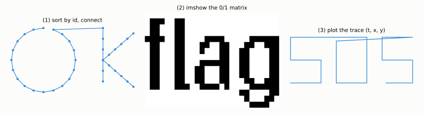
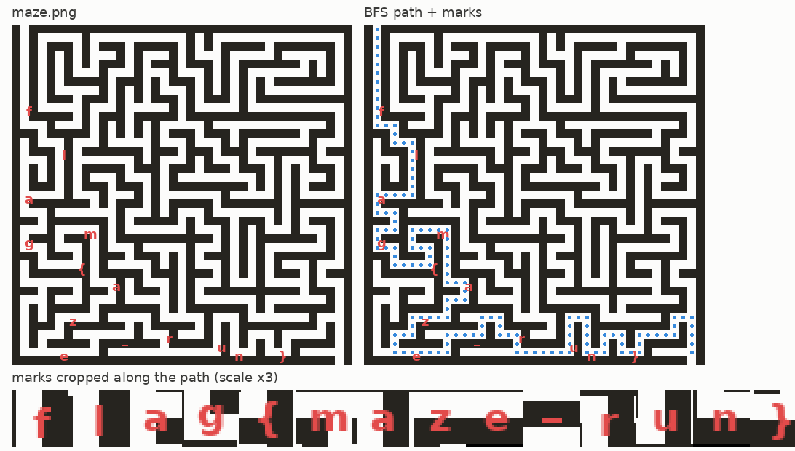
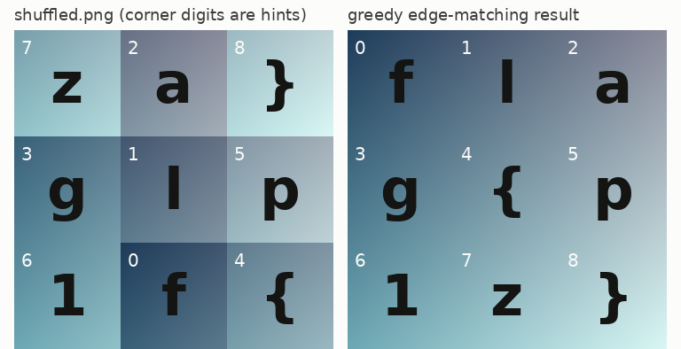
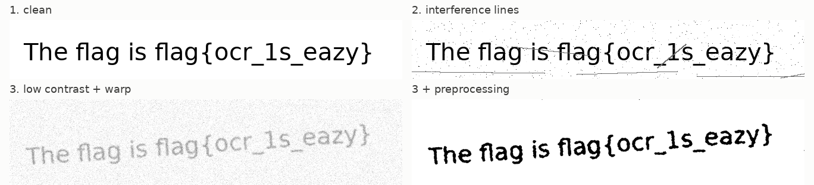
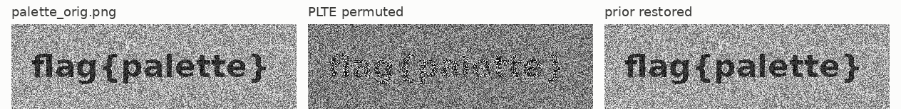
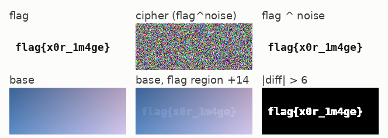
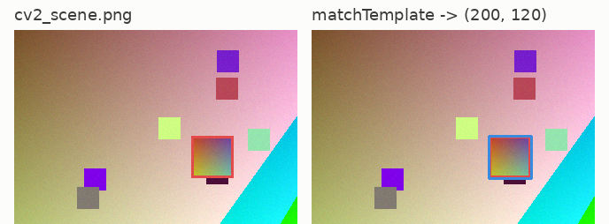

# M16 脑洞与算法杂项
## Puzzles and Misc Algorithms

> [!info]- 章节信息
> **所属方向**：MISC ｜ **难度阶段**：L3 进阶期 ｜ **前置要求**：[[M01-MISC导论与工具箱|M01]] · [[M02-文件格式深拆I-PNG全解|M02]] · [[M05-图片隐写I-LSB与位平面|M05]]
> **本章目标**：收拢 MISC 里不依赖固定工具套路的一类题——数据画成图就是答案的可视化靶、迷宫寻路、拼图还原、OCR、调色板置换、整图运算与游戏存档。每类都现场造靶、现场解出，把"看数据形状选手法"变成固定动作。

## 1. 定位：从隐写主线到杂项大类

[[M15-隐写进阶与隐写分析|M15]]把隐写这条主线收到统计检测与对抗为止：嵌入可以做得让固定组合扫不出来，检测就要回到像素分布本身。本章离开隐写主线，处理 MISC 里剩下的几大类。它们与前文的差别只有一条：==没有统一的容器结构可拆，解法入口是"把数据当成另一种东西来看"==——坐标对画成线是字，像素网格寻路是迷宫，调色板表换序是乱色，存档字节是 struct。

先立一张全章地图，七类靶、各自的入口与本章落点：

| 类 | 靶长什么样 | 解法入口 | 节 |
| ---- | ---- | ---- | ---- |
| 可视化 flag | 一堆坐标对、0/1 矩阵、时间轨迹 | matplotlib / PIL 画出来 | 2 |
| 迷宫 | 黑白迷宫图、`#` 字符画 | 二值化 → BFS 寻路 → 画回 | 3 |
| 拼图 | 切块打乱后的整图 | 角标线索或边缘配对 | 4 |
| OCR | 含文字的图片 | tesseract + 预处理 | 5 |
| 颜色表调换 | 颜色全乱的调色板 PNG | PLTE 先验还原 | 6 |
| 图像运算 | 噪点图、两张近似图 | XOR / 加法 / 差分 | 7 |
| 游戏存档 | 无后缀二进制文件 | struct + diff + 校验和 | 8 |

工具全部在前文装齐：PIL / numpy / matplotlib 三件套与 struct 在 [[M01-MISC导论与工具箱|M01]]，PNG 的 chunk 结构（尤其 PLTE）在 [[M02-文件格式深拆I-PNG全解|M02]]，位平面在 [[M05-图片隐写I-LSB与位平面|M05]]。本章新增一件主角工具 tesseract，装法见 5 节。

## 2. 可视化 flag：数据画出来就是答案

### 2.1 三类靶与识别特征

可视化靶的共同点是：==数据本身没有编码，画出来才是 flag==。附件常是一份不起眼的 `.txt`，混杂在压缩包里毫无特征。按数据形状分三类：

| 数据形状 | 识别特征 | 画法 |
| ---- | ---- | ---- |
| 坐标对 `(x, y)` | 每行两个浮点数，常带一列"序号" | 按序号排序后连线 |
| 0/1（或小整数）矩阵 | 行列长度规整，取值只有几个 | `imshow` 直接显示 |
| 时间序列 `(t, x, y)` | 第一列单调递增 | 对 x-y 按时间连线 |

第一类的"序号"是出题人留下的排序依据：文件里行序被打乱，按第一列排回去再连线。第三类的时间列天然有序，直接画 x 对 y。

### 2.2 造靶

```python
# vis_targets.py —— 造第 2 节的三类可视化靶
import os
import numpy as np
from PIL import Image, ImageDraw, ImageFont

os.chdir(os.path.dirname(os.path.abspath(__file__)))
rng = np.random.default_rng(16)

# ---- 靶 1：乱序坐标对，按序连线出字 ----
def seg_points(p0, p1, n):
    xs = np.linspace(p0[0], p1[0], n, endpoint=False)
    ys = np.linspace(p0[1], p1[1], n, endpoint=False)
    return list(zip(xs, ys))

pts = []
t = np.linspace(np.pi / 2, np.pi / 2 + 2 * np.pi, 20, endpoint=False)   # O：从顶点逆时针一圈
pts += [(1.6 + 1.4 * np.cos(a), 1.9 + 1.4 * np.sin(a)) for a in t]
pts += seg_points((4.2, 3.3), (4.2, 0.5), 6)               # K：竖笔（从顶到底）
pts += seg_points((4.2, 1.9), (5.8, 3.3), 6)               # K 上斜笔（起点与竖笔中点重合）
pts += seg_points((4.2, 1.9), (5.8, 0.5), 6)               # K 下斜笔
idx = list(range(1, len(pts) + 1))
order = rng.permutation(len(pts))                          # 文件里的行序打乱
lines = [f"{idx[i]} {pts[i][0]:.3f} {pts[i][1]:.3f}" for i in order]
open("coords.txt", "w").write("\n".join(lines) + "\n")
print(f"[1] coords.txt：{len(pts)} 行，每行 = 序号 x y（行序已打乱）")

# ---- 靶 2：数字矩阵，imshow 出字 ----
font = ImageFont.load_default(size=16)
im = Image.new("L", (200, 40), 255)
d = ImageDraw.Draw(im)
d.text((6, 6), "flag", font=font, fill=0)
bbox = im.point(lambda v: 255 - v).getbbox()               # 非白区域的包围盒
im = im.crop(bbox)
m = (np.array(im) < 128).astype(int)
with open("matrix.txt", "w") as f:
    for row in m:
        f.write(" ".join(str(v) for v in row) + "\n")
print(f"[2] matrix.txt：{m.shape[0]} 行 x {m.shape[1]} 列，元素只有 0/1")

# ---- 靶 3：路径序列，按时间连线出字 ----
S_rev = [(0, 0), (2, 0), (2, 1.5), (0, 1.5), (0, 3), (2, 3)]    # S 倒序画：终点在右上
O_poly = [(0, 3), (2, 3), (2, 0), (0, 0), (0, 3)]               # O：闭合方框，终点回到左上
S_fwd = [(2, 3), (0, 3), (0, 1.5), (2, 1.5), (2, 0), (0, 0)]    # S 正序画：终点在左下
trace = []
for gi, poly in enumerate((S_rev, O_poly, S_fwd)):              # SOS 三个字母
    x0 = gi * 3.0
    for p0, p1 in zip(poly[:-1], poly[1:]):
        n = max(2, int(round((abs(p1[0] - p0[0]) + abs(p1[1] - p0[1])) * 4)))
        for k in range(n):
            f = k / n
            trace.append((p0[0] + f * (p1[0] - p0[0]) + x0,
                          p0[1] + f * (p1[1] - p0[1])))
rows = [f"{i * 0.5:.1f} {p[0]:.3f} {p[1]:.3f}" for i, p in enumerate(trace)]
open("sensor_log.txt", "w").write("\n".join(rows) + "\n")
print(f"[3] sensor_log.txt：{len(rows)} 行，每行 = 时间 x y（时间已按序）")
```

```bash
python3 vis_targets.py
```

输出：

```
[1] coords.txt：38 行，每行 = 序号 x y（行序已打乱）
[2] matrix.txt：16 行 x 27 列，元素只有 0/1
[3] sensor_log.txt：112 行，每行 = 时间 x y（时间已按序）
```

造靶时有两处笔画顺序的设计值得留意：O 从顶点逆时针画完一圈、K 的三笔首尾相接，SOS 三个字母的折线终点都落在下一个字母的起点附近——==连线靶的笔画要设计成"上一笔的终点靠近下一笔的起点"==，否则排序连线后会出现横穿图案的过渡线。matrix.txt 每行 27 个 0/1，前几行长这样：

```bash
head -3 matrix.txt
```

输出：

```
0 0 0 0 0 0 0 0 0 0 0 0 0 0 0 0 0 0 0 0 0 0 0 0 0 0 0
0 1 1 1 0 0 1 1 0 0 0 0 0 0 0 0 0 0 0 0 0 0 0 0 0 0 0
0 1 1 0 0 0 1 1 0 0 0 0 0 0 0 0 0 0 0 0 0 0 0 0 0 0 0
```

### 2.3 解法：看形状选图

```python
# vis_solve.py —— 三类靶的解法：看数据形状，选可视化方式
import os
import numpy as np
import matplotlib
matplotlib.use("Agg")
import matplotlib.pyplot as plt

os.chdir(os.path.dirname(os.path.abspath(__file__)))

# ---- 靶 1：行序被打乱的坐标对 —— 按行首序号排序后连线 ----
raw = [ln.strip() for ln in open("coords.txt") if ln.strip()]
print("coords.txt 前 3 行（原始行序）：")
for ln in raw[:3]:
    print(" ", ln)
rows = sorted(raw, key=lambda s: int(s.split()[0]))
print("按序号排序后的前 3 行：")
for ln in rows[:3]:
    print(" ", ln)

x = [float(r.split()[1]) for r in rows]
y = [float(r.split()[2]) for r in rows]
fig, ax = plt.subplots(figsize=(4, 3), dpi=100)
ax.plot(x, y, "-o", color="#378ADD", markersize=3, linewidth=1.2)
ax.set_aspect("equal"); ax.axis("off")
fig.savefig("coords_plot.png", bbox_inches="tight", facecolor="#FCFCFB")
plt.close(fig)
print("连线结果 -> coords_plot.png\n")

# ---- 靶 2：0/1 矩阵 —— imshow 直接显示 ----
m = np.array([[int(v) for v in ln.split()] for ln in open("matrix.txt") if ln.strip()])
print(f"matrix.txt 读入数组：shape={m.shape}，取值 {sorted(set(m.ravel().tolist()))}")
fig, ax = plt.subplots(figsize=(4, 1.6), dpi=100)
ax.imshow(m, cmap="gray_r", interpolation="nearest")
ax.axis("off")
fig.savefig("matrix_plot.png", bbox_inches="tight", facecolor="#FCFCFB")
plt.close(fig)
print("显示结果 -> matrix_plot.png\n")

# ---- 靶 3：时间序列轨迹 —— x 对 y 按时间连线 ----
log = [ln.split() for ln in open("sensor_log.txt") if ln.strip()]
log.sort(key=lambda r: float(r[0]))
tx = np.array([float(r[1]) for r in log])
ty = np.array([float(r[2]) for r in log])
print(f"sensor_log.txt 读入 {len(log)} 个采样点，t 从 {log[0][0]} 到 {log[-1][0]}")
fig, ax = plt.subplots(figsize=(4, 3), dpi=100)
ax.plot(tx, ty, color="#378ADD", linewidth=1.4)
ax.set_aspect("equal"); ax.axis("off")
fig.savefig("trace_plot.png", bbox_inches="tight", facecolor="#FCFCFB")
plt.close(fig)
print("轨迹结果 -> trace_plot.png")
```

```bash
python3 vis_solve.py
```

输出：

```
coords.txt 前 3 行（原始行序）：
  4 0.467 2.723
  27 4.200 1.900
  17 2.931 2.333
按序号排序后的前 3 行：
  1 1.600 3.300
  2 1.167 3.231
  3 0.777 3.033
连线结果 -> coords_plot.png

matrix.txt 读入数组：shape=(16, 27)，取值 [0, 1]
显示结果 -> matrix_plot.png

sensor_log.txt 读入 112 个采样点，t 从 0.0 到 55.5
轨迹结果 -> trace_plot.png
```

三张图连起来看：靶 1 按序号连线拼出 `OK`，靶 2 的矩阵 `imshow` 显示 `flag` 字样，靶 3 的轨迹画出 `SOS`。矩阵靶的字就是 flag 内容时，读图上的字符即可；坐标与轨迹靶的图案是字母或符号时，按形认读。



> [!note] 拿到数据先问形状
> 解可视化靶的动作固定：先看行数、列数、取值范围（`wc -l`、看前几行），再对照 2.1 的表选画法。坐标对画出来是折线不是图案时，先换排序依据（序号列、x 值、时间列）再下结论。

> [!info]- 更多变体
> 出题人常在三类骨架上加一层变换：坐标换成极坐标 `(r, θ)`，先转换再画；点带第三列颜色值，用 `scatter` 的 `c=` 参数编码；矩阵取值不止 0/1，每个数字对应一种颜色；轨迹靶的 x、y 两列被拆进两个文件。处理原则不变——先恢复"画图需要的那几列"，再选画法。flag 内容本身是一段 [[08-编码与古典密码|08 章]]的编码时，画出的图案可能就是那段编码的字符，认出来后回到编码链剥层。

## 3. 迷宫：二值化、寻路与画回

### 3.1 图像迷宫与造靶

迷宫题的图像版是一张黑白迷宫图：白色通道、黑色墙，入口和出口开在边界上。手工走迷宫不现实（迷宫稍大就会走进死路），标准解法是==把图还原成网格，用 BFS 找唯一通路==。

迷宫用递归回溯法生成：所有房间连成一棵树，任意两格之间恰有一条通路（完美迷宫）。生成、寻路与方向串三个函数放在 maze_build.py 里供两座迷宫共用，图像迷宫靶的渲染放在主程序里——生成之后，顺手把 flag 的每个字符画在通路的格子上：

```python
# maze_build.py —— 迷宫生成器与图像迷宫靶；文本迷宫靶见 maze_text_build.py
import os
import random
from collections import deque
from PIL import Image, ImageDraw, ImageFont

WALL, ROAD = 1, 0


def gen_maze(cw, ch, seed):
    """递归回溯法生成完美迷宫（任意两格之间恰有一条通路），外圈加墙"""
    r = random.Random(seed)
    W, H = 2 * cw + 1, 2 * ch + 1
    g = [[WALL] * W for _ in range(H)]
    g[1][1] = ROAD
    stack = [(1, 1)]
    while stack:
        x, y = stack[-1]
        nbrs = []
        for dx, dy in ((2, 0), (-2, 0), (0, 2), (0, -2)):
            nx, ny = x + dx, y + dy
            if 1 <= nx < W - 1 and 1 <= ny < H - 1 and g[ny][nx] == WALL:
                nbrs.append((nx, ny, dx, dy))
        if nbrs:
            nx, ny, dx, dy = r.choice(nbrs)
            g[y + dy // 2][x + dx // 2] = ROAD
            g[ny][nx] = ROAD
            stack.append((nx, ny))
        else:
            stack.pop()
    g[0][1] = ROAD          # 入口开在上边界
    g[H - 1][W - 2] = ROAD  # 出口开在下边界
    return g


def solve(g, start, goal):
    """网格 BFS，返回 start 到 goal 的路径（含两端）"""
    prev = {start: None}
    q = deque([start])
    while q:
        cur = q.popleft()
        if cur == goal:
            break
        x, y = cur
        for dx, dy in ((1, 0), (-1, 0), (0, 1), (0, -1)):
            nxt = (x + dx, y + dy)
            if nxt not in prev and g[nxt[1]][nxt[0]] == ROAD:
                prev[nxt] = cur
                q.append(nxt)
    path, cur = [], goal
    while cur is not None:
        path.append(cur)
        cur = prev[cur]
    return path[::-1]


def dirs_of(path):
    d = {(1, 0): "R", (-1, 0): "L", (0, 1): "D", (0, -1): "U"}
    return "".join(d[(b[0] - a[0], b[1] - a[1])] for a, b in zip(path, path[1:]))


if __name__ == "__main__":
    os.chdir(os.path.dirname(os.path.abspath(__file__)))
    CW = CH = 19                   # 19 x 19 个房间
    g = gen_maze(CW, CH, seed=16)
    path = solve(g, (1, 0), (2 * CW - 1, 2 * CH - 1))
    print(f"图像迷宫：{2*CW+1} x {2*CH+1} 网格，唯一通路 {len(path)} 格")
    print(f"通路方向串：{dirs_of(path)}")

    CELL = 12                      # 每格 12 像素，墙与通道同宽
    im = Image.new("RGB", ((2 * CW + 1) * CELL, (2 * CH + 1) * CELL), (38, 36, 31))
    d = ImageDraw.Draw(im)
    for gy in range(2 * CH + 1):
        for gx in range(2 * CW + 1):
            if g[gy][gx] == ROAD:
                d.rectangle([gx * CELL, gy * CELL,
                             gx * CELL + CELL - 1, gy * CELL + CELL - 1],
                            fill=(252, 252, 251))

    flag = "flag{maze_run}"
    step = max(2, len(path) // (len(flag) + 1))
    font = ImageFont.truetype(
        "/usr/share/fonts/truetype/dejavu/DejaVuSans-Bold.ttf", 18)
    for i, chp in enumerate(flag):
        gx, gy = path[(i + 1) * step]
        cx, cy = gx * CELL + CELL, gy * CELL + CELL   # 以该格右下角为中心的 2x2 格区域
        d.text((cx, cy), chp, font=font, fill=(226, 75, 74), anchor="mm")
    print(f"flag 共 {len(flag)} 个字符，红色画在通路途经的 {len(flag)} 个格子上")
    im.save("maze.png")
```

```bash
python3 maze_build.py
```

输出：

```
图像迷宫：39 x 39 网格，唯一通路 142 格
通路方向串：DDDDDDDDDDDRRDDRRDDDDDDLLLLDDRRDDLLDDRRDDRRRRUULLUURRRRDDDDDDRRDDLLDDLLLLDDLLDDRRRRRRUURRRRUURRDDRRDDRRRRRRUUUURRDDDDRRUURRDDRRUURRRRUURRDDDD
flag 共 14 个字符，红色画在通路途经的 14 个格子上
```

迷宫网格是 39×39：房间格与隔墙交替排布，所以格子数是房间数的两倍加一。每格渲染成 12 像素，整图 468×468。像素级寻路前先把这两个数读出来（图像宽 468 ÷ 每格 12 = 39 格）——==格宽是解题者要从图里恢复的参数==，墙与通道同宽的迷宫拿尺子量一次就有。

BFS 在网格上跑，复杂度与格子数成正比：

$$O(V + E) \approx O(4 \cdot W \cdot H) \tag{16.1}$$

V 是格子数，每个格子最多 4 条边，对迷宫尺寸来说是常数级开销。

### 3.2 二值化、寻路与标记收集

解法脚本分四步：读图判定墙、BFS 找通路、把通路画回图上、按通路顺序收集红色标记：

```python
# maze_solve.py —— 图像迷宫：二值化 -> BFS 寻路 -> 路径画回图上
import os
from collections import deque
import numpy as np
from PIL import Image, ImageDraw
from scipy import ndimage

DIRS = ((1, 0), (-1, 0), (0, 1), (0, -1))
DCH = {(1, 0): "R", (-1, 0): "L", (0, 1): "D", (0, -1): "U"}


def bfs_passable(passable, start, goal):
    prev = {start: None}
    q = deque([start])
    while q:
        cur = q.popleft()
        if cur == goal:
            break
        x, y = cur
        for dx, dy in DIRS:
            nxt = (x + dx, y + dy)
            if nxt not in prev and passable(nxt[1], nxt[0]):
                prev[nxt] = cur
                q.append(nxt)
    path, cur = [], goal
    while cur is not None:
        path.append(cur)
        cur = prev[cur]
    return path[::-1]


def dirs_of(path):
    return "".join(DCH[(b[0] - a[0], b[1] - a[1])] for a, b in zip(path, path[1:]))


if __name__ == "__main__":
    os.chdir(os.path.dirname(os.path.abspath(__file__)))
    arr = np.array(Image.open("maze.png").convert("RGB")).astype(int)
    H, W = arr.shape[:2]
    print(f"maze.png：{W} x {H} 像素，39 格 x 12 像素 = 468")
    dark = (arr < 100).all(axis=2)                 # 接近黑色的像素才算墙；红色标记不算
    GW = GH = W // 12
    wall = np.zeros((GH, GW), dtype=bool)
    for gy in range(GH):
        for gx in range(GW):
            cell = dark[gy * 12:(gy + 1) * 12, gx * 12:(gx + 1) * 12]
            wall[gy, gx] = cell.mean() > 0.5       # 一格内过半是暗色 -> 墙
    print(f"格墙判定：{wall.sum()} / {GH*GW} 格是墙")

    start, goal = (1, 0), (GW - 2, GH - 2)
    path = bfs_passable(lambda y, x: not wall[y, x], start, goal)
    print(f"BFS 通路：{len(path)} 格，方向串 {dirs_of(path)[:20]}...")

    out = Image.open("maze.png").convert("RGB")
    d = ImageDraw.Draw(out)
    for gx, gy in path:
        cx, cy = gx * 12 + 6, gy * 12 + 6
        d.ellipse([cx - 2, cy - 2, cx + 2, cy + 2], fill=(55, 138, 221))
    clean = Image.open("maze.png").convert("RGB")   # 无路径标注的原图，裁字符用

    # 找红色标记：全图连通域 -> 质心聚类成字符 -> 按通路进度排序
    red = (arr[:, :, 0] > 180) & (arr[:, :, 1] < 120) & (arr[:, :, 2] < 120)
    lab, n = ndimage.label(red)
    cents = ndimage.center_of_mass(red, lab, range(1, n + 1))   # 各连通域质心 (y, x)
    clusters = []                    # 质心间距 < 15px 的连通域归为同一个字符
    for cy, cx in cents:
        for c in clusters:
            if abs(cy - c[0][0]) < 15 and abs(cx - c[0][1]) < 15:
                c.append((cy, cx))
                break
        else:
            clusters.append([(cy, cx)])
    print(f"红色连通域 {n} 个，聚成 {len(clusters)} 个字符标记")

    pidx = {}
    for i, (gx, gy) in enumerate(path):
        pidx[(gx, gy)] = i
    marks = []
    for c in clusters:
        cy = sum(p[0] for p in c) / len(c)
        cx = sum(p[1] for p in c) / len(c)
        # 对整条通路取离质心最近的格子中心：迷宫路径会折回，
        # 只看相邻格会把别的段落错当成当前位置
        best = min(path, key=lambda p: (p[0] * 12 + 6 - cx) ** 2 + (p[1] * 12 + 6 - cy) ** 2)
        marks.append((pidx[best], int(cx), int(cy)))           # (通路序号, 质心x, 质心y)
    marks.sort()
    print(f"按通路先后排序的标记格序：{[m[0] for m in marks]}")

    # 每个标记从原图裁一块放大 3 倍，拼成一条便于连读的长图
    crops = []
    for _, cx, cy in marks:
        crops.append(clean.crop((cx - 13, cy - 13, cx + 13, cy + 13)).resize((78, 78), Image.NEAREST))
    strip = Image.new("RGB", (78 * len(crops), 78), (252, 252, 251))
    for i, c in enumerate(crops):
        strip.paste(c, (i * 78, 0))
    strip.save("maze_marks.png")
    out.save("maze_solved.png")
    print("路径画回图上 -> maze_solved.png；标记字符连读条 -> maze_marks.png")
```

```bash
python3 maze_solve.py
```

输出：

```
maze.png：468 x 468 像素，39 格 x 12 像素 = 468
格墙判定：798 / 1521 格是墙
BFS 通路：142 格，方向串 DDDDDDDDDDDRRDDRRDDD...
红色连通域 18 个，聚成 14 个字符标记
按通路先后排序的标记格序：[9, 18, 28, 38, 45, 54, 64, 72, 81, 90, 99, 107, 117, 126]
路径画回图上 -> maze_solved.png；标记字符连读条 -> maze_marks.png
```



左图是原始迷宫，右图把 BFS 通路画回图上（蓝色点列），红色字符就躺在通路上。下半条是把 14 处标记按通路顺序裁下、放大 3 倍拼成的连读条，从左到右读出 `flag{maze_run}`。三个实现要点：

- **墙判定看"过半暗色"而不是"中心点暗"**：红色字符压在格子上，若按单像素取色，字符笔画会把通道格误判成墙、把贴着字符的墙格误判成通道。统计整格 144 个像素里暗色占比，一个字符的笔画影响不了过半的判定。
- **彩色标记不是墙**：`dark` 的条件是三个通道都低于 100——纯红 (226, 75, 74) 不满足，不会被当成墙；若用灰度阈值一刀切，红色亮度约 120 上下，会被卷进墙里。
- **标记归位要跟整条通路比距离**：见下面的警告框。

> [!warning] 迷宫路径会折回，标记归属不能只看相邻格
> 给标记找"它在通路的第几格"时，直觉做法是看质心旁边是哪个通路格。迷宫的通路经常从自己旁边绕回来，相邻的通路格可能属于折回的另一段，序号会错乱（例如 `{` 被排到 `m` 后面）。正确做法是对整条通路算"离质心最近的格子中心"，完美迷宫里通道之间隔着整格的墙，最近格必然是标记真正的锚点格。

### 3.3 文本迷宫

迷宫的文本形式是一张字符画：`#` 是墙、空格是通道，`S` 入口、`E` 出口，通道格上散布着字符。造靶脚本从 maze_build.py 导入生成与寻路函数，把 flag 字符撒在通路格上、干扰字符撒在死胡同里：

```python
# maze_text_build.py —— 文本迷宫靶：字符撒在通路格上，干扰字符撒在死胡同
import os
import random
from maze_build import WALL, ROAD, gen_maze, solve

os.chdir(os.path.dirname(os.path.abspath(__file__)))

cw = ch = 13
tg = gen_maze(cw, ch, seed=2026)
tpath = solve(tg, (1, 0), (2 * cw - 1, 2 * ch - 1))
print(f"文本迷宫：{2*ch+1} x {2*cw+1} 网格，唯一通路 {len(tpath)} 格")

tflag = "flag{text_maze}"
onpath = set(tpath)
tstep = max(2, (len(tpath) - 4) // len(tflag))
slots = tpath[3:-2:tstep][: len(tflag)]              # 避开入口与出口，每隔 tstep 取一个通路格
assert len(slots) == len(tflag), f"通路太短：只有 {len(slots)} 个槽位"
for (gx, gy), chp in zip(slots, tflag):
    tg[gy][gx] = chp

# 死胡同里撒 10 个干扰字符（都不在通路上）
road_cells = [(x, y) for y in range(2 * ch + 1) for x in range(2 * cw + 1)
              if tg[y][x] == ROAD and (x, y) not in onpath]
decoys = random.Random(7).sample(road_cells, 10)
for (gx, gy), chp in zip(decoys, "MK8O0QB1XZ"):
    tg[gy][gx] = chp

with open("maze.txt", "w") as f:
    for y, row in enumerate(tg):
        line = "".join("#" if c == WALL else (" " if c == ROAD else str(c))
                       for c in row)
        if y == 0:
            line = line[:1] + "S" + line[2:]         # 入口标 S
        if y == 2 * ch - 1:
            line = line[:2 * cw - 1] + "E" + line[2 * cw:]   # 出口标 E
        f.write(line + "\n")
print(f"flag 字符放在通路格（如 {slots[0]}、{slots[1]}...），干扰字符 10 个撒在死胡同")
```

```bash
python3 maze_text_build.py
cat maze.txt
```

输出：

```
文本迷宫：27 x 27 网格，唯一通路 114 格
flag 字符放在通路格（如 (3, 1)、(3, 8)...），干扰字符 10 个撒在死胡同
#S#########################
#  f#      {    #     #   #
### #g######### ### # # # #
# # #   #   # # t #e# # #z#
# # # # # # # ### # #x#a# #
#0# # # # # #  Q#   # # # #
# # # # # # # #X##### # # #
# # # #a# # # #   #   # # #
# #l### # # # ### # ### # #
#K#     # # #   # #t#   # #
# ####### # # # ### ### #e#
#         # # #   # #  m# #
# ######### # ### # # ### #
#   #     # #   #M# # #   #
# # ### ### # ### # # # ###
# #   #Z  # # #   # _ #}#8#
# ### ### # ### # ##### # #
# # #   # #   # #     #   #
# # ### # ### # ##### ### #
#     # #1#   # #   # # # #
##### # # # ### # # # # # #
#     # #    O  # # #   # #
# ##### ######### # ### # #
# #   # #     #   #     # #
# ### # # ### ########### #
#     #   B #            E#
######################### #
```

地图里能直接看到的字符有 `f`、`l`、`a`、`g`，也有 `K`、`M`、`8` 这类干扰——肉眼看不出谁在通路上。解法与图像版同构，BFS 直接在二维字符数组上跑，判据只有一条：`#` 是墙，其余（空格、`S`、`E`、散布的字符）都是路：

```python
# maze_text_solve.py —— 文本迷宫：BFS 收集通路上的字符
import os
from maze_solve import bfs_passable, dirs_of

os.chdir(os.path.dirname(os.path.abspath(__file__)))

grid = [list(ln.rstrip("\n")) for ln in open("maze.txt")]
H2, W2 = len(grid), len(grid[0])
print(f"maze.txt：{H2} 行 x {W2} 列")
pos = {}
for y in range(H2):
    for x in range(W2):
        if grid[y][x] in "SE":
            pos[grid[y][x]] = (x, y)
tpath = bfs_passable(lambda y, x: grid[y][x] != "#", pos["S"], pos["E"])
print(f"BFS 通路：{len(tpath)} 格，方向串 {dirs_of(tpath)}")

got = []
for x, y in tpath:
    c = grid[y][x]
    if c not in " #SE":
        got.append(c)
print(f"沿途收集到的字符（{len(got)} 个）：{''.join(got)}")
print(f"干扰字符在通路上出现 0 次，不通路的死胡同走不进去")
```

```bash
python3 maze_text_solve.py
```

输出：

```
maze.txt：27 行 x 27 列
BFS 通路：114 格，方向串 DRRDDDDDDDDRRRRUUUUUULLUURRRRRRRRRRDDRRDDRRUUUURRDDDDDDLLDDDDDDDDRRUUUURRUUUUUUUUUURRDDDDDDDDDDDDLLDDDDRRDDDDDDDD
沿途收集到的字符（15 个）：flag{text_maze}
干扰字符在通路上出现 0 次，不通路的死胡同走不进去
```

BFS 从 `S` 走到 `E`，沿途路过的字符按经过顺序拼起来就是 flag；撒在死胡同里的 10 个干扰字符一个也收不到——==干扰字符靠"是否在唯一通路上"自然过滤==。方向串本身（`DRRDDDD...`）也是常见的提交形式，有的题直接把方向串当作答案或再套一层编码。

## 4. 拼图：切块、乱序与还原

### 4.1 造靶：每块一个字符，角上留序号

拼图靶把一张图切成 N×N 块打乱。本章的靶把 flag 的字符一个一块画进去——flag 恰好 9 个字符，对应 3×3 九块：

```python
# puzzle_build.py —— 造第 4 节的拼图靶：3x3 切块打乱，块角留序号线索
import os
import numpy as np
from PIL import Image, ImageDraw, ImageFont

os.chdir(os.path.dirname(os.path.abspath(__file__)))

N = 3                     # 3x3 = 9 块
T = 120                   # 每块 120 像素
flag = "flag{p1z}"        # 恰好 9 个字符，一块一字

# 每块的底：随全图位置变化的渐变，保证任意两块的相邻边都不同
tiles = []
for i, chp in enumerate(flag):
    r0, c0 = divmod(i, N)
    xx, yy = np.meshgrid(np.arange(T), np.arange(T))
    gx, gy = c0 * T + xx, r0 * T + yy          # 全图坐标
    base = np.zeros((T, T, 3), np.uint8)
    base[:, :, 0] = (30 + gx * 0.30 + gy * 0.22).astype(np.uint8)
    base[:, :, 1] = (60 + gx * 0.22 + gy * 0.30).astype(np.uint8)
    base[:, :, 2] = (90 + gx * 0.18 + gy * 0.25).astype(np.uint8)
    im = Image.fromarray(base, "RGB")
    d = ImageDraw.Draw(im)
    f_big = ImageFont.truetype("/usr/share/fonts/truetype/dejavu/DejaVuSans-Bold.ttf", 64)
    d.text((T // 2, T // 2), chp, font=f_big, fill=(20, 20, 18), anchor="mm")
    f_small = ImageFont.truetype("/usr/share/fonts/truetype/dejavu/DejaVuSans.ttf", 20)
    d.text((8, 8), str(i), font=f_small, fill=(250, 250, 248), anchor="la")  # 角落序号线索
    tiles.append(im)

rng = np.random.default_rng(316)
perm = rng.permutation(N * N)          # 显示位置 p 放的是原块 perm[p]
shuffled = Image.new("RGB", (N * T, N * T))
for p, src in enumerate(perm):
    r0, c0 = divmod(p, N)
    shuffled.paste(tiles[src], (c0 * T, r0 * T))
shuffled.save("shuffled.png")
print("显示位置 0..8 依次是原块：", perm.tolist())
print("原块 0..8 依次对应字符：", " ".join(flag))
```

```bash
python3 puzzle_build.py
```

输出：

```
显示位置 0..8 依次是原块： [7, 2, 8, 3, 1, 5, 6, 0, 4]
原块 0..8 依次对应字符： f l a g { p 1 z }
```

底图不用纯色而用随全图位置变化的渐变，是为 4.3 的边缘配对铺路：==纯色底图的九块边缘完全相同，脚本与肉眼都无从配对==。

### 4.2 手工解法：读角标

不少出题人会在每块角落留一个序号（本章的靶留了）。还原动作是纯手工：按角标把九块摆回 0–8 的位置，连读块中央的字符得到 `flag{p1z}`。下面配图左图 shuffled.png 的九个角标可以直接读出来核对。

### 4.3 脚本解法：边缘配对

没有角标时，脚本按"相邻边缘的像素差"配对：两块真的相邻，接缝两侧的像素应当连续，平均绝对差接近 0；接错了差值很大。拼合策略是贪心：枚举 9 个起点块，逐格挑"与左邻/上邻接缝代价最小"的未用块，九种起点各拼一遍取总代价最小者：

```python
# puzzle_solve.py —— 无线索时的脚本还原：按块边缘差异贪心配对
import os
import numpy as np
from PIL import Image

os.chdir(os.path.dirname(os.path.abspath(__file__)))

N, T = 3, 120
img = Image.open("shuffled.png")
tiles = []
for p in range(N * N):                       # 按显示位置切开
    r0, c0 = divmod(p, N)
    tiles.append(np.array(img.crop((c0 * T, r0 * T, (c0 + 1) * T, (r0 + 1) * T))).astype(int))

def edge_cost(a, b):
    """把 b 接到 a 右边的代价：相接两列像素的平均绝对差"""
    return np.abs(a[:, -1, :] - b[:, 0, :]).mean()

def edge_cost_down(a, b):
    """把 b 接到 a 下边的代价：相接两行像素的平均绝对差"""
    return np.abs(a[-1, :, :] - b[0, :, :]).mean()

CR = [[edge_cost(tiles[i], tiles[j]) for j in range(9)] for i in range(9)]
CD = [[edge_cost_down(tiles[i], tiles[j]) for j in range(9)] for i in range(9)]

best_grid, best_cost = None, None
results = []
for start in range(9):
    used = {start}
    grid = [start]
    for p in range(1, 9):
        cands = [t for t in range(9) if t not in used]
        if p % 3:                                     # 有左邻：按右接边代价挑
            ref, table = grid[p - 1], CR
        else:                                         # 行首：按上接边代价挑
            ref, table = grid[p - 3], CD
        nxt = min(cands, key=lambda t: table[ref][t])
        grid.append(nxt)
        used.add(nxt)
    total = sum(CR[grid[p - 1]][grid[p]] for p in range(9) if p % 3)
    total += sum(CD[grid[p - 3]][grid[p]] for p in range(9) if p >= 3)
    results.append((total, start, grid))
results.sort()
for total, start, grid in results[:3]:
    print(f"起点 {start}：总代价 {total:7.2f}  排列 {grid}")
best_cost, _, best_grid = results[0]

out = Image.new("RGB", (N * T, N * T))
for p, src in enumerate(best_grid):
    r0, c0 = divmod(p, N)
    out.paste(Image.fromarray(tiles[src].astype(np.uint8)), (c0 * T, r0 * T))
out.save("puzzle_solved.png")
print(f"\n取总代价最小的排列（次优与最优差 {results[1][0]-best_cost:.2f}）-> puzzle_solved.png")
print("拼合后按位置读出九个角标，应是 0-8 各一次；连读中央字符即为 flag")
```

```bash
python3 puzzle_solve.py
```

输出：

```
起点 7：总代价    3.18  排列 [7, 4, 1, 3, 8, 5, 6, 0, 2]
起点 3：总代价  389.63  排列 [3, 8, 5, 6, 0, 2, 1, 4, 7]
起点 4：总代价  410.83  排列 [4, 1, 5, 8, 0, 2, 6, 3, 7]

取总代价最小的排列（次优与最优差 386.45）-> puzzle_solved.png
拼合后按位置读出九个角标，应是 0-8 各一次；连读中央字符即为 flag
```



最优排列的总代价 3.18——接缝两侧像素平均只差 3 个灰度级，等于"接上了"；次优 389.63，差了两个数量级。==总代价与次优的差距就是配对是否可信的判据==，差距小到同一量级时，贪心结果要人工过目。拼合图 puzzle_solved.png 里九个角标恰好排成 0–8，与手工解法互证。

> [!info]- 拼图靶的常见变体
> 块数到 16（4×4）以上时，贪心的错误会累积，常用的加固手段是把贪心换成"先拼出代价最低的两块，再逐步扩张"或直接分支限界搜全排列（9! = 362880 尚可枚举，16! 不可行）。另一类变体把 flag 藏在"正确排列的块序号序列"里：图面没有文字，拼对之后按位置读每块的角标或文件名才是答案。还有一类把二维码切成块打乱——按本节方法拼回后，用 zbarimg（[[M01-MISC导论与工具箱|M01]] 2.2 装过）扫描验证可读，缺角定位图案的块按三个"回"字形角先钉死。

## 5. OCR：把图里的字变成文本

### 5.1 tesseract 用法

OCR 主角是 tesseract。 Ubuntu 下连同中文语言包与渲染靶用的中文字体一起装：

```bash
sudo apt install tesseract-ocr tesseract-ocr-chi-sim fonts-noto-cjk
```

输出：

```
tesseract-ocr is already the newest version (5.5.0-1build1).
tesseract-ocr-chi-sim is already the newest version (1:4.1.0-2build1).
fonts-noto-cjk is already the newest version (1:20240730+repack1-1build1).
Solving dependencies...
0 upgraded, 0 newly installed, 0 to remove and 25 not upgraded.
```

基本命令格式：

```bash
tesseract 图片名 输出目标 -l 语言 --psm N
```

输出目标写 `stdout` 直接打到终端；`-l` 选语言（`eng` 英文默认，`chi_sim` 简体中文，装了哪个包就能用哪个）；`--psm`（page segmentation mode）告诉引擎这页文字怎么排布，选错模式是识别差的第一原因：

| psm | 含义 | 什么时候用 |
| ---- | ---- | ---- |
| 3 | 全自动分页（默认） | 一般图片 |
| 6 | 单一均匀文本块 | 截图、整段文字 |
| 7 | 单行文本 | 明确只有一行 |
| 8 | 单个词 | 只有一个词 |
| 10 | 单个字符 | 验证码、拼图块、迷宫标记单字识别 |
| 11 | 稀疏文本 | 文字散落在图各处 |
| 13 | 裸行：按一行处理、不做方向检测 | 预处理后的干净行 |

### 5.2 三档靶：从全对到全败

造四张英文靶（三档难度加一张双行靶）和一张中文靶：

```python
# ocr_targets.py —— 造第 5 节的 OCR 靶：正常 / 干扰线 / 扭曲 三档 + 中文靶
import os
import numpy as np
from PIL import Image, ImageDraw, ImageFont

os.chdir(os.path.dirname(os.path.abspath(__file__)))
rng = np.random.default_rng(4)

W, H = 660, 100
TEXT = "The flag is flag{ocr_1s_eazy}"
font = ImageFont.truetype("/usr/share/fonts/truetype/dejavu/DejaVuSans.ttf", 40)

def canvas():
    im = Image.new("L", (W, H), 255)
    d = ImageDraw.Draw(im)
    d.text((24, 30), TEXT, font=font, fill=0)
    return im

# 档 1：正常
canvas().save("ocr_clean.png")

# 档 2：干扰线 + 椒盐噪点
im = canvas()
d = ImageDraw.Draw(im)
for _ in range(6):
    x0, y0 = rng.integers(0, W), rng.integers(0, H)
    x1, y1 = x0 + rng.integers(-300, 300), y0 + rng.integers(-60, 60)
    d.line([x0, y0, x1, y1], fill=110, width=2)
a = np.array(im)
noise = rng.random(a.shape) < 0.01
a[noise] = rng.integers(0, 256, noise.sum())
Image.fromarray(a).save("ocr_lines.png")

# 档 3：轻度扭曲 —— 低对比 + 旋转 + 缩小再放大 + 噪点
im = Image.new("L", (W, H), 255)
ImageDraw.Draw(im).text((24, 30), TEXT, font=font, fill=165)   # 浅灰字：对比度低
im = im.rotate(4, expand=True, fillcolor=255)
im = im.resize((im.width // 2, im.height // 2)).resize(
    (im.width, im.height), Image.BILINEAR)
a = np.array(im).astype(int)
a = np.clip(a + rng.normal(0, 18, a.shape), 0, 255).astype(np.uint8)
Image.fromarray(a).save("ocr_warp.png")

# 中文靶
f_cn = ImageFont.truetype(
    "/usr/share/fonts/opentype/noto/NotoSansCJK-Regular.ttc", 40)
im = Image.new("L", (420, 100), 255)
ImageDraw.Draw(im).text((24, 28), "答案就在图中", font=f_cn, fill=0)
im.save("ocr_cn.png")

# 双行靶（psm 演示用）
im = Image.new("L", (420, 120), 255)
d = ImageDraw.Draw(im)
d.text((24, 20), "MISC chapter 16", font=font, fill=0)
d.text((24, 70), "OCR ready", font=font, fill=0)
im.save("ocr_twoline.png")
print("已生成 ocr_clean / ocr_lines / ocr_warp / ocr_cn / ocr_twoline 五张靶")
```

```bash
python3 ocr_targets.py
tesseract ocr_clean.png stdout --psm 7
tesseract ocr_lines.png stdout --psm 7
tesseract ocr_warp.png stdout --psm 7
```

输出：

```
已生成 ocr_clean / ocr_lines / ocr_warp / ocr_cn / ocr_twoline 五张靶
The flag is flag{ocr_1s eazy}
The flag'is flag{ocr_1s_eazy}
```

三档结果分层：干净的档 1 全对（`_` 被读成空格是 tesseract 对下划线的常见处理）；干扰线档 2 出了一处错，一条线插进 `is` 与 `flag` 之间被读成 `'`；低对比加扭曲的档 3 ==一个字都没认出来，输出为空==。图长这样：



psm 的选法用双行靶对比。psm 6 按"一个文本块"处理，两行都出来；psm 7 硬按单行处理，两行被挤在一起读成乱码：

```bash
tesseract ocr_twoline.png stdout --psm 6
tesseract ocr_twoline.png stdout --psm 7
```

输出：

```
MISC chapter 16
OCR ready
OCR esky
```

中文靶加 `-l chi_sim`：

```bash
tesseract ocr_cn.png stdout -l chi_sim --psm 7
```

输出：

```
答案就在图中
```

### 5.3 预处理流水线

档 3 人工看毫无压力，机器全败——问题在对比度（文字灰度约 165、背景 255）和噪点。预处理流水线四步：中值去噪 → 放大 → Otsu 二值化 → 再去噪：

```python
# ocr_prep.py —— 预处理流水线：去噪 -> 放大 -> 二值化 -> 再去噪
import os
import numpy as np
from PIL import Image, ImageFilter

os.chdir(os.path.dirname(os.path.abspath(__file__)))

def otsu(a):
    """Otsu 大津法：遍历阈值，取类间方差最大的那个"""
    hist, _ = np.histogram(a, 256, (0, 256))
    total = a.size
    sum_all = np.dot(np.arange(256), hist)
    sum_b, w_b, best, thr = 0.0, 0, -1.0, 127
    for t in range(256):
        w_b += hist[t]
        if w_b == 0:
            continue
        w_f = total - w_b
        if w_f == 0:
            break
        sum_b += t * hist[t]
        m_b = sum_b / w_b
        m_f = (sum_all - sum_b) / w_f
        var = w_b * w_f * (m_b - m_f) ** 2
        if var > best:
            best, thr = var, t
    return thr

im = Image.open("ocr_warp.png")
a = np.array(im)
print(f"原始：{im.size} {im.mode}，灰度 min={a.min()} max={a.max()}")

# 1) 中值去噪：3x3 邻域取中位数，孤立椒盐噪点直接消失，笔画边缘基本不动
step1 = im.filter(ImageFilter.MedianFilter(3))

# 2) 放大 3 倍：小字放大后笔画更粗，tesseract 的特征提取更稳
step2 = step1.resize((step1.width * 3, step1.height * 3), Image.LANCZOS)

# 3) Otsu 二值化：阈值由直方图自动算出（本图约 224），只留黑白
b = np.array(step2)
t = otsu(b)
print(f"放大后 Otsu 阈值 = {t}")
step3 = Image.fromarray(np.where(b < t, 0, 255).astype(np.uint8))

# 4) 二值化会保留被放大过的残余噪块，末尾再来一次中值收尾
clean = step3.filter(ImageFilter.MedianFilter(3))
clean.save("ocr_warp_prep.png")
print("流水线产物 -> ocr_warp_prep.png")
```

```bash
python3 ocr_prep.py
tesseract ocr_warp_prep.png stdout --psm 7 2>/dev/null
```

输出：

```
原始：(666, 146) L，灰度 min=121 max=255
放大后 Otsu 阈值 = 224
流水线产物 -> ocr_warp_prep.png
The flag is flag {ocr_1s_eazy}
```

从全败到全对（`{` 前多一个空格）。流水线的顺序有讲究：

> [!info]- 每一步各贡献了什么
> 对档 3 逐项拆开试：只做中值去噪就能全对——孤立椒盐点是最大杀手；"先放大再二值化"不做开头那次去噪，残余噪点被放大成块，二值化后连成片，识别仍是空输出；流水线末尾那次中值负责清掉放大后残留的噪块，去掉它输出会混入符号。==顺序记法：去噪在前，放大居中，二值化在后，收尾再去噪==。Otsu 给的 224 介于文字灰（约 165）与背景灰（约 255）之间，比手拍一个固定阈值稳。

### 5.4 什么时候该想到 OCR

三类信号：附件是"以文字为主体内容"的图片（截图、票据、手写体、告示牌）；flag 明明印在图里可读，题目却要提交文本；前面几节的手法（拼图块角标、迷宫标记）需要批量读单字。最后这一类把单字裁出来后用 `--psm 10` 逐个识别，就能把第 3 节的标记收集全自动跑通（练习 2）。

> [!warning] OCR 结果必须过目
> tesseract 对形近字符的混淆是常态：`1/l/I`、`0/O`、`_` 与空格、连笔处的多余 `'`，本章靶里全出现过。识别结果拼进 flag 前逐字符核对，拿不准的字回原图放大看。识别不出时先查三件事：psm 对不对、对比度够不够、语言包装没装。

## 6. 颜色表调换：PLTE 置换与还原

### 6.1 原理与造靶

调色板模式（P 模式）的 PNG，像素字节里存的是调色板索引号，真颜色在 PLTE 块里（[[M02-文件格式深拆I-PNG全解|M02]] 2.1 的 bit5 表里 PLTE 是四种关键块之一）。==置换 PLTE 的表项，改变的是"每个索引显示成什么颜色"，像素索引一个字节都不动==——IDAT 不变、pngcheck 不报错（它只校验结构合法性）、图却整个变样。这是"结构合法但内容被动过"的典型靶。

造靶分三步：渲染一张 flag 文字图；把灰度量化到 16 级等距灰阶（索引 i 对应灰度 i×17）生成调色板 PNG；在文件字节里置换 PLTE。为了让置换后的图糊成噪点，文字内部与背景都铺了随机灰——单色笔画换表后仍是单色，形状会浮出来：

```python
# palette_build.py —— 造第 6 节的调色板靶：渲染 flag 图 -> 16 级灰阶调色板 -> 置换 PLTE
import os
import struct
import zlib
import numpy as np
from PIL import Image, ImageDraw, ImageFont

os.chdir(os.path.dirname(os.path.abspath(__file__)))

W, H = 400, 120
im = Image.new("L", (W, H), 255)
ImageDraw.Draw(im).text((28, 34), "flag{palette}",
                        font=ImageFont.truetype(
                            "/usr/share/fonts/truetype/dejavu/DejaVuSans-Bold.ttf", 44),
                        fill=0)
arr = np.array(im).astype(float)

# 文字内部铺 0-95 的随机灰：单色笔画换表后仍是单色，形状会浮出来；
# 铺满一段灰阶，换表后才会散进背景的噪点里
rng = np.random.default_rng(55)
dark = rng.integers(0, 96, (H, W))
out = np.where(arr < 60, dark, rng.integers(70, 256, (H, W)))   # 背景是 70-255 的灰噪声

dither = (rng.random((H, W)) - 0.5) * 17          # 随机抖动：边界像素在两档间散开
idx = np.clip(np.round((out + dither) / 17), 0, 15).astype(np.uint8)
print(f"用到的索引：{sorted(np.unique(idx).tolist())}（共 {len(np.unique(idx))} 个）")

p = Image.fromarray(idx, "P")
p.putpalette([v for i in range(16) for v in (i * 17,) * 3])   # 索引 i -> 灰度 i*17
p.save("palette_orig.png")

# 把文件里的 PLTE 块置换：新表第 j 项 = 原表第 perm[j] 项，像素索引一个不动
# 置换按用量挑色：用得越多的索引，越靠先分到中灰带——背景与文字全糊进同一片
counts = np.bincount(idx.ravel(), minlength=16)
order_by_use = np.argsort(-counts)                       # 索引按用量从高到低
mids = [7, 8, 6, 9, 5, 10, 4, 11, 3, 12, 2, 13, 1, 14, 0, 15]   # 从中灰向两端取色
perm = np.zeros(16, dtype=int)
for rank, j in enumerate(order_by_use):
    perm[j] = mids[rank]
print("各索引用量：", counts.tolist())
print("置换表 perm：", perm.tolist())

png = open("palette_orig.png", "rb").read()
pos = 8
newpng = bytearray(png[:8])
while pos < len(png):
    ln = struct.unpack(">I", png[pos:pos + 4])[0]
    t = png[pos + 4:pos + 8]
    body = png[pos + 8:pos + 8 + ln]
    if t == b"PLTE":
        old = [tuple(body[i * 3:i * 3 + 3]) for i in range(16)]
        print("原 PLTE[0..15] 灰度值：", [c[0] for c in old])
        newb = b"".join(bytes(old[perm[j]]) for j in range(16))
        print("新 PLTE[0..15] 灰度值：", [newb[j * 3] for j in range(16)])
        body = newb
        ln = len(body)
    newpng += struct.pack(">I", ln) + t + body
    newpng += struct.pack(">I", zlib.crc32(t + body) & 0xFFFFFFFF)
    pos += 12 + ln
open("palette_scrambled.png", "wb").write(bytes(newpng))
print(f"PLTE 已置换 -> palette_scrambled.png（IDAT 未动，像素索引不变）")
```

```bash
python3 palette_build.py
```

输出：

```
用到的索引：[0, 1, 2, 3, 4, 5, 6, 7, 8, 9, 10, 11, 12, 13, 14, 15]（共 16 个）
各索引用量： [437, 878, 891, 848, 2432, 4656, 4080, 3936, 3999, 3999, 3910, 3968, 3860, 4062, 3976, 2068]
置换表 perm： [15, 14, 1, 0, 2, 7, 8, 11, 9, 5, 3, 4, 12, 6, 10, 13]
原 PLTE[0..15] 灰度值： [0, 17, 34, 51, 68, 85, 102, 119, 136, 153, 170, 187, 204, 221, 238, 255]
新 PLTE[0..15] 灰度值： [255, 238, 17, 0, 34, 119, 136, 187, 153, 85, 51, 68, 204, 102, 170, 221]
PLTE 已置换 -> palette_scrambled.png（IDAT 未动，像素索引不变）
```

置换按用量挑色：像素最多的索引优先分到中灰带，背景噪点与文字笔画全被压进同一片灰度区间。



左图是原始靶（噪底上清晰的 `flag{palette}`），中图置换后整图糊成一片灰噪声，文字只在极淡的纹理差里隐约可辨，右图是按 6.2 的先验还原的结果。

### 6.2 先验还原

解题的抓手是那条先验：==这张图的调色板本该是 16 级等距灰阶==（索引 i 对应灰度 i×17，0 黑到 255 白，这类灰阶图非常常见）。置换只是把 16 个灰度在 16 个索引间搬了家——每个索引 j 的颜色 c 本身还是某个 i×17 的灰，按亮度算出它本来该待的索引，把颜色搬回去，映射就完全复原：

```python
# palette_solve.py —— 按"调色板是 16 级等距灰阶"的先验还原映射
import os
import struct
import subprocess
import zlib
import numpy as np
from PIL import Image

os.chdir(os.path.dirname(os.path.abspath(__file__)))

def walk_chunks(data):
    pos, out = 8, []
    while pos + 12 <= len(data):
        ln = struct.unpack(">I", data[pos:pos+4])[0]
        t = data[pos+4:pos+8]
        out.append((pos, t, data[pos+8:pos+8+ln]))
        pos += 12 + ln
    return out

def rebuild_plte(src, dst, new_colors):
    data = open(src, "rb").read()
    out = bytearray(data[:8])
    for pos, t, body in walk_chunks(data):
        if t == b"PLTE":
            body = bytes(v for c in new_colors for v in c)
        out += struct.pack(">I", len(body)) + t + body
        out += struct.pack(">I", zlib.crc32(t + body) & 0xFFFFFFFF)
    open(dst, "wb").write(bytes(out))

data = open("palette_scrambled.png", "rb").read()
plte = next(body for _, t, body in walk_chunks(data) if t == b"PLTE")
cur = [tuple(plte[i*3:i*3+3]) for i in range(len(plte) // 3)]
print(f"乱序 PLTE 共 {len(cur)} 项：{[c[0] for c in cur]}")

# 先验：这张图的调色板应是 16 级等距灰阶（索引 i -> 灰度 i*17）。
# 每个现索引 j 的颜色 c 是某个 i*17 的灰，按亮度算出它本来该待的索引：
fixed = [None] * len(cur)
for j, c in enumerate(cur):
    i = round(c[0] / 17)
    fixed[i] = c
print("还原 PLTE[0..15]：", [c[0] for c in fixed])
print("等距递增（0,17,34,...,255）：", [c[0] for c in fixed] == [i * 17 for i in range(16)])

rebuild_plte("palette_scrambled.png", "palette_fixed.png", fixed)

for f in ("palette_scrambled.png", "palette_fixed.png"):
    r = subprocess.run(["pngcheck", "-v", f], capture_output=True, text=True)
    print((r.stdout + r.stderr).strip().splitlines()[-1])

a = np.array(Image.open("palette_fixed.png").convert("RGB"))
b = np.array(Image.open("palette_orig.png").convert("RGB"))
print(f"还原图与原图逐像素一致：{(a == b).all()}")
```

```bash
python3 palette_solve.py
```

输出：

```
乱序 PLTE 共 16 项：[255, 238, 17, 0, 34, 119, 136, 187, 153, 85, 51, 68, 204, 102, 170, 221]
还原 PLTE[0..15]： [0, 17, 34, 51, 68, 85, 102, 119, 136, 153, 170, 187, 204, 221, 238, 255]
等距递增（0,17,34,...,255）： True
No errors detected in palette_scrambled.png (4 chunks, 0.1% compression).
No errors detected in palette_fixed.png (4 chunks, 0.1% compression).
还原图与原图逐像素一致：True
```

pngcheck 对置换前后的文件都报 No errors——==调色板置换不破坏任何结构校验==，发现问题只能靠看图。还原图与原图逐像素一致，`flag{palette}` 清晰可读。

> [!info]- 没有先验时：枚举置换
> 先验不成立（比如彩色图）时，暴力路线是枚举全部置换：k 个被用到的颜色有 k! 种排法，k ≤ 8 时 40320 次渲染仍在秒级。枚举配一个打分函数筛选——"原图该是白底黑字"的题，给"最亮色覆盖像素数多 + 最暗色覆盖像素数多"的组合打高分，最高分的几个候选人工看一眼定夺。k 一大（本章靶用满 16 色，16! 约 2×10¹³）枚举就不可行，只能靠先验或肉眼颜色语义（如"背景块在图边缘、面积最大"）逐个锁定。

## 7. 图像运算：整图级的加减异或

### 7.1 与位平面的分工

[[M05-图片隐写I-LSB与位平面|M05]]的隐写在"位"这一级：把消息写进某些像素的某些位，图看起来不变，运算对象是单个位。本章的运算在"整图"这一级：==两张同尺寸的图参与同一次逐像素运算，产物本身是一张图==。分工见下表：

| | 位平面（M05） | 整图运算（本节） |
| ---- | ---- | ---- |
| 运算对象 | 单个位 | 整幅图的像素值 |
| 典型动作 | 取出 bit0 拼字节 | 两图 XOR / 相加 / 相减 |
| 图面变化 | 看不出 | 一方常是噪点图 |
| 附件特征 | 单张图 | 成对出现或"密图 + 噪点图" |

### 7.2 XOR：密图与干扰图成对出现

XOR 靶的附件是两张图：一张噪点密图、一张干扰图。加密与解密是同一个运算：

$$c = p \oplus k, \qquad p = c \oplus k \tag{16.2}$$

p 是 flag 原图，k 是随机干扰图，c 是密图。uint8 的 XOR 是逐位运算，不涉及进位，==永远不会溢出==，直接 `^` 即可：

```python
# ops_build.py —— 造第 7 节的图像运算靶：XOR、加法份额、差分
import os
import numpy as np
from PIL import Image, ImageDraw, ImageFont

os.chdir(os.path.dirname(os.path.abspath(__file__)))
rng = np.random.default_rng(616)

W, H = 200, 80
font = ImageFont.truetype("/usr/share/fonts/truetype/dejavu/DejaVuSansMono-Bold.ttf", 18)

def flag_image():
    im = Image.new("RGB", (W, H), (252, 252, 251))
    ImageDraw.Draw(im).text((10, 30), "flag{x0r_1m4ge}", font=font, fill=(20, 20, 18))
    return np.array(im)

flag = flag_image()
Image.fromarray(flag).save("ops_flag.png")

# ---- 靶 1：XOR ----
noise = rng.integers(0, 256, flag.shape, dtype=np.uint8)
cipher = flag ^ noise                      # uint8 的 XOR 不会溢出
Image.fromarray(noise).save("ops_noise.png")
Image.fromarray(cipher).save("ops_cipher.png")
print(f"ops_flag.png   原图 {W}x{H}")
print(f"ops_noise.png  随机干扰图")
print(f"ops_cipher.png 密图 = 原图 XOR 干扰图")

# ---- 靶 2：加法份额（mod 256）----
share1 = rng.integers(0, 256, flag.shape, dtype=np.uint8)
share2 = (flag.astype(np.int16) - share1.astype(np.int16)) % 256
share2 = share2.astype(np.uint8)
Image.fromarray(share1).save("ops_share1.png")
Image.fromarray(share2).save("ops_share2.png")
print("ops_share1/2.png  两份加法份额（单独看都是噪声）")

# ---- 靶 3：差分 ----
xx, yy = np.meshgrid(np.arange(W), np.arange(H))
base = np.zeros((H, W, 3), np.uint8)
base[:, :, 0] = (60 + xx * 0.6 + yy * 0.4).astype(np.uint8)
base[:, :, 1] = (100 + xx * 0.3 + yy * 0.5).astype(np.uint8)
base[:, :, 2] = (150 + xx * 0.2 + yy * 0.6).astype(np.uint8)
mask = Image.new("L", (W, H), 0)
ImageDraw.Draw(mask).text((10, 30), "flag{x0r_1m4ge}", font=font, fill=255)
m = np.array(mask) > 0
base2 = base.copy()
base2[m] = np.clip(base2[m].astype(np.int16) + 14, 0, 255).astype(np.uint8)
Image.fromarray(base).save("ops_base1.png")
Image.fromarray(base2).save("ops_base2.png")
print(f"ops_base1/2.png  同底图两张，第二张把 flag 区域整体提亮 14")
```

```bash
python3 ops_build.py
```

输出：

```
ops_flag.png   原图 200x80
ops_noise.png  随机干扰图
ops_cipher.png 密图 = 原图 XOR 干扰图
ops_share1/2.png  两份加法份额（单独看都是噪声）
ops_base1/2.png  同底图两张，第二张把 flag 区域整体提亮 14
```

```python
# ops_solve.py —— 四种运算的解法与溢出坑
import os
import numpy as np
from PIL import Image

os.chdir(os.path.dirname(os.path.abspath(__file__)))

flag = np.array(Image.open("ops_flag.png"))

# ---- XOR：密图 XOR 干扰图 ----
cipher = np.array(Image.open("ops_cipher.png"))
noise = np.array(Image.open("ops_noise.png"))
back = cipher ^ noise
Image.fromarray(back).save("ops_xored.png")
print(f"[XOR] 还原 == 原图：{(back == flag).all()} -> ops_xored.png")

# ---- 加法：uint8 回绕 vs 升位中转 ----
a = np.array([200], dtype=np.uint8)
print(f"\n[加法] uint8 直接加：200 + 100 = {(a + 100)[0]}（回绕）")
ok = np.clip(a.astype(np.uint16) + 100, 0, 255).astype(np.uint8)
print(f"[加法] uint16 中转 + clip：200 + 100 = {ok[0]}")

s1 = np.array(Image.open("ops_share1.png"))
s2 = np.array(Image.open("ops_share2.png"))
merged = (s1.astype(np.uint16) + s2.astype(np.uint16)) % 256
merged = merged.astype(np.uint8)
print(f"[加法] 份额相加（mod 256）== 原图：{(merged == flag).all()}")

# ---- 差分：两图相减，提亮区域现形 ----
b1 = np.array(Image.open("ops_base1.png")).astype(np.int16)
b2 = np.array(Image.open("ops_base2.png")).astype(np.int16)
diff = np.abs(b2 - b1).max(axis=2)              # 三通道取最大差
text = diff > 6
ys, xs = np.where(text)
print(f"\n[差分] 差值 > 6 的像素 {text.sum()} 个，范围 x [{xs.min()},{xs.max()}] y [{ys.min()},{ys.max()}]")
Image.fromarray((text * 255).astype(np.uint8)).save("ops_diff.png")
Image.fromarray(diff.astype(np.uint8)).save("ops_diff_gray.png")

# ---- AND：掩掉低四位，看高四位 ----
print(f"\n[AND] base1[0,0] = {b1[0,0].astype(np.uint8)}，& 0xF0 后 = {(b1[0,0].astype(np.uint8) & 240)}")
print(f"[AND] XOR 前后对比：flag[0,0] = {flag[0,0]}")

# ---- 通道交换：R/B 对调 ----
swapped = b1.astype(np.uint8)[:, :, [2, 1, 0]]
Image.fromarray(swapped).save("ops_swapped.png")
print(f"[通道] base1[0,0] {b1[0,0].astype(np.uint8)} -> R/B 对调 {swapped[0,0]} -> ops_swapped.png")
```

```bash
python3 ops_solve.py
```

输出：

```
[XOR] 还原 == 原图：True -> ops_xored.png

[加法] uint8 直接加：200 + 100 = 44（回绕）
[加法] uint16 中转 + clip：200 + 100 = 255
[加法] 份额相加（mod 256）== 原图：True

[差分] 差值 > 6 的像素 1165 个，范围 x [11,171] y [33,50]

[AND] base1[0,0] = [ 60 100 150]，& 0xF0 后 = [ 48  96 144]
[AND] XOR 前后对比：flag[0,0] = [252 252 251]
[通道] base1[0,0] [ 60 100 150] -> R/B 对调 [150 100  60] -> ops_swapped.png
```



密图与两份份额单独看都是纯噪声，运算一次全部现形。四类运算的适用场景：

- **XOR**：附件出现"两张同尺寸噪点图"或"一张图 + 一段等长字节串"时先试。干扰图可能藏在另一张图的通道里（那时先按 [[M05-图片隐写I-LSB与位平面|M05]] 的通道拆分取出来）。
- **加法**：两份份额各自是噪声，相加（mod 256）复原。密码学里叫一次一密的图像版。
- **差分**：两张近似图找不同。人眼看不出 +14 的亮度差，逐像素相减直接现形——这也是 [[M15-隐写进阶与隐写分析|M15]] 隐写分析里"对比原偷图与载密图"的同一手法。
- **AND / 通道交换**：`& 0xF0` 掩掉低四位看色带结构，是位平面的整图版；R/B 对调一行下标重排，处理"红蓝颠倒"的图。

> [!warning] uint8 的加法会回绕，sub 与减法都可能出负数
> numpy 的 uint8 数组做 `+` 按模 256 回绕（200 + 100 = 44），做 `-` 会下溢成大正数（60 - 100 = 216）。提亮、求差这类可能越界的运算，先 `astype(np.int16)`（或 `np.uint16`）升位，算完 `np.clip` 回到 0–255 再转回 uint8。唯一能"裸算"的是 XOR 与 AND/OR——纯位运算不进位。加法份额是例外中的例外：方案本身就定义在 mod 256 上，uint8 的回绕恰好是想要的语义，但中间和仍建议升位后 `% 256`，意图写在代码里。

### 7.3 cv2 最小入门

OpenCV（import 名 cv2）是图像运算的重型工具箱，CTF 里常用三件事：读图、饱和运算、模板匹配。

```python
# cv2_intro.py —— OpenCV 最小入门：读图 / 饱和加法 / 模板匹配
import os
import numpy as np
import cv2

os.chdir(os.path.dirname(os.path.abspath(__file__)))

# ---- 读图：cv2.imread 返回 BGR 顺序的 numpy 数组 ----
img = cv2.imread("ops_flag.png")            # 读失败返回 None，不抛异常
print(f"imread: shape={img.shape} dtype={img.dtype}")
print(f"左上角像素 BGR = {img[0, 0]}（PIL 里同一像素 RGB = [252 252 251]）")
rgb = cv2.cvtColor(img, cv2.COLOR_BGR2RGB)  # 与 PIL/numpy 混用时先转回 RGB
print(f"cvtColor 转 RGB 后 = {rgb[0, 0]}")

# ---- cv2.add 饱和加法：越过 255 停在 255，不回绕 ----
a = np.full((1, 1, 3), 200, np.uint8)
b = np.full((1, 1, 3), 100, np.uint8)
print(f"\ncv2.add(200, 100) = {cv2.add(a, b)[0, 0, 0]}")
print(f"numpy  (200 + 100) = {(a + b)[0, 0, 0]}（uint8 回绕）")

# ---- 模板匹配：在大图里找小图 ----
rng = np.random.default_rng(7)
scene = np.zeros((220, 320, 3), np.uint8)
xx, yy = np.meshgrid(np.arange(320), np.arange(220))
scene[:, :, 0] = (40 + xx * 0.5 + yy * 0.3).astype(np.uint8)
scene[:, :, 1] = (80 + xx * 0.2 + yy * 0.5).astype(np.uint8)
scene[:, :, 2] = (120 + xx * 0.35 + yy * 0.25).astype(np.uint8)
for _ in range(8):                          # 撒几个干扰色块
    x0, y0 = rng.integers(0, 280), rng.integers(0, 180)
    c = rng.integers(0, 256, 3)
    cv2.rectangle(scene, (int(x0), int(y0)), (int(x0) + 24, int(y0) + 24),
                  [int(v) for v in c], -1)

# 目标：红框小徽块，贴到 (200, 120)；模板用未加噪的干净副本
S = 48
TX, TY = 200, 120
emblem = np.zeros((S, S, 3), np.uint8)
ex, ey = np.meshgrid(np.arange(S), np.arange(S))
emblem[:, :, 0] = (30 + ex * 3).astype(np.uint8)
emblem[:, :, 1] = (60 + ey * 3).astype(np.uint8)
emblem[:, :, 2] = (200 - ex * 2).astype(np.uint8)
cv2.rectangle(emblem, (0, 0), (S - 1, S - 1), (74, 75, 226), 3)   # cv2 的颜色按 BGR 给
templ = emblem.copy()
scene[TY:TY + S, TX:TX + S] = emblem
noise = rng.integers(-6, 7, scene.shape)    # 整图加噪声，逼真一点
scene = np.clip(scene.astype(np.int16) + noise, 0, 255).astype(np.uint8)

res = cv2.matchTemplate(scene, templ, cv2.TM_CCOEFF_NORMED)
_, score, _, loc = cv2.minMaxLoc(res)
print(f"\nmatchTemplate: 最大响应 {score:.4f} @ {loc}（真位置 ({TX}, {TY})）")

out = scene.copy()
cv2.rectangle(out, loc, (loc[0] + S, loc[1] + S), (221, 138, 55), 2)   # 蓝框（BGR）
cv2.imwrite("cv2_scene.png", scene)
cv2.imwrite("cv2_match.png", out)
print("场景与匹配框 -> cv2_scene.png / cv2_match.png")
```

```bash
python3 cv2_intro.py
```

输出：

```
imread: shape=(80, 200, 3) dtype=uint8
左上角像素 BGR = [251 252 252]（PIL 里同一像素 RGB = [252 252 251]）
cvtColor 转 RGB 后 = [252 252 251]

cv2.add(200, 100) = 255
numpy  (200 + 100) = 44（uint8 回绕）

matchTemplate: 最大响应 0.9950 @ (200, 120)（真位置 (200, 120)）
场景与匹配框 -> cv2_scene.png / cv2_match.png
```



三个入门点：`imread` 返回 BGR 顺序数组，与 PIL 混用必须 `cvtColor` 转一次，颜色给错顺序是 cv2 的头号坑（脚本里的红框蓝框就按 BGR 给值）；`cv2.add` 做==饱和加法==，越过 255 停在 255，与 numpy 的回绕语义不同，按题目语义选；`matchTemplate` 在大图里滑动小图算相似度，`minMaxLoc` 取响应峰——模板匹配的 CTF 场景是"在小图里找大图的一角"（比如从残图里定位某块拼图、在截图里找按钮坐标）。

## 8. 游戏存档：结构猜测与校验和

### 8.1 两类存档

游戏存档题的附件是一个无后缀二进制文件，任务是改出"满属性存档"或读出藏在里面的 flag。按结构分两类处理：

| 类型 | 特征 | 处理 |
| ---- | ---- | ---- |
| 明文结构 | 字段直接按 struct 排布，xxd 能对号 | 猜字段 → 改值 |
| 带校验 | 尾部（或头部）有 crc32 / 自家哈希 | 改值后必须重算校验 |
| 混合 | 字段整体 XOR / 加扰过一层 | 先 diff 定位常量区，再剥 XOR |

三样基本功全在前文：struct 打包见 [[M01-MISC导论与工具箱#4.1 struct 的完整用法|M01 4.1]]，zlib.crc32 在 [[M01-MISC导论与工具箱|M01]] 4.1 同节出现过（PNG chunk 的 CRC 同源），diff 思路与 [[M02-文件格式深拆I-PNG全解|M02]] 的宽高爆破共享"拿已知量筛候选"的骨架。

### 8.2 造靶

存档格式：4 字节魔数 `GSAV` + 版本 + 等级/血量/金币三个 u32 + 坐标两个 f32 + 16 字节名字 + 16 字节保留区 + 末尾 crc32。保留区两份存档内容相同，装着 XOR 0x5A 后的 flag：

```python
# save_build.py —— 造第 8 节的游戏存档靶：struct 打包 + crc32 校验 + 隐藏字段
import os
import struct
import zlib

os.chdir(os.path.dirname(os.path.abspath(__file__)))

FMT = "<4sHIIIff16s16sI"          # 魔数 版本 等级 血量 金币 x y 名字 保留区 CRC32


def make_save(path, level, hp, gold, x, y, name, reserved_plain):
    reserved = bytes(b ^ 0x5A for b in reserved_plain.ljust(16, "\x00").encode())
    body = struct.pack(FMT[:-1], b"GSAV", 1, level, hp, gold, x, y,
                       name.encode().ljust(16, b"\x00"), reserved)
    data = body + struct.pack("<I", zlib.crc32(body) & 0xFFFFFFFF)
    open(path, "wb").write(data)
    return data


d1 = make_save("save1.dat", 3, 87, 250, 12.5, -3.0, "hua", "flag{s4ve_h4ck}")
d2 = make_save("save2.dat", 5, 120, 1740, -66.25, 48.0, "qaq", "flag{s4ve_h4ck}")
print(f"save1.dat：{len(d1)} 字节")
print(f"save2.dat：{len(d2)} 字节")
print(f"保留区（两份相同，XOR 0x5A 后是 flag）：{d1[42:58].hex(' ')}")
```

```bash
python3 save_build.py
xxd save1.dat
xxd save2.dat
```

输出：

```
save1.dat：62 字节
save2.dat：62 字节
保留区（两份相同，XOR 0x5A 后是 flag）：3c 36 3b 3d 21 29 6e 2c 3f 05 32 6e 39 31 27 5a
00000000: 4753 4156 0100 0300 0000 5700 0000 fa00  GSAV......W.....
00000010: 0000 0000 4841 0000 40c0 6875 6100 0000  ....HA..@.hua...
00000020: 0000 0000 0000 0000 0000 3c36 3b3d 2129  ..........<6;=!)
00000030: 6e2c 3f05 326e 3931 275a 6385 c163       n,?.2n91'Zc..c
00000000: 4753 4156 0100 0500 0000 7800 0000 cc06  GSAV......x.....
00000010: 0000 0080 84c2 0000 4042 7161 7100 0000  ........@Bqaq...
00000020: 0000 0000 0000 0000 0000 3c36 3b3d 2129  ..........<6;=!)
00000030: 6e2c 3f05 326e 3931 275a c253 df50       n,?.2n91'Z.S.P
```

xxd 是结构猜测的主战场：`4753 4156` 是 ASCII `GSAV`；`0100` 是小端 u16 的 1；两份存档在偏移 6 处分别是 `03` 和 `05`——多存档对比，哪个字段像"等级"一目了然。save1 偏移 0x12 的 `0000 4841` 是 f32 的 12.5，save2 偏移 0x16 的 `0000 4042` 是 48.0（[[03-计算机组成与数据表示|03 章]]的浮点编码）。

### 8.3 对比、解密隐藏字段

解题脚本四段：字节对比定位常量区、按猜测的格式解包、对常量区做单字节 XOR 暴力、CRC 校验演示：

```python
# save_solve.py —— 结构猜测 -> 字节对比 -> 隐藏字段解密 -> CRC 重算
import os
import struct
import zlib

os.chdir(os.path.dirname(os.path.abspath(__file__)))

d1 = open("save1.dat", "rb").read()
d2 = open("save2.dat", "rb").read()
print(f"两份存档各 {len(d1)} 字节")

# ---- 1) 字节对比：相同的段 = 结构常量 + 没动过的隐藏字段 ----
same = [i for i in range(min(len(d1), len(d2))) if d1[i] == d2[i]]
runs = []
for i in same:
    if runs and i == runs[-1][1] + 1:
        runs[-1][1] = i
    else:
        runs.append([i, i])
print("两份存档相同的字节段：", ["%d-%d" % (a, b) for a, b in runs])

# ---- 2) 结构猜测：按 <4sHIIIff16s16sI> 解一遍 ----
FMT = "<4sHIIIff16s16sI"
magic, ver, level, hp, gold, x, y, name, reserved, crc = struct.unpack(FMT, d1)
print(f"\nmagic={magic}  version={ver}  level={level}  hp={hp}")
print(f"gold={gold}  x={x}  y={y}  name={name.rstrip(bytes([0])).decode()}")
print(f"保留区原始字节：{reserved.hex(' ')}")

# ---- 3) 保留区是逐字节 XOR 的密文：单字节暴力 -> 找 flag{ 开头的明文 ----
for k in range(256):
    dec = bytes(b ^ k for b in reserved)
    if dec.startswith(b"flag{"):
        print(f"XOR 0x{k:02X} -> {dec.rstrip(bytes([0])).decode()}")
        break

# ---- 4) CRC32 校验：改字段必须重算 ----
body, stored = d1[:-4], struct.unpack("<I", d1[-4:])[0]
print(f"\n原存档 CRC 校验：{zlib.crc32(body) & 0xFFFFFFFF == stored}")

mod = bytearray(d1)
mod[14:18] = struct.pack("<I", 999999)              # 金币 250 -> 999999
stored2 = struct.unpack("<I", bytes(mod[-4:]))[0]
ok2 = zlib.crc32(bytes(mod[:-4])) & 0xFFFFFFFF == stored2
print(f"改完金币直接保存，CRC 校验：{ok2}（游戏会拒绝读取）")

mod[-4:] = struct.pack("<I", zlib.crc32(bytes(mod[:-4])) & 0xFFFFFFFF)
open("save1_mod.dat", "wb").write(bytes(mod))
stored3 = struct.unpack("<I", bytes(mod[-4:]))[0]
ok3 = zlib.crc32(bytes(mod[:-4])) & 0xFFFFFFFF == stored3
_, _, lv, _, gold3, *_ = struct.unpack(FMT, bytes(mod))
print(f"重算 CRC 写回 save1_mod.dat：校验 {ok3}，gold 读回 {gold3}")
```

```bash
python3 save_solve.py
```

输出：

```
两份存档各 62 字节
两份存档相同的字节段： ['0-5', '7-9', '11-13', '16-18', '22-24', '29-57']

magic=b'GSAV'  version=1  level=3  hp=87
gold=250  x=12.5  y=-3.0  name=hua
保留区原始字节：3c 36 3b 3d 21 29 6e 2c 3f 05 32 6e 39 31 27 5a
XOR 0x5A -> flag{s4ve_h4ck}

原存档 CRC 校验：True
改完金币直接保存，CRC 校验：False（游戏会拒绝读取）
重算 CRC 写回 save1_mod.dat：校验 True，gold 读回 999999
```

逐段读这组输出：

- **相同段 0-5** 是魔数加版本，结构常量；**29-57** 覆盖名字的零填充（两份名字都只有 3 字符）和偏移 42–57 的保留区。==字段值各不相同的两份存档却有一段"内容级"相同区，这就是值得单独看的隐藏字段==。偏移 0x2A 起的 `3c36 3b3d...` 在两份里逐字节一致，xxd 的 ASCII 列里是 `<6;=!)n,?.2n91'Z`——可见字符里混着控制符，像被处理过，XOR 逐键试一遍，0x5A 键下 `flag{` 开头现形。
- 单字节 XOR 暴力的判据是"解出可读内容"：256 个键里筛 `flag{` 开头，与 [[M01-MISC导论与工具箱|M01]] 4.2 正则打靶的收口思路一致。

### 8.4 校验和：改了值必须重算

第 4 段输出把校验和的规矩演完：改金币后直接保存，crc32 对不上，带校验的游戏读档时拒绝加载；把前 58 字节重新算 crc32 写回末 4 字节，存档恢复合法，金币读回 999999。

> [!note] 校验和的三种处理
> 先改值、不动校验、直接试读——相当一部分题（与真实游戏）不校验，零成本；报错再重算 crc32；如果校验算法不是 crc32（自家哈希、魔改 crc），从游戏本体（逆向方向）或存档间的字节关系反推算法。改字段时一次只改一个，配合游戏行为变化确认"这个字段真的管这个属性"。

## 9. 常见问题

| 现象 | 原因与解决 |
| ---- | ---- |
| 坐标连线出来是乱线 | 排序依据不对：按序号列、x 值、时间列挨个试；散点未连线加 `plot` 的 `-o`；图案上下颠倒查坐标轴方向 |
| `imshow` 出来一片白或一片黑 | 矩阵取值没归一到 0/1：先 `np.unique` 看取值范围，再选 `cmap` |
| 迷宫 BFS 找不到路 | 墙判定阈值太松或太紧：用"整格过半暗色"判墙；彩色标记不是墙，别用灰度阈值一刀切；确认入口出口真的开在边界 |
| 迷宫标记读出来顺序不对 | 通路会折回，按相邻格归位会抓到另一段；对整条通路取离质心最近的格子（3.2 警告框） |
| 文本迷宫收集到干扰字符 | BFS 的可通行判定把字符格当成墙了；判据应是 `!= '#'`，字符与空格都是路 |
| 拼图边缘配对结果不可信 | 底色均匀的图边缘全相同；先看总代价与次优的差距，同量级就人工按角标核对（4.3） |
| OCR 完全没有输出 | 图太花或对比度太低：跑 5.3 的流水线；psm 选错也会导致空输出，换 6/7/11 对比 |
| OCR 结果有错字符 | 形近字混淆（`1/l/I`、`0/O`）是常态，逐字符回原图核对；语言包没装时 `tesseract --list-langs` 查 |
| 中文 OCR 乱码 | `-l chi_sim` 没加或语言包没装；渲染中文靶需要系统有 CJK 字体（`fonts-noto-cjk`） |
| 调色板还原后颜色仍不对 | 先验不成立（不是等距灰阶）：换"白底黑字"频率先验或小 k 枚举（6.2 折叠框） |
| 调色板图 pngcheck 报 No errors 却明显被动过 | PLTE 置换不破坏结构校验，pngcheck 只管登记不管内容（6.1） |
| 图像运算结果花屏 | uint8 回绕或下溢：升位 int16/uint16 + clip；cv2 的图是 BGR 序，与 PIL 混用先 cvtColor（7.3） |
| 存档改完游戏读不进 | 校验和没重算：crc32 对前 N-4 字节重算写回末 4 字节（8.4） |
| struct 解出离谱大的数 | 字节序或字段错位：CTF 里显式写 `<`/`>` 前缀；对不上就按 4/8 字节滑动重试 |

## 10. 配套练习与延伸阅读

配套练习：

1. 把 2.2 的三类靶各换一组内容重造：coords.txt 连出自己名字的字母（先在纸上定笔画与采样点），matrix.txt 渲染自己的 flag，跑通 2.3 后互相交换靶子解对方的题。
2. 给图像迷宫换两个 seed 重新生成，把 3.2 的标记收集升级成全自动：每处标记裁出后用 `tesseract --psm 10` 单字识别，与连读条肉眼结果对照（`{`、`}` 这类符号识别不了，单独处理）。
3. 把拼图改成 4×4 十六块，flag 一个块放不下就两块拼一个字，观察贪心配对的总代价差是否仍然悬殊；再给每块加一个方向箭头提示，对比"有线索"与"纯边缘配对"的难度。
4. 造一张彩色版调色板靶：白底黑字加两种装饰色共 4 个颜色，置换 PLTE 后按"频率最高的颜色该是白底"的先验加 4! = 24 次枚举还原（6.2 折叠框的落地）。
5. 给存档靶加一层"金币字段 XOR 固定键"的混合加密，重造两份存档，按 8.3 的流程定位、解密并改出满金币——体会校验和与字段加密叠加时的处理顺序。

练习场：

- [[01-练习平台索引|练习平台索引]]：MISC 分区按手法分类，本章每类靶都有对应题目；
- [[03-工具清单|工具清单]]：tesseract、zbar-tools 与 Python 三件套的装法与同类替代。

延伸阅读：

- [[M15-隐写进阶与隐写分析|M15]]：前一章收尾隐写主线；本章差分手法与它的隐写分析共用"相减看差异"的思路；
- [[08-编码与古典密码|08 章]]：可视化靶画出的图案是一段编码时，回到编码链识别与剥层；
- [[M02-文件格式深拆I-PNG全解|M02]]：PLTE 块的字段级结构与手工改 chunk 的通用流程；
- [[M05-图片隐写I-LSB与位平面|M05]]：位级嵌入与本章整图运算的分工边界；
- 下一站：[[M17-OSINT与地理定位|M17]] 离开纯技术处理，进入开放情报——从图片、账号与文本的细枝末节里定位现实世界的坐标。
