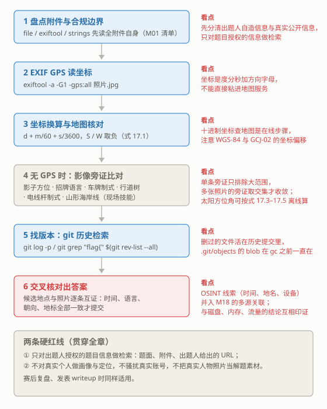

# M17 OSINT 与地理定位
## OSINT and Geolocation

> [!info]- 章节信息
> **所属方向**：MISC ｜ **难度阶段**：L4 高级期 ｜ **前置要求**：[[M01-MISC导论与工具箱|M01]] · [[M16-脑洞与算法杂项|M16]]
> **本章目标**：进入 MISC 里唯一一类"证据在附件之外"的题：OSINT（开源情报）与地理定位。分清四类题型与合规边界；把 EXIF GPS 从读坐标、度分秒换算到地图核对的流程走通（离线部分全部现场造靶）；立起地理定位的旁证比对清单，离线可算的太阳方位角配公式与脚本；搜索引擎运算符与 git 历史检索（离线全流程）；最后从出题视角看自造 OSINT 靶的构造，并与 [[M18-取证综合-多源关联|M18]] 的多源关联衔接。

## 1. 定位：从附件内部到开放情报

[[M16-脑洞与算法杂项|M16]]之前的每一章，证据都完整地装在附件里：字节、像素、波形、内存页，工具再多是读法不同。本章处理另一类题：附件本身只是起点，答案要靠检索找回来。OSINT（Open Source Intelligence，开源情报）指从公开信息里获取线索；地理定位（Geolocation）是其中最常见的一支——给一张照片，答案是一个地名或一组经纬度。

检索面变了，前文的方法论不作废：[[M01-MISC导论与工具箱|M01]] 的固定动作清单在 OSINT 题里依然是第一步——file 认真身、exiftool 读元数据、strings 扫可见串，先把附件自身的信息读全，再决定要不要出门检索。本章两条主轴，EXIF GPS（第 2 节）与太阳方位（第 3 节），都建立在这套动作上。

### 1.1 四类题型

| 题型 | 题面特征 | 主要入口 | 本章节 |
| ---- | ---- | ---- | ---- |
| 找源头 | 给一张图或一段视频，找原始出处、首发或完整版 | 特征词检索、反向图片搜索（现场技能） | 4 |
| 找地点 | 给照片或轨迹，答案是一个地名、坐标或国名 | EXIF GPS（2 节）、影像比对（3 节） | 2、3 |
| 找文件版本 | 给一个仓库、网站或文档，找被删改前的内容 | git 历史（4 节）、网页存档（现场技能） | 4 |
| 找人设线索 | 出题人虚构的身份在多个页面留下碎片信息 | 碎片交叉：时间、设备、语言、地点 | 2、5 |

四类题共用一个判断：出题人构造的信息面里，==哪一条线索能把检索范围缩小一格==。逐条排查的流程如下，第 2 节起逐格展开：



### 1.2 合规边界

CTF 的 OSINT 题是一场比赛，不是对现实世界的调查：出题人预先构造靶场信息——自造的身份、自造的网站、自造的照片——选手只在靶场内检索。==只对出题人授权的题目信息做检索==：题面、附件、出题人明确给出的 URL 与比赛平台内的页面。

三条红线，违反任何一条都不再是做题：

1. **不对真实个人做画像与定位**（这类行为俗称开盒）：不检索真实姓名对应的住址、单位、证件与联系方式，不汇总真实个人的公开碎片；
2. **不骚扰真实账号**：不向真实存在的账号发消息，不注册相近账号冒充，不举报或轰炸真实主页；
3. **不把真实人物的照片与真实私人账号当解题素材**：题面出现疑似真实人物的素材时，先确认它是出题人自造的；无法确认就不做针对个人的检索。

自造信息与真实公开信息的区分是本章的操作基础：

| 自造信息（题内素材，可检索可解） | 真实公开信息（比对知识，只引用不检索人） |
| ---- | ---- |
| 出题人注册的假用户名与自建网站 | 真实城市的路名、语言、车牌制式（比对知识） |
| 出题人自造并写入 EXIF 的照片 | 公开的地图、卫星影像与日出日落数据（比对工具） |
| 出题人构造的 git 仓库与提交历史 | 搜索引擎的通用语法（检索工具） |

判断标准只有一条：==这条信息是不是为这道题而存在的==。为题目而造的可以检索；真实世界里"关于某个人"的信息不碰，真实世界里"关于某个地方"的知识只用来做比对。

> [!warning] 红线延伸到赛后
> 写 writeup、复盘、发帖时同样适用：不公开任何真实个人的可识别信息，不复现"如何定位某个真实账号"。本章所有示例都用自造靶与自造数据。

## 2. EXIF GPS 定位：从照片到坐标

EXIF 的读法在 [[12-隐写与流量取证#5.2 EXIF：图片的简历|12 章 5.2]] 讲过：exiftool 一条命令读全部元数据，Comment / Artist / Description 是 flag 常住地；JPEG 里 EXIF 整个住在 APP1 段，段结构在 [[M03-文件格式深拆II-JPEG与GIF|M03]] 拆过。EXIF 里还有一个专门的 GPS 子区（IFD），记录拍摄时刻的经纬度、海拔与朝向——找地点类题的第一入口。

### 2.1 GPS 子区的字段

| 字段 | 含义 | 示例值 |
| ---- | ---- | ---- |
| GPSLatitude / GPSLatitudeRef | 纬度数值 / 半球（N 或 S） | 39.9075 / N |
| GPSLongitude / GPSLongitudeRef | 经度数值 / 东西（E 或 W） | 116.3912 / E |
| GPSAltitude / GPSAltitudeRef | 海拔 / 海平面上下 | 43.5 / 0 |
| GPSImgDirection | 拍摄朝向（北为 0 度，顺时针） | 135.5 |
| DateTimeOriginal | 拍摄时刻（设备本地时间） | 2026:06:21 05:45:30 |

==方向不放在数值的正负号里，而是单独一个 Ref 字母字段==：纬度配 N/S，经度配 E/W。读坐标时要同时读两个字段；换算成带符号的十进制时，S、W 取负。

### 2.2 造靶与读靶

先用 PIL 生成一张没有任何元数据的照片，再用 exiftool 写入 GPS 与拍摄信息：

```python
# make_photo.py —— 造一张干净的照片
from PIL import Image, ImageDraw
im = Image.new("RGB", (320, 240), (252, 252, 251))
d = ImageDraw.Draw(im)
d.rectangle([40, 40, 160, 120], fill=(55, 138, 221))
d.rectangle([180, 100, 280, 200], fill=(226, 75, 74))
im.save("photo.jpg", quality=95)
print("photo.jpg", im.size)
```

```bash
python3 make_photo.py
```

输出：

```
photo.jpg (320, 240)
```

写入用 `-字段=值` 的形式。数值字段加 `#` 后缀（如 `-GPSLatitude#=`）表示按数字处理——exiftool 会把十进制度自动换成 EXIF 要求的"度、分、秒三个分数"结构，不必手工拆：

```bash
exiftool -overwrite_original \
  -GPSLatitudeRef=N -GPSLatitude#=39.907500 \
  -GPSLongitudeRef=E -GPSLongitude#=116.391230 \
  -GPSAltitude#=43.5 \
  -DateTimeOriginal="2026:06:21 05:45:30" \
  -Model="CTF Cam X1" \
  photo.jpg
```

输出：

```
    1 image files updated
```

读 GPS 用三个参数组合：`-a` 显示重复字段、`-G1` 打印组名、`-gps:all` 只取 GPS 组：

```bash
exiftool -a -G1 -gps:all photo.jpg
```

输出：

```
[GPS]           GPS Version ID                  : 2.3.0.0
[GPS]           GPS Latitude Ref                : North
[GPS]           GPS Latitude                    : 39 deg 54' 27.00"
[GPS]           GPS Longitude Ref               : East
[GPS]           GPS Longitude                   : 116 deg 23' 28.43"
[GPS]           GPS Altitude                    : 43.5 m
```

单独抠"可直接使用"的几个字段用 `-s` 加字段名；`GPSPosition` 是纬度经度的合并显示：

```bash
exiftool -s -GPSLatitude -GPSLongitude -GPSPosition -DateTimeOriginal photo.jpg
```

输出：

```
GPSLatitude                     : 39 deg 54' 27.00" N
GPSLongitude                    : 116 deg 23' 28.43" E
GPSPosition                     : 39 deg 54' 27.00" N, 116 deg 23' 28.43" E
DateTimeOriginal                : 2026:06:21 05:45:30
```

exiftool 输出的坐标是度分秒格式（39 deg 54' 27.00"），方向字母缀在后面；地图服务一般只收十进制度——中间隔着一次换算。

### 2.3 度分秒与十进制的互转

换算公式两条，方向由 Ref 字母承担（N/E 为正，S/W 为负）：

$$dec = d + \frac{m}{60} + \frac{s}{3600} \tag{17.1}$$

$$d = \lfloor dec \rfloor, \qquad m = \left\lfloor (dec - d) \times 60 \right\rfloor, \qquad s = \left((dec - d) \times 60 - m\right) \times 60 \tag{17.2}$$

d 是度、m 是分、s 是秒。反向换算 (17.2) 只对绝对值进行，负号交给 Ref 字母。手撕版本：

```python
# dms.py —— EXIF 度分秒与十进制度的互转
def dms_to_dec(d, m, s, ref):
    """度分秒 -> 十进制；南纬 / 西经为负"""
    dec = d + m / 60 + s / 3600
    return -dec if ref in ("S", "W") else dec

def dec_to_dms(dec):
    """十进制 -> (度, 分, 秒)；按绝对值换算，方向交给 Ref 字段"""
    dec = abs(dec)
    d = int(dec)
    m_dec = (dec - d) * 60
    m = int(m_dec)
    s = (m_dec - m) * 60
    return d, m, s

lat = dms_to_dec(39, 54, 27.00, "N")
lon = dms_to_dec(116, 23, 28.43, "E")
print(f"39d54m27.00s N -> {lat:.6f}")
print(f"116d23m28.43s E -> {lon:.6f}")

d, m, s = dec_to_dms(39.907500)
print(f"39.907500 -> {d} deg {m}' {s:.2f}\"")
d, m, s = dec_to_dms(-116.391230)
print(f"-116.391230 -> {d} deg {m}' {s:.2f}\" （负号交给 W 承担）")

assert abs(dms_to_dec(*dec_to_dms(39.9075), "N") - 39.9075) < 1e-9
print("round trip ok")
```

```bash
python3 dms.py
```

输出：

```
39d54m27.00s N -> 39.907500
116d23m28.43s E -> 116.391231
39.907500 -> 39 deg 54' 27.00"
-116.391230 -> 116 deg 23' 28.43" （负号交给 W 承担）
round trip ok
```

两处细节：写进去的是十进制 116.391230，读回来换算是 116.391231——==尾数差异来自秒值的显示精度（两位小数约合 0.3 米），不是公式误差==；`assert` 一行的往返检验是这类换算脚本的标准自检，改公式后先跑往返再用于解题。

### 2.4 拿坐标去地图服务查（在线步骤）

> [!note] 现场步骤：需要联网，不配输出
> 拿到十进制坐标后的核对动作：把坐标粘进地图或卫星影像服务，确认落点——落在城市、街道还是海面；周边地物（水系、路网、地形）能否与照片内容对上。常用服务：OpenStreetMap 与其卫星图层、Google Maps / Google Earth。答题提交的通常是地名或 flag，坐标只是中间产物。

> [!info]- 中国大陆地图服务的坐标偏移
> EXIF 的 GPS 与国际地图服务（OpenStreetMap、Google Maps 国际版）用同一坐标系 WGS-84；中国大陆的地图服务（高德、百度、腾讯地图）用加偏后的 GCJ-02 / BD-09 坐标系，WGS-84 坐标直接查会偏移几百米。核对国内地点优先用 WGS-84 服务；必须用国内服务时先做坐标转换，公开的转换算法与工具很多。

### 2.5 元数据会消失：剥离、重编码与旁证

EXIF 定位的对抗面是常识考点，两个方向。

平台方向：主流社交平台上传图片时普遍重编码并剥掉 EXIF，GPS 能原样到达读者手里的场景是原始文件直传——出题人自造的照片、邮件附件、网盘原文件。拿到图先判断是不是原始文件（[[M03-文件格式深拆II-JPEG与GIF|M03]] 的警告：微信传输、截图、格式转换都会重编码剥段）。元数据全空不代表没有定位线索，可能只是文件被转了一手。

出题人方向（也是解题者的工具）：exiftool 一条命令剥掉全部元数据：

```bash
exiftool -all= photo.jpg
```

输出：

```
    1 image files updated
```

剥离后 `-gps:all` 不再有任何输出，`exiftool photo.jpg` 只剩文件系统信息与 JPEG 结构参数，与拍摄行为有关的字段全部消失：

```bash
exiftool -a -G1 -gps:all photo.jpg
exiftool photo.jpg | head -6
```

输出：

```
ExifTool Version Number         : 13.50
File Name                       : photo.jpg
Directory                       : .
File Size                       : 4.8 kB
File Modification Date/Time     : 2026:10:25 01:31:55+08:00
File Access Date/Time           : 2026:10:25 01:31:55+08:00
```

GPS 字段被剥掉之后，定位还能靠两类旁证。画面里的旁证（招牌语言、车牌、植被）在 3 节展开；元数据里能拿到的旁证如下：

| 元数据字段 | 能推出什么 |
| ---- | ---- |
| DateTimeOriginal | 拍摄时刻；与日出日落时刻、方位比对可缩范围（2.4、3.2） |
| OffsetTime / OffsetTimeOriginal | 设备写入的时区偏移（不是所有相机都写，有就是强线索） |
| Model / LensModel | 设备与镜头型号，虚构身份的设备线索 |
| Software | 后期处理软件；出现社交平台或转码工具名，说明文件被重编码过 |
| Artist / Copyright | 作者与版权字段，常被出题人预置提示 |

> [!info]- 时间也是坐标：用日出时刻估经度带
> DateTimeOriginal 与照片内容组合可以估经度：照片里太阳恰在地平线上（日出时分），EXIF 时刻是 06:15，则拍摄地在该日期 06:15 前后日出的经度带内——同一时刻太阳升起的地方，经度相差不超过 15 度。查候选日期的日出时刻分布，与 EXIF 时刻比对，能排除大部分经度带；再配 3.2 的方位角定纬度，范围就收敛了。GPS 与时间都有时，还能互相校验：坐标所在时区与 DateTimeOriginal 是否自洽。

## 3. 地理定位方法论：旁证比对

> [!note] 本节定位
> 街景与卫星影像比对依赖在线服务，是比赛现场技能，本节不配输出块；可离线计算的只有太阳方位角（3.2，配公式与脚本）。

### 3.1 比对要点清单

一张照片里能读到的东西比多数人预想的多。按出镜率与分辨力排成清单：

| 线索 | 看什么 | 通常能把范围缩到 |
| ---- | ---- | ---- |
| 太阳方位与影子 | 影子方向 + 拍摄时刻（EXIF） | 半球与纬度带（3.2） |
| 文字与招牌 | 文字种类、语言、双语比例 | 国家或地区 |
| 车牌 | 颜色、排版、制式（如欧盟侧窄条） | 国家 |
| 电话与号码 | 招牌上的电话区号、邮编格式 | 国家或城市 |
| 行道树与植被 | 树种、气候带特征 | 气候带、大洲 |
| 电线杆与交通设施 | 杆型、行驶方向、信号灯样式 | 国家或地区 |
| 山形与海岸线 | 轮廓与卫星图比对 | 局部区域 |
| 建筑与路面 | 屋顶材质、护栏样式、路面标线 | 地区 |

==单条旁证只排除大范围==：语言缩到国家带、植被缩到气候带。定位是一个取交集的过程——旁证越多、交集越小，最后用可辨识的地标（一段海岸线、一座山的轮廓、一栋楼的形状）在候选里确认。

### 3.2 太阳方位与影子：可离线计算的一条

太阳的视运动由纬度与日期决定，这是 3.1 清单里唯一能完全离线算的一条。三个公式：

一年中第 n 天的太阳赤纬（太阳直射点的纬度），Cooper 近似式（偏差在 1 度量级）：

$$\delta = 23.45° \times \sin\left(\frac{360° \times (284 + n)}{365}\right) \tag{17.3}$$

日出时角 $\omega_0$ 与昼长（$\varphi$ 是纬度，北纬为正）：

$$\cos\omega_0 = -\tan\varphi \cdot \tan\delta, \qquad \text{昼长} = \frac{2\,\omega_0}{15°} \tag{17.4}$$

日出方位角 A（北为 0 度，顺时针向东增长），日落方位角为 $360° - A$：

$$\cos A = \frac{\sin\delta}{\cos\varphi} \tag{17.5}$$

$\tan\varphi \cdot \tan\delta$ 的绝对值超过 1 时，该纬度当天处于极昼或极夜。脚本按这组公式实现：

```python
# sun_azimuth.py —— 按日期与纬度算日出日落方位角与昼长
import math


def declination(n):
    """一年中第 n 天的太阳赤纬（Cooper 公式），单位弧度"""
    return math.radians(23.45) * math.sin(math.radians(360 * (284 + n) / 365))


def sun_info(lat_deg, n):
    """纬度 lat_deg（北纬为正）、第 n 天：返回 (昼长小时, 日出方位角, 日落方位角)
    方位角以北为 0 度、顺时针向东增长；极昼极夜返回 None"""
    phi = math.radians(lat_deg)
    delta = declination(n)
    x = -math.tan(phi) * math.tan(delta)
    if abs(x) > 1:
        return None                       # 极昼或极夜：太阳不升不落
    omega0 = math.acos(x)                 # 日出时角（弧度）
    daylen = 2 * math.degrees(omega0) / 15
    cos_a = max(-1.0, min(1.0, math.sin(delta) / math.cos(phi)))
    a_rise = math.degrees(math.acos(cos_a))
    return daylen, a_rise, 360 - a_rise


cases = [
    ("北纬 40 度，6 月 21 日（第 172 天）", 40.0, 172),
    ("南纬 40 度，6 月 21 日", -40.0, 172),
    ("北纬 40 度，12 月 22 日（第 356 天）", 40.0, 356),
    ("赤道（纬度 0），3 月 21 日（第 80 天）", 0.0, 80),
    ("南纬 33.87 度，6 月 21 日", -33.87, 172),
    ("北纬 69.6 度，12 月 21 日", 69.6, 355),
]
for name, lat, n in cases:
    info = sun_info(lat, n)
    delta_deg = math.degrees(declination(n))
    if info is None:
        print(f"{name}：赤纬 {delta_deg:+.2f} 度，太阳整日不升不落（极昼/极夜）")
    else:
        daylen, rise, sett = info
        hh = int(daylen)
        mm = int(round((daylen - hh) * 60))
        print(f"{name}：赤纬 {delta_deg:+.2f} 度，昼长 {hh} 小时 {mm} 分，"
              f"日出方位 {rise:.1f} 度，日落方位 {sett:.1f} 度")
```

```bash
python3 sun_azimuth.py
```

输出：

```
北纬 40 度，6 月 21 日（第 172 天）：赤纬 +23.45 度，昼长 14 小时 51 分，日出方位 58.7 度，日落方位 301.3 度
南纬 40 度，6 月 21 日：赤纬 +23.45 度，昼长 9 小时 9 分，日出方位 58.7 度，日落方位 301.3 度
北纬 40 度，12 月 22 日（第 356 天）：赤纬 -23.44 度，昼长 9 小时 9 分，日出方位 121.3 度，日落方位 238.7 度
赤道（纬度 0），3 月 21 日（第 80 天）：赤纬 -0.40 度，昼长 12 小时 0 分，日出方位 90.4 度，日落方位 269.6 度
南纬 33.87 度，6 月 21 日：赤纬 +23.45 度，昼长 9 小时 45 分，日出方位 61.4 度，日落方位 298.6 度
北纬 69.6 度，12 月 21 日：赤纬 -23.45 度，太阳整日不升不落（极昼/极夜）
```

输出与天文常识逐条对上：夏至日北纬 40 度日出东北（58.7 度）、昼长接近 15 小时；前两行是本节最重要的对照——==同一天，南北同纬度的日出方位角完全相同，昼长一长一短==；冬至日日出东南、昼长 9 小时；赤道春分前后昼夜平分、日出方位接近正东；南半球 6 月是冬季，昼短夜长；北极圈内城市冬至前后处于极夜。

比赛里的用法是**排除候选**，不是直接定位：

1. EXIF 的 DateTimeOriginal 给出拍摄日期，题目候选列表（或照片旁证缩出的候选城市）给出待检纬度；
2. 对每个候选按式 (17.3)–(17.5) 算该日的日出日落方位与昼长；
3. 与照片里的影子方向、天色比对，方位或昼长对不上的候选排除；
4. 极昼极夜是硬排除：EXIF 是 12 月而照片里太阳悬在空中，北极圈内候选全部出局（输出最后一行）。

> [!warning] 方位角定不了半球
> 式 (17.5) 里纬度只以 $\cos\varphi$ 出现：北纬 40 度与南纬 40 度在同一天的日出方位角完全相同（6 月 21 日都是 58.7 度，对照输出前两行）。==方位角加日期只能定纬度带，半球要靠别的旁证==：昼长对比（同日南北半球一长一短，但单张照片读不出昼长）、正午影子方向（式 17.6，用法见下方折叠框）、植被的季节状态（6 月枝繁叶茂是北半球温带）、或招牌语言。

正午太阳高度角是观测成本最低的半球判据：

$$h = 90° - |\varphi - \delta| \tag{17.6}$$

> [!info]- 正午影子定半球
> 北温带正午太阳恒在正南（影子朝北），南温带恒在正北——回归线以外的地区不受季节影响。照片拍摄时刻接近正午、且画面朝向已知（有可读文字等参照）时，看正午影子的朝向即可定半球，比日出日落时刻的影子更好观测。式 (17.6) 也可以反用：由正午高度 h 与当日赤纬 δ 解出 $|\varphi - \delta| = 90° - h$，纬度是 $\varphi = \delta \pm (90° - h)$ 两个解，配半球判断取其一。

### 3.3 多张照片交叉缩小范围

找地点题给多张照片时，逐张独立提取旁证，再按顺序收敛：

1. 每张照片先跑 [[M01-MISC导论与工具箱|M01]] 清单与第 2 节动作：exiftool 读元数据（时间、设备、GPS）、strings 扫可见串；
2. 把 3.1 清单里"国家级"的旁证（语言、车牌、电话区号）先取交集，多数题到这里只剩一两个国家；
3. 交集内的候选城市按拍摄日期算太阳方位（3.2），与影子方向比对；
4. 最后用可辨识地标（山形、海岸线、建筑轮廓）在候选中确认，答案要求经纬度时从地图服务读出十进制坐标（2.4）。

> [!note] 旁证冲突时
> 两条旁证指向不同的国家，先怀疑自己读错了：文字可能是外文招牌（旅游区常见）、车辆可能是过境车辆。旁证要按可靠度排队——文字语言强于植被，植被强于建筑风格；个别冲突不推翻交集，全部冲突才回头检查。

## 4. 搜索引擎与版本检索

### 4.1 搜索运算符

找源头与找人设线索两类题的主要工具是搜索引擎，检索语法本身是通用知识：

| 运算符 | 作用 | 示例（对自造靶站 chall.example） |
| ---- | ---- | ---- |
| `"词组"` | 精确短语匹配 | `"CTF Cam X1"` 找设备型号的出处 |
| `site:` | 限定站点 | `site:chall.example profile` |
| `filetype:` | 限定文件类型 | `filetype:pdf site:chall.example` |
| `intitle:` / `inurl:` | 标题 / URL 含词 | `inurl:notes site:chall.example` |
| `intext:` | 正文含词 | `intext:"draft notes"` |
| `-词` | 排除词 | `flag -writeup` |
| `OR` | 或 | `osint OR geolocation` |

两点使用边界：各搜索引擎对运算符的支持程度不同，表中语法是通用最小集；==运算符只作用于已被收录的页面==，出题人自建且未收录的站点要靠题面给出的 URL 直接访问。

为什么这是比赛技能：出题人构造的网页、页面与文件同样会被搜索引擎收录，赛题要求选手用通用检索语法在题目信息面内定位内容。语法本身不针对任何真实个人；对真实平台的检索遵守 1.2 的红线。

### 4.2 git 历史检索：删掉的文件活在提交里

找文件版本类题的本地形态：附件就是一个 `.git` 目录（或题面给出仓库地址，git clone 下来）。网站侧的 `.git/` 泄露——通过 HTTP 逐个拉取 objects 还原整个仓库——在 [[W03-信息泄露与前端安全#3. .git 泄露与版本库还原|W03 3 节]] 已完整讲过：HEAD 指出当前分支，refs 里存着入口提交哈希，objects 下是按内容哈希存放的对象。手里直接拿到仓库时，还原这步不需要了，剩下的动作是翻历史。

造一个靶：三次提交，flag 在第二次提交写进 notes.txt，第三次提交把它删掉：

```bash
# make_repo.sh —— 造靶：flag 只存在于历史提交里
git init -q -b main
git config user.email "author@ctf.local"
git config user.name "CTF Author"

echo "<h1>Team Blog</h1>" > index.html
git add . && git commit -qm "init: site skeleton"

cat > notes.txt <<'EOF'
draft notes, do not publish
flag{g1t_h1st0ry_n3v3r_f0rg3ts}
EOF
git add . && git commit -qm "add draft notes"

git rm -q notes.txt && git commit -qm "clean up unpublished notes"

ls -A
git log --oneline
```

```bash
bash make_repo.sh
```

输出：

```
.git
index.html
670fef5 clean up unpublished notes
7b27a2a add draft notes
2c582c1 init: site skeleton
```

工作目录里没有 notes.txt，`git log --oneline` 只给三条提交信息——从表面看什么都没有。提交哈希包含时间戳与作者信息，重跑会得到不同的哈希，diff 的内容一致。

先看仓库里实际存了什么：

```bash
cat .git/HEAD
cat .git/refs/heads/main
find .git/objects -type f | sort
```

输出：

```
ref: refs/heads/main
670fef53257c59620298a494e44b2cd8d9bba423
.git/objects/2c/582c1006e74e615722eb88d7bcc3f85f62cf8f
.git/objects/54/b6edb29ba4c57c05b8a485151aeafce77eeabc
.git/objects/67/0fef53257c59620298a494e44b2cd8d9bba423
.git/objects/7b/27a2a89095d628c32120313810d31153d64ed9
.git/objects/94/46bccc2e902a50023fe49b12cb69a95735a90a
.git/objects/96/58d8ffd5123abe3daff62a1361bd16568d5ae1
.git/objects/ca/d79af21aeed35feff1b2313ce683e98308f959
```

HEAD 是一行引用，指向 refs/heads/main；refs 里存当前提交的哈希；objects 下七个文件按"前两位哈希做目录 + 余下哈希做文件名"存放，每个都是 zlib 压缩的对象（commit、tree 或 blob）。==删除文件只产生"删除"这个改动记录，被删内容的 blob 还躺在 objects 里==——这就是翻历史能找回内容的原理，也是 [[W03-信息泄露与前端安全#3. .git 泄露与版本库还原|W03 3 节]]"网站挂出 `.git/` 目录等于让访问者拉到全部历史"的同一件事。

翻历史三招。第一招，`git log -p` 按提交看每个文件的增删 diff，删除动作里直接带着被删的行：

```bash
git log -p -- notes.txt
```

输出：

```
commit 670fef53257c59620298a494e44b2cd8d9bba423
Author: CTF Author <author@ctf.local>
Date:   Sun Oct 25 01:24:07 2026 +0800

    clean up unpublished notes

diff --git a/notes.txt b/notes.txt
deleted file mode 100644
index 9658d8f..0000000
--- a/notes.txt
+++ /dev/null
@@ -1,2 +0,0 @@
-draft notes, do not publish
-flag{g1t_h1st0ry_n3v3r_f0rg3ts}

commit 7b27a2a89095d628c32120313810d31153d64ed9
Author: CTF Author <author@ctf.local>
Date:   Sun Oct 25 01:24:07 2026 +0800

    add draft notes

diff --git a/notes.txt b/notes.txt
new file mode 100644
index 0000000..9658d8f
--- a/notes.txt
+++ /dev/null
@@ -0,0 +1,2 @@
+draft notes, do not publish
+flag{g1t_h1st0ry_n3v3r_f0rg3ts}
```

第二招，按提交号直接取历史版本：`HEAD~1` 是当前提交的上一个提交，`git show 提交:路径` 把那个版本的文件原样倒出来：

```bash
git diff HEAD~1 HEAD
git show HEAD~1:notes.txt
```

输出：

```
diff --git a/notes.txt b/notes.txt
deleted file mode 100644
index 9658d8f..0000000
--- a/notes.txt
+++ /dev/null
@@ -1,2 +0,0 @@
-draft notes, do not publish
-flag{g1t_h1st0ry_n3v3r_f0rg3ts}
draft notes, do not publish
flag{g1t_h1st0ry_n3v3r_f0rg3ts}
```

第三招，关键词扫全部历史：`git rev-list --all` 列出所有提交的哈希，`git grep 模式 提交列表` 对每个提交逐一检索，命中行前缀标出提交哈希：

```bash
git grep "flag{" $(git rev-list --all)
```

输出：

```
7b27a2a89095d628c32120313810d31153d64ed9:notes.txt:flag{g1t_h1st0ry_n3v3r_f0rg3ts}
```

拿到哈希后 `git show 7b27a2a:notes.txt` 取出完整文件。三招的适用场景：知道文件名用第一、二招，只知道内容特征（一段密码、一个 flag 前缀、一串 base64）用第三招。

> [!warning] 三个检索不到的去处
> 一是 pack 文件：仓库执行过 gc 后松散对象合并进 `.git/objects/pack/*.pack`，`find .git/objects -type f` 看不到散文件，`git log -p` 与 `git grep` 不受影响——优先用 git 命令而不是手工翻目录。二是非当前分支：`git rev-list --all` 覆盖所有分支，但 `git diff HEAD~1` 只在当前分支上走，多分支的靶先用 `git log --all --oneline` 看全貌。三是 reflog：`.git/logs/HEAD` 记录分支指向的历次变化，提交被重写后旧提交仍可能从 reflog 找到哈希（`git log -g --oneline`）。

## 5. 出题视角：自造靶与多源关联

### 5.1 自造 OSINT 靶的构造

出题人构造 OSINT 靶的常见手法，反过来就是解题者的检查清单：

| 靶型 | 出题人做的事 | 解题入口 |
| ---- | ---- | ---- |
| EXIF 写坐标 | 自造照片，exiftool 写入 GPS、时间、设备 | 2.2 读出 → 2.3 换算 → 2.4 核对 |
| 假社交主页 | 自建站点，发布虚构身份的时间线 | 4.1 检索 + 时间地点碎片交叉 |
| 自造街景截图 | 用有权素材绘制或拍摄场景 | 3.1 旁证比对 |
| git 仓库 | 提交历史里预置被删内容 | 4.2 翻历史 |

### 5.2 识别刻意留下的线索

OSINT 题的附件里既有噪声也有线索，区分的依据是**信息量**：

- 元数据里信息量异常的字段：同批字段都是模板值，只有 Description 是一句完整的话——这句话就是给解题者的；
- 附件名与文件名：`IMG_20260621_054530.jpg` 这种命名把拍摄时刻又写了一遍，等于确认时刻可用；
- 画面里"恰好"完整可读的元素：完整的车牌、完整的招牌、能读出数字的门牌。真实照片里这些通常模糊或残缺，完整可读就是刻意安排；
- 检验方法：==把候选线索串起来，看能否推出唯一答案==。推不出唯一答案时，大概率还有一条线索没读到，回头把 3.1 清单再过一遍，而不是靠猜。

### 5.3 并入多源关联

[[M18-取证综合-多源关联|M18]] 把磁盘、内存、流量的取证结果放在同一条时间线上比对；OSINT 线索是时间线上的另一类事件源——EXIF 的 DateTimeOriginal 对上日志里的登录时间，地名对上流量里 IP 的归属地，设备型号对上内存里进程的运行环境。综合题的收口动作就是这类交叉印证：单一来源的结论允许存疑，两个独立来源指向同一结论才落笔。

## 6. 常见问题

| 现象 | 原因与解决 |
| ---- | ---- |
| exiftool 读不到 GPS 字段 | 没加 `-a`（重复组默认隐藏）或文件确实没有；`-G1` 看组名确认；元数据全空时先确认手里是不是原始文件（2.5，重编码剥段） |
| 坐标粘进地图服务偏了几百米 | 坐标系差异：EXIF 是 WGS-84，国内地图服务用 GCJ-02 / BD-09（2.4 折叠框），先转换再查 |
| 度分秒换算结果差一点 | 尾数来自秒值两位小数的显示精度（约 0.3 米）；换算脚本先跑往返自检（2.3） |
| git grep 搜不到历史里的内容 | 不带提交参数的 git grep 只搜工作区；`git grep 模式 $(git rev-list --all)` 扫全部提交（4.2） |
| git 历史里也找不到 flag | 对象进了 pack（用 git 命令检索，别手工翻目录）；或在其他分支（`git log --all`）；或提交被重写（`git log -g` 看 reflog） |
| 搜索引擎搜不到出题人的站 | 自造域名未被收录；改用题面给出的 URL 直接访问，运算符只对已收录页面有效（4.1） |
| 影子方向推不出位置 | 单条旁证分辨率本来就低：先凑齐语言、车牌、植被，太阳方位只用来在候选间排除（3.2） |
| 日出方位相同，两个半球分不开 | 式 (17.5) 纬度只以 cos 出现，南北同纬度方位角相同；半球用正午影子或植被季节判断（3.2 警告框） |
| 照片里出现真实人物或真实地点 | 红线检查：先确认是出题人自造素材；无法确认时不做针对真实个人的检索（1.2） |
| 多张照片的旁证互相矛盾 | 个别冲突常见（旅游区外文招牌、过境车辆）；按可靠度排队取交集，全部冲突才回头检查（3.3） |

## 7. 配套练习与延伸阅读

配套练习：

1. 给 2.2 的靶子换一座城市：查一个城市的经纬度写进照片，按 2.3 换算、2.4 核对走完全程；再把照片 `exiftool -all=` 之后交给同学，看对方能否从画面与残留字段里推出线索。
2. 把 sun_azimuth.py 改成命令行参数版：接收纬度与日期，输出日出日落方位与昼长；用它给三个候选城市排某一天的日出方位，写出排除顺序。
3. 给 4.2 的仓库加一层变形：开一个分支把 notes.txt 的 flag 改成假 flag 并合并回 main，重跑 `git grep "flag{" $(git rev-list --all)`，观察真假两个版本同时命中——检索历史时按提交时间与提交信息分辨哪个是出题人预置的。
4. 出一道自造 OSINT 题交换解：构造一张带 EXIF 的照片加一个含三次提交的仓库，flag 拆成两半，一半在照片元数据里，一半在 git 历史里；交换后只允许用本章手法解。
5. （现场技能练习）用 `site:` 运算符在练习平台的公开题面页里定位某道 MISC 题的官方提示页，体会限定站点的收敛效果。

练习场：

- [[01-练习平台索引|练习平台索引]]：MISC 分区按手法分类，OSINT 与杂项题按难度排列，本章四类题型都有对应练习。

延伸阅读：

- [[M18-取证综合-多源关联|M18]]：下一章把本章的 OSINT 线索与磁盘、内存、流量的取证结果并线；
- [[M19-赛事真题复盘|M19]]：成套真题的复盘，含 OSINT 类题的赛场景；
- [[W03-信息泄露与前端安全#3. .git 泄露与版本库还原|W03 3 节]]：网站侧 `.git/` 泄露的完整还原流程与对象结构；
- [[M07-文档与Office隐写|M07]]：文档元数据的字段对照，读 Office 附件时同一套 exiftool 动作；
- [[03-工具清单|工具清单]]：exiftool 与 git 的安装说明与同类工具。
