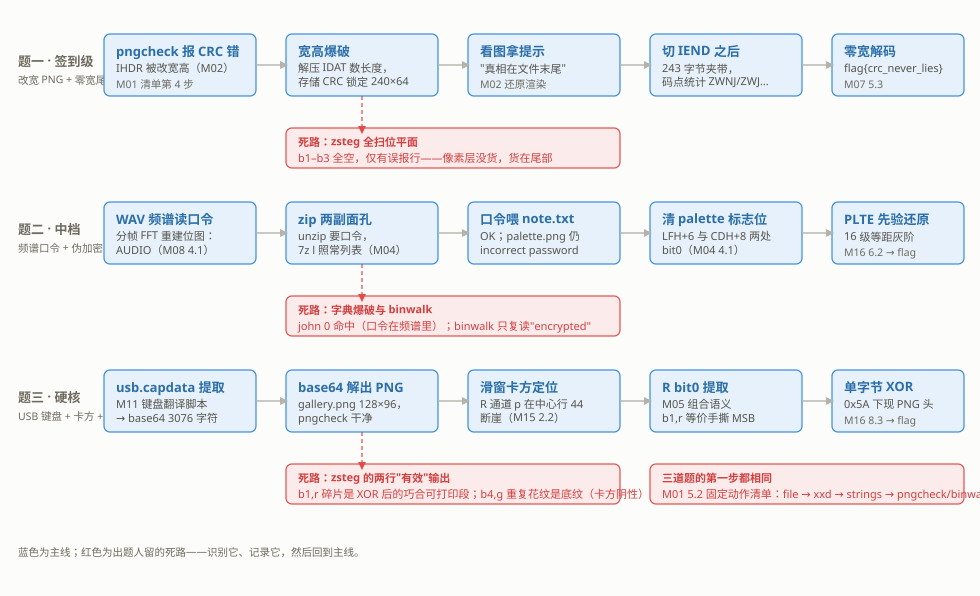

# M19 赛事真题复盘
## Challenge Walkthroughs

> [!info]- 章节信息
> **所属方向**：MISC ｜ **难度阶段**：L4 高级期 ｜ **前置要求**：[[M01-MISC导论与工具箱|M01]] · [[M02-文件格式深拆I-PNG全解|M02]] · [[M04-压缩包全解|M04]] · [[M11-流量取证II-加密流量与USB|M11]]
> **本章目标**：把前面各章的单项手法放进三道完整的赛题里走通：签到级、中档、硬核各一道，每道题都按固定四段展开——题目描述、附件与造靶、解题全流程、出题视角拆解。解题全程按 [[M01-MISC导论与工具箱#5.2 固定动作清单|M01 5.2]] 的固定动作清单起步，走过的每一条路（包括出题人设计的死路）都如实记录；最后把三道题的共性收拢成复盘方法论。

## 1. 定位：从单项手法到成题链

前面十七章每章解决一类问题：PNG 结构在 [[M02-文件格式深拆I-PNG全解|M02]]、压缩包在 [[M04-压缩包全解|M04]]、位平面在 [[M05-图片隐写I-LSB与位平面|M05]]、音频在 [[M08-音频隐写|M08]]、USB 流量在 [[M11-流量取证II-加密流量与USB|M11]]、统计检测在 [[M15-隐写进阶与隐写分析|M15]]。赛题不按章出题——它把几个手法串成一条链，链上每一环都可能是别章的内容，而真正的难度在于==知道下一环去哪找==。

本章三道题都是自造的仿题，难度递进、考点互补：

| 题 | 难度 | 链路 | 考点所在章 |
| ---- | ---- | ---- | ---- |
| 题一 postcard | 签到级 | 改宽的 PNG → 图上提示 → 尾部零宽字符 | [[M02-文件格式深拆I-PNG全解\|M02]] · [[M07-文档与Office隐写\|M07]] |
| 题二 muffled | 中档 | 频谱口令 → 真加密与伪加密混装的 zip → 调色板还原 | [[M08-音频隐写\|M08]] · [[M04-压缩包全解\|M04]] · [[M16-脑洞与算法杂项\|M16]] |
| 题三 wiretap | 硬核 | USB 键盘流量 → base64 → 卡方定位 → LSB 提取 → XOR | [[M11-流量取证II-加密流量与USB\|M11]] · [[M15-隐写进阶与隐写分析\|M15]] · [[M05-图片隐写I-LSB与位平面\|M05]] · [[M16-脑洞与算法杂项\|M16]] |



三道题的链路画在一起，能看到两个重复出现的模式。第一，==每道题的第一步都是同一套固定动作清单==（[[M01-MISC导论与工具箱#5.2 固定动作清单|M01 5.2]]），三道题的突破口全部由清单的前四步给出。第二，每道题都有一条出题人铺好的死路：动作本身是正规动作（zsteg 全扫、字典爆破、读 zsteg 输出行），但它的前提在这道题里不成立。识别死路、回到清单换动作，是本章要训练的核心能力。

每道题的四段读法：题目描述给出赛题页原文；附件与造靶给出完整的造靶脚本，读者可以在自己的环境复现同一道题；解题全流程的每条命令都配输出块（标题写"输出："），命令与输出逐条对应；出题视角拆解回答三个问题——卡点设计在哪、常见错误路径是什么、考点清单是什么。

## 2. 题一（签到级）：postcard——改宽的 PNG 与看不见的尾巴

### 2.1 题目描述

> [!note] 赛题页
> **postcard** ｜ 50 分 ｜ 解出后提交 `flag{...}`
> 收到一张从赛场寄来的明信片。图片软件打开是花的，尺寸也不对劲——但文件本身没有坏。
> 附件：`postcard.png`

"图片是花的"说明像素层的数据不完整或没读对；"文件本身没有坏"排除了损坏，指向结构被改。

### 2.2 附件与造靶

靶子由两层组成：一张 240×64 的提示图，IEND 之后粘一段零宽字符编码的 flag；最后把 IHDR 里的宽高改成 60×32 且不修 CRC。

```python
# q1_build.py —— 造题一：改宽 PNG（CRC 未修）+ IEND 之后粘零宽字符
import struct
from PIL import Image, ImageDraw, ImageFont

FLAG = "flag{crc_never_lies}"
W, H = 240, 64

# 1) 画提示图（修好宽高后才能完整看到）
im = Image.new("RGB", (W, H), (252, 252, 251))
d = ImageDraw.Draw(im)
f_cn = ImageFont.truetype("/usr/share/fonts/opentype/noto/NotoSansCJK-Regular.ttc", 22)
f_en = ImageFont.truetype("/usr/share/fonts/truetype/dejavu/DejaVuSans.ttf", 13)
d.text((W // 2, 22), "真相在文件末尾", font=f_cn, fill=(55, 138, 221), anchor="mm")
d.text((W // 2, 46), "data lives after IEND", font=f_en, fill=(226, 75, 74), anchor="mm")
im.save("q1_orig.png")

# 2) 零宽编码（M07 5.2 的方案：4 码点各带 2 位，U+FEFF 收尾）
PAIRS = ["\u200b", "\u200c", "\u200d", "\u2060"]
zw = ""
for ch in FLAG:
    v = ord(ch)
    for sh in (6, 4, 2, 0):
        zw += PAIRS[(v >> sh) & 3]
zw += "\ufeff"
payload = zw.encode("utf-8")

# 3) IEND 之后粘载荷
png = open("q1_orig.png", "rb").read()
open("q1_stage1.png", "wb").write(png + payload)

# 4) 宽高 240x64 改成 60x32，CRC 不修
data = bytearray(open("q1_stage1.png", "rb").read())
data[16:20] = struct.pack(">I", 60)
data[20:24] = struct.pack(">I", 32)
open("postcard.png", "wb").write(bytes(data))
print(f"postcard.png = 图 {len(png)} 字节 + 零宽载荷 {len(payload)} 字节，宽高 240x64 -> 60x32（CRC 未修）")
print(f"零宽载荷 {len(zw)} 个字符，嵌入内容: {FLAG}")
```

```bash
python3 q1_build.py
```

输出：

```text
postcard.png = 图 4952 字节 + 零宽载荷 243 字节，宽高 240x64 -> 60x32（CRC 未修）
零宽载荷 81 个字符，嵌入内容: flag{crc_never_lies}
```

两个设计点。零宽编码沿用 [[M07-文档与Office隐写#5. 零宽字符|M07 第 5 节]]的方案：20 个字符的 flag 展开成 80 个零宽码点加 1 个结束符，UTF-8 落盘 243 字节，肉眼与文本编辑器都不可见。宽高从 240×64 改成 60×32 且不修 CRC——[[M02-文件格式深拆I-PNG全解#3. CRC 校验与 pngcheck|M02 第 3 节]]的 pngcheck 会当场报错，这既是考点也是签到级的提示。

### 2.3 解题全流程

按 [[M01-MISC导论与工具箱#5.2 固定动作清单|M01 5.2]] 清单起步。第 1 步，file 问真身：

```bash
file postcard.png
```

输出：

```text
postcard.png: PNG image data, 60 x 32, 8-bit/color RGB, non-interlaced
```

第 2、3 步，xxd 看头、strings 扫可见串：

```bash
xxd postcard.png | head -2
strings postcard.png | tail -1
```

输出：

```text
00000000: 8950 4e47 0d0a 1a0a 0000 000d 4948 4452  .PNG........IHDR
00000010: 0000 003c 0000 0020 0802 0000 00ab fd6d  ...<... .......m
IEND
```

头两行里就能读出问题：IHDR 数据区按 [[M02-文件格式深拆I-PNG全解#1.1 十三字节逐字段|M02 1.1]]的字段表对号，前 8 字节 `00 00 00 3c 00 00 00 20` 按大端是宽 60、高 32；尾部 strings 只剩一个 IEND，零宽夹带对 strings 完全不可见。线索集中在第 4 步，pngcheck 查结构：

```bash
pngcheck -v postcard.png
```

输出：

```text
File: postcard.png (5195 bytes)
  chunk IHDR at offset 0x0000c, length 13
    60 x 32 image, 24-bit RGB, non-interlaced
  CRC error in chunk IHDR (computed c18a8cc5, expected abfd6db0)
ERRORS DETECTED in postcard.png
```

`CRC error in chunk IHDR`：IHDR 被改过而 CRC 没跟着改。[[M02-文件格式深拆I-PNG全解#3. CRC 校验与 pngcheck|M02 第 3 节]]说过，pngcheck 报的是"登记与内容不一致"；这里不一致的字段大概率就是宽高——IDAT 的数据量是现成的已知量，[[M02-文件格式深拆I-PNG全解#4. 宽高爆破完整脚本|M02 第 4 节]]的爆破脚本直接套用：

```python
# q1_crack.py —— 宽高爆破（M02 第 4 节的存储 CRC 分支）
import struct
import zlib

data = open("postcard.png", "rb").read()
fake_w, fake_h = struct.unpack(">II", data[16:24])
bd, ct = data[24], data[25]
bits = {0: bd, 2: 3 * bd, 3: bd, 4: 2 * bd, 6: 4 * bd}[ct]

# 拼齐 IDAT 并解压，拿到已知量：解压后总字节数
pos, idat = 8, b""
while pos + 12 <= len(data):
    ln = struct.unpack(">I", data[pos:pos + 4])[0]
    t = data[pos + 4:pos + 8]
    if t == b"IDAT":
        idat += data[pos + 8:pos + 8 + ln]
    pos += 12 + ln
L = len(zlib.decompress(idat))

# 长度约束 L = h x (1 + (w x bits + 7) // 8)，枚举宽、整除出高
cands = []
for w in range(1, 2049):
    row = 1 + (w * bits + 7) // 8
    if L % row == 0 and 1 <= L // row <= 4096:
        cands.append((w, L // row))
print(f"伪装宽高 {fake_w}x{fake_h}  解压后 {L} 字节  长度匹配 {len(cands)} 个: {cands}")

# 文件里存的 CRC 还是原始 IHDR 的：候选逐个代入重算，对上即锁定
stored = struct.unpack(">I", data[29:33])[0]
for w, h in cands:
    body = struct.pack(">II", w, h) + data[24:29]
    if zlib.crc32(b"IHDR" + body) & 0xFFFFFFFF == stored:
        print(f"存储 CRC 命中：原宽高 {w}x{h}")
        fixed = bytearray(data)
        fixed[16:20] = struct.pack(">I", w)
        fixed[20:24] = struct.pack(">I", h)
        open("postcard_fixed.png", "wb").write(bytes(fixed))
        from PIL import Image
        im = Image.open("postcard_fixed.png")
        im.load()
        print(f"还原 -> postcard_fixed.png：{im.size}，PIL 正常打开")
        break
```

```bash
python3 q1_crack.py
```

输出：

```text
伪装宽高 60x32  解压后 46144 字节  长度匹配 10 个: [(5, 2884), (9, 1648), (21, 721), (34, 448), (37, 412), (137, 112), (149, 103), (240, 64), (549, 28), (961, 16)]
存储 CRC 命中：原宽高 240x64
还原 -> postcard_fixed.png：(240, 64)，PIL 正常打开
```

出题人没修 CRC，反而省掉了 [[M02-文件格式深拆I-PNG全解#4. 宽高爆破完整脚本|M02 第 4 节]]的"滤波字节预筛 + 渲染比对"阶段：文件里存的 CRC 就是原始 IHDR 的，10 个长度匹配的候选逐个代入重算，只有真宽高能对上。打开 postcard_fixed.png，画面上两行字：**"真相在文件末尾"** 与 **"data lives after IEND"**。

复查结构，pngcheck 的第二次输出里出现了另一件事：

```bash
pngcheck -v postcard_fixed.png
```

输出：

```text
File: postcard_fixed.png (5195 bytes)
  chunk IHDR at offset 0x0000c, length 13
    240 x 64 image, 24-bit RGB, non-interlaced
  chunk IDAT at offset 0x00025, length 4895
    zlib: deflated, 32K window, default compression
  chunk IEND at offset 0x01350, length 0
  additional data after IEND chunk
ERRORS DETECTED in postcard_fixed.png
```

IEND 之后有追加数据。宽高修好了，按 [[M05-图片隐写I-LSB与位平面#4. zsteg：全组合自动扫描|M05 第 4 节]]的习惯，先把位平面全扫一遍再谈别的——这条路在这道题里走不通：

```bash
zsteg postcard_fixed.png
```

输出（节选；b1–b4 共 40 种组合的其余行全部为空）：

```text
[?] 243 bytes of extra data after image end (IEND), offset = 0x1358
extradata:0         .. file: Unicode text, UTF-8 text, with no line terminators
    00000000: e2 80 8c e2 80 8d e2 80  8c e2 80 8d e2 80 8c e2  |................|
    ……（共 16 行 hex）
imagedata           .. text: "=#\n<#\t8 "
chunk:0:IHDR        .. file: Adobe Photoshop Color swatch, version 0, 240 colors; 1st RGB space (0), w 0x40, x 0x802, y 0, z 0; 2nd RGB space (0), w 0, x 0, y 0, z 0
b1,r,lsb,xy         .. b1,r,msb,xy         .. b1,g,lsb,xy         .. b1,g,msb,xy         ..
……
```

位平面部分一无所获：`b1` 到 `b4` 的全部组合为空，仅有的几行是 [[M05-图片隐写I-LSB与位平面#4. zsteg：全组合自动扫描|M05 第 4 节]]说过的误报（IHDR 的十几个字节被 `file` 强行认成 Photoshop 色板，imagedata 上的可打印碎片来自底图规律）。==像素层没有货==。这条死路的价值在于排除：zsteg 自己开头的 `[?] 243 bytes of extra data after image end` 与 pngcheck 的 `additional data after IEND chunk` 是两条独立线索，指向同一个位置——文件尾。

按结构走到 IEND，切下其后的全部字节，按 [[M07-文档与Office隐写#5. 零宽字符|M07 5.3]]的解码器还原：

```python
# q1_tail.py —— 切出 IEND 之后的载荷，零宽解码（M07 5.3 的解码器）
import struct
from collections import Counter

PAIRS = ["\u200b", "\u200c", "\u200d", "\u2060"]
NAMES = {0x200B: "ZWSP", 0x200C: "ZWNJ", 0x200D: "ZWJ", 0x2060: "WORD JOINER", 0xFEFF: "BOM"}
INV = {ord(c): i for i, c in enumerate(PAIRS)}


def zw_decode(text):
    buf, out = [], []
    for ch in text:
        cp = ord(ch)
        if cp in INV:
            buf.append(INV[cp])
        elif cp == 0xFEFF:                      # 结束符：整组还原
            for i in range(0, len(buf) - 3, 4):
                v = (buf[i] << 6) | (buf[i + 1] << 4) | (buf[i + 2] << 2) | buf[i + 3]
                out.append(chr(v))
            buf = []
    return "".join(out)


data = open("postcard_fixed.png", "rb").read()
pos = 8
while True:
    ln = struct.unpack(">I", data[pos:pos + 4])[0]
    t = data[pos + 4:pos + 8]
    pos += 12 + ln
    if t == b"IEND":
        break
tail = data[pos:]
print(f"IEND 结束于偏移 {pos}，其后 {len(tail)} 字节是夹带物")
print("夹带物前 24 字节:", tail[:24].hex(" "))

txt = tail.decode("utf-8")
cnt = Counter(NAMES[ord(c)] for c in txt if ord(c) in NAMES)
print("不可见码点统计:", dict(cnt))
print("解码结果:", zw_decode(txt))
```

```bash
python3 q1_tail.py
```

输出：

```text
IEND 结束于偏移 4952，其后 243 字节是夹带物
夹带物前 24 字节: e2 80 8c e2 80 8d e2 80 8c e2 80 8d e2 80 8c e2 80 8d e2 81 a0 e2 80 8b
不可见码点统计: {'ZWNJ': 34, 'ZWJ': 19, 'WORD JOINER': 19, 'ZWSP': 8, 'BOM': 1}
解码结果: flag{crc_never_lies}
```

夹带物的字节全是 `e2 80 8b`、`e2 81 a0` 这类三字节组——零宽码点的 UTF-8 签名，不是乱码。码点统计与 [[M07-文档与Office隐写#5. 零宽字符|M07 5.3]]的检测动作一致：四种编码码点加一个结束符 BOM，按 4 码点拼 1 字节还原，flag 到手。

### 2.4 出题视角拆解

签到级的门槛不在"修得快"，在"知道要去修"。卡点设计与错误路径：

- **CRC 不修是故意的**：修了 CRC 的靶，pngcheck 一声不吭（[[M02-文件格式深拆I-PNG全解#3. CRC 校验与 pngcheck|M02 第 3 节]]的对照），爆破要走渲染比对分支；不修则第一轮清单就报错，把"结构被改"写在门口。签到题给提示的方式就是这种"合规的破绽"。
- **flag 放尾部而不是像素**：zsteg 一键扫描是最普及的动作，位平面必被扫到；尾部夹带只有 pngcheck 和结构走查能发现——考的是清单第 2 步（看头尾）是否真的执行。
- **提示图画在修复后的画面里**：玩家修好宽高才看得见"真相在文件末尾"，修复动作本身被奖励了一次。

常见错误路径：在 60×32 的花图上硬看或 OCR；位平面扫完换 stegsolve 再扫一遍；把 243 字节夹带当垃圾跳过；零宽解码映射猜错——正确顺序是先统计码点种类与个数，再对照 [[M07-文档与Office隐写#5. 零宽字符|M07 5.1]]的表定方案。

| 考点 | 出处 |
| ---- | ---- |
| IHDR 结构与 CRC 校验 | [[M02-文件格式深拆I-PNG全解\|M02]] 第 1、3 节 |
| 宽高爆破（存储 CRC 分支） | [[M02-文件格式深拆I-PNG全解\|M02]] 第 4 节 |
| IEND 之后的夹带与切割 | [[M02-文件格式深拆I-PNG全解\|M02]] 第 6 节 |
| 零宽字符的统计与解码 | [[M07-文档与Office隐写\|M07]] 第 5 节 |

## 3. 题二（中档）：muffled——频谱口令与两副面孔的压缩包

### 3.1 题目描述

> [!note] 赛题页
> **muffled** ｜ 150 分 ｜ 解出后提交 `flag{...}`
> 一段录音，一个压缩包。口令就在声音里——但声音只解决了一半。
> 附件：`hum.wav`、`mix.zip`

"口令在声音里"指向音频分析；"只解决了一半"提示口令不是终点，压缩包里还有一层结构问题。

### 3.2 附件与造靶

三个部件一次造齐：画出 zip 口令的频谱音频、PLTE 被置换的调色板图、以及一个把"真加密"与"伪加密"装进同一个包的 zip。

频谱音频按 [[M08-音频隐写#4. 频谱图隐写：把文字画进时频平面|M08 第 4 节]]的方法合成：行频率全部按 FFT bin 对齐，每列一帧正弦和，口令五个字母用 5×7 点阵字模画出：

```python
# q2_make_hum.py —— 造题二音频：把口令画进频谱（M08 4.1 的合成）
import numpy as np
from scipy.io import wavfile

FONT = {
    "A": [0b01110, 0b10001, 0b10001, 0b11111, 0b10001, 0b10001, 0b10001],
    "U": [0b10001, 0b10001, 0b10001, 0b10001, 0b10001, 0b10001, 0b01110],
    "D": [0b11110, 0b10001, 0b10001, 0b10001, 0b10001, 0b10001, 0b11110],
    "I": [0b11111, 0b00100, 0b00100, 0b00100, 0b00100, 0b00100, 0b11111],
    "O": [0b01110, 0b10001, 0b10001, 0b10001, 0b10001, 0b10001, 0b01110],
}
TEXT = "AUDIO"
ROWS = 7

fs = 22050
N = 512                                   # 每列一帧 512 采样
K0, KSTEP = 24, 4                         # 行 r 的频率 = (24 + 4r) * fs / N
ks = K0 + KSTEP * np.arange(ROWS)
freqs = ks * fs / N

grid = []                                 # (ROWS, T) 的 0/1 图，行 0 = 字母顶部
for col in range(len(TEXT) * 6 - 1):      # 每个字母占 5 列 + 1 列间隔
    ch, c = TEXT[col // 6], col % 6
    grid.append([0 if c == 5 else FONT[ch][r] >> (4 - c) & 1 for r in range(ROWS)])
grid = np.array(grid).T
freqmap = grid[::-1]                      # 行 0 = 最低频（频谱图底部）
T = grid.shape[1]

pad = int(0.3 * fs // N)                  # 前后各垫 0.3 秒静音
cols = []
for c in range(T):
    seg = np.zeros(N)
    for r in np.where(freqmap[:, c] == 1)[0]:
        seg += 4000 * np.sin(2 * np.pi * freqs[r] * np.arange(N) / fs)
    cols.append(seg)
sig = np.concatenate([np.zeros(pad * N)] + cols + [np.zeros(pad * N)])
wavfile.write("hum.wav", fs, np.clip(sig, -32768, 32767).astype(np.int16))
print(f"[1] hum.wav：{len(sig) / fs:.2f} 秒，行频率 {[round(f) for f in freqs]} Hz")
```

```bash
python3 q2_make_hum.py
```

输出：

```text
[1] hum.wav：1.23 秒，行频率 [1034, 1206, 1378, 1550, 1723, 1895, 2067] Hz
```

调色板图的造法与 [[M16-脑洞与算法杂项#6. 颜色表调换：PLTE 置换与还原|M16 第 6 节]]同款：渲染 flag 文字，量化成 16 级等距灰阶调色板，再在文件字节里置换 PLTE 的表项。这段脚本放折叠框：

> [!info]- q2_palette_build.py —— 渲染 flag、量化 16 级灰阶、置换 PLTE（M16 6.1 同款）
> ```python
> import struct
> import zlib
>
> import numpy as np
> from PIL import Image, ImageDraw, ImageFont
>
> W, H = 440, 120
> im = Image.new("L", (W, H), 255)
> ImageDraw.Draw(im).text((20, 44), "flag{listen_then_unpack}",
>                         font=ImageFont.truetype(
>                             "/usr/share/fonts/truetype/dejavu/DejaVuSans-Bold.ttf", 28),
>                         fill=0)
> arr = np.array(im).astype(float)
>
> # 文字内部铺 0-95 的随机灰，背景 70-255：换表后整图糊成灰噪点
> rng = np.random.default_rng(55)
> dark = rng.integers(0, 96, (H, W))
> out = np.where(arr < 60, dark, rng.integers(70, 256, (H, W)))
> dither = (rng.random((H, W)) - 0.5) * 17
> idx = np.clip(np.round((out + dither) / 17), 0, 15).astype(np.uint8)
> p = Image.fromarray(idx, "P")
> p.putpalette([v for i in range(16) for v in (i * 17,) * 3])   # 索引 i -> 灰度 i*17
> p.save("q2_palette_orig.png")
>
> # 固定置换：新表第 j 项 = 原表第 perm[j] 项，像素索引一个不动
> perm = [15, 14, 1, 0, 2, 7, 8, 11, 9, 5, 3, 4, 12, 6, 10, 13]
> png = open("q2_palette_orig.png", "rb").read()
> pos, newpng = 8, bytearray(png[:8])
> while pos < len(png):
>     ln = struct.unpack(">I", png[pos:pos + 4])[0]
>     t = png[pos + 4:pos + 8]
>     body = png[pos + 8:pos + 8 + ln]
>     if t == b"PLTE":
>         old = [tuple(body[i * 3:i * 3 + 3]) for i in range(16)]
>         body = b"".join(bytes(old[perm[j]]) for j in range(16))
>         ln = len(body)
>     newpng += struct.pack(">I", ln) + t + body
>     newpng += struct.pack(">I", zlib.crc32(t + body) & 0xFFFFFFFF)
>     pos += 12 + ln
> open("palette.png", "wb").write(bytes(newpng))
> print(f"q2_palette_orig.png {len(png)} 字节 -> palette.png {len(newpng)} 字节（PLTE 已置换，IDAT 未动）")
> print("置换表 perm:", perm)
> ```
>
> ```bash
> python3 q2_palette_build.py
> ```
>
> 输出：
>
> ```text
> q2_palette_orig.png 26447 字节 -> palette.png 26447 字节（PLTE 已置换，IDAT 未动）
> 置换表 perm: [15, 14, 1, 0, 2, 7, 8, 11, 9, 5, 3, 4, 12, 6, 10, 13]
> ```

zip 的造法是本题的核心设计。[[M04-压缩包全解|M04 第 4 节]]的伪加密是"明文数据 + 标志位置 1"，本靶在一个包里同时放两种条目：`note.txt` 用 ZipCrypto 真加密（口令就是频谱里的 AUDIO），`palette.png` 是明文 deflate 数据加置位标志。前者用 `zip -P` 造，后者用 zipfile 造明文条目再翻标志位，三段结构按 [[M04-压缩包全解#2.1 骨架与解析器|M04 2.1]]的字段表手工拼装：

```python
# q2_zip_build.py —— 造题二压缩包：note.txt 真加密 + palette.png 伪加密（M04 第 2、4 节）
import io
import struct
import subprocess
import zipfile

open("note.txt", "w").write(
    "palette.png 的调色板是 16 级等距灰阶：索引 i 对应灰度 i*17。\n"
    "别信眼睛，信先验。\n")

# ---- note.txt：ZipCrypto 真加密，口令在频谱图里 ----
subprocess.run(["zip", "-q", "-P", "AUDIO", "-0", "note_enc.zip", "note.txt"], check=True)
nb = open("note_enc.zip", "rb").read()
eocd = nb.rfind(b"PK\x05\x06")
cdh_off = struct.unpack("<I", nb[eocd + 16:eocd + 20])[0]
note_lfh = nb[:cdh_off]                          # LFH + ZipCrypto 密文，整体照搬
note_cdh = bytearray(nb[cdh_off:eocd])
assert struct.unpack("<I", bytes(note_cdh[42:46]))[0] == 0   # 单条目，本地头偏移为 0

# ---- palette.png：zipfile 造明文 deflate 条目，再把两处标志位置 1（伪加密） ----
png = open("palette.png", "rb").read()
buf = io.BytesIO()
with zipfile.ZipFile(buf, "w", zipfile.ZIP_DEFLATED) as z:
    z.writestr("palette.png", png)
pb = buf.getvalue()
peocd = pb.rfind(b"PK\x05\x06")
pcdh_off = struct.unpack("<I", pb[peocd + 16:peocd + 20])[0]
pal_lfh = bytearray(pb[:pcdh_off])               # LFH + deflate 明文数据
pal_cdh = bytearray(pb[pcdh_off:peocd])
pal_lfh[6] |= 1                                  # LFH 标志位 +6：bit0 置 1
pal_cdh[8] |= 1                                  # CDH 标志位 +8：bit0 置 1
struct.pack_into("<I", pal_cdh, 42, len(note_lfh))   # 本地头偏移改到新位置

cd_off = len(note_lfh) + len(pal_lfh)
eocd = struct.pack("<4sHHHHIIH", b"PK\x05\x06", 0, 0, 2, 2,
                   len(note_cdh) + len(pal_cdh), cd_off, 0)
open("mix.zip", "wb").write(bytes(note_lfh + pal_lfh + note_cdh + pal_cdh + eocd))
print("mix.zip：note.txt（ZipCrypto 真加密）+ palette.png（伪加密：标志位=1，数据是明文 deflate）")
print(f"  note 条目 {len(note_lfh)} 字节  palette 条目 {len(pal_lfh)} 字节")
```

```bash
python3 q2_zip_build.py
```

输出：

```text
mix.zip：note.txt（ZipCrypto 真加密）+ palette.png（伪加密：标志位=1，数据是明文 deflate）
  note 条目 201 字节  palette 条目 26498 字节
```

### 3.3 解题全流程

固定动作清单第一轮。`file` 认两个附件的真身，binwalk 扫嵌入文件：

```bash
file hum.wav mix.zip
binwalk mix.zip
binwalk hum.wav
strings hum.wav | head -5
```

输出：

```text
hum.wav:     RIFF (little-endian) data, WAVE audio, Microsoft PCM, 16 bit, mono 22050 Hz
mix.zip:     Zip archive data, made by v3.0 UNIX, extract using at least v1.0, last modified Oct 25 2026 01:59:20, uncompressed size 107, method=store

DECIMAL       HEXADECIMAL     DESCRIPTION
--------------------------------------------------------------------------------
0             0x0             Zip archive data, encrypted at least v1.0 to extract, compressed size: 119, uncompressed size: 107, name: note.txt
201           0xC9            Zip archive data, encrypted at least v2.0 to extract, compressed size: 26457, uncompressed size: 26447, name: palette.png
26834         0x68D2          End of Zip archive, footer length: 22

DECIMAL       HEXADECIMAL     DESCRIPTION
--------------------------------------------------------------------------------
0             0x0             RIFF audio data (WAV), PCM, 1 channels, 22050 sample rate

RIFF$
WAVEfmt
data
%}D:V#X
J	1,
```

第一条死路在这里：binwalk 对 zip 只复读了两个条目的"encrypted"——它读的是标志位，标志位说加密它就报加密，内容一个字节也分离不出来；对 WAV 只认出一个 RIFF 头，正弦采样串在 strings 里没有可读内容。频谱音频没有可分离的"内层文件"，它的信息在时频平面上。按 [[M08-音频隐写#4. 频谱图隐写：把文字画进时频平面|M08 第 4 节]]的分帧 FFT 读 7 个行频率，相对阈值重建位图：

```python
# q2_read_spec.py —— 解题侧：分帧 FFT 读 7 个行频率，重建频谱位图（M08 4.1 的解靶四步）
import numpy as np
from scipy.io import wavfile

fs, N = 22050, 512
K0, KSTEP, ROWS = 24, 4, 7
ks = K0 + KSTEP * np.arange(ROWS)         # 行 r 的频率 = (24 + 4r) * fs / N

_, x = wavfile.read("hum.wav")
x = x.astype(np.float64)
nframe = len(x) // N
spec = np.abs(np.fft.rfft(x[:nframe * N].reshape(nframe, N), axis=1))
band = spec[:, ks]                        # 只看 7 个行频率
fmax = band.max(axis=1, keepdims=True)
hit = (band > 0.5 * fmax).T               # 逐帧相对阈值：过半即有墨
hit[:, fmax[:, 0] < band.max() * 0.05] = False
idx = np.where(hit.any(axis=0))[0]
art = hit[:, idx[0]:idx[-1] + 1][::-1]    # 行 0 = 字母顶部
for r in range(ROWS):
    print("    " + "".join("#" if v else "." for v in art[r]))
print(f"重建位图 {art.shape[0]} 行 x {art.shape[1]} 列")
```

```bash
python3 q2_read_spec.py
```

输出：

```text
    .###..#...#.####..#####..###.
    #...#.#...#.#...#...#...#...#
    #...#.#...#.#...#...#...#...#
    #####.#...#.#...#...#...#...#
    #...#.#...#.#...#...#...#...#
    #...#.#...#.#...#...#...#...#
    #...#..###..####..#####..###.
重建位图 7 行 x 29 列
```

位图读出 **AUDIO**——zip 的口令。（图形界面里用 Audacity 的频谱图视图直接看，结果相同，[[M08-音频隐写#4. 频谱图隐写：把文字画进时频平面|M08 4.2]]有分工说明。）

第二条死路在 zip 侧。`7z l` 能正常列出两个条目——[[M04-压缩包全解#4. 伪加密：标志位的四种组合|M04 第 4 节]]的伪加密信号之一；先按直觉走一趟字典爆破：

```bash
7z l mix.zip
zip2john mix.zip > q2hash.txt
john --wordlist=/usr/share/john/password.lst q2hash.txt 2>&1 | tail -4
```

输出：

```text
Type = zip
Physical Size = 26856

   Date      Time    Attr         Size   Compressed  Name
------------------- ----- ------------ ------------  ------------------------
2026-10-25 01:59:19 .....          107          119  note.txt
2026-10-25 01:59:18 .....        26447        26457  palette.png
------------------- ----- ------------ ------------  ------------------------
2026-10-25 01:59:19              26554        26576  2 files

Note: Passwords longer than 21 [worst case UTF-8] to 63 [ASCII] rejected
Press Ctrl-C to abort, or send SIGUSR1 to john process for status
0g 0:00:00:00 DONE (2026-10-25 02:09) 0g/s 7182Kp/s 7182Kc/s 7182KC/s amador18..sambarock
Session completed
```

0 命中。口令不在字典里——它写在频谱里。把频谱读出的 AUDIO 显式喂给这份哈希，同样是 0 命中：这份哈希把两个条目的校验字节拴在一起验，palette.png 那份"密文"本是明文，对不上任何口令。字典爆破对这种包没有意义，死路到此为止。

正路是拿 AUDIO 去喂压缩包，观察它"半灵"的反应：

```bash
unzip -t -P AUDIO mix.zip
7z t -pAUDIO mix.zip
```

输出：

```text
Archive:  mix.zip
    testing: note.txt                 OK
   skipping: palette.png             incorrect password
No errors detected in mix.zip for the 1 file tested.
1 file skipped because of incorrect password.

Testing archive: mix.zip
--
Path = mix.zip
Type = zip
Physical Size = 26856

ERROR: Wrong password : palette.png

Sub items Errors: 1

Archives with Errors: 1

Sub items Errors: 1
```

==同一个口令，note.txt 通过、palette.png 报 incorrect password==。[[M04-压缩包全解#3.2 加密位与两代加密：ZipCrypto 与 WinZip AES|M04 3.2]]的判定在此逐字兑现：口令对不对与数据加没加密是两件事——palette.png 的"解密"结果 CRC 对不上，unzip 把它报成口令错误。逐条目对照 LFH 与 CDH 的标志位：

```python
# q2_flags.py —— 逐条目对照 LFH / CDH 的加密标志位（M04 第 4 节）
import struct


def u16(b, o):
    return struct.unpack("<H", b[o:o + 2])[0]


data = open("mix.zip", "rb").read()
lfhs, cdhs = {}, {}
i = 0
while (i := data.find(b"PK\x03\x04", i)) >= 0:
    nlen = u16(data, i + 26)
    lfhs[data[i + 30:i + 30 + nlen].decode()] = u16(data, i + 6)
    i += 4
i = 0
while (i := data.find(b"PK\x01\x02", i)) >= 0:
    nlen = u16(data, i + 28)
    cdhs[data[i + 46:i + 46 + nlen].decode()] = u16(data, i + 8)
    i += 4

for name in lfhs:
    print(f"{name:<14} LFH 标志 0x{lfhs[name]:04x}  CDH 标志 0x{cdhs[name]:04x}"
          f"  bit0(LFH/CDH) = {lfhs[name] & 1}/{cdhs[name] & 1}")
```

```bash
python3 q2_flags.py
```

输出：

```text
note.txt       LFH 标志 0x0009  CDH 标志 0x0009  bit0(LFH/CDH) = 1/1
palette.png    LFH 标志 0x0001  CDH 标志 0x0001  bit0(LFH/CDH) = 1/1
```

两个条目的 bit0 都是 1，从标志位分不出真假——note.txt 多出的 bit3 是流式写入标记，与加密无关。区分真伪的办法在 [[M04-压缩包全解#4.1 修复与验证|M04 4.1]]：清掉标志位试解，解开了是伪加密，报 bad CRC 是真加密被抹了标志。对 palette.png 清两处 bit0：

```python
# q2_fix.py —— 清指定条目在 LFH(+6) 与 CDH(+8) 两处的 bit0（M04 4.1 的翻转函数，反向）
import struct
import sys

target = sys.argv[1].encode()
data = bytearray(open("mix.zip", "rb").read())
i = 0
while (i := data.find(b"PK\x03\x04", i)) >= 0:
    nlen = struct.unpack("<H", bytes(data[i + 26:i + 28]))[0]
    if bytes(data[i + 30:i + 30 + nlen]) == target:
        data[i + 6] &= 0xFE
    i += 4
i = 0
while (i := data.find(b"PK\x01\x02", i)) >= 0:
    nlen = struct.unpack("<H", bytes(data[i + 28:i + 30]))[0]
    if bytes(data[i + 46:i + 46 + nlen]) == target:
        data[i + 8] &= 0xFE
    i += 4
open("mix_fixed.zip", "wb").write(bytes(data))
print(f"已清 {target.decode()} 的 LFH/CDH bit0 -> mix_fixed.zip")
```

```bash
python3 q2_fix.py palette.png
unzip -P AUDIO mix_fixed.zip -d out2
cat out2/note.txt
```

输出：

```text
已清 palette.png 的 LFH/CDH bit0 -> mix_fixed.zip
Archive:  mix_fixed.zip
 extracting: out2/note.txt
  inflating: out2/palette.png
palette.png 的调色板是 16 级等距灰阶：索引 i 对应灰度 i*17。
别信眼睛，信先验。
```

palette.png 清位后正常解出——伪加密判定成立（unzip 对它不再要口令、CRC 全对）；note.txt 保留标志位、继续靠口令 AUDIO 解出——真加密判定成立。两个判定各就各位，note.txt 顺手给出了下一环的先验：调色板是 16 级等距灰阶。按 [[M16-脑洞与算法杂项#6.2 先验还原|M16 6.2]]把每个表项按亮度搬回它该在的索引：

```python
# q2_palette_solve.py —— 按"16 级等距灰阶"先验还原 PLTE（M16 6.2）
import struct
import subprocess
import zlib

import numpy as np
from PIL import Image


def walk_chunks(data):
    pos, out = 8, []
    while pos + 12 <= len(data):
        ln = struct.unpack(">I", data[pos:pos + 4])[0]
        t = data[pos + 4:pos + 8]
        out.append((pos, t, data[pos + 8:pos + 8 + ln]))
        pos += 12 + ln
    return out


def rebuild_plte(src, dst, new_colors):
    data = open(src, "rb").read()
    out = bytearray(data[:8])
    for pos, t, body in walk_chunks(data):
        if t == b"PLTE":
            body = bytes(v for c in new_colors for v in c)
        out += struct.pack(">I", len(body)) + t + body
        out += struct.pack(">I", zlib.crc32(t + body) & 0xFFFFFFFF)
    open(dst, "wb").write(bytes(out))


data = open("palette.png", "rb").read()
plte = next(body for _, t, body in walk_chunks(data) if t == b"PLTE")
cur = [tuple(plte[i * 3:i * 3 + 3]) for i in range(len(plte) // 3)]
print(f"乱序 PLTE 共 {len(cur)} 项：{[c[0] for c in cur]}")

# 先验：这张图的调色板应是 16 级等距灰阶（索引 i -> 灰度 i*17）
fixed = [None] * len(cur)
for j, c in enumerate(cur):
    fixed[round(c[0] / 17)] = c
print("还原 PLTE[0..15]：", [c[0] for c in fixed])
print("等距递增（0,17,34,...,255）:", [c[0] for c in fixed] == [i * 17 for i in range(16)])

rebuild_plte("palette.png", "palette_fixed.png", fixed)
r = subprocess.run(["pngcheck", "palette_fixed.png"], capture_output=True, text=True)
print((r.stdout + r.stderr).strip())

a = np.array(Image.open("palette_fixed.png").convert("RGB"))
b = np.array(Image.open("q2_palette_orig.png").convert("RGB"))
print("还原图与原始渲染逐像素一致:", (a == b).all())
```

```bash
python3 q2_palette_solve.py
```

输出：

```text
乱序 PLTE 共 16 项：[255, 238, 17, 0, 34, 119, 136, 187, 153, 85, 51, 68, 204, 102, 170, 221]
还原 PLTE[0..15]： [0, 17, 34, 51, 68, 85, 102, 119, 136, 153, 170, 187, 204, 221, 238, 255]
等距递增（0,17,34,...,255）: True
OK: palette_fixed.png (440x120, 4-bit palette, non-interlaced, static, -0.2%).
还原图与原始渲染逐像素一致: True
```

还原后的 PLTE 恢复 0,17,34,…,255 的等距递增，与原始渲染逐像素一致——图上 `flag{listen_then_unpack}` 清晰可读。

### 3.4 出题视角拆解

本题的卡点设计在"口令的半灵状态"：频谱口令是真信息（note.txt 靠它解出），但它对 palette.png 无效——这个"无效"不是口令错，而是数据根本没加密。玩家必须完成一次判定升级：从"口令对不对"升级到"这个条目到底有没有加密"。混装两种条目是让两种状态出现在同一个包里，unzip 与 7z 的分歧（[[M04-压缩包全解#4. 伪加密：标志位的四种组合|M04 第 4 节]]对照表）成为可观察的证据。

常见错误路径：字典爆破死磕（伪加密条目对不上任何口令，字典再大也没用）；拿到 AUDIO 后用 `7z x` 解全包、失败后放弃；清标志位只清一处（LFH 或 CDH），部分工具仍要口令（[[M04-压缩包全解#4. 伪加密：标志位的四种组合|M04 第 4 节]]的行为差异表）；把还原前的灰噪图当坏图丢弃——pngcheck 对 PLTE 置换一贯报 No errors（[[M16-脑洞与算法杂项#6. 颜色表调换：PLTE 置换与还原|M16 6.1]]），发现问题靠先验而不是校验器。

| 考点 | 出处 |
| ---- | ---- |
| 频谱图隐写的合成与还原 | [[M08-音频隐写\|M08]] 第 4 节 |
| ZIP 三段结构与逐条目标志位 | [[M04-压缩包全解\|M04]] 第 2、4 节 |
| 伪加密的判定与修复 | [[M04-压缩包全解\|M04]] 4.1 |
| PLTE 置换与灰阶先验还原 | [[M16-脑洞与算法杂项\|M16]] 第 6 节 |

## 4. 题三（硬核）：wiretap——键盘流量、卡方断崖与两层编码

### 4.1 题目描述

> [!note] 赛题页
> **wiretap** ｜ 300 分 ｜ 解出后提交 `flag{...}`
> 我们恢复了一段工位键盘的 USB 监控记录。有人在这台机器上粘贴过一段很长的文本——粘贴的内容没有留在屏幕上，留在了总线上。
> 附件：`usb_tap.pcap`

"总线"指向 USB 键盘流量（[[M11-流量取证II-加密流量与USB|M11]]），"粘贴"说明敲入内容是一整段编码文本。

### 4.2 附件与造靶

链路从里向外造：一张写着 flag 的内层图，逐字节与 0x5A 异或后铺进外层图的 R 通道 bit0；G 通道 bit1 在前 60 行置 1 作诱饵；外层图转 base64 后用 [[M11-流量取证II-加密流量与USB#3.2 造靶：usbmon 格式的 pcap|M11 3.2]]的 usbmon 机件敲进 pcap。完整造靶脚本放折叠框：

> [!info]- q3_build.py —— 内层图 → XOR → LSB 嵌入 + 诱饵 → base64 → USB 键盘 pcap
> ```python
> import base64
> import calendar
> import io
> import struct
>
> import numpy as np
> from PIL import Image, ImageDraw, ImageFont
>
> # ---------- 第 1 部分：内层 flag 图（二值渲染，体积小才塞得进 LSB） ----------
> W2, H2 = 320, 72
> tmp = Image.new("L", (W2, H2), 255)
> ImageDraw.Draw(tmp).text((12, 26), "flag{from_wires_to_pixels}",
>                          font=ImageFont.truetype(
>                              "/usr/share/fonts/truetype/dejavu/DejaVuSansMono-Bold.ttf", 20),
>                          fill=0)
> mask = np.array(tmp) < 128
> im2 = Image.fromarray(np.where(mask, 0, 255).astype(np.uint8))
> im2.save("q3_inner_orig.png")
> inner = open("q3_inner_orig.png", "rb").read()
>
> # ---------- 第 2 部分：单字节 XOR（M16 8.3 同款，解端按 PNG 魔数暴力找键） ----------
> KEY = 0x5A
> payload = bytes(b ^ KEY for b in inner)
> print(f"[1] 内层 PNG {len(inner)} 字节 -> XOR 0x{KEY:02X} -> 载荷 {len(payload)} 字节")
>
> # ---------- 第 3 部分：底图与嵌入（M15 的色块渐变底图；R bit0，MSB-first 行优先） ----------
> W, H = 128, 96
> x, y = np.meshgrid(np.arange(W), np.arange(H))
> r = (96 + 4 * (((x // 8) + (y // 8)) % 32)).astype(np.uint8)
> g = (64 + 4 * ((x // 8) % 48)).astype(np.uint8)
> b = (160 + 4 * ((y // 8) % 24)).astype(np.uint8)
> arr = np.dstack([r, g, b])
>
> bits = np.unpackbits(np.frombuffer(payload, dtype=np.uint8))
> need = len(bits)
> rows = (need + W - 1) // W
> flat = arr[:, :, 0].ravel().copy()
> flat[:need] = (flat[:need] & np.uint8(254)) | bits.astype(np.uint8)
> arr[:, :, 0] = flat.reshape(H, W)
> print(f"[2] 载荷 {need} 位 -> 占 R bit0 前 {rows} 行（图高 {H}）")
>
> # ---------- 第 4 部分：诱饵——G bit1 全 1（前 60 行），bit0 一个不动 ----------
> arr[:60, :, 1] |= np.uint8(2)
> buf = io.BytesIO()
> Image.fromarray(arr, "RGB").save(buf, "PNG")
> stego = buf.getvalue()
> open("q3_gallery.png", "wb").write(stego)
> b64 = base64.b64encode(stego).decode()
> print(f"[3] q3_gallery.png {len(stego)} 字节 -> base64 {len(b64)} 字符")
> print(f"[4] 诱饵：G bit1 在前 60 行置 1（bit0 未动）")
>
> # ---------- 第 5 部分：M11 3.2 的 usbmon 键盘造靶机件，敲进 pcap ----------
> CHAR2KEY = {}
> for i, ch in enumerate("abcdefghijklmnopqrstuvwxyz"):
>     CHAR2KEY[ch] = (0x04 + i, False)
>     CHAR2KEY[ch.upper()] = (0x04 + i, True)
> for i, ch in enumerate("1234567890"):
>     CHAR2KEY[ch] = (0x1E + i, False)
> CHAR2KEY.update({" ": (0x2C, False), "=": (0x2E, False), "+": (0x2E, True),
>                  "/": (0x38, False), "\n": (0x28, False)})
>
>
> def pcap_records(linktype, records):
>     out = [struct.pack("<IHHiIII", 0xA1B2C3D4, 2, 4, 0, 0, 65535, linktype)]
>     for ts, data in records:
>         out.append(struct.pack("<IIII", int(ts), int(round((ts - int(ts)) * 1e6)),
>                                len(data), len(data)))
>         out.append(data)
>     return b"".join(out)
>
>
> _id = [0]
>
>
> def usbmon(ts, typ, xfer, epnum, devnum, flag_data, payload_, status=0, length=None):
>     _id[0] += 1
>     ts_sec = int(ts)
>     ts_usec = int(round((ts - ts_sec) * 1e6))
>     length = len(payload_) if length is None else length
>     hdr = struct.pack("<qBBBBHccqiiII8siiiI",
>                       _id[0], ord(typ), xfer, epnum, devnum, 1,
>                       b"-", flag_data,
>                       ts_sec, ts_usec, status, length, len(payload_),
>                       b"\x00" * 8, 0, 0, 0, 0)
>     return hdr + payload_
>
>
> def type_reports(text):
>     reps = []
>     t = 0.0
>     for ch in text:
>         key, shift = CHAR2KEY[ch]
>         mod = 0x02 if shift else 0x00
>         reps.append((bytes([mod, 0, key, 0, 0, 0, 0, 0]), t)); t += 0.02
>         reps.append((bytes(8), t)); t += 0.03
>     return reps
>
>
> TEXT = b64 + "\n"
> reports = type_reports(TEXT)
> records = []
> ts = float(calendar.timegm((2026, 10, 24, 18, 0, 0)))
> for report, dt in reports:
>     ts += dt
>     records.append((ts, usbmon(ts, "S", 1, 0x81, 1, b"-", b"", status=-115, length=8)))
>     ts += 0.001
>     records.append((ts, usbmon(ts, "C", 1, 0x81, 1, b"<", report)))
> open("usb_tap.pcap", "wb").write(
>     pcap_records(220, records))
> print(f"[5] usb_tap.pcap：{len(records)} 条记录，敲入 {len(TEXT) - 1} 个 base64 字符 + 回车")
> ```
>
> ```bash
> python3 q3_build.py
> ```
>
> 输出：
>
> ```text
> [1] 内层 PNG 721 字节 -> XOR 0x5A -> 载荷 721 字节
> [2] 载荷 5768 位 -> 占 R bit0 前 46 行（图高 96）
> [3] q3_gallery.png 2307 字节 -> base64 3076 字符
> [4] 诱饵：G bit1 在前 60 行置 1（bit0 未动）
> [5] usb_tap.pcap：12308 条记录，敲入 3076 个 base64 字符 + 回车
> ```
>
> `CHAR2KEY`、`type_reports`、`pcap_records`、`usbmon` 四件与 [[M11-流量取证II-加密流量与USB#3.2 造靶：usbmon 格式的 pcap|M11 3.2]]逐行相同，base64 的字母表（大小写字母、数字、`+`、`/`、`=`）全部在映射表内。附件只有 usb_tap.pcap；q3_gallery.png 与 q3_inner_orig.png 是造靶侧的中间产物，解题侧会把它们重新解出来。

### 4.3 解题全流程

固定动作清单第一轮。`file` 报出链路类型：

```bash
file usb_tap.pcap
```

输出：

```text
usb_tap.pcap: pcap capture file, microsecond ts (little-endian) - version 2.4 (Memory-mapped Linux USB, capture length 65535)
```

`Memory-mapped Linux USB`——链路类型 220，不是以太网帧，[[M11-流量取证II-加密流量与USB#3.2 造靶：usbmon 格式的 pcap|M11 3.2]]的解析方式直接套用。协议统计与载荷字段：

```bash
tshark -r usb_tap.pcap -q -z io,phs | tail -3
tshark -r usb_tap.pcap -Y usb.capdata -T fields -e usb.capdata | head -4
```

输出：

```text
frame                                    frames:12308 bytes:836944
  usb                                    frames:12308 bytes:836944
===================================================================
00000c0000000000
0000000000000000
0200190000000000
0000000000000000
```

第一条 report 修饰键 0、键码 0x0c——HID 表里的 `i`；第二条全零是放键；第三条修饰键 0x02（左 Shift）、键码 0x19——`V`。8 字节 report 的翻译交给 [[M11-流量取证II-加密流量与USB#3.3 解靶：去重、查表、拼接|M11 3.3]]的 solve_usb_kb.py，脚本原样复用：

```bash
tshark -r usb_tap.pcap -Y usb.capdata -T fields -e usb.capdata | python3 solve_usb_kb.py > typed.txt
wc -c typed.txt
head -c 96 typed.txt; echo
tail -c 24 typed.txt
```

输出：

```text
3077 typed.txt
iVBORw0KGgoAAAANSUhEUgAAAIAAAABgCAIAAABaGO0eAAAIyklEQVR4nO1bWZJbNwwEnzgXy01ys5w0zMfYcKO7QU1il/kR
Y35y5suAAAAAElFTkSuQmCC
```

敲入的是 3076 个 base64 字符。==开头 `iVBORw0KGgo` 就是 PNG 签名 `\x89PNG\r\n\x1a\n` 的 base64==——还没解码就能认出这是张 PNG。解码落盘：

```bash
base64 -d typed.txt > gallery.png
file gallery.png
pngcheck gallery.png
```

输出：

```text
gallery.png: PNG image data, 128 x 96, 8-bit/color RGB, non-interlaced
OK: gallery.png (128x96, 24-bit RGB, non-interlaced, static, 93.7%).
```

gallery.png 是一张结构完全正常的 128×96 RGB 图——"表面无隐写"。按 [[M05-图片隐写I-LSB与位平面#4. zsteg：全组合自动扫描|M05 第 4 节]]全扫一遍，输出里只有噪声：

```bash
zsteg gallery.png
```

输出（节选；b2、b3 共 20 组全部为空）：

```text
b1,r,lsb,xy         .. text: "WP@PZZZW"
b1,r,msb,xy         .. text: "XZZZHJZZZZ"
b1,g,lsb,xy         .. b1,g,msb,xy         .. b1,b,lsb,xy         .. b1,b,msb,xy         ..
b1,rgb,lsb,xy       .. b1,rgb,msb,xy       .. file: Excel 3 BIFF 3
b1,bgr,lsb,xy       .. b1,bgr,msb,xy       .. file: Applesoft BASIC program data, first line number 144
b2,r,lsb,xy         .. b2,r,msb,xy         .. b2,g,lsb,xy         .. b2,g,msb,xy         ..
……
b4,r,lsb,xy         .. file: TeX font metric data (\001\020\020EETT\211\211\230\230\315\315\315\335)
b4,g,lsb,xy         .. text: "\"\"\"\"ffff"
b4,g,msb,xy         .. text: "DDDDffffUUUUwwwwDDDDffffUUUUwwwwDDDDffff……（长重复串）"
```

三行内容逐条判读。`b1,r` 的两个 text 行是载荷的碎片：XOR 过的压缩流里恰好有连续可打印的段，拼不成任何结构化内容。`b1,rgb` 与 `b4,r` 的 file 行是 [[M05-图片隐写I-LSB与位平面#4. zsteg：全组合自动扫描|M05 第 4 节]]说过的 `file` 误报。`b4,g` 的长重复串是 [[M05-图片隐写I-LSB与位平面#4. zsteg：全组合自动扫描|M05 第 4 节]]的"重复字符行"——底图的固定模式，不是货。==zsteg 的有效行全部走不通，方向要交给统计检测==。

对 zsteg 输出里有内容的两个通道跑 [[M15-隐写进阶与隐写分析#2.2 造靶与整图检验|M15 2.2]]的卡方检验——R 通道（b1,r 有碎片行）做滑动窗口定位，G 通道（b4,g 有花纹行）做整图复核，窗高 8 行、步距 2 行：

```python
# q3_chi2.py —— R/G 两通道卡方：R 滑窗定位嵌入区，G 验证花纹通道（M15 2.2 的 chi2_stat 原样复用）
import numpy as np
from PIL import Image
from scipy.stats import chi2 as chi2_dist


def chi2_stat(c):
    """值对卡方检验，返回 (χ², 自由度, p 值)"""
    h = np.bincount(c.ravel(), minlength=256)
    pair_sum = h[0::2] + h[1::2]
    use = pair_sum >= 5
    n_star = pair_sum[use] / 2
    dev = h[0::2][use] - n_star
    x2 = float((dev ** 2 / n_star).sum())
    return x2, int(use.sum()) - 1, float(chi2_dist.sf(x2, int(use.sum()) - 1))


img = np.array(Image.open("gallery.png"))
r, g = img[:, :, 0], img[:, :, 1]
x2, dof, p = chi2_stat(r)
print(f"R 通道整图卡方：chi2 = {x2:.1f}  dof = {dof}  p = {p:.4f}")
WIN, STEP, H = 8, 2, 96
print(f"R 通道滑窗（窗高 {WIN} 行，步距 {STEP} 行）：")
for c0 in range(WIN // 2, 50, STEP):
    w0 = c0 - WIN // 2
    _, _, pw = chi2_stat(r[w0:w0 + WIN, :])
    bar = "#" * round(pw * 30)
    print(f"  窗口中心行 {c0:>3}: p = {pw:.4f}  {bar}")
tail = [chi2_stat(r[c0 - WIN // 2:c0 + WIN // 2, :])[2]
        for c0 in range(50, H - WIN // 2 + 1, STEP)]
print(f"  中心行 50～{range(50, H - WIN // 2 + 1, STEP)[-1]} 全部 p = {max(tail):.4f}（尾部全干净）")
x2g, dofg, pg = chi2_stat(g)
print(f"G 通道整图卡方：chi2 = {x2g:.1f}  dof = {dofg}  p = {pg:.4f}")
```

```bash
python3 q3_chi2.py
```

输出：

```text
R 通道整图卡方：chi2 = 2244.0  dof = 26  p = 0.0000
R 通道滑窗（窗高 8 行，步距 2 行）：
  窗口中心行   4: p = 0.7548  #######################
  窗口中心行   6: p = 0.9143  ###########################
  窗口中心行   8: p = 0.9798  #############################
  窗口中心行  10: p = 0.9504  #############################
  窗口中心行  12: p = 0.8948  ###########################
  窗口中心行  14: p = 0.6864  #####################
  窗口中心行  16: p = 0.9292  ############################
  窗口中心行  18: p = 0.9531  #############################
  窗口中心行  20: p = 0.7914  ########################
  窗口中心行  22: p = 0.8375  #########################
  窗口中心行  24: p = 0.9750  #############################
  窗口中心行  26: p = 0.8855  ###########################
  窗口中心行  28: p = 0.6216  ###################
  窗口中心行  30: p = 0.6382  ###################
  窗口中心行  32: p = 0.7375  ######################
  窗口中心行  34: p = 0.9397  ############################
  窗口中心行  36: p = 0.9559  #############################
  窗口中心行  38: p = 0.9421  ############################
  窗口中心行  40: p = 0.9944  ##############################
  窗口中心行  42: p = 0.6026  ##################
  窗口中心行  44: p = 0.0000
  窗口中心行  46: p = 0.0000
  窗口中心行  48: p = 0.0000
  中心行 50～92 全部 p = 0.0000（尾部全干净）
G 通道整图卡方：chi2 = 6144.0  dof = 31  p = 0.0000
```

R 通道的 p 值在窗口中心行 42 之后从高位跌到 0——嵌入区在图的前段。[[M15-隐写进阶与隐写分析#2.2 造靶与整图检验|M15 2.2]]的判读规则直接给出结论：R 通道前若干行有整段 LSB 嵌入。G 通道整图 p = 0：`b4,g` 出花纹的那条通道在值对检验下干净，重复花纹是底图模式，不是嵌入（[[M15-隐写进阶与隐写分析#2. 卡方攻击：值对的均衡化|M15 2.1]]的值对机制：bit0 未被触碰，奇数值的频数保持为 0，失衡原样保留）。嵌入占了多少行由载荷长度决定：

$$\text{载荷占用的行数} = \left\lceil \frac{8 \times L}{W} \right\rceil \tag{19.1}$$

L 是载荷字节数，W 是图宽。file 与 pngcheck 给出的图宽是 128，若载荷约 700 字节，行数在 44 上下——与 p 的断点位置一致。按 [[M05-图片隐写I-LSB与位平面#3.1 通用组合提取器|M05 3.1]]的组合语义（R 通道、bit0、MSB-first、行优先）提取，再对提取结果做 [[M16-脑洞与算法杂项#8.3 对比、解密隐藏字段|M16 8.3]]的单字节 XOR 暴力——判据是已知明文 PNG 文件头：

```python
# q3_solve.py —— 提取 R bit0（M05 组合语义）-> 单字节 XOR 暴力（M16 8.3）-> 裁出内层 PNG
import numpy as np
from PIL import Image

r = np.array(Image.open("gallery.png"))[:, :, 0]
NBYTES = 800                                  # 比载荷多提一些，收口时裁掉
bits = ((r & 1).ravel()[:NBYTES * 8]).reshape(-1, 8)
data = np.packbits(bits).tobytes()            # MSB-first 拼字节
print(f"[1] R bit0 提取前 {NBYTES} 字节，头部 hex：")
print("   ", data[:32].hex(" "))

hit = None
for k in range(256):
    dec = bytes(b ^ k for b in data[:8])
    if dec == b"\x89PNG\r\n\x1a\n":
        hit = k
        break
print(f"[2] 单字节 XOR 暴力：键 0x{hit:02X} 下前 8 字节是 PNG 文件头")

dec = bytes(b ^ hit for b in data)
end = dec.find(b"IEND") + 8                   # IEND 类型 + CRC 收尾
inner = dec[:end]
open("inner_flag.png", "wb").write(inner)
im = Image.open("inner_flag.png")
im.load()
print(f"[3] 裁出 inner_flag.png {len(inner)} 字节，{im.size}，PNG 结构完整")

orig = open("q3_inner_orig.png", "rb").read()
print(f"[4] 与造靶渲染的原图逐字节一致: {inner == orig}")
```

```bash
python3 q3_solve.py
```

输出：

```text
[1] R bit0 提取前 800 字节，头部 hex：
    d3 0a 14 1d 57 50 40 50 5a 5a 5a 57 13 12 1e 08 5a 5a 5b 1a 5a 5a 5a 12 52 5a 5a 5a 5a f8 85 29
[2] 单字节 XOR 暴力：键 0x5A 下前 8 字节是 PNG 文件头
[3] 裁出 inner_flag.png 721 字节，(320, 72)，PNG 结构完整
[4] 与造靶渲染的原图逐字节一致: True
```

提取出的头 32 字节是高熵数据（zsteg 在这里只能撞出碎片），单字节暴力在 0x5A 处命中：`d3 0a 14 1d 57 50 40 50` 与 `89 50 4E 47 0D 0A 1A 0A` 逐位异或对应。解出的 721 字节按 IEND 裁齐，正好对上式 (19.1) 的 46 行（8 × 721 ÷ 128 = 45.06，向上取整）。打开 inner_flag.png，320×72 的画面上是 **flag{from_wires_to_pixels}**。

> [!note] 两路互证与收口
> `zsteg -E b1,r,lsb,xy gallery.png` 提出的字节与手撕提取器逐字节一致（注意 [[M05-图片隐写I-LSB与位平面#4. zsteg：全组合自动扫描|M05 第 4 节]]那对反着的标注：手撕的 MSB-first 对应 zsteg 的 `lsb`）：
>
> ```bash
> zsteg -E b1,r,lsb,xy gallery.png | xxd | head -2
> ```
>
> 输出：
>
> ```text
> 00000000: d30a 141d 5750 4050 5a5a 5a57 1312 1e08  ....WP@PZZZW....
> 00000010: 5a5a 5b1a 5a5a 5a12 525a 5a5a 5af8 8529  ZZ[.ZZZ.RZZZZ..)
> ```
>
> "与造靶渲染的原图逐字节一致"是自造靶才有的收口（原图恰好留在工作区）；实战里的收口标准是 inner_flag.png 正常打开且内容可读——这两条在本靶同时成立。

### 4.4 出题视角拆解

四层链各有分工：USB 键盘流量负责"把大段编码藏进一个不起眼的附件"（[[M11-流量取证II-加密流量与USB|M11]]）；base64 负责编码层（[[M01-MISC导论与工具箱#4.2 二进制里的正则打靶|M01 4.2]]）；外层图的 LSB 藏载荷；XOR 负责让提取出的字节失去一切可读性。三层难度递进的死路：

- **zsteg 的有效行**：载荷经过 XOR 后是高熵数据，zsteg 的 text/file 判定只能给出碎片与误报——盲扫的"有输出"不等于"有方向"。玩家必须接受"zsteg 走不通"这个事实，换 [[M15-隐写进阶与隐写分析|M15]]的统计检测要方向。
- **卡方阴性区域是干扰**：诱饵设在 G 通道 bit1（bit0 一个不动）。bit1 的固定花纹让 `b4,g` 组合产生长重复串，很像"藏了东西"；但 [[M15-隐写进阶与隐写分析#2. 卡方攻击：值对的均衡化|M15 2.1]]的值对机制说明它是干净的——bit0 未被触碰，奇数值的频数保持为 0，值对失衡原样保留。这道检验在解题流程里已经完成：G 通道整图 p = 0，与 R 通道前 46 行的阳性形成对照。
- **先 XOR 再读**：提取出的 800 字节里前 8 字节不是任何已知魔数，直接当文件保存毫无意义；[[M16-脑洞与算法杂项#8.3 对比、解密隐藏字段|M16 8.3]]的单字节暴力以 PNG 头为判据，一步定位键值。

常见错误路径：把 usb_tap.pcap 当网络流量在以太网层找协议；把敲出的 base64 文本当 flag；对 `b4,g` 的重复花纹做各种解码；提取后忘记 XOR、把高熵字节当"提取失败"反复换组合。

| 考点 | 出处 |
| ---- | ---- |
| usbmon 格式与 HID 键盘翻译 | [[M11-流量取证II-加密流量与USB\|M11]] 第 3 节 |
| base64 的识别与解码 | [[M01-MISC导论与工具箱\|M01]] 4.2 |
| 滑窗卡方定位嵌入区 | [[M15-隐写进阶与隐写分析\|M15]] 2.2 |
| 组合语义提取（b1,r 与手撕对应） | [[M05-图片隐写I-LSB与位平面\|M05]] 3.1、第 4 节 |
| 单字节 XOR 与已知明文判据 | [[M16-脑洞与算法杂项\|M16]] 8.3 |

## 5. 复盘方法论：三道题教会的事

### 5.1 三道题的共性

三道题的突破口全部出现在 [[M01-MISC导论与工具箱#5.2 固定动作清单|M01 5.2]]清单的前四步：

| 题 | 附件 | 清单第一轮的发现 |
| ---- | ---- | ---- |
| 题一 postcard | postcard.png | pngcheck 报 IHDR CRC 错——结构被动过 |
| 题二 muffled | hum.wav、mix.zip | file 认出 WAV 与 zip；binwalk 分离无货；7z l 列表正常 |
| 题三 wiretap | usb_tap.pcap | file 报链路类型 220——USB 总线流量，不是以太网 |

三道题的死路也结构相同：每条死路都是一个正规动作，动作本身没错，错的是它的前提在这道题里不成立。

| 死路 | 动作与前提 | 识别信号 | 出口 |
| ---- | ---- | ---- | ---- |
| 题一：位平面全扫 | 前提：flag 在像素低位 | b1–b4 全空；pngcheck 的 additional data 与 zsteg 的 `[?]` 行两条独立线索都指向文件尾 | 换到结构层，切尾 |
| 题二：字典爆破 | 前提：口令在字典里 | 0 命中；频谱口令喂进 unzip 仍有一个条目失败；7z l 列表正常 | 逐条目查标志位 |
| 题三：读 zsteg 有效行 | 前提：text/file 行就是货 | 内容是碎片与重复花纹，不是结构化数据；对 G 通道卡方 p = 0 | 卡方定方向，提取后先解密再读 |

识别死路靠两类信号：==动作的前提可以被直接检验==（口令在不在字典、通道的值对是否均衡），以及==两条独立线索是否指向同一处==（题一的两条尾部线索、题三"zsteg 无方向 + 卡方有断点"的对比）。换源的时机：一条路连续两轮没有产生新信息，回清单换下一个动作；两条独立线索指向同一处，立刻换过去。三道题的出口动作都是"回到 [[M01-MISC导论与工具箱#5.2 固定动作清单|M01 5.2]]重新分配"——清单的价值在赛前是起步顺序，在卡题时是换向依据。

### 5.2 复盘笔记的记录格式

赛后再想"这道题当时怎么卡的"，靠的是赛中记下的笔记。复盘笔记固定四段：

1. **复现环境**：系统、工具版本、附件哈希——保证换个时间还能原样重跑；
2. **卡点时间线**：按顺序记"做了什么、看到什么、为什么停"——死路也是信息，写下来才知道在哪耗了多久；
3. **新工具与新参数**：本次学到的命令与参数，失败的用法也记；
4. **同类题索引**：把每个考点归到章节，下次按章检索。

以题一为例，一份完整的复盘笔记：

```text
# postcard 复盘 2026-10-25
## 复现环境
WSL Ubuntu 26.04；pngcheck 4.0.1 / zsteg 0.2.14 / PIL 13.0
附件 postcard.png（5195 字节），sha256
2a2e4dd764311dc7b726fc2e6fd7a2c6ea44c2f65d17f56a11a38f9a4c0a0235
## 卡点时间线
1. file -> PNG 60x32；pngcheck -v -> CRC error in chunk IHDR   [定位：结构层]
2. zsteg 全扫 -> b1-b4 全空                                    [死路，约 8 分钟]
3. 宽高爆破（存储 CRC 分支）-> 240x64，PIL 正常打开，图上见提示
4. pngcheck -v -> additional data after IEND（243 字节）
5. 切尾 -> e2 80 8c 开头 -> 码点统计 5 种 -> M07 5.3 解码 -> flag
## 新工具与新参数
- 宽高爆破先试"存储 CRC 命中"分支：出题人没修 CRC 时零成本锁定
- e2 80 开头的三字节组是零宽码点的 UTF-8 签名，不是乱码
## 同类题索引
- IHDR 结构与 CRC -> M02 第 1、3 节
- IEND 之后的夹带 -> M02 第 6 节
- 零宽字符 -> M07 第 5 节
```

这份格式与 [[M01-MISC导论与工具箱#5.1 目录组织|M01 5.1]]的 notes.md 是同一件事：赛中记录、赛后整理 writeup 时直接扩写。多道题的笔记按同一格式堆叠，赛季末按"同类题索引"一列就能看出哪些章的考点反复出现——那是下一阶段该补强的地方。

### 5.3 与 M20 的衔接

本章三道题都是单链：一条线索从附件头部走到底，链上每环唯一。[[M20-MISC综合实战与赛事策略|M20]]处理的是另一类现场：多个附件互为线索（压缩包里装流量包、图片里藏音频的口令）、同一道题里多条链并行、以及比赛时间在链条之间的分配。三道题积累的两样东西——固定动作清单的起步纪律、死路的识别与换向——在多链现场从"解题技巧"变成"时间管理工具"：每条链先用清单跑一轮，有信号的继续投入，无信号的在笔记里记下死路后放下。

## 6. 常见问题

| 现象 | 原因与解决 |
| ---- | ---- |
| 图片能打开但内容残缺、尺寸可疑 | 先 pngcheck -v 而不是 OCR：CRC error 指向被改的块；宽高被改走爆破（[[M02-文件格式深拆I-PNG全解\|M02]] 第 4 节，题一） |
| 宽高爆破候选太多收不了口 | 出题人没修 CRC 时用存储 CRC 命中分支；修了就按"滤波字节 ≤ 4"预筛加渲染比对（题一，10 个候选一步锁定） |
| zsteg 位平面全空，但 pngcheck 报 additional data after IEND | 货在结构层不在像素层。按 chunk 结构走到 IEND 切出夹带物，验魔数再定读法（题一） |
| 夹带物是一串 e2 80 开头的"乱码" | 零宽码点的 UTF-8 签名。先统计码点种类与个数，再对照映射表解码（[[M07-文档与Office隐写\|M07]] 5.3） |
| 口令明明正确，unzip 还是报 incorrect password | 该条目可能是伪加密：数据是明文，解密结果 CRC 必然对不上。逐条目对照 LFH/CDH 的 bit0，清两处再试（[[M04-压缩包全解\|M04]] 第 4 节，题二） |
| 清了标志位反而报 bad CRC | 反向情形：真加密被抹了标志。把标志改回去，按真加密处理（[[M04-压缩包全解\|M04]] 4.1） |
| john 对整个压缩包 0 命中，口令确认没错 | 多条目哈希把各条目的校验字节拴在一起验，混入伪加密条目后任何口令都通不过；单条目验证另起炉灶（题二） |
| 7z l 列表正常但解压要口令 | 7z l 只读中央目录不解数据——"要口令但能列表"是伪加密的第一信号（[[M04-压缩包全解\|M04]] 第 4 节） |
| 频谱音频读出的位图字母粘连或缺列 | 行频率没按 FFT bin 对齐，或阈值用了绝对值。行频率取 $f_s/N$ 整数倍、阈值用逐帧相对值（[[M08-音频隐写\|M08]] 4.1，题二） |
| tshark 提不出 usb.capdata | 链路类型不对：USB 流量是 220（Memory-mapped Linux USB），不是 1（Ethernet）。file 看链路类型字段（[[M11-流量取证II-加密流量与USB\|M11]] 3.2，题三） |
| 键盘翻译出现 `<0x..>` 占位 | 键码表缺字符：base64 的 `+`、`/`、`=` 和大写字母都要在映射里，缺了就补（题三） |
| zsteg 的 text/file 行拼不出内容 | 行内容是高熵载荷的碎片或 file 误报。统计检测定方向（滑窗卡方），提取后先解密再读（题三） |
| 某个通道有重复字符花纹，解码无果 | 底图的固定模式（[[M05-图片隐写I-LSB与位平面\|M05]] 第 4 节）。对它跑一次卡方：bit0 未动的花纹 p = 0，阴性即干扰（题三诱饵） |
| 卡方整图 p = 0 但图里确实有货 | 局部嵌入被干净像素稀释。缩小窗口做滑动检验，边界从 p 的骤降读出（[[M15-隐写进阶与隐写分析\|M15]] 2.2，题三） |
| 提取出的字节既不是文本也不是已知魔数 | 载荷被加密或异或过。单字节暴力配已知明文判据（PNG 头、flag 前缀），多字节键回到元数据与题面找线索（[[M16-脑洞与算法杂项\|M16]] 8.3） |

## 7. 配套练习与延伸阅读

配套练习：

1. 给题一换一种死法：把宽高改成 64×128（数据不足的方向）并修好 CRC，重走 [[M02-文件格式深拆I-PNG全解#4. 宽高爆破完整脚本|M02 第 4 节]]的"滤波字节预筛 + 渲染比对"分支，对比两条分支的筛选成本；再把零宽方案换成"每字符一位"的两码点方案重造靶，解码前先统计码点定映射。
2. 给题二加一层：把 note.txt 的口令从频谱文字换成 [[M08-音频隐写#5. Morse 电码：时序编码|M08 第 5 节]]的 Morse 报文，重造 hum.wav；再单造一个"只置 CDH"版本的伪加密条目混进包里，对照 [[M04-压缩包全解#4. 伪加密：标志位的四种组合|M04 第 4 节]]的行为表观察 unzip 与 7z 的新分歧。
3. 给题三换载荷：XOR 键改成 4 字节重复键，已知明文从 PNG 头的 8 字节扩到 16 字节（IHDR 长度与类型也是常量），写出对应的暴力脚本；把诱饵改成 G 通道 bit1 棋盘隔点置 1，重跑 zsteg 与卡方，观察重复花纹的形态变化。
4. 互相出题：按本章四段模板造一道两步链的仿题（附件 + 造靶脚本 + 死路一处），交给同学解；解完交换出题视角拆解，核对对方踩的坑是否就是你设计的死路。
5. 复盘训练：从 [[M02-文件格式深拆I-PNG全解|M02]]、[[M04-压缩包全解|M04]]、[[M15-隐写进阶与隐写分析|M15]]各挑一个已解过的造靶当"已完成的题"，按 5.2 的四段格式补写复盘笔记，重点补"卡点时间线"——哪怕当时没卡，也把"哪一步本可能卡住"写出来。

练习场：

- [[01-练习平台索引|练习平台索引]]：MISC 分区按手法分类，本章三道题的每个环节都有对应真题可以对照练习；
- [[03-工具清单|工具清单]]：pngcheck、zsteg、tshark、7z 的装法与同类替代。

延伸阅读：

- [[M01-MISC导论与工具箱#5.2 固定动作清单|M01 5.2]]：三道题共用的起步动作，卡题时的换向依据；
- [[M15-隐写进阶与隐写分析#2.3 p 值判读与已知局限|M15 2.3]]：卡方 p 值的判读规则与照片载体的误报边界——题三的检验在合成底图上进行，换真实照片时先读这一节；
- [[M20-MISC综合实战与赛事策略|M20]]：下一章把单链推广到多附件、多链并行的成套实战与赛事策略；
- [[M18-取证综合-多源关联|M18]]：取证侧的多源联合作业，与本章"单链精读"构成两种复盘视角。
