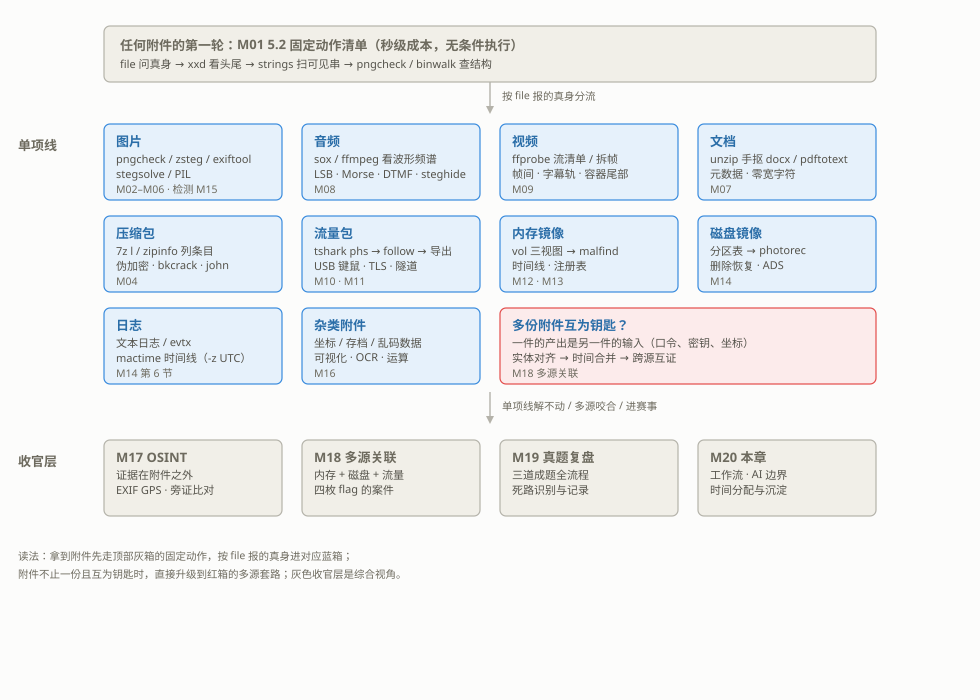
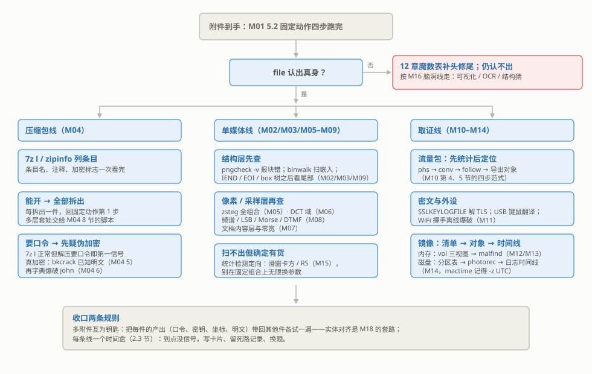

# M20 MISC 综合实战与赛事策略
## MISC CTF Strategy & Comprehensive Practice

> [!info]- 章节信息
> **所属方向**：MISC ｜ **难度阶段**：L4 高级期 ｜ **前置要求**：[[M01-MISC导论与工具箱|M01]] · [[M18-取证综合-多源关联|M18]] · [[M19-赛事真题复盘|M19]]
> **本章目标**：为 MISC 方向收束。给出一张全系列的知识地图——看到什么证据形态，翻哪一章；把赛事工作流（开赛准备、附件分流、时间分配、多题并行）落到 MISC 方向可执行的清单；划清 AI 辅助在本方向的用法与边界；最后用一道自建套娃靶，按比赛节奏走通"压缩包 → 流量包 → 音频 → 图片"的完整链，并以它为样本建立 MISC 侧的复盘与工具箱沉淀方法。

## 1. 全系列知识地图：看到什么，翻哪章

[[M19-赛事真题复盘|M19]] 立过一条判断：赛题不按章出题——它把几个手法串成一条链，真正的难度在于==知道下一环去哪找==。本章把"去哪找"做成一张总表。MISC 题的"现象"与 Web、密码学都不同：手里没有页面功能，也没有参数位数，只有一份或几份字节——==file 报出的真身、xxd 头尾的形状，就是 MISC 题的特征来源==。一张 PNG、一段 WAV、一块内存镜像，各自指向固定的章节。

下表把 M01 到 M19 按"证据形态 → 识别特征 → 工具链 → 主章 → 相邻章"收拢，==这是 MISC 方向的索引页：开赛分诊、赛后复盘、平台刷题归类，都从这张表开始查==。

| 证据形态 | 识别特征：看到什么，翻哪章 | 首选工具链 | 主章 | 相邻章 |
| ---- | ---- | ---- | ---- | ---- |
| 图片 | `PNG` / `JFIF` / `GIF8` 魔数；pngcheck 报块错或尾部有追加 | pngcheck -v · exiftool · zsteg · stegsolve | [[M02-文件格式深拆I-PNG全解\|M02]] · [[M03-文件格式深拆II-JPEG与GIF\|M03]] 结构，[[M05-图片隐写I-LSB与位平面\|M05]] · [[M06-图片隐写II-DCT与盲水印\|M06]] 隐写 | [[M15-隐写进阶与隐写分析\|M15]]（检测）· [[M16-脑洞与算法杂项\|M16]]（调色板 / OCR） |
| 音频 | `RIFF/WAVE`、`MPEG`；波形"听得见"但听不出信息 | sox / ffmpeg 看频谱 · 采样级 LSB · 包络与频率（Morse / DTMF / SSTV）· stegseek | [[M08-音频隐写\|M08]] | [[M05-图片隐写I-LSB与位平面\|M05]]（LSB 同源）· [[M15-隐写进阶与隐写分析\|M15]] |
| 视频 | `ISO Media`；ffprobe 出流清单 | ffprobe / ffmpeg：流清单、拆帧、分离与合成 | [[M09-视频隐写\|M09]] | [[M03-文件格式深拆II-JPEG与GIF\|M03]]（拆帧） |
| 文档 | docx / `PDF document` / 纯文本 / `Composite Document` | unzip 手抠 · pdftotext · exiftool · olefile | [[M07-文档与Office隐写\|M07]] | [[M04-压缩包全解\|M04]]（OOXML 即 zip） |
| 压缩包 | `Zip archive` / RAR 魔数；binwalk 报 encrypted | 7z l · zipinfo · bkcrack · john | [[M04-压缩包全解\|M04]] | [[M07-文档与Office隐写\|M07]] · [[M02-文件格式深拆I-PNG全解\|M02]]（尾部夹 zip） |
| 流量包 | `pcap capture file`；链路类型字段 | tshark 统计 → 定位 → 导出 · scapy 造靶 | [[M10-流量取证I-协议还原深挖\|M10]] · [[M11-流量取证II-加密流量与USB\|M11]] | [[M18-取证综合-多源关联\|M18]]（外传关联） |
| 内存镜像 | 无魔数的 raw 大文件，体积与物理内存同量级 | vol：info → 进程三视图 → malfind | [[M12-内存取证I-Volatility基础\|M12]] · [[M13-内存取证II-进阶\|M13]] | [[M14-磁盘与文件系统取证\|M14]]（落地痕迹） |
| 磁盘镜像 | dd 镜像；分区表签名在头部或尾部 | 分区表 → 文件系统解析 → photorec | [[M14-磁盘与文件系统取证\|M14]] | [[M12-内存取证I-Volatility基础\|M12]]（内存对照） |
| 日志 | 纯文本行或 `EVTX`；带时间戳列 | 正则打靶 · evtx 导出 · mactime（`-z UTC`） | [[M14-磁盘与文件系统取证#6. 日志取证与时间线\|M14 第 6 节]] | [[M18-取证综合-多源关联\|M18]]（时间合并） |
| 杂类附件 | 无魔数；坐标对 / 存档字节 / 颜色异常 | 十六进制直觉 · 可视化 · OCR · z3 | [[M16-脑洞与算法杂项\|M16]] | [[M08-音频隐写\|M08]]（信号语义）· [[M17-OSINT与地理定位\|M17]]（答案在附件外） |

这张表的用法是两步检索：==先按证据形态定线，再按层内特征锁章==。例如附件是一个 zip，里面躺着一张锁着的 PNG——形态是压缩包，落到 [[M04-压缩包全解|M04]]；锁着的条目先记账，明文条目按各自形态继续分流；如果 pcap 里导出的音频解出口令再回头开锁，那就是本章第 4 节战例的走法。分诊（第 2 节）和复盘（第 5 节）都建立在这两步上。

> [!note] 与 W20、C20 地图和 R16 模式库的分工
> [[W20-Web赛事综合实战与策略|W20]] 第 1 节是 Web 侧的同款索引（按页面功能与响应现象），[[C20-密码学综合实战与赛事策略|C20]] 第 1 节按参数形状与附件形态，本章按证据形态与容器分层；[[R16-综合实战案例复盘|R16]] 的模式库条目回答"确认模式之后怎么解"。几个方向的地图字段一致，刷题量上来之后，把对应方向的表当成模式库的**目录层**维护，每道新题按第 5 节的方法沉淀成条目。

全系列 20 章的四个阶段，一张表看完：

| 阶段 | 章 | 各章主题 |
| ---- | ---- | ---- |
| L1 筑基 | M01–M04 | [[M01-MISC导论与工具箱\|M01]] 工具箱与固定工作流 · [[M02-文件格式深拆I-PNG全解\|M02]] PNG 全解 · [[M03-文件格式深拆II-JPEG与GIF\|M03]] JPEG 与 GIF · [[M04-压缩包全解\|M04]] 压缩包全解 |
| L2 核心 | M05–M10 | [[M05-图片隐写I-LSB与位平面\|M05]] LSB 与位平面 · [[M06-图片隐写II-DCT与盲水印\|M06]] DCT 与盲水印 · [[M07-文档与Office隐写\|M07]] 文档与 Office · [[M08-音频隐写\|M08]] 音频 · [[M09-视频隐写\|M09]] 视频 · [[M10-流量取证I-协议还原深挖\|M10]] 流量 I |
| L3 进阶 | M11–M16 | [[M11-流量取证II-加密流量与USB\|M11]] 流量 II（TLS / USB / WiFi）· [[M12-内存取证I-Volatility基础\|M12]] 内存 I · [[M13-内存取证II-进阶\|M13]] 内存 II · [[M14-磁盘与文件系统取证\|M14]] 磁盘 · [[M15-隐写进阶与隐写分析\|M15]] 隐写分析 · [[M16-脑洞与算法杂项\|M16]] 脑洞与算法 |
| L4 高级 | M17–M20 | [[M17-OSINT与地理定位\|M17]] OSINT 与地理定位 · [[M18-取证综合-多源关联\|M18]] 多源取证 · [[M19-赛事真题复盘\|M19]] 真题复盘 · 本章综合实战与赛事策略 |



## 2. 赛事工作流：MISC 方向

报名、组队、状态板、止损规则、WriteUp 模板、行为红线，[[R17-赛事策略与团队协作|R17]] 已按"赛前—赛中—赛后"成体系讲过；PWN 手的节奏在 [[P21-综合实战赛事策略与AI辅助|P21]] 第 5 节，Web 手的节奏在 [[W20-Web赛事综合实战与策略|W20]] 第 2 节，Crypto 手的节奏在 [[C20-密码学综合实战与赛事策略|C20]] 第 2 节。本节只补 MISC 方向的差异，通用规则一句带过加双链，不重讲。

### 2.1 开赛准备：MISC 侧的加购清单

[[R17-赛事策略与团队协作#4. 赛前：开赛清单|R17 第 4 节]]的通用清单之上，MISC 手赛前一天加过这几项：

- [ ] 固定动作四件全绿：file / xxd / strings 各扫一次真附件，pngcheck 与 binwalk 各出一次报告（[[M01-MISC导论与工具箱#5.2 固定动作清单|M01 5.2]]）；
- [ ] 隐写与压缩两翼在位：zsteg 出扫描行、stegseek 出用法、bkcrack 出说明（[[M01-MISC导论与工具箱#2.2 四条安装渠道|M01 2.2]] 的四条渠道，明文攻击见 [[M04-压缩包全解#5. bkcrack 已知明文攻击：完整流程|M04 第 5 节]]）；
- [ ] vol 能出清单：对一份本地留存的小镜像跑通 `windows.info`——volatility3 的符号表按内核补丁级别精确匹配，断网的赛机现场拉不到（[[M12-内存取证I-Volatility基础#3.3 符号表：名字到偏移的映射|M12 3.3]]）；
- [ ] tshark 与 sox / ffmpeg 各出一次输出：流量与音频两条线的入口（[[M10-流量取证I-协议还原深挖|M10]]、[[M08-音频隐写|M08]]）；
- [ ] 模板目录备好：宽高爆破（[[M02-文件格式深拆I-PNG全解#4. 宽高爆破完整脚本|M02 第 4 节]]）、套娃解包（[[M04-压缩包全解#8. 套娃自动化|M04 第 8 节]]）、Morse 解码（[[M08-音频隐写#5. Morse 电码：时序编码|M08 第 5 节]]）、滑窗卡方（[[M15-隐写进阶与隐写分析|M15]] 2.2）各存一份可跑版本——5.2 节的工具箱维护管这个；
- [ ] 磁盘与下载余量：取证题附件以百 MB 计，开赛先看附件体积再排期下载；
- [ ] 约定确认：工作目录四件套（[[M01-MISC导论与工具箱#5.1 目录组织|M01 5.1]]）、flag 格式、队内共享附件的位置。

> [!warning] 符号表是清单里最容易漏的一项
> 工具没装看得见，符号缓存缺了看不见：vol 平时能跑，赛题镜像的内核版本一变，它就要向微软公共符号服务器现场拉 PDB（[[M12-内存取证I-Volatility基础#3.3 符号表：名字到偏移的映射|M12 3.3]] 的机制）——限网或离线的赛场在这一步卡死，表现是 `windows.info` 长时间无输出。赛前用一份旧镜像把 vol 跑一遍热好缓存；拿到赛题镜像先跑 info 确认命中，再做其他事。

### 2.2 附件分流：从 file 输出到工具链

开赛前 15 分钟的分诊里（[[R17-赛事策略与团队协作#5.1 开赛第一个小时|R17 5.1]]），MISC 手把全部附件的 file 输出抄进状态板，每道题过三问：

1. **一件还是多件**：多件附件先看互相有没有指涉——readme 提到另一件、条目名相关联、尺寸互相咬合。有指涉就是 [[M18-取证综合-多源关联|M18]] 的"实体对齐"现场：把每件的产出登记成一个钥匙池（2.4 的卡片）；
2. **每件什么形态**：file 的输出对第 1 节的表，形态定线；
3. **哪件先做**：明文的、体积小的、固定动作就能出线索的先做；锁着的、体积大的记账后排期（2.3）。

定线之后的动作序列，一张图收拢：



套娃件的处理原则就一句：==每一层的出口都是下一层的入口，每拆出一层就回固定动作第 1 步==（M01 清单的第 6 步）。纯压缩包的多层嵌套可以交给 [[M04-压缩包全解#8. 套娃自动化|M04 第 8 节]]的脚本自动剥；跨形态的嵌套（zip 里装 pcap、pcap 里传音频、音频给 zip 口令）脚本盖不住，靠的是这条原则加一个登记动作——==钥匙与锁常常不同层，拆出的每把钥匙都要拿回全部锁着的条目各试一遍==。本章第 4 节的战例就是把这条原则走完整。

赛时的快扫信号与判断：

| 快扫信号 | 判断 | 工时预期 | 先翻哪章 |
| ---- | ---- | ---- | ---- |
| 附件是百 MB 级镜像 | 取证题，下载与扫描都按分钟计 | 高 | [[M12-内存取证I-Volatility基础\|M12]]–[[M14-磁盘与文件系统取证\|M14]] |
| 一件附件多层嵌套 | 套娃链，按层给时间盒 | 中 | [[M04-压缩包全解#8. 套娃自动化\|M04 第 8 节]] + 各层主章 |
| 题面给了日期、地点、故事 | 时间线或 OSINT，检索面可能出门 | 中到高 | [[M14-磁盘与文件系统取证#6. 日志取证与时间线\|M14 第 6 节]] · [[M17-OSINT与地理定位\|M17]] |
| 图片能打开但"看着不对" | 像素层隐写或调色板置换 | 中 | [[M05-图片隐写I-LSB与位平面\|M05]] · [[M16-脑洞与算法杂项\|M16]] |
| 音频听得见但无信息 | 时序或频率语义编码 | 中 | [[M08-音频隐写\|M08]] |
| 无魔数、无结构的乱码 | 可视化 / 运算 / 脑洞，方差大 | 放最后 | [[M16-脑洞与算法杂项\|M16]] |

### 2.3 时间分配：MISC 题的性价比

排序规则一句话：==固定动作能解的先拿分，机器能跑的先启动，大活排整块，脑洞压轴==。签到级题目在固定动作第 2、3 步就结束，用它们热手并给队里报平安；zsteg 全扫、john 字典、photorec 恢复、vol 插件都是"启动之后等结果"的活——启动它们，然后切去下一题，回来看输出（等待不是占题）；镜像与 OSINT 需要整块时间，排在中段；脑洞题收益方差最大，放到最后用零碎时间碰。单题的时间盒按题型给：

| 题型 | 时间盒 | 到点没信号的动作 |
| ---- | ---- | ---- |
| 固定动作级 | 10–15 分钟 | 无——这类题不该卡，卡住说明形态认错了，回第 1 节的表重新分流 |
| 单媒体隐写 | 30–40 分钟 | 死路记录后转统计检测（[[M15-隐写进阶与隐写分析#7. 检测决策清单\|M15 第 7 节]]），再无信号即换题 |
| 套娃 / 多附件 | 60 分钟起，按层再分 | 每层到点盘点：这一层有没有新产物？没有就先放下这一层 |
| 大镜像取证 | 整块时间，机器活后台跑 | 扫描与恢复都启动后切走，回来收结果，不干等 |
| OSINT | 45 分钟 | 旁证不足先撤，等 hint 或队友补检索面（[[M17-OSINT与地理定位\|M17]]） |
| 脑洞 | 20 分钟一档，放最后 | 两档无思路即弃，赛后看题解补条目 |

==MISC 的止损判据比别的方向更客观：固定动作四步加主章第一轮工具，全部跑完仍无新产物，就是"无信号"==。无信号不等于题无解，只等于这一轮投入没有产出——死路写进笔记（[[M19-赛事真题复盘#5.2 复盘笔记的记录格式|M19 5.2]]），按 [[R17-赛事策略与团队协作#5.3 卡题止损与 hint 决策|R17 5.3]] 的 30 分钟止损换题。[[M19-赛事真题复盘|M19]] 5.3 说过：每条链先用清单跑一轮，有信号的继续投入，无信号的记下死路后放下——这句话在多题现场就是时间分配的执行规则。MISC 的固定动作成本是秒级，所以更要每一步都留痕：==死路记录的价值与死路的成本成反比==，成本越低的试探，越容易被反复重试。

### 2.4 多题并行：上下文卡片与钥匙暂存

[[W20-Web赛事综合实战与策略#2.3 时间盒与多题并行：上下文切换卡片|W20 2.3]] 的五行上下文卡片 MISC 手照用，另加两栏：

| 栏 | 填什么 |
| ---- | ---- |
| 机器在跑的活 | zsteg 全扫、john 字典、photorec 恢复、vol 插件——启动了什么、预计多久、输出落在哪个文件 |
| 产物与钥匙 | 拆出的每一层产物路径；已经到手但"还没用上"的口令、密钥、坐标——下一件附件可能就用它 |

"产物与钥匙"这一栏是 MISC 特有的：套娃题的钥匙与锁常常不同层（本章战例里，口令在 pcap 传的音频里，锁在 zip 的条目上），==每拿到一把新钥匙，先对全部锁着的条目重试一轮，再继续往下拆==。中间产物不落盘、钥匙不登记，换题回来等于重拆。

频道里的同步格式沿用 [[W20-Web赛事综合实战与策略#2.4 队友同步：一句一个攻击面|W20 2.4]]：每句话只说一个面，面 + 状态。MISC 版的三句话长这样：

```text
[nest_100] zip→pcap→wav：前两层已过，音频 LSB 空，正在读包络，预计 5 分钟
[gal_250]  三张 PNG：zsteg 全空 + 卡方阴性，死路已记，放弃
[disk_500] 磁盘镜像 800MB：photorec 后台恢复中，先做别的，30 分钟后收结果
```

三句拆开三个面：第一句是链条进度与下一步，第二句是明确的止损结论，第三句是后台活与收菜时间。队友扫一眼就知道哪块能接手、哪块在等机器。

## 3. AI 辅助：MISC 方向的用法与边界

[[R16-综合实战案例复盘#8. AI 辅助分析：假设与验证的分工|R16 第 8 节]]给 RE 侧立了"AI 给假设、人工验证、修正"的闭环，[[P21-综合实战赛事策略与AI辅助#3. AI 辅助利用：能做什么，必须自己做什么|P21 第 3 节]]把 PWN 侧的边界落到了数值查证上，Web 与 Crypto 各有一张分工表。MISC 侧的分工表不同、红线相同：

| 位置 | 你给它什么 | 它产出什么 | 你的动作 |
| ---- | ---- | ---- | ---- |
| 解析脚本初稿 | 格式说明、字段表、样例字节（hex 头） | 脚本骨架 | 占位纪律（[[P21-综合实战赛事策略与AI辅助#3.3 工作流实证：骨架、三个空、一次跑通\|P21 3.3]]）：偏移、魔数、位序、通道全部来自自己的 file / xxd 输出 |
| 陌生格式解读 | file 输出 + 头部 64 字节 hex + 已知工具的输出原文 | "属于哪个格式家族、该试哪些工具"的清单 | 逐条用本地工具核实——它没见过你的字节（见下） |
| 卡题头脑风暴 | 已试过的路和失败现象（死路清单） | 没试过的方向清单 | 对照 2.2 的分流图逐条排除，先走成本最低的 |
| 批量翻译表 | 编码规则样例（几个键码到字符、几段 Morse） | 完整映射表（USB 键码、Morse 码表） | 抽样对拍：用已知前缀判据验收（[[M16-脑洞与算法杂项\|M16]] 8.3 的思路） |

MISC 题里有三类东西不是文本任务，AI 给不了可信结论：

1. **附件字节的真实形态。** 它没见过你的文件。hex 头是你转述的，转述错一位，它的整段判断跟着错。"这个看起来像 zlib 流"是概率话，不是观察结论——一次 file 加 xxd 的事，先做再谈。
2. **工具在本地环境的行为。** zsteg 组合段的命名方向、vol 插件的 `windows.` 前缀、tshark 参数随版本的变化，这些是本地事实，`--help` 一跑就有，不问它。
3. **隐写检测的边界数值。** 卡方窗口开多大、p 值怎么算显著、RS 分析的分档——这些要用 [[M15-隐写进阶与隐写分析|M15]] 的脚本在本地算，模型对"多少算显著"的回答经常停在教材示例上。

红线里 MISC 要单拎一条：==flag 幻觉在本方向最危险==。AI 没有文件也能顺着上下文编出一个形如 `flag{...}` 的串，或把工具输出里的误报行读成有效载荷——zsteg 的 `text:` 字样不是判据，内容可读才是（[[M05-图片隐写I-LSB与位平面#4. zsteg：全组合自动扫描|M05 第 4 节]]的三种判定）。工具输出的每一行都要自己核对。

> [!warning] 赛内先读规则，再决定发不发题
> 把未结束赛事的附件、字节发给在线服务，可能触碰比赛的保密与公平条款（[[P21-综合实战赛事策略与AI辅助#3.4 纪律清单|P21 3.4]] 的纪律四、[[R17-赛事策略与团队协作#10. 心态与行为红线|R17 第 10 节]]的红线同源）。信息卫生的三条底线：不贴 flag 与队名比赛名，不贴未脱敏的完整附件，拿不准就不发——只贴脱敏后的 file 输出与 hex 头，或只使用本地部署的模型。

### 3.1 prompt 示范：把卡壳处的中间产物交给 AI

用第 4 节战例的中间产物做一次完整示范。设定：你刚从 pcap 导出 `hum.wav`，采样级 LSB 一无所获（4.4 节的死路二），想让 AI 过一遍方向。prompt 按这个骨架写：

```text
我在打一道 CTF MISC 题，卡在一段音频上。已脱敏的信息如下：

1. 容器事实：file 输出 "RIFF (little-endian) data, WAVE audio,
   Microsoft PCM, 16 bit, mono 8000 Hz"，时长 4.62 秒。
2. 已试过且失败的路：
   - 采样级 LSB 提取（每采样最低位，8 位拼 1 字节）：flag 前缀未命中，
     头部无全零哨兵；
   - strings：无可读串；exiftool：无异常元数据。
3. 题面：zip 里同时有 pcap（已从里面导出这段 wav）和一个口令加密的
   png，readme 写 "the vault key is not in this archive. it sings."。

请只输出假设清单：按可能性列出这段音频可能的藏法与对应提取方法，
每条给出依据和一条可执行的验证命令。凡依赖我没提供的数值（频谱形状、
包络分布）一律标"待验证"。不要编造工具输出，不要猜 flag。
```

按这份 prompt，合理的回答长这样（要点摘录）：

> 1. "it sings" 指向语义编码：Morse（时序）或 DTMF（双音）。验证：包络切 run，看发音段时长是否聚成两簇、静音是否聚成三簇（[[M08-音频隐写#5. Morse 电码：时序编码\|M08 第 5 节]]的三步）。
> 2. 频谱图文字：待验证——画一次频谱，看有没有人工笔画的水平条带。
> 3. 音频尾夹带：待验证——比对 RIFF 里 data 块的长度与文件尾，多出的字节直接切出再看。
> 4. steghide 口令隐写：需要口令，而口令还没出现，优先级放后。

对照 3 节的分工逐条看：第 1 条是"读文本"能得出的，带验证方法；第 2、3 条它自己标了待验证；第 4 条它按依赖关系排了优先级——==音频里到底藏没藏 Morse，要你的包络脚本说了算，prompt 里要求它标注而不是猜测，交互边界就守住了==。这条流程与 4.4 节的实战步骤一一对应，可以对照着走。

## 4. 示范战例：从一份附件到跨层 flag 的完整链

本节按比赛节奏完整打一道自建套娃靶。题目只有一句话：**附件 bundle.zip，找到 flag。**[[M18-取证综合-多源关联|M18]] 的靶是三份来源并排的取证案件，[[M19-赛事真题复盘|M19]] 的三道题各自是一条单链；本题把四层容器装进一个文件——zip 里装 pcap 与锁着的图片，pcap 里传音频，音频里的口令回过头开 zip 的锁，==钥匙与锁跨层回跳==。全程按第 2 节的工作流走：固定动作 → 分流 → 逐层解 → flag，死路与回退照实记录。

### 4.1 靶场设计与准备

四层结构，每层单独对应一章，层与层靠"上一层的产出"衔接：

| 层 | 形态 | 章节出处 | 产出 |
| ---- | ---- | ---- | ---- |
| 0 | bundle.zip：readme.txt 与 traffic.pcap 明文条目，vault.png ZipCrypto 加密条目 | [[M04-压缩包全解\|M04]] | 两件明文，一件锁着 |
| 1 | traffic.pcap：噪声 DNS + 诱饵 ICMP + 一对 HTTP 传输 | [[M10-流量取证I-协议还原深挖\|M10]] | hum.wav，和一条假 flag |
| 2 | hum.wav：Morse 报文（600 Hz 正弦，单位 70 ms） | [[M08-音频隐写\|M08]] | 口令 WAVEKEY |
| 3 | vault.png：蓝通道 bit0 的 LSB 隐写 | [[M05-图片隐写I-LSB与位平面\|M05]] | flag |

造靶脚本 `m20_build.py` 的音频与图片两段：

```python
# m20_build.py（第 1、2 段）：音频口令与 vault.png
import calendar
import io
import subprocess
import zipfile

import numpy as np
from PIL import Image
from scipy.io import wavfile

FLAG = "flag{m20_n3st_zip_pcap_wav_png}"
PASS = "WAVEKEY"

# ---------- 1) hum.wav：口令画成 Morse 报文（M08 5.1 的造法） ----------
fs, U = 8000, 0.07
MORSE = {"W": ".--", "A": ".-", "V": "...-", "E": ".", "K": "-.-", "Y": "-.--"}

def tone(sec):
    return np.sin(2 * np.pi * 600 * np.arange(int(sec * fs)) / fs)

def silence(sec):
    return np.zeros(int(sec * fs))

sig = []
for j, letter in enumerate(PASS):
    for s in MORSE[letter]:
        sig.append(tone(U if s == "." else 3 * U))
        sig.append(silence(U))
    if j < len(PASS) - 1:
        sig[-1] = silence(3 * U)
audio = (np.concatenate(sig) * 18000).astype(np.int16)
wavfile.write("hum.wav", fs, audio)

# ---------- 2) vault.png：蓝通道 bit0 藏 flag（M05 组合语义的写入侧） ----------
w, h = 128, 128
arr = np.zeros((h, w, 3), dtype=np.uint8)
xx, yy = np.meshgrid(np.arange(w), np.arange(h))
arr[..., 0] = (xx * 2) % 256
arr[..., 1] = (yy * 2) % 256
arr[..., 2] = 128 + ((xx + yy) % 64)          # 规律渐变底图，信息只在 bit0

bits = np.unpackbits(np.frombuffer(FLAG.encode(), dtype=np.uint8))   # 每字节 MSB 在前
b = arr[..., 2].ravel()                       # 蓝通道拉平（ravel 出来的是副本）
b[: len(bits)] = (b[: len(bits)] & 0xFE) | bits
arr[..., 2] = b.reshape(h, w)                 # 改完必须写回原数组
Image.fromarray(arr).save("vault.png")
```

> [!info]- m20_build.py 的第 3 段：流量源——噪声、诱饵与分段传输的 HTTP
> 造法沿用 [[M10-流量取证I-协议还原深挖#2. scapy 最小入门与本章靶场|M10 第 2 节]]的 scapy 范式：固定时间戳保证可复跑，TCP 序号自己维护。有一个造大载荷的必知点：==单个 IP 包上限 65535 字节==，74 KB 的 wav 响应体必须按 MSS 分段发送，否则 scapy 打包阶段直接报错。
>
> ```python
> # ---------- 3) traffic.pcap：噪声 DNS/ICMP + 一对 HTTP 传输 hum.wav ----------
> DECOY = b"flag{strings_is_not_enough}"
> BASE = calendar.timegm((2026, 10, 24, 12, 0, 0))
> C_MAC, S_MAC = "52:54:00:12:34:56", "52:54:00:78:9a:bc"
> C_IP, S_IP = "10.13.0.2", "10.13.0.1"
>
> def eth_ip(payload, *, src=C_IP, dst=S_IP):
>     m_src, m_dst = (C_MAC, S_MAC) if src == C_IP else (S_MAC, C_MAC)
>     return Ether(src=m_src, dst=m_dst) / IP(src=src, dst=dst) / payload
>
> pkts, t = [], 0.0
> def add(p, *, src=C_IP, dst=S_IP):
>     global t
>     pkt = eth_ip(p, src=src, dst=dst)
>     pkt.time = BASE + t
>     t += 0.5
>     pkts.append(pkt)
>
> # 噪声：一组 DNS 解析
> add(UDP(sport=40001, dport=53) / DNS(id=1, rd=1, qd=DNSQR(qname="portal.misc.lab", qtype="A")))
> add(UDP(sport=53, dport=40001)
>     / DNS(id=1, qr=1, qd=DNSQR(qname="portal.misc.lab", qtype="A"),
>           an=DNSRR(rrname="portal.misc.lab", type="A", rdata=S_IP, ttl=300)),
>     src=S_IP, dst=C_IP)
>
> # 诱饵：一组 ICMP，载荷是假 flag（strings 一眼"命中"的那条死路）
> add(ICMP(type=8, id=0x77, seq=3) / Raw(DECOY))
> add(ICMP(type=0, id=0x77, seq=3) / Raw(DECOY), src=S_IP, dst=C_IP)
>
> # 主线：TCP 握手 + GET /media/hum.wav + 200 响应（响应体按 MSS 分段）
> sport, cseq, sseq = 44444, 1000, 5000
> get = b"GET /media/hum.wav HTTP/1.1\r\nHost: portal.misc.lab\r\nUser-Agent: curl/8.16.0\r\n\r\n"
> wav = open("hum.wav", "rb").read()
> resp = (b"HTTP/1.1 200 OK\r\nContent-Type: audio/wav\r\nContent-Length: "
>         + str(len(wav)).encode() + b"\r\n\r\n" + wav)
> add(TCP(sport=sport, dport=80, flags="S", seq=cseq))
> add(TCP(sport=80, dport=sport, flags="SA", seq=sseq, ack=cseq + 1), src=S_IP, dst=C_IP)
> add(TCP(sport=sport, dport=80, flags="A", seq=cseq + 1, ack=sseq + 1))
> add(TCP(sport=sport, dport=80, flags="PA", seq=cseq + 1, ack=sseq + 1) / Raw(get))
> sseq, MSS = sseq + 1, 1400
> for i in range(0, len(resp), MSS):
>     add(TCP(sport=80, dport=sport, flags="PA", seq=sseq, ack=cseq + 1 + len(get))
>         / Raw(resp[i:i + MSS]), src=S_IP, dst=C_IP)
>     sseq += min(MSS, len(resp) - i)
>
> wrpcap("traffic.pcap", pkts)
> ```

第 4 段组装 zip：zipfile 写不了加密条目，口令条目交给 zip 命令行——`-P` 用的是传统 ZipCrypto，正是 [[M04-压缩包全解#6. 口令爆破工程化：zip2john 与 john|M04 第 6 节]]里 john 能啃的格式：

```python
# ---------- 4) bundle.zip：两条明文 + 一条 ZipCrypto 口令条目 ----------
readme = (
    "session archive bundle\n"
    "----------------------\n"
    "traffic.pcap : gateway capture, do not forward\n"
    "vault.png    : internal only, encrypted copy\n"
    "the vault key is not in this archive. it sings.\n"
)
buf = io.BytesIO()
with zipfile.ZipFile(buf, "w", zipfile.ZIP_DEFLATED) as z:
    z.writestr("readme.txt", readme)
    z.writestr("traffic.pcap", open("traffic.pcap", "rb").read())
open("bundle.zip", "wb").write(buf.getvalue())
subprocess.run(["zip", "-q", "-P", PASS, "bundle.zip", "vault.png"], check=True)
```

```bash
mkdir -p ~/m20 && cd ~/m20
python3 m20_build.py
```

输出：

```text
[1] hum.wav：Morse 报文 'WAVEKEY'，时长 4.62 秒，PCM 73920 字节
[2] vault.png：128x128，蓝通道 bit0 写入 flag（31 字节，248 位）
[3] traffic.pcap：61 个包，HTTP 响应体 73964 字节，按 1400 字节分段
[4] bundle.zip：readme.txt + traffic.pcap 明文条目，vault.png ZipCrypto 口令加密
```

> [!warning] ravel 的副本陷阱：位要写回原数组
> `arr[..., 2]` 是跨步视图，对它 `ravel()` 拿到的是**副本**——上面的 `b` 若不写回，位永远不会落进 vault.png，靶就成了"没造上"的空靶。本文的造靶脚本第一版就错在这里，表现为解题侧怎么读都是底图。==造靶后先用自写提取器读回一遍再封包==：造靶侧与解题侧对同一组参数给出同一个串，才算造上了（[[M05-图片隐写I-LSB与位平面#4. zsteg：全组合自动扫描|M05 第 4 节]]的两路互证同款）。

> [!note] 本章的实验约定
> 全部命令在 WSL 的 `~/m20` 目录执行，拆出的产物进 `extracted/`；命令与输出成对给出，输出块标题写"输出："。

### 4.2 第一环：固定动作与压缩包分流

按 [[M01-MISC导论与工具箱#5.2 固定动作清单|M01 5.2]] 起步，前四步无条件执行：

```bash
file bundle.zip
```

输出：

```text
bundle.zip: Zip archive data, made by v2.0 UNIX, extract using at least v2.0, last modified Oct 25 2026 02:42:18, uncompressed size 186, method=deflate
```

```bash
binwalk bundle.zip
```

输出：

```text

DECIMAL       HEXADECIMAL     DESCRIPTION
--------------------------------------------------------------------------------
0             0x0             Zip archive data, at least v2.0 to extract, compressed size: 125, uncompressed size: 186, name: readme.txt
165           0xA5            Zip archive data, at least v2.0 to extract, compressed size: 1712, uncompressed size: 78507, name: traffic.pcap
1919          0x77F           Zip archive data, encrypted at least v2.0 to extract, compressed size: 781, uncompressed size: 877, name: vault.png
2976          0xBA0           End of Zip archive, footer length: 22
```

binwalk 把三个条目连同加密标志一起报了出来：readme.txt 与 traffic.pcap 是明文，**vault.png 是加密条目**。`unzip -l` 只读中央目录，看不到这个标志——分诊要靠 binwalk 的逐条目扫描（[[M04-压缩包全解#2. ZIP 三段结构：LFH、CDH 与 EOCD|M04 第 2 节]]的标志位）。按 2.2 的分流三问走：多件附件、其中一件锁着；锁着的先记账，明文的先拆：

```bash
unzip -o bundle.zip readme.txt traffic.pcap -d extracted
```

输出：

```text
Archive:  bundle.zip
  inflating: extracted/readme.txt
  inflating: extracted/traffic.pcap
```

```bash
cat extracted/readme.txt
```

输出：

```text
session archive bundle
----------------------
traffic.pcap : gateway capture, do not forward
vault.png    : internal only, encrypted copy
the vault key is not in this archive. it sings.
```

readme 的最后一行是题面：钥匙不在这个包里，而且"it sings"——它会发声。第一环完成：分流明确，vault.png 记在锁账上，先走 traffic.pcap 的流量线。

### 4.3 第二环：流量层——strings 的假 flag 与 HTTP 导出

固定动作第 3 步，对拆出的 pcap 扫可见串：

```bash
strings extracted/traffic.pcap | grep -a flag
```

输出：

```text
flag{strings_is_not_enough}
flag{strings_is_not_enough}
```

第一环里就"看到 flag"了。先别提交：==strings 命中的 flag 字样是线索，不是答案==。这串出现了两次（ICMP 请求与应答各带一次，tshark 一跑就能确认来源），而且内容自己写着 `strings_is_not_enough`——出题人把假 flag 放在最容易命中的地方，考的就是"命中即交"的习惯。记入死路，回到主线。

```bash
tshark -r extracted/traffic.pcap -q -z io,phs
```

输出：

```text

===================================================================
Protocol Hierarchy Statistics
Filter:

frame                                    frames:61 bytes:77507
  eth                                    frames:61 bytes:77507
    ip                                   frames:61 bytes:77507
      udp                                frames:2 bytes:181
        dns                              frames:2 bytes:181
      icmp                               frames:2 bytes:138
      tcp                                frames:57 bytes:77188
        http                             frames:2 bytes:1418
          riff                           frames:1 bytes:1285
===================================================================
```

协议树三层信息：一组 DNS（噪声）、一组 ICMP（假 flag 的来处）、一条 TCP 会话跑到 HTTP，==而且 HTTP 载荷的下一层被直接认成了 riff==——传的是音频。按 [[M10-流量取证I-协议还原深挖#5. HTTP 对象批量导出|M10 第 5 节]]的对象导出把音频取下来：

```bash
tshark -r extracted/traffic.pcap --export-objects http,extracted -q
ls -l extracted
```

输出：

```text
total 160
-rw-r--r-- 1 hua hua 73964 Oct 25 02:43 hum.wav
-rw------- 1 hua hua   186 Oct 25 02:42 readme.txt
-rw------- 1 hua hua 78507 Oct 25 02:42 traffic.pcap
```

第二环完成：hum.wav 到手。二进制载荷不走 `Follow Stream` 肉眼拼——对象导出一步到位，这也是 [[M10-流量取证I-协议还原深挖#4. tshark 脚本化：把点选动作变成命令行|M10 第 4 节]]把点选动作变成命令行的意义。

### 4.4 第三环：音频层——两条惯用路的取舍

```bash
file extracted/hum.wav
```

输出：

```text
extracted/hum.wav: RIFF (little-endian) data, WAVE audio, Microsoft PCM, 16 bit, mono 8000 Hz
```

16 位单声道 8 kHz 的无损 PCM。按 [[M08-音频隐写|M08]] 的顺序，惯例第一路是采样级 LSB（[[M08-音频隐写#3. WAV LSB：采样值的最低位|M08 第 3 节]]）：每采样取最低位，8 位拼 1 字节，找 flag 前缀与全零哨兵：

```python
# m20_lsbcheck.py —— 惯例先查 WAV 采样级 LSB：M08 3 节的读法（每采样最低位，8 位拼 1 字节）
import numpy as np
from scipy.io import wavfile

fs, x = wavfile.read("extracted/hum.wav")
lsb = (x.astype(np.int16) & 1).astype(np.uint8)
data = np.packbits(lsb)
print(f"采样 {len(x)} 个，拼出 {len(data)} 字节")
print("flag 前缀检索：", "命中" if b"flag{" in data.tobytes() else "未命中")
print("头部全零哨兵：", "命中" if not data[:64].any() else "未命中")
print("低位中 1 的占比：%.3f" % (lsb.mean()))
```

```bash
python3 m20_lsbcheck.py
```

输出：

```text
采样 36960 个，拼出 4620 字节
flag 前缀检索： 未命中
头部全零哨兵： 未命中
低位中 1 的占比：0.218
```

死路二：低位里 1 的占比 0.218，不是 0.5 附近的随机分布，而是正弦量化自己的规则模式——==这些低位是采样值生来就有的，不是外来载荷==。LSB 这条路无信号，按 2.3 的判据记死路、换下一路。下一路是什么，两处信息合起来指：readme 说钥匙"it sings"，[[M08-音频隐写|M08]] 的决策序里，时序编码（Morse、DTMF）的验证成本最低——一次包络提取就能看出发音段时长是否聚成两簇。按 [[M08-音频隐写#5. Morse 电码：时序编码|M08 第 5 节]]的三步解码：

```python
# m20_morse.py —— 包络提取 + run 时长分类解码 Morse（M08 5.2 的三步）
import numpy as np
from scipy.io import wavfile

MORSE = {"W": ".--", "A": ".-", "V": "...-", "E": ".", "K": "-.-", "Y": "-.--"}
INV = {v: k for k, v in MORSE.items()}

fs, x = wavfile.read("extracted/hum.wav")
env = np.convolve(np.abs(x.astype(np.float64)), np.ones(80) / 80, mode="same")
on = env > env.max() * 0.4                       # 阈值取包络峰的 40%

runs, cur, cnt = [], on[0], 1
for v in on[1:]:
    if v == cur:
        cnt += 1
    else:
        runs.append((cur, cnt))
        cur, cnt = v, 1
runs.append((cur, cnt))
unit = min(c for v, c in runs if v) / fs          # 最短发音段 = 1 个单位（点）
print(f"发音段 {sum(1 for v, _ in runs if v)} 个，最短 {unit * 1000:.0f} ms -> 单位时长")

text, cur = "", ""
for voiced, n in runs:
    L = n / fs
    if voiced:
        cur += "." if L < 2 * unit else "-"       # 发音：不足 2U 是点，其余是划
    elif L >= 2 * unit:                            # 静音：2U~6U 字母间隔，6U 以上单词间隔
        text += INV.get(cur, "?") + (" " if L >= 6 * unit else "")
        cur = ""
if cur:
    text += INV.get(cur, "?")
print("解码结果:", text)
```

```bash
python3 m20_morse.py
```

输出：

```text
发音段 18 个，最短 71 ms -> 单位时长
解码结果: WAVEKEY
```

18 个发音段、71 ms 的单位时长，解码出 `WAVEKEY`——与 3.1 节 prompt 示范里 AI 排第一的假设一致，但结论是包络脚本给的。第三环完成：口令到手。

### 4.5 第四环：回到压缩包——口令、结构与像素层

口令在手之前，锁这边的低成本动作其实早就该做完：拿题面词当口令试一轮，成本秒级。这里补上这一轮（五个词全部失败，extracted/ 里始终没有 vault.png）：

```bash
for p in vault archive portal sings misc; do
    unzip -P "$p" bundle.zip vault.png -d extracted 2>&1 | tail -1
done
ls extracted
```

输出：

```text
   skipping: vault.png               incorrect password
   skipping: vault.png               incorrect password
   skipping: vault.png               incorrect password
   skipping: vault.png               incorrect password
   skipping: vault.png               incorrect password
hum.wav
readme.txt
traffic.pcap
```

`incorrect password` 是口令不对的标准报错——它只说明这个口令不匹配，不说明包坏了。readme 早就说了钥匙不在包里：这轮试探的意义在于用 30 秒排除"口令就是题面词"的可能，然后按 2.3 的规则回到音频的产出。现在把 `WAVEKEY` 喂给锁：

```bash
unzip -P WAVEKEY bundle.zip vault.png -d extracted
```

输出：

```text
Archive:  bundle.zip
  inflating: extracted/vault.png
```

vault.png 落地。先查结构层还是先扫像素层，[[M19-赛事真题复盘|M19]] 题一的答案是"先结构"——pngcheck 一条命令排除块级问题：

```bash
pngcheck -v extracted/vault.png
```

输出：

```text
File: extracted/vault.png (877 bytes)
  chunk IHDR at offset 0x0000c, length 13
    128 x 128 image, 24-bit RGB, non-interlaced
  chunk IDAT at offset 0x00025, length 820
    zlib: deflated, 32K window, default compression
  chunk IEND at offset 0x00365, length 0
No errors detected in extracted/vault.png (3 chunks, 98.2% compression).
```

三块齐全、无追加数据——结构层干净，与 M19 题一（IHDR 被改宽 + 尾部夹带）正相反，货只能在像素层。zsteg 全组合扫描：

```bash
zsteg extracted/vault.png
```

输出（四十余行，只保留有内容的四行）：

```text
b1,b,lsb,xy         .. text: "flag{m20_n3st_zip_pcap_wav_png}"
b1,b,msb,xy         .. text: ["U" repeated 16 times]
b2,b,lsb,xy         .. text: "K=(9}=(<-<)=(9}==<)=<9}=(<|<==yll"
b2,b,msb,xy         .. text: ["c" repeated 32 times]
```

命中行读作 `b1,b,lsb,xy`：蓝通道 bit0、行优先——与造靶脚本的写入参数对应（每字节 MSB 在前的位流，在 zsteg 的标注里落在 `lsb` 行，[[M05-图片隐写I-LSB与位平面#4. zsteg：全组合自动扫描|M05 第 4 节]]讲过这对反向命名的标注）。其余三行是误报：`["U" repeated ...]` 是重复字符模式，`K=(9…` 是渐变底图的巧合可打印段——==判据是内容可读，不是出现了 `text:` 字样==。flag 到手，链路闭环：

```text
flag{m20_n3st_zip_pcap_wav_png}
```

### 4.6 出题视角：这题考了什么

跳出来当一次出题人，链路上每个环节都是刻意的：

| 环节 | 出题人给的 | 考什么 | 章节 |
| ---- | ---- | ---- | ---- |
| zip 三条目，两明一密 | 锁与钥匙分离 | 分流：明文先拆，锁着的记账 | [[M04-压缩包全解\|M04]] |
| ICMP 载荷放假 flag | strings 一眼"命中"的假终点 | 核对意识：线索不等于答案 | [[M01-MISC导论与工具箱#5.2 固定动作清单\|M01 5.2]] |
| HTTP 传 wav | 流量线接到媒体线 | 对象导出，不是肉眼拼流 | [[M10-流量取证I-协议还原深挖#5. HTTP 对象批量导出\|M10 第 5 节]] |
| 口令用 Morse 而非频谱 | 时序编码，包络一验即知 | 音频决策序：LSB → 时序 → 频谱 | [[M08-音频隐写\|M08]] |
| 题面词口令全部落空 | 逼你走完音频层 | 低成本动作要限时，不能替代主线 | 本章 2.3 |
| pngcheck 干净 | 排除结构层 | 先结构后像素的固定顺序 | [[M02-文件格式深拆I-PNG全解#3. CRC 校验与 pngcheck\|M02 第 3 节]] |
| 渐变底图制造 zsteg 噪声行 | 误报混在命中里 | `text:` 不是判据，内容可读才是 | [[M05-图片隐写I-LSB与位平面#4. zsteg：全组合自动扫描\|M05 第 4 节]] |
| 口令在 pcap 传的音频里 | 钥匙与锁跨层 | 拆出的钥匙对全部锁重试 | [[M18-取证综合-多源关联#5.3 多源取证的固定套路\|M18 5.3]] 的微缩 |

四层里没有一层是新知识——==套娃题考的不是新工具，是把每章的第一反应按层的顺序排好队==。真实赛题的套娃更深：本题的口令层在正式赛里可能换成频谱文字（[[M08-音频隐写#4. 频谱图隐写：把文字画进时频平面|M08 第 4 节]]，[[M19-赛事真题复盘|M19]] 题二的做法）、加密条目可能换成伪加密（[[M04-压缩包全解#4. 伪加密：标志位的四种组合|M04 第 4 节]]）、vault.png 可能是多帧 APNG（[[M02-文件格式深拆I-PNG全解#5. APNG：一个文件装多帧|M02 第 5 节]]）——层在换，识别每一层用的都是第 1 节那张表的检索动作。

## 5. 复盘方法与赛后沉淀

复盘会的开法与通用产出物在 [[R17-赛事策略与团队协作#8. 赛后：复盘|R17 第 8 节]]；单题复盘笔记的四段格式（复现环境、卡点时间线、新工具与新参数、同类题索引）在 [[M19-赛事真题复盘#5.2 复盘笔记的记录格式|M19 5.2]]。本节往宏观走一层：一场比赛记什么、一个赛季工具箱怎么长、新题怎么变成知识库素材。

### 5.1 每场赛记什么：题目索引与时间偏差

M19 的四段笔记是**一道题**的复盘；一场比赛还需要一张**整场**的账，固定两栏：

| 字段 | 记什么 | 为什么 |
| ---- | ---- | ---- |
| 题目索引 | 全部 MISC 题：题号、分值、一检形态、归属章、是否解出 | 第 1 节地图的目录层，刷题归类直接回填这张表 |
| 时间分配偏差 | 每题的预估时间盒与实际耗时；卡在哪个动作上 | 2.3 的性价比判断要靠真实耗时校准，不校准就永远是拍脑袋 |

一份完整的赛记长这样（与 M19 的单题四段并存，一题一段笔记，一场一张账）：

```text
# XXCTF MISC 赛记 2026-10-25
## 题目索引
nest_100  zip>pcap>wav>png 套娃   M04/M10/M08/M05  solved  40min（预算 30min）
img_250   PNG 调色板置换          M16 6            failed  卡 zsteg 全空 50min
spec_350  频谱口令 + 伪加密       M08/M04          solved  55min（预算 45min）
disk_500  磁盘镜像时间线          M14              failed  恢复跑了 1.5h 没接上
## 时间分配偏差
- img_250 实际 50min：前 20min 在反复换 zsteg 参数——应在第 10min 转卡方（M15 2.2）
- disk_500 排期失误：800MB 镜像下载与恢复都是分钟级，开赛第 1 小时没启动它
- 整场 MISC 投入 3.5h，OSINT 0 道——下一场分诊时先看题面是否有检索面
## 新工具与新参数
- tshark --export-objects http,目录 的目录参数紧跟在 http 后面（逗号分隔）
- zip -P 口令 走的是 ZipCrypto，john 能直接啃
## 同类题索引
- 按章归类：M04x2 M08x2 M16x1 M14x1 —— 压缩包与音频是高频，磁盘是弱项
```

时间偏差这一栏的用法在下一场的分诊：==上一次卡住的动作类型，就是这一次要设闹钟的动作类型==——反复换参数超过 10 分钟、镜像恢复没提前启动、检索面没在分诊时识别，每一条都对应 2.3 的一张时间盒表。

### 5.2 个人工具箱：从装机清单到自己的清单

[[M01-MISC导论与工具箱|M01]] 的装机清单是出厂状态；复盘笔记的"新工具与新参数"是生长点。规则一条：==新工具进清单要带三行——安装渠道、验收命令、最近一次命中的题==。缺任何一行，一个月后它就只是一个名字。工具箱分三级管理：

| 级别 | 内容 | 维护动作 |
| ---- | ---- | ---- |
| 常驻 | file / xxd / strings / pngcheck / binwalk / 7z / tshark / zsteg / exiftool / sox / ffmpeg / vol / photorec | 赛前清单逐个跑验收命令（2.1），有版本语义坑的登记在案 |
| 备查 | stegseek / bkcrack / testdisk / foremost / 一行流脚本 | 装法记在 [[03-工具清单\|工具清单]]，用时再装，但装法要赛前试通一次 |
| 脚本化 | 宽高爆破、套娃解包、Morse 解码、滑窗卡方、tshark 四步 | 每场比赛把当场的临时脚本泛化一条进模板，头部注释写适用条件 |

版本与语义的坑单独一个登记页：zsteg 组合段与手撕位序的反向命名（[[M05-图片隐写I-LSB与位平面#4. zsteg：全组合自动扫描|M05 第 4 节]]）、vol 的 `windows.` 前缀与符号缓存（[[M12-内存取证I-Volatility基础|M12]] 第 3 节）、mactime 的时区参数 `-z UTC`（[[M14-磁盘与文件系统取证|M14]] 第 6 节）、tshark 参数随版本的变化。==这些坑不是背下来的，是登记在案、用验收命令固化下来的==——工具箱的价值在检索，不在收集（[[C20-密码学综合实战与赛事策略#5.3 solve 脚本库|C20 5.3]] 对脚本库的判语，对工具箱同样成立）。

### 5.3 新题沉淀成知识库素材

一道解出的题有三种去向，按投入递增：

1. **模式库条目**：[[R16-综合实战案例复盘|R16]] 的五字段模板，MISC 条目的"特征"栏填 file 输出与容器形态（"zip 三条目两明一密 + pcap 传音频"），填不出来说明这道题你还没看清它的形态；
2. **造靶入库**：MISC 特有的沉淀方式——每道解出的题都能还原成造靶脚本（本章 4.1、[[M19-赛事真题复盘|M19]] 各题都是这个做法），Morse 表、频谱合成器、字体位图这些造靶资产可复用，==能出题才算真懂了这道题的构造==；
3. **WriteUp**：值得整篇写的成题，按 [[R17-赛事策略与团队协作#7.1 标准结构模板|R17 7.1]] 的模板写，存进 `07-实战案例库`，命令与输出直接取自解题记录。

沉淀判据一句话：提不出条目、造不出靶、写不出三行摘要的题，还停在"做完了"，没到"做透了"（[[R16-综合实战案例复盘#1. 为什么要建模式库|R16 第 1 节]]的三问）。

### 5.4 赛后 24 小时的动作清单

| 时限 | 动作 | 产出 |
| ---- | ---- | ---- |
| 赛中即时 | 换题前填上下文卡片，产物与钥匙落盘（2.4） | 卡片堆 + extracted/ 目录 |
| 赛后 24 小时内 | 卡片转错题本；解出的题补四段笔记（[[M19-赛事真题复盘#5.2 复盘笔记的记录格式\|M19 5.2]]） | 错题本条目、单题笔记 |
| 赛后 24 小时内 | 一页纸总结（[[R17-赛事策略与团队协作#8. 赛后：复盘\|R17 第 8 节]]）+ 赛记的题目索引与时间偏差（5.1） | 下场的赛前素材 |
| 赛后一周内 | 新工具进清单（5.2）；造靶泛化入模板库；能提条目的提条目（5.3） | 工具箱、模板库、模式库条目 |

## 6. 常见问题

| 现象 | 原因与解决 |
| ---- | ---- |
| 赛中现装 zsteg / bkcrack，半小时没了 | 赛前清单没过（2.1）：常驻工具赛前逐个跑验收命令；装不上的赛前解决，赛时只允许补字典与符号缓存 |
| 镜像题附件几百 MB，下载排队半小时 | 先看体积再排期：下载、扫描、恢复都是分钟级后台活，开赛启动它们，人去做别的题（2.3） |
| strings 命中 flag 字样，提交错误 | 线索不是答案：假 flag 常放在 ICMP 载荷、注释、日志里（4.3）；提交前核对来源与格式，可疑字样先用 tshark / xxd 看上下文 |
| zsteg 扫出一堆 text: / file: 行，不知道信哪行 | 判据是内容可读，不是出现 text: 字样（[[M05-图片隐写I-LSB与位平面#4. zsteg：全组合自动扫描\|M05 第 4 节]]的判定表）：重复字符与离谱的 file 名是底图模式误报，可读串才算数 |
| 音频听了三遍什么都听不出来 | 别用耳朵用脚本：包络看时序（Morse / DTMF）、FFT 看频谱、LSB 看采样低位（[[M08-音频隐写\|M08]] 的决策序）；听感是最后一档 |
| vol 对赛题镜像长时间无输出 | 符号缓存未命中，断网的赛机拉不到 PDB（2.1 的警告框）：赛前热好缓存；仍不行用 strings 扫镜像当降级手段，并尽快向平台反馈 |
| 伪加密清了标志位反而报错 | 先分清真伪再动手："7z l 正常 + 解压要口令"是伪加密的第一信号（[[M04-压缩包全解#4. 伪加密：标志位的四种组合\|M04 第 4 节]]）；动手前备份原文件，清错方向就还原 |
| zip 口令字典跑完 0 命中 | 口令可能不在字典里：先找已知明文走 bkcrack（[[M04-压缩包全解#5. bkcrack 已知明文攻击：完整流程\|M04 第 5 节]]），或钥匙在题面、readme、其他附件里（4.4 的 Morse）——字典只是第三顺位 |
| 两道题同时卡住，都舍不得放 | 双卡必换一：30 分钟止损（[[R17-赛事策略与团队协作#5.3 卡题止损与 hint 决策\|R17 5.3]]）；两张上下文卡片都写完再换，回来才有抓手（2.4） |
| 解出 A 题的口令，忘了 B 题还有锁着的条目 | 钥匙暂存没做：卡片的"产物与钥匙"栏（2.4），每把新钥匙对全部锁着的条目重试一轮 |
| AI 给的提取脚本一跑全是乱码 | 它没见过你的字节：偏移、位序、通道全部来自自己的 file / xxd 输出（第 3 节）；乱码先查组合语义与位序的对应（[[M05-图片隐写I-LSB与位平面#4. zsteg：全组合自动扫描\|M05 第 4 节]]），再怀疑脚本 |
| 赛机断网，在线工具全废 | 常驻与离线双路（2.1）：本地字典、本地脚本、热好的符号缓存才是底座；任何依赖在线库的动作都要有本地替代 |
| 复盘时想不起时间花在哪 | 赛中没留痕：时间盒的起止记进上下文卡片（2.4），5.1 的偏差字段才有数据；空白卡片救不回两天前的耗时 |

## 7. 配套练习与延伸阅读

> [!note] 实战任务：按地图刷一轮，再完赛一次
> **第一轮（平台）**：在 [[01-练习平台索引|练习平台索引]] 选定的平台 MISC 分区按第 1 节的地图刷 20 道：每种证据形态至少 2 道，做题时先自己归类（"这是哪一章的题"），再动手。归类错过的题价值最高——它暴露的是你这张表的盲区。**第二轮（赛事）**：按 [[R17-赛事策略与团队协作#2.2 第一场正式赛怎么选|R17 2.2]] 选一场新手友好的比赛，以 MISC 主力完赛：分诊按 2.2 的三问与分流图，时间盒按 2.3 执行，卡片与钥匙暂存按 2.4，AI 参与守第 3 节的红线，赛后按第 5 节沉淀。完赛标准：解出至少 1 道 MISC、错题本有新条目、工具箱有新增（脚本或登记）。

配套练习：

1. 把战例的口令层换成频谱文字：按 [[M08-音频隐写#4. 频谱图隐写：把文字画进时频平面|M08 第 4 节]]的合成法把 `WAVEKEY` 画进频谱替换 Morse 段，重造 hum.wav；解码侧换成 [[M19-赛事真题复盘|M19]] 题二的分帧 FFT 读法——对比两条解码路的脚本成本与抗噪性。
2. 把战例的传输层换成 DNS 隧道：wav 按 base64 切片塞进子域名（[[M10-流量取证I-协议还原深挖#8. DNS 隧道完整还原|M10 第 8 节]]的造法），解出侧用同节的重组脚本还原音频——流量层难度上调，音频层与像素层原样保留，体会"换层不换链"。
3. 给战例的出口加一层检测：vault.png 的嵌入从逐像素固定顺序改成隔点写入（只改 `(x+y)` 为偶数的像素），zsteg 的默认组合大概率扫不出——用 [[M15-隐写进阶与隐写分析|M15]] 的滑窗卡方缩小范围再提，体会固定组合扫描的边界（[[M15-隐写进阶与隐写分析#7. 检测决策清单|M15 第 7 节]]）。
4. 互相出题：按本章 4.1 的模板造一道三层套娃（附件 + 造靶脚本 + 死路一处），交给同学解；解完交换出题视角拆解，核对对方踩的坑是否就是你设计的死路（[[M19-赛事真题复盘|M19]] 练习 4 的同款训练，难度升一档）。
5. 给战例写一篇完整 WriteUp：按 [[R17-赛事策略与团队协作#7.1 标准结构模板|R17 7.1]] 的模板填，命令与输出直接取自本章第 4 节，写完对照 [[R17-赛事策略与团队协作#7.2 合格 WriteUp 的自检清单|R17 7.2]] 的清单逐项过——这是下场比赛前最省时间的演练。

延伸阅读：

- [[M19-赛事真题复盘|M19]]：三道成题的单链精读与单题复盘笔记的四段格式，本章 5.1 的整场账目建立在它之上；两章的战例合起来是"单链"与"跨层"两种链形。
- [[M18-取证综合-多源关联|M18]]：多源关联的完整套路与实体对齐，本章 2.2"多附件互为钥匙"一条的展开版。
- [[M01-MISC导论与工具箱|M01]]：工具箱与固定动作的起点章，本章 2.1 加购清单的底座。
- [[03-工具清单\|工具清单]]：常驻与备查工具的装法与同类替代，5.2 工具箱的备查页。
- [[W20-Web赛事综合实战与策略|W20]] · [[C20-密码学综合实战与赛事策略|C20]] · [[P21-综合实战赛事策略与AI辅助|P21]] · [[R17-赛事策略与团队协作|R17]]：四个方向的赛事工作流与 AI 边界，合起来是一支队伍的完整备赛材料。
- [[04-赛事与社区|赛事与社区]]：赛历与赛后题解的去处；打完的比赛按这里的渠道回看官方存档，读别人 WriteUp 的方法照 [[R16-综合实战案例复盘#6. 精读别人的 WriteUp|R16 第 6 节]]的三步。
- CTF Wiki（ctf-wiki.org）的 MISC 部分：按手法组织的赛题知识库，与第 1 节的地图对照复习。

## 8. 结语：从套路到赛场

M 系列到本章收束。从 [[12-隐写与流量取证|12 章]]的最小闭环起步——认魔数、修文件头、拆 PNG、抠 LSB、翻流量包——[[M01-MISC导论与工具箱|M01]] 把工具箱与固定动作立起来，[[M02-文件格式深拆I-PNG全解|M02]]–[[M04-压缩包全解|M04]] 拆完三大容器的内部结构，[[M05-图片隐写I-LSB与位平面|M05]]–[[M09-视频隐写|M09]] 把隐写从像素走到变换域、采样与帧，[[M10-流量取证I-协议还原深挖|M10]]–[[M14-磁盘与文件系统取证|M14]] 从流量走进内存与磁盘，[[M15-隐写进阶与隐写分析|M15]] 站到检测一侧，[[M16-脑洞与算法杂项|M16]] 收拢没有固定套路的杂项，[[M17-OSINT与地理定位|M17]] 走出附件，[[M18-取证综合-多源关联|M18]] 把多源合进一个案件，[[M19-赛事真题复盘|M19]] 用三道真题把单项手法串成链——本章把它们收进一张知识地图、一套赛事工作流和一条跨层的示范链。==知识库能替你做的到此为止：剩下的判断，只能在题上长出来==。下一步在三处：按第 1 节的地图去平台刷题归类，按 R17 与本章的流程打一场正式赛，赛后按第 5 节把每一道题变成地图、工具箱与模式库的增量。题见得够了，这张地图会替你记住所有路。
