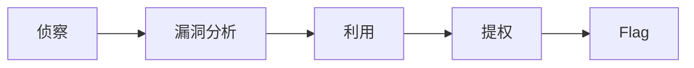

# 示例笔记

这篇笔记用来验证 Mermaid 图表、任务列表和反向链接。从 [[index|首页]] 可以跳转回来。

## 流程图

## 任务列表

- [x] 搭建发布管线
- [ ] 迁移第一批笔记
- [ ] 定制 Callout Studio 样式

## 表格

| 阶段 | 工具 |
| ---- | ---- |
| recon | nmap |
| pwn | gdb / pwntools |
| web | burpsuite |
